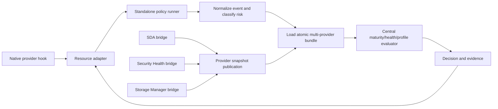
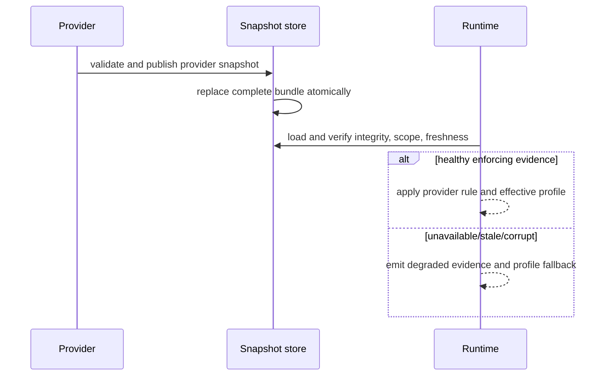

# Agent Policy Runtime Ownership and Migration

This document is the ownership boundary for coding-agent policy enforcement.
It replaces the prototype that previously mixed shared CLI policy primitives
with runtime evaluation in `packages/cli-core/agentpolicy`.

## Ownership matrix

| Concern | Stable owner | Volatile edge | Contract |
| --- | --- | --- | --- |
| Caller identity and human/agent permission documents | `packages/cli-core/agentpolicy` | resource CLIs | existing Go APIs and permission JSON |
| Native permission projection | resource-owned `internal/permissions` packages | installed provider versions | resource permission documents |
| Normalized tool events and risk facts | `packages/agentharness` | provider/resource event adapters | `agent-policy/v1` |
| Effective rollout evaluation | `packages/agentharness` | operator profile and provider snapshots | provider-neutral decisions |
| Filesystem removal floor | `packages/agentharness` | host context (home, repository, temporary directories) | `filesystem_removal` decisions |
| Durable provider policy | provider scenarios | publication bridges | atomic snapshot bundle |
| Dependency mutation | Scenario Dependency Analyzer | typed ecosystem adapters | argv and structured intent |
| Filesystem dispositions | Storage Manager | repo-contract `storage.roots`, `runtime_home`, owner storage declarations | snapshot `path_rules` |
| Security findings and repair validation | Security Health | Code Facts and scanner adapters | immutable evidence and repair plans |
| Readiness and friction evidence | Test Genie | phase-specific producers | readiness/fraction records |

The runtime has no import or process dependency on Agent Manager, Security
Health, Scenario Dependency Analyzer, or Test Genie. Providers may be absent;
the runtime evaluates the last integrity-checked local bundle and applies the
selected rollout profile.

## Model source

A model source is the selected origin for a coding-agent request: the harness's
own account, a user-managed key, local compute, or Vrooli credits. The harness
and model source are separate choices. This runtime owns policy enforcement
and provider-neutral decisions; it does not own connection credentials or
commercial balances. Account-bound connections are documented in
[connections](../configuration/integrations/connections.md), and user-facing
choices are summarized in [coding agents](../configuration/coding-agents.md).
Credit eligibility and usage receipts belong to the paid-feature and AI
provider contracts.

## Migration matrix

| Prototype surface | Disposition | Compatibility obligation |
| --- | --- | --- |
| `agentpolicy.go` | retained | caller detection and permission decisions remain unchanged |
| `permission_document.go` | retained | permission document JSON and public commands remain unchanged |
| `permission_projection.go` | retained | resource projection and preservation behavior remain unchanged |
| `models.go` and `coding_role_policy.go` | retained | model/policy catalog APIs remain resource-facing |
| `policy_runner.go` | retired | evaluator moves to `packages/agentharness`; no cli-core runtime import remains |
| `cmd/policy-runner` | retired | installed runner moves to `cmd/vrooli-policy-runner` |

## Runtime flow

Claude Code's managed PreToolUse hook (`resource-claude-code permissions
hook-guard`) evaluates the same runtime in process rather than through the
runner; Codex, OpenCode, and Grok hooks call `vrooli-policy-runner hook`.

## Filesystem removal

Deletion is floor policy: the runtime decides it the same way under every
rollout profile, for every runner, with or without providers. The engine reads
command text as data and never executes it. It parses POSIX shells,
PowerShell, and cmd.exe, including `bash -c`, `eval`, `pwsh -Command`, and
`cmd /c` up to three levels deep, command substitutions, and here-documents
fed to a shell. The verbs are `rm`, `rmdir`, `unlink`, `shred`, `truncate`,
`find -delete` or `-exec` a deletion, `rsync --delete`, `Remove-Item`,
`Clear-Content`, `del`, and `rd`. Each target resolves against the event's
working directory, the environment, and any `cd` or assignment earlier in the
same command. Symlinks resolve in the parent directory only, because deleting
a link removes the link. Each target is then classified:

| Order | Location | Decision |
| --- | --- | --- |
| 1 | a filesystem root or a directory directly under it; the home or repository root or any ancestor; anything inside `<repo>/.git` | deny, and no declaration overrides it |
| 2 | inside a provider `path_rules` root; the most specific root wins, and a stricter rule nested inside a recursive target wins over it | the rule's action |
| 3 | `<repo>/<project_config_dir>` | ask |
| 3 | inside `<repo>/<scratch_dir>` | allow |
| 3 | elsewhere in the repository | allow a named path; ask for a recursive tree or a pattern |
| 3 | inside an operating-system temporary directory | allow; the directory itself asks |
| 3 | elsewhere in the home directory, or anywhere else | deny |

Some targets can't be pinned down from the text. Those cases ask:
- an unset variable;
- a command substitution;
- `xargs` or a PowerShell pipeline supplying the targets;
- an encoded PowerShell command;
- unparseable text that names a deletion command.

The strictest target decides the event. An ask reaches a person only where the
agent can prompt: Claude Code's `default`, `acceptEdits`, and `plan` modes.
Elsewhere the hook denies, with the reason telling the agent to get the
operator.

Storage Manager publishes the `path_rules` every 30 minutes. It publishes
through `vrooli-policy-runner publish`, in a snapshot scoped to
`scope.risks: ["filesystem_removal"]`, so the snapshot vouches for no other
kind of action. The rules come from three sources:
- **The contract's `storage.roots`.** Safe and regenerable tiers allow, safe-with-owner and conditional tiers ask, and forbidden denies.
- **The contract's `runtime_home` entries.** Regenerable entries that storage-manager reaps allow. Protected, sensitive, and `cleanup: never` entries deny. The rest ask.
- **Owner storage declarations.** An entry's explicit `agent_removal` (allow, ask, or deny) wins. Without one, regenerable data allows and durable or sensitive data denies. SQLite `-wal`, `-shm`, and `-journal` files deny even when declared regenerable, because deleting one under a live database loses committed writes.

When two declarations name one root, the governed root outranks the
runtime-home entry, which outranks the owner declaration. A rule rooted at a
floor-protected location can add protection there but never removes it. A
missing, expired, unready, or unhealthy snapshot leaves the floor to decide
alone, which is only ever stricter. The decision then carries
`PATH_RULES_UNAVAILABLE` or `PATH_RULES_UNUSABLE` evidence.

## Snapshot publication and degraded enforcement

## Compatibility and rollback

The migration rollback point is the pre-migration baseline collection named
`greenfield-agent-policy-runtime-and-polyglot-supply-chain-baseline`. A failed
runtime or canary does not require changing Agent Manager defaults: resources
retain their native controls and the runtime defaults to advisory mode. The
legacy evaluator is not retained as a compatibility shim; the compatibility
surface is the existing caller/permission API only.

## Cross-platform rules

The runner is a portable Go binary. Its data root is selected from
`VROOLI_AGENT_POLICY_HOME`, then the platform application-config directory,
and its writes use a same-directory temporary file followed by replacement.
The policy contract carries argv as structured data. For dependency risks,
shell text is provenance only and an opaque/unknown event is never treated as
a safe package mutation. For filesystem removal, the runtime parses shell text
as data. It compares paths case-insensitively on macOS and Windows, and it
reads Windows drive, rooted, and Git Bash `/c/...` paths. Project-level scripts
are not part of this design.

## Session ownership and reaping

Policy decides what an agent may do; the session lifecycle decides how long
its processes may hold the host. Every coding-agent session records its owner
at launch (an Agent Manager run, a web-console session, a bundled desktop app,
an operator terminal, or unknown) and older sessions are backfilled from
kernel and environment evidence, never from scope names. `vrooli agent list`
reports whether each owner still exists and derives `orphaned` and `idle`
states; `vrooli agent reap --orphaned` stops only sessions whose known owner
its own authority confirmed gone, never terminal, unknown-owner, idle-only or
operator web-console sessions, and audits each stop. The owner and orphan
logic is platform-neutral (`internal/agentsession`); stopping goes through
platform-go's `StopScope` (systemd scope on Linux, explicit `unsupported` on
macOS and Windows). Host remediation stays in the control plane; scenarios
only observe. Contract and states: [Agent sessions](../reference/agent-sessions.md).

## Native execution permissions

The resource permission document has two independently versioned concerns:
Bash tool rules and native filesystem/network/approval settings. Existing `v1`
documents continue to manage only Bash rules. `v2` optionally adds `execution`;
unsupported adapters reject that intent before mutation. Capabilities describe
configuration support, not evidence that a running agent enforces it.

Codex user scope projects a reserved `vrooli` native permission profile, extending
`:workspace` or `:read-only`. Additional roots are explicit absolute paths;
network destinations are exact DNS names or IP literals, without wildcard grants.
Domain filtering requires the native network proxy. Approval settings and profile
selection change only with explicit activation. Legacy sandbox settings are
conflicts, never silently deleted. Higher-precedence settings and managed
requirements remain authoritative; desktop adoption needs fresh-session evidence.

Reconciliation previews include a digest binding the desired document, activation,
and native file snapshots. Execution reconciliation requires that digest and
checks it again under the shared document lock. Writes preserve POSIX modes and Windows access ACLs,
reject symlinks, retain a private backup, and publish state only after all native
writes succeed. Partial failures identify applied files and recovery evidence.
Neither config equality nor hook presence establishes live enforcement.

Implementation finish line: strict version/capability validation, Codex projection
and activation separation, stale-preview rejection, hook-only drift detection,
mode-preserving writes and recovery, focused Go regressions across the shared
package and all five resource adapters, followed by an isolated native sandbox
probe. No change to live user permissions is required to implement or test this
contract. Cross-client runtime verification is reported separately.

Validation completed on 2026-09-30: shared harness and all five resource CLI
packages passed race-enabled Go tests and static analysis; committed protobuf
artifacts passed the owning verifier. Windows harness and Codex permission CLI
test binaries cross-compiled successfully. Isolated, no-model probes on native
Codex 0.156.1 verified workspace/read-only boundaries, an explicit outside-root
denial, allowed and denied network destinations, disabled networking, and direct
socket proxy bypass denial. Windows execution and desktop adoption remain
unverified. Native Codex 0.141.0 passed the offline probe but failed the allowed
loopback proxy probe; filtered-network intent therefore requires the qualified
0.156.1 floor. The exact older-runtime cause remains unconfirmed and is recorded
as Scenario QA bug `knw-1790737560799308018`. No live user configuration was
changed during implementation or validation.
