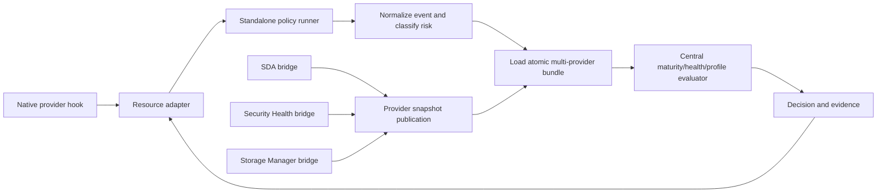
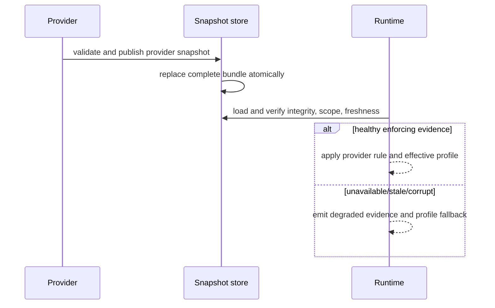

# Agent Policy Runtime Ownership and Migration

This document is the ownership boundary for coding-agent policy enforcement.
It replaces the prototype that previously mixed shared CLI policy primitives
with runtime evaluation in `packages/cli-core/agentpolicy`.

## Ownership matrix

| Concern | Stable owner | Volatile edge | Contract |
| --- | --- | --- | --- |
| Caller identity and human/agent permission documents | `packages/cli-core/agentpolicy` | resource CLIs | existing Go APIs and permission JSON |
| Native permission projection | resource-owned `internal/permissions` packages | installed provider versions | resource permission documents |
| Normalized tool events and risk facts | `packages/agentharness` | provider/resource event adapters | `agent-policy/v1` |
| Effective rollout evaluation | `packages/agentharness` | operator profile and provider snapshots | provider-neutral decisions |
| Filesystem removal floor | `packages/agentharness` | host context (home, repository, temporary directories) | `filesystem_removal` decisions |
| Durable provider policy | provider scenarios | publication bridges | atomic snapshot bundle |
| Dependency mutation | Scenario Dependency Analyzer | typed ecosystem adapters | argv and structured intent |
| Filesystem dispositions | Storage Manager | repo-contract `storage.roots`, `runtime_home`, owner storage declarations | snapshot `path_rules` |
| Security findings and repair validation | Security Health | Code Facts and scanner adapters | immutable evidence and repair plans |
| Readiness and friction evidence | Test Genie | phase-specific producers | readiness/fraction records |

The runtime has no import or process dependency on Agent Manager, Security
Health, Scenario Dependency Analyzer, or Test Genie. Providers may be absent;
the runtime evaluates the last integrity-checked local bundle and applies the
selected rollout profile.

## Model source

A model source is the selected origin for a coding-agent request: the harness's
own account, a user-managed key, local compute, or Vrooli credits. The harness
and model source are separate choices. This runtime owns policy enforcement
and provider-neutral decisions; it does not own connection credentials or
commercial balances. Account-bound connections are documented in
[connections](../configuration/integrations/connections.md), and user-facing
choices are summarized in [coding agents](../configuration/coding-agents.md).
Credit eligibility and usage receipts belong to the paid-feature and AI
provider contracts.

## Migration matrix

| Prototype surface | Disposition | Compatibility obligation |
| --- | --- | --- |
| `agentpolicy.go` | retained | caller detection and permission decisions remain unchanged |
| `permission_document.go` | retained | permission document JSON and public commands remain unchanged |
| `permission_projection.go` | retained | resource projection and preservation behavior remain unchanged |
| `models.go` and `coding_role_policy.go` | retained | model/policy catalog APIs remain resource-facing |
| `policy_runner.go` | retired | evaluator moves to `packages/agentharness`; no cli-core runtime import remains |
| `cmd/policy-runner` | retired | installed runner moves to `cmd/vrooli-policy-runner` |

## Runtime flow



Claude Code's managed PreToolUse hook (`resource-claude-code permissions
hook-guard`) evaluates the same runtime in process rather than through the
runner; Codex, OpenCode, and Grok hooks call `vrooli-policy-runner hook`.

## Filesystem removal

Deletion is floor policy: the runtime decides it the same way under every
rollout profile, for every runner, with or without providers. The engine reads
command text as data and never executes it. It parses POSIX shells,
PowerShell, and cmd.exe, including `bash -c`, `eval`, `pwsh -Command`, and
`cmd /c` up to three levels deep, command substitutions, and here-documents
fed to a shell. The verbs are `rm`, `rmdir`, `unlink`, `shred`, `truncate`,
`find -delete` or `-exec` a deletion, `rsync --delete`, `Remove-Item`,
`Clear-Content`, `del`, and `rd`. Each target resolves against the event's
working directory, the environment, and any `cd` or assignment earlier in the
same command. Symlinks resolve in the parent directory only, because deleting
a link removes the link. Each target is then classified:

| Order | Location | Decision |
| --- | --- | --- |
| 1 | a filesystem root or a directory directly under it; the home or repository root or any ancestor; anything inside `<repo>/.git` | deny, and no declaration overrides it |
| 2 | inside a provider `path_rules` root; the most specific root wins, and a stricter rule nested inside a recursive target wins over it | the rule's action |
| 3 | `<repo>/<project_config_dir>` | ask |
| 3 | inside `<repo>/<scratch_dir>` | allow |
| 3 | elsewhere in the repository | allow a named path; ask for a recursive tree or a pattern |
| 3 | inside an operating-system temporary directory | allow; the directory itself asks |
| 3 | elsewhere in the home directory, or anywhere else | deny |

Some targets can't be pinned down from the text. Those cases ask:
- an unset variable;
- a command substitution;
- `xargs` or a PowerShell pipeline supplying the targets;
- an encoded PowerShell command;
- unparseable text that names a deletion command.

The strictest target decides the event. An ask reaches a person only where the
agent can prompt: Claude Code's `default`, `acceptEdits`, and `plan` modes.
Elsewhere the hook denies, with the reason telling the agent to get the
operator.

Storage Manager publishes the `path_rules` every 30 minutes. It publishes
through `vrooli-policy-runner publish`, in a snapshot scoped to
`scope.risks: ["filesystem_removal"]`, so the snapshot vouches for no other
kind of action. The rules come from three sources:
- **The contract's `storage.roots`.** Safe and regenerable tiers allow, safe-with-owner and conditional tiers ask, and forbidden denies.
- **The contract's `runtime_home` entries.** Regenerable entries that storage-manager reaps allow. Protected, sensitive, and `cleanup: never` entries deny. The rest ask.
- **Owner storage declarations.** An entry's explicit `agent_removal` (allow, ask, or deny) wins. Without one, regenerable data allows and durable or sensitive data denies. SQLite `-wal`, `-shm`, and `-journal` files deny even when declared regenerable, because deleting one under a live database loses committed writes.

When two declarations name one root, the governed root outranks the
runtime-home entry, which outranks the owner declaration. A rule rooted at a
floor-protected location can add protection there but never removes it. A
missing, expired, unready, or unhealthy snapshot leaves the floor to decide
alone, which is only ever stricter. The decision then carries
`PATH_RULES_UNAVAILABLE` or `PATH_RULES_UNUSABLE` evidence.

## Operator-only commands

Some control-plane commands are the operator's decision by policy, not by
risk class (`operator_only.go`). The runtime asks for every one of them,
under every rollout profile and without providers, like the removal floor:

- `make rebaseline` and `vrooli runtime update rebaseline`, which make a root
  build that changes the persistent-state contract the new baseline without
  automatic rollback;
- `vrooli runtime update enroll` and `disable`, which change automatic root
  update enrollment;
- `vrooli runtime update retry`, which overrides a failed release's
  suppression;
- the installed watchdog's own modes those verbs forward to:
  `vrooli-watchdog --enroll-core-updates`, `--disable-core-updates` and
  `--retry-core-update`.

These are the `runtime update` verbs the CLI manifest marks
`run_eligible: false`. The walker resolves the command name from its last
path segment, so `~/.vrooli/bin/vrooli`, `$HOME/...` and a checkout's
`.vrooli/build/vrooli` are all `vrooli`; the hook resolves `~` and variables
from its own environment. A name that is only known when the command runs
(`$(command -v vrooli)`, an unset variable) is decided by its arguments: if
they spell an operator-only command under any of these names, it asks.

The walker unwraps `sudo`, `env`, `timeout`, `nohup`, `nice`, `exec`,
`command`, `setsid`, `flock` (including `flock -c`), `script -c`, `bash -c`,
`eval` and `go run ./cmd/vrooli`. Commands that relaunch their arguments
elsewhere (`tmux`, `screen`, `systemd-run`, `watch`, `ssh`, `parallel`,
`xargs`) are read for operator-only command text in every argument suffix,
without feeding the removal floor. `xargs make`, `xargs vrooli runtime update`
and `xargs vrooli-watchdog` ask when standard input could supply the rest of an
operator-only command. An attended Claude Code session shows the prompt to the
person at the keyboard. An unattended one denies it, so the operator runs the
command from their own terminal.

The floor does not see commands an interpreter builds at run time
(`python3 -c "subprocess.run(['make','rebaseline'])"`, `node -e`),
`make $(echo rebaseline)`, `go run .` from inside `cmd/vrooli`, or a value-taking
option placed before `runtime`. It asks, rather than allows, for
`--help` on these verbs and for `make -n rebaseline`.

Codex, OpenCode and Grok reach this floor only once their hooks call
`vrooli-policy-runner hook`; Codex hook enforcement is a pending operator
decision. For every runner, and for the wrappers the floor cannot unwrap, the
commands refuse in process: `vrooli runtime update rebaseline`, `enroll`,
`disable` and `retry`, and the watchdog's enrollment and retry modes, refuse
when `agentscope.SessionEvidence` finds an agent session. That check combines
`cliutil.DetectCallerKind` with the kernel's cgroup record of a
launcher-minted `vrooli-agent-*.scope`, which a process cannot leave by
clearing its environment; an operator's web-console pane runs in a
`tmux-spawn-*` scope and is not refused. Web Console keeps cli-core's ambient
agent variables (`cliutil.AmbientAgentEnvironment`) out of operator panes: it
filters each new session's environment and, at API start, unsets them in its
tmux server's global environment, which a long-lived server otherwise keeps
from whatever started it. Neither layer is an authority
boundary against a same-user process that scrubs its environment outside an
agent scope (for example through `systemd-run --user`); they stop agents that
follow the rules.

## Snapshot publication and degraded enforcement



## Agent guards

Four guards stop an agent action that needs the operator, under every rollout
profile and for every runner. Claude Code's hook sees Bash and its file tools
(Read, Write, Edit, MultiEdit, NotebookEdit); a file tool is judged by its path
only, never by the file's contents, the same way another runner's file tools
are:

| Guard | Check ID | Stops |
| --- | --- | --- |
| Spending money | `agent-guard:money` | payments, charges, purchases, invoices, refunds |
| Reading credentials | `agent-guard:secret` | credential files (`.env`, `.ssh`, `.npmrc`, `.netrc`), secret-store reads, another process's `/proc/*/environ` |
| Messaging the outside world | `agent-guard:outside-message` | chat and email sends, GitHub/GitLab comments, `gh pr create` and similar publishing commands, `git push`, and web requests that send data to a messaging service |
| Running hidden commands | `agent-guard:hidden-effect` | text decoded and then run (`base64 -d \| sh`, `pwsh -EncodedCommand`) |

**One data file is the policy.** [`packages/agentharness/hard_stops.json`](../../packages/agentharness/hard_stops.json)
holds each guard's name, reason and alternatives, and every word list that
recognizes it. The Go code holds no lists. A misspelled key or an empty list
fails `hard_stops_test.go`; if the embedded file still fails to load at run
time, every guard matches nothing and nothing is stopped, because a guard that
crashes or blocks everything stops every agent. `guard_visible_shell_test.go`
is the table of real commands that must pass and disguised ones that must stop.

**What counts.** A command is judged on what it does, never on the words its
data carries. Program names, flags, single-word arguments and code handed to an
interpreter count. Multi-word text (a message, a search pattern, a sed script,
a heredoc written to a file) is data. Its `$(...)` substitutions still count.
Web requests are messages only when they send data (`-d`, `-X POST`,
`requests.post`) to a host in `messages.message_hosts`. A POST to a local
service or an ordinary API is not a message.

**What a blocked agent sees.** The refusal names the guard and the signal, says
why, lists what to use instead, and gives the exact approval request:

```text
Stopped by the agent guard for reading credentials (agent-guard:secret): this command reads or writes a credential file.
Why: ...
Instead: Let the owning CLI or scenario fetch the credential itself. Inspect credentials without values: `secrets-manager credentials list|status|doctor`.
If the action is legitimate, ask the operator to approve it, then retry once approved:
  vrooli agent authorize "$VROOLI_AGENT_SESSION" --policy agent-guard-override --target agent-guard:secret --reason "<what you need to do and why>"
```

**Three ways past a guard, all the operator's decision:**

1. *A per-agent grant.* `vrooli agent authorize "$VROOLI_AGENT_SESSION" --policy
   agent-guard-override --target agent-guard:<guard>` raises an approval in the
   operator's inbox (`--target agent-guard:*` asks for every guard). When the
   guard stops an action, the runtime asks the local credential broker for the
   calling session's credential and verifies it with Agent Manager: an Agent
   Manager run holds a baseline plus an operation credential, a launcher-attached
   session one grant-bearing credential. The action continues to the remaining
   checks only when the verified grant names `agent-guard.override`, this check
   ID, and has not expired. Outside a known session the broker answers no. A
   newer approval replaces the session's earlier grant, so an agent asks for
   every policy it needs in one request.
2. *Log-only mode for everyone.* A guard in log-only mode lets actions through
   and logs what it would have stopped. The operator sets it from a terminal
   (`vrooli guard-mode enable --check agent-guard:secret --expires-at <RFC3339>
   --reason ...`) or by answering the steward's decision, which applies it with
   `vrooli guard-mode apply-answer`. Every interval ends within 30 days.
3. *A permanent change.* Edit `hard_stops.json` (narrow a list or remove a
   word) and install. The steward's decision offers this as "assign a fix".

Relaxing one guard never relaxes another, and nothing withdraws a relaxation
early: the former tripwire that restored every relaxation on any stop is gone.

**The steward closes the loop.** Every guard outcome (`blocked`, `log_only`,
`granted`), and every other stop an agent meets (`blocked` or `asked`), is appended to `guard-events.jsonl` beside the guard modes
(`~/.config/vrooli/agent-policy/`), with the check, signal, runner, session and
the first 240 characters of the command. The file rotates to `.1` at 4 MiB and
writing it never decides an event. A runtime without a store (a test or library
caller) writes nothing. Stops that are not guards are logged under
`agent-floor:` IDs named from their evidence code (`agent-floor:deletion-outside`,
`agent-floor:operator-only`, `agent-floor:provider-unavailable`); a provider's
own evaluator ID is kept as is. No log-only mode or guard grant relaxes an
`agent-floor:` check, and `vrooli guard-mode apply-answer` refuses one; the
steward offers only an owner fix or no change for them. The portfolio steward reads it on its
structural tick. Stops, confirmation requests and grants all count as
friction. A check qualifies when it meets two separate sessions within seven
days, or one session five times (an agent looping on it). The steward then
sends the operator a decision with recent examples (credential values redacted
both here and in the log) and a per-day chart by outcome. Relaxable checks
(guards and provider evaluators) offer log-only for 24 hours, 7 days or 30
days, an owner fix, turning the check off now (30 days of log-only while its
owner removes it), or no change; repeated grants make a log-only window the
recommendation. `agent-floor:` checks offer only an owner fix or no change.
Every answer except "no change" queues owner work with the examples, the files
to change, the acceptance and, for log-only answers, the deadline; after any
answer other than a log-only window the check stays quiet for seven days unless
new sessions qualify on their own. The steward's daily briefing reports whether
the log is readable, seven-day counts per check by outcome, and which checks
are log-only and until when, so a silent log is never mistaken for no friction.

**Provider checks.** The same log-only mode applies to a provider's own
evaluator IDs (for example `scenario-dependency-analyzer:dependency-addition`).
Runtime applies such a mode to that provider's decision before combining
decisions, so another provider's denial is not suppressed. Former `RiskClass`
strings stay readable in historical state but cannot be selected.

**The store.** Modes are written atomically to `guard-modes.json`, and every
change is appended to `guard-modes.audit.jsonl`. Hooks read one check's mode
without the store lock, so concurrent agents never contend. Mutation from a
terminal checks `agentscope.CallerSessionEvidence()` and refuses inside an
agent session. An agent's route is the answered decision, whose stable answer
ID is consumed once (see [internal invariants](../internal/INVARIANTS.md#guard-mode-answers)).
Audit entries never include command text, message bodies or secret values.

Deletion is not one of these guards. The filesystem-removal floor above has its
own approval route (`storage-manager deletion-grant request`), and the
operator-only commands stay with the operator.

## Compatibility and rollback

The migration rollback point is the pre-migration baseline collection named
`greenfield-agent-policy-runtime-and-polyglot-supply-chain-baseline`. A failed
runtime or canary does not require changing Agent Manager defaults: resources
retain their native controls and the runtime defaults to advisory mode. The
legacy evaluator is not retained as a compatibility shim; the compatibility
surface is the existing caller/permission API only.

## Cross-platform rules

The runner is a portable Go binary. Its data root is selected from
`VROOLI_AGENT_POLICY_HOME`, then the platform application-config directory,
and its writes use a same-directory temporary file followed by replacement.
The policy contract carries argv as structured data. For dependency risks,
shell text is provenance only and an opaque/unknown event is never treated as
a safe package mutation. For filesystem removal, the runtime parses shell text
as data. It compares paths case-insensitively on macOS and Windows, and it
reads Windows drive, rooted, and Git Bash `/c/...` paths. Project-level scripts
are not part of this design.


## Session ownership and reaping

Policy decides what an agent may do; the session lifecycle decides how long
its processes may hold the host. Every coding-agent session records its owner
at launch (an Agent Manager run, a web-console session, a bundled desktop app,
an operator terminal, or unknown) and older sessions are backfilled from
kernel and environment evidence, never from scope names. `vrooli agent list`
reports whether each owner still exists and derives `orphaned` and `idle`
states; `vrooli agent reap --orphaned` stops only sessions whose known owner
its own authority confirmed gone, never terminal, unknown-owner, idle-only or
operator web-console sessions, and audits each stop. The owner and orphan
logic is platform-neutral (`internal/agentsession`); stopping goes through
platform-go's `StopScope` (systemd scope on Linux, explicit `unsupported` on
macOS and Windows). Host remediation stays in the control plane; scenarios
only observe. Contract and states: [Agent sessions](../reference/agent-sessions.md).

## Native execution permissions

The resource permission document has two independently versioned concerns:
Bash tool rules and native filesystem/network/approval settings. Existing `v1`
documents continue to manage only Bash rules. `v2` optionally adds `execution`;
unsupported adapters reject that intent before mutation. Capabilities describe
configuration support, not evidence that a running agent enforces it.

Codex user scope projects a reserved `vrooli` native permission profile, extending
`:workspace` or `:read-only`. Additional roots are explicit absolute paths;
network destinations are exact DNS names or IP literals, without wildcard grants.
Domain filtering requires the native network proxy. Approval settings and profile
selection change only with explicit activation. Legacy sandbox settings are
conflicts, never silently deleted. Higher-precedence settings and managed
requirements remain authoritative; desktop adoption needs fresh-session evidence.

Reconciliation previews include a digest binding the desired document, activation,
and native file snapshots. Execution reconciliation requires that digest and
checks it again under the shared document lock. Writes preserve POSIX modes and Windows access ACLs,
reject symlinks, retain a private backup, and publish state only after all native
writes succeed. Partial failures identify applied files and recovery evidence.
Neither config equality nor hook presence establishes live enforcement.

Implementation finish line: strict version/capability validation, Codex projection
and activation separation, stale-preview rejection, hook-only drift detection,
mode-preserving writes and recovery, focused Go regressions across the shared
package and all five resource adapters, followed by an isolated native sandbox
probe. No change to live user permissions is required to implement or test this
contract. Cross-client runtime verification is reported separately.

Validation completed on 2026-09-30: shared harness and all five resource CLI
packages passed race-enabled Go tests and static analysis; committed protobuf
artifacts passed the owning verifier. Windows harness and Codex permission CLI
test binaries cross-compiled successfully. Isolated, no-model probes on native
Codex 0.156.1 verified workspace/read-only boundaries, an explicit outside-root
denial, allowed and denied network destinations, disabled networking, and direct
socket proxy bypass denial. Windows execution and desktop adoption remain
unverified. Native Codex 0.141.0 passed the offline probe but failed the allowed
loopback proxy probe; filtered-network intent therefore requires the qualified
0.156.1 floor. The exact older-runtime cause remains unconfirmed and is recorded
as Scenario QA bug `knw-1790737560799308018`. No live user configuration was
changed during implementation or validation.
