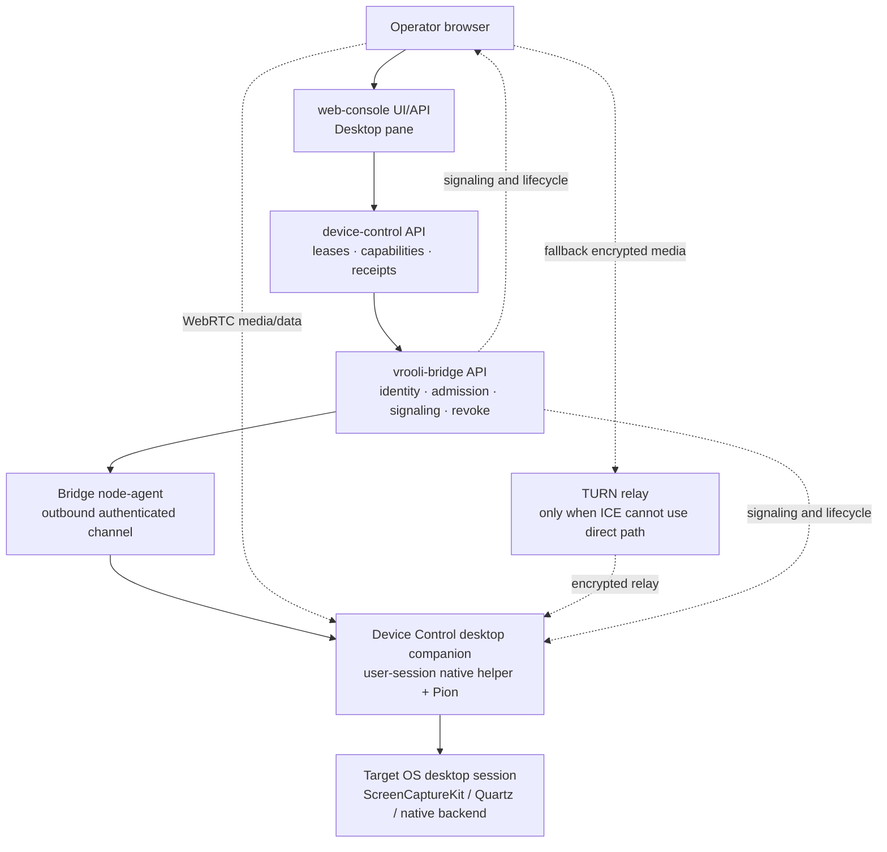
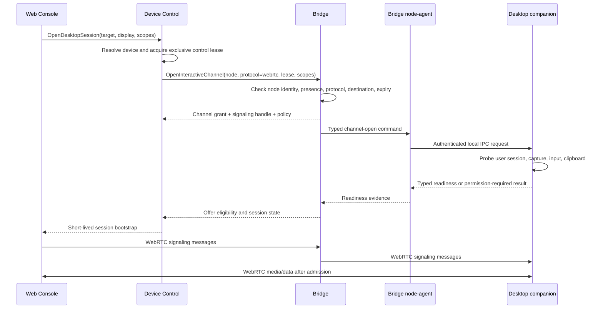
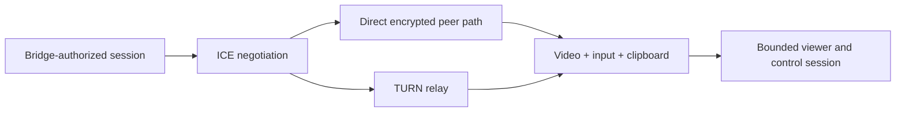
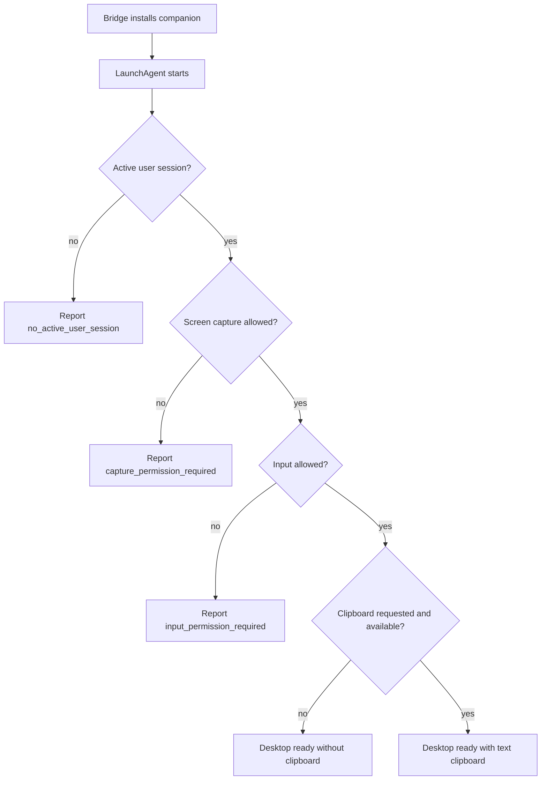

# Remote Desktop Control Architecture

**Status:** documentation-first design baseline  
**Owners:** `device-control` (desktop operation), `vrooli-bridge` (trusted reach and interactive transport), `web-console` (operator experience)  
**Primary first target:** macOS Intel `minimouse`  
**First transport:** native desktop capture/input carried by WebRTC  
**First media codec:** VP8  
**First display scope:** one selected display  
**First clipboard scope:** bounded bidirectional text  
**Last reviewed:** 2026-09-18

This is the canonical cross-scenario design record for browser-operated desktop
sessions on trusted Vrooli nodes. It is intentionally separate from any one
scenario's PRD: the design describes the shared product boundary, while each
owner's PRD and requirements describe the obligations that owner must satisfy.

Related owner documents:

- [Vrooli Bridge PRD](../../scenarios/vrooli-bridge/PRD.md)
- [Device Control PRD](../../scenarios/device-control/PRD.md)
- [Web Console PRD](../../scenarios/web-console/PRD.md)
- [Bridge architecture](../../scenarios/vrooli-bridge/docs/concepts/ARCHITECTURE.md)
- [Device Control architecture](../../scenarios/device-control/docs/concepts/ARCHITECTURE.md)
- [Web Console architecture](../../scenarios/web-console/docs/concepts/ARCHITECTURE.md)
- [Implementation plan](/home/matthalloran8/.vrooli/plans/bridge-device-control-web-console-webrtc-remote-desktop.md)

## Executive decision

The first release is **not** a new general-purpose `remote-desktop` scenario.
The repository already assigns desktop operation to Device Control through the
`host-desktop` strategy, desktop leases, signed helper grants, native observation,
typed input, geometry revisions, and action receipts. Creating another scenario
would duplicate that authority.

The selected ownership is:

| Concern | Owner | Meaning |
|---|---|---|
| Trusted Vrooli node identity | `vrooli-bridge` | Which machine exists, is paired, is online, and may be addressed. |
| Interactive transport | `vrooli-bridge` | Authenticated signaling/channel admission, revocation, relay policy, bounded transport behavior. |
| Desktop operation | `device-control` | Which desktop session is available, who may control it, native capture/input, clipboard, leases, receipts, and evidence. |
| Native desktop companion | `device-control` | User-session process that talks to ScreenCaptureKit/Quartz or the platform equivalent and runs Pion WebRTC. |
| Operator workspace | `web-console` | Desktop pane, video element, input gestures, clipboard controls, readiness and recovery UI. |
| Generated-app virtual desktop | `scenario-to-desktop` | Scenario-specific virtual display workflows; it consumes shared device capabilities where appropriate but does not become the fleet desktop owner. |



The browser never receives node credentials and never connects directly to an
SSH, VNC, RDP, or arbitrary node port. “Direct WebRTC” means the browser and
companion negotiate an authenticated encrypted peer path after Bridge has
authorized the exact session; the node still exposes no inbound administration
surface.

## Why this work exists

The work began with a concrete minimouse failure. Bridge successfully onboarded
the macOS node, delivered the current agent, and proved host reachability, but
host inventory reported:

```text
display_attached=true
remote_desktop=macos-screen-sharing active/listening
active_session_user=""
session_type=""
auto_login_user="matthalloran8"
```

The first automatic-login safeguard was corrected to fail closed: a successful
`sysadminctl` command is not evidence that macOS actually enabled automatic
login. A postcondition probe reported `disabled`, so Bridge correctly refused to
reboot for desktop validation. This exposed the real boundary: a node can be
online and have a screen-sharing service listening while no usable Aqua desktop
session exists.

The operator requirement is stronger than “make a one-off remote login work”:

> All setup, permission diagnosis, session opening, control, revocation, and
> validation should be operable from the Vrooli control plane. Routine direct
> SSH or physical login to minimouse should not be required.

The architecture therefore treats desktop readiness as a typed capability and
does not claim success from service presence alone.

### Bootstrap fallback boundary

Bridge-managed macOS nodes have one additional, setup-owned bootstrap path. The
project commissioning flow must opt into the existing `remote_desktop_access`
host safeguard with the macOS Screen Sharing provider and verify that the
built-in `com.apple.screensharing` service is enabled. This is the only point
at which host elevation is allowed. The node agent and Device Control companion
remain unprivileged during normal operation.

When the native companion cannot start because there is no Aqua session or its
Screen Recording/Accessibility approvals are not yet complete, Bridge may
temporarily relay the built-in Screen Sharing protocol through the authenticated
node channel. The relay is a typed, lease-bound bootstrap transport owned by
Bridge; it is not SSH, a generic TCP tunnel, or a new remote-desktop authority.
The browser-facing bootstrap client is likewise a Vrooli component. No
operator-side remote-control application may be required, and no software is
installed on the Mac for this fallback.

The fallback is deliberately transitional: it can expose only the minimum
screen/input surface needed to establish or approve the native companion, it
must report its provider and readiness state explicitly, and it closes as soon
as the Device Control WebRTC companion reaches `desktop_ready`. If the built-in
service is not enabled or the OS refuses the requested operation, the control
plane reports a typed setup/readiness failure instead of asking the operator to
log into the node directly.

## Current repository state

The design builds on existing work rather than inventing parallel ownership.

| Area | Current evidence | Consequence |
|---|---|---|
| Bridge node identity | `scenarios/vrooli-bridge/agent/` and registry/presence domains exist. | Reuse Bridge node identity and outbound reach. |
| Bridge desktop seam | `requirements/16-remote-desktop-seam/` and `requirements/21-desktop-transport/` exist, but their wording still describes a future separate scenario. | Update the contract to describe Device Control as the consumer. |
| Device Control ownership | `PRD.md` already declares portable desktop user-session control and destination authority. | Keep desktop semantics in Device Control. |
| Device Control helper | `api/internal/desktophelper/`, `api/internal/sessions/`, and `api/strategy/hostdesktop/` exist. | Extend the existing helper/lease boundary for interactive streaming. |
| Desktop proto | `packages/proto/schemas/device-control/v1/desktop/desktop.proto` already has leases, observations, pointer/key/text/wheel actions, epochs, revisions, and receipts. | Add only the missing stream/session contracts. |
| Web Console | It owns durable terminal panes and remote terminal targets, but has no desktop pane. | Add a desktop session presentation surface, not a second desktop backend. |
| Scenario-to-desktop | Its interactive desktop guide uses browser → WebSocket → VNC → virtual display. | Reuse its validation lessons, not its virtual-display ownership. |
| minimouse | Bridge onboarding and host inventory are working; active GUI session is not yet proven. | Use minimouse for the first real macOS readiness and WebRTC validation. |
| Existing plans | Portal Everywhere contains related native companion and desktop-control phases; cross-machine validation covers Bridge fleet foundations. | Reconcile and reuse relevant phases; do not silently duplicate or supersede them. |

## Runtime architecture

### Control-plane flow



### Data-plane channels

The first WebRTC peer carries separate logical lanes:

| Lane | Delivery | Payload | Safety rule |
|---|---|---|---|
| Video | WebRTC media track | Selected display, VP8 initially | Frames are sensitive; no default recording or persistence. |
| Pointer motion | Unordered/best-effort data | Coalescible movement | Dropping intermediate motion is acceptable; final button state is not. |
| Reliable input | Ordered/reliable data | Key down/up, button down/up, click, wheel, text | Carries session, lease epoch, sequence, and geometry revision. |
| Session control | Ordered/reliable data | Heartbeat, resize, focus, stop, takeover, bounded transport stats | Invalidates the peer on lease/revocation failure; lower-level peer or queue failure routes through session revoke and held-input release. Stats contain counters only. |
| Clipboard | Ordered/reliable data | Bounded text request/response | Explicit capability, visible action, audit event, no silent sync. |
| Semantic operations | Device Control RPC/channel | Observe, resolve, invoke, assert | Remains separate from raw human input and produces typed receipts. |

The input contract must distinguish three outcomes:

```text
accepted       the companion admitted and applied the event
rejected       the event was definitely not applied
outcome_unknown transport or helper failure prevents certainty
```

The client must never automatically replay an `outcome_unknown` input event.
The operator or owning flow must reconcile the current observation before
deciding whether to continue.

### WebRTC path selection



Bridge owns signaling and policy. The short-lived route metadata returned by
channel admission is also carried over the signed node signal so the
companion's Pion peer uses the same direct/TURN candidates as the browser.
TURN credentials are never persisted or logged. A future dedicated TURN
service may own relay bandwidth, but it must receive only short-lived session
authorization and must not become a second identity registry.

## Code placement

These are the intended locations. Existing code must be extended when the
domain already owns the concept; proposed directories are not permission to
create duplicate registries or helpers.

### Shared proto contracts

```text
packages/proto/schemas/vrooli-bridge/v1/interactive/
  interactive.proto

packages/proto/schemas/device-control/v1/desktop/
  desktop.proto              # extend existing contract

packages/proto/schemas/web-console/v1/desktop/
  desktop.proto              # only if Web Console needs a public adapter contract
```

Bridge messages should describe channel identity, protocol, signaling, expiry,
revocation, and transport evidence. Device Control messages should describe
desktop session identity, display selection, capability facts, leases,
clipboard grants, and action receipts. Web Console should not invent JSON
mirrors of either contract.

### Bridge

```text
scenarios/vrooli-bridge/api/internal/interactive/
  admission.go       # actor/node/protocol/scope checks
  signaling.go       # offer/answer/ICE relay lifecycle
  sessions.go        # durable/ephemeral interactive channel state
  revoke.go          # node/session/lease revocation fan-out
  backpressure.go    # bounded signaling/viewer queues

scenarios/vrooli-bridge/agent/internal/interactive/
  channel.go         # node-side channel binding
  companion.go       # typed local companion IPC client
  grant.go           # short-lived signed grant verification
```

Bridge must not contain ScreenCaptureKit, Quartz, AT-SPI, Wayland portal,
Windows UI Automation, or Pion capture policy. It may contain the minimal
transport code required to carry typed signaling and lifecycle messages.

### Device Control

```text
scenarios/device-control/api/internal/sessions/
  desktop.go             # existing lease/session authority
  desktop_transport.go  # existing helper transport; extend carefully
  desktop_authority.go  # existing signed grant and epoch authority

scenarios/device-control/api/internal/desktopwebrtc/
  pion.go                # Pion peer lifecycle, VP8 track, data lanes, counters
  queue.go               # bounded media/control/data backpressure policy
  session.go             # readiness, lease, input, clipboard, cleanup
  *_test.go              # peer, queue, state-machine, and race regressions

scenarios/device-control/api/internal/native/macos/
  provider.go            # typed readiness and native capability mapping
  host_backend.go        # authenticated host seam adapter

scenarios/device-control/api/internal/native/host/
  backend.go             # user-session input, clipboard, VP8 capture boundary
  screencapturekit_darwin.go # ScreenCaptureKit/CoreGraphics binding

scenarios/device-control/api/internal/native/linux/
  x11.go
  wayland_gnome.go
  wayland_kde.go

scenarios/device-control/api/internal/native/windows/
  capture.go
  input.go
  permissions.go

scenarios/device-control/api/cmd/desktop-companion/
  main.go                # per-user companion process
```

The companion is a Device Control capability package installed by Bridge
onboarding. On macOS it should run as a user-session `LaunchAgent`, not a root
`LaunchDaemon`, because screen capture, Accessibility, and clipboard access
belong to the logged-in user session. Darwin onboarding builds this companion on
the target Mac with CGO and the Apple SDK, verifies Mach-O plus
ScreenCaptureKit/CoreGraphics linkage, and only then places it at the managed
user-scoped path; a control-plane cgo-free cross-build is not a production
companion. The Bridge node-agent forwards the authorized interactive channel to
the companion's loopback Connect endpoint on the dedicated
`DEVICE_CONTROL_COMPANION_PORT` (default `16465`) for every typed
`DesktopSessionService` procedure, including readiness, open, input,
clipboard, close, and signaling; it must not resolve the ordinary Device
Control API port for these hops. The companion's current VP8 implementation
requires an `ffmpeg` binary with `libvpx`; readiness fails closed with an
actionable encoder status when that host capability is absent.

### Web Console

```text
scenarios/web-console/ui/src/features/desktop/
  DesktopPane.tsx
  DesktopCanvas.tsx
  DesktopToolbar.tsx
  useDesktopSession.ts
  useDesktopInput.ts
  useDesktopClipboard.ts
  desktopState.ts

scenarios/web-console/ui/src/api/desktop.ts
  # typed Device Control/Bridge adapter; no node credentials

scenarios/web-console/api/internal/desktop/
  session_adapter.go       # only if a server-side adoption proxy is required
```

Web Console owns presentation and browser interaction. It does not own leases,
native capture, node identity, or desktop policy.
Its same-origin browser adapter uses Connect-JSON for the typed
`DesktopSessionService`; Bridge preserves that JSON representation across the
target proxy while ordinary scenario procedures retain their raw protobuf
transport.

## Readiness model

“Screen Sharing is listening” is not equivalent to “the desktop is usable.”
The target must expose a typed state such as:

| State | Meaning | Operator action |
|---|---|---|
| `node_offline` | Bridge cannot reach the paired node. | Restore node/agent/network. |
| `booting` | Node is present but startup is incomplete. | Wait for the next readiness observation. |
| `disk_locked_preboot` | FileVault or equivalent preboot boundary is active. | Physical/out-of-band unlock; ordinary Bridge jobs cannot bypass it. |
| `no_active_user_session` | No user-owned desktop session exists. | Start or retain a permitted user session. |
| `capture_permission_required` | Native capture is installed but denied. | One-time local macOS approval or managed policy where supported. |
| `input_permission_required` | Capture works but input injection is denied. | One-time Accessibility approval or managed policy. |
| `clipboard_unavailable` | Clipboard is not granted or unsupported. | Continue without clipboard or grant explicitly. |
| `desktop_locked` | Session exists but is locked. | Unlock through an OS-supported path; do not fake readiness. |
| `desktop_ready` | Selected display, capture, input, and requested scopes are proven. | Open or resume the session. |
| `revoked` | Grant, node, or lease authority was removed. | Re-authorize and create a new epoch. |

Automatic login is a readiness policy, not proof of a usable session. The
graphical-session safeguard must continue to fail closed when its postcondition
probe does not report enabled.

## Provider support matrix

Support status is evidence-based. A provider is not production-ready because
its contract, binary, or service manager can be built; it needs native and live
qualification for the target OS.

| Provider | Status | Current boundary |
|---|---|---|
| macOS / minimouse | **implemented, live qualification blocked** | Native ScreenCaptureKit, Quartz/CGEvent, text clipboard, Pion, and Bridge-managed companion paths are implemented and offline-tested. The target still lacks an approved Aqua GUI session and the required privacy permissions. |
| Linux | **deferred / contract-only** | No production WebRTC desktop provider is enabled by this first-release path. Existing X11/Wayland and scenario-to-desktop flows remain separate consumers. |
| Windows | **deferred / contract-only** | No production WebRTC desktop provider is enabled by this first-release path. Native service and UI-automation work must earn its own provider and live evidence. |
| scenario-to-desktop virtual display | **separate provider** | Its virtual-display/VNC validation path may consume shared contracts later, but it does not own fleet desktop identity, leases, or native macOS control. |

The matrix must be updated with a live receipt before any row changes to
production-ready. Related Portal and cross-machine plans are dependency and
reuse records; they do not authorize a second desktop authority.

## macOS permission and setup policy

The first minimouse release uses a control-plane-managed installation followed
by one-time local OS approval when macOS requires it.



Bridge can install, start, probe, and explain the missing state. It must not
claim that arbitrary privileged commands can grant macOS privacy consent.
Screen Recording is especially constrained. Managed fleets may use Apple's
device-management mechanisms for supported privacy controls, but the exact
macOS-version policy must be probed and recorded. The implementation must not
hard-code the deprecated PPPC Accessibility path as the only future solution.

## Security invariants

1. No browser payload contains a node private key, owner credential, or long-lived
   Bridge token.
2. Every desktop session binds actor, target node, target desktop session,
   requested scopes, lease ID, epoch, policy revision, and expiry.
3. A viewer has no input authority unless Device Control grants control.
4. A stale epoch, stale geometry revision, or revoked node rejects input.
5. Stop, revoke, lock, disconnect, and helper loss release held input.
6. Screen content cannot grant authority to issue a native action.
7. Clipboard is opt-in and bounded; no ambient synchronization is enabled.
8. Raw screen frames are not persisted by default and are redacted before they
   become durable evidence.
9. The companion is not a general shell and cannot execute arbitrary commands.
10. Terminal and desktop protocols are explicitly typed and cannot be confused.
11. Direct WebRTC media remains bound to a Bridge-issued session fingerprint.
12. Revocation closes existing channels, not only future admissions.
13. An uncertain input result is surfaced as unknown, never silently retried.

## Validation model

The work is complete only when evidence exists at four levels:

| Level | Required proof |
|---|---|
| Contract | Proto/API/CLI/UI shapes agree; generated code is current; forbidden ownership does not appear. |
| Component | Lease, epoch, action, WebRTC channel, permission, clipboard, and cleanup tests pass with fakes. |
| Scenario | Bridge, Device Control, and Web Console owned suites pass through lifecycle-managed runs. |
| Live target | minimouse opens a real selected-display session, receives input, transfers text clipboard, survives reconnect, and stops/revokes safely. |

Minimum live acceptance journey:

1. Bridge reports minimouse paired and online.
2. Device Control reports `desktop_ready` for the selected user session/display.
3. Web Console opens a view-only session and receives VP8 frames.
4. Operator acquires control and clicks a deterministic fixture target.
5. Operator types Unicode text into the fixture.
6. Operator copies text in both directions through the explicit clipboard action.
7. Browser disconnects and reconnects without replaying uncertain input.
8. A second viewer remains read-only until explicit takeover.
9. Revocation closes the peer and the companion releases held input.
10. A locked/no-session/permission-denied target reports the correct typed state.
11. Evidence includes node identity, OS/build, session ID, display ID, lease epoch,
    WebRTC route, codec, frame statistics, input receipts, clipboard audit, and
    final disposition without retaining secret screen content.

## Definition of done

The implementation plan is complete only when:

- all owner PRDs, requirements, architecture, flow, data, security, deployment,
  and runbook documents agree with this design;
- Bridge interactive transport is implemented and verified without breaking
  terminal transport;
- Device Control exposes a real WebRTC desktop companion and native macOS
  capture/input path;
- Pion peer lifecycle, signaling, ICE direct path, TURN fallback, VP8 track,
  input channels, and clipboard channel are tested;
- Web Console has an accessible desktop pane with explicit readiness, control,
  clipboard, reconnect, and revoke states;
- Bridge onboarding can install/configure/probe the companion without routine
  direct node login;
- minimouse produces live proof of selected-display viewing, pointer/keyboard
  input, Unicode text, clipboard, reconnect, lease takeover, and revocation;
- FileVault/preboot, no-session, locked-session, missing permission, and helper
  crash states fail closed and remain actionable;
- focused unit/component tests and relevant Test Genie phases pass;
- cross-scenario generated proto/client artifacts are synchronized;
- the plan's evidence ledger links each deliverable to a producer receipt or a
  clearly documented limitation; and
- no unsupported “remote desktop ready” claim remains based solely on service
  presence or automatic-login configuration.

## Canonical navigation

The detailed implementation and validation sequence is in:

`/home/matthalloran8/.vrooli/plans/bridge-device-control-web-console-webrtc-remote-desktop.md`

Supporting conversation and decision capture is in:

`/home/matthalloran8/Vrooli/docs/architecture/remote-desktop-control-decision-record.md`
