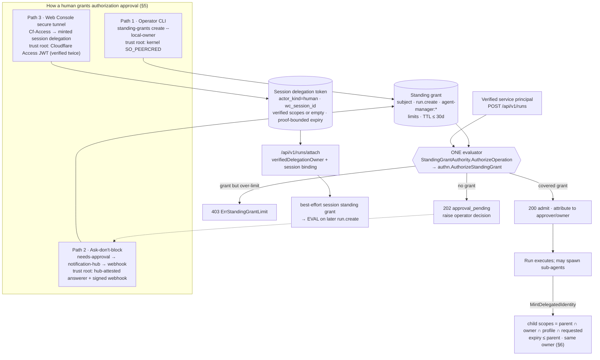
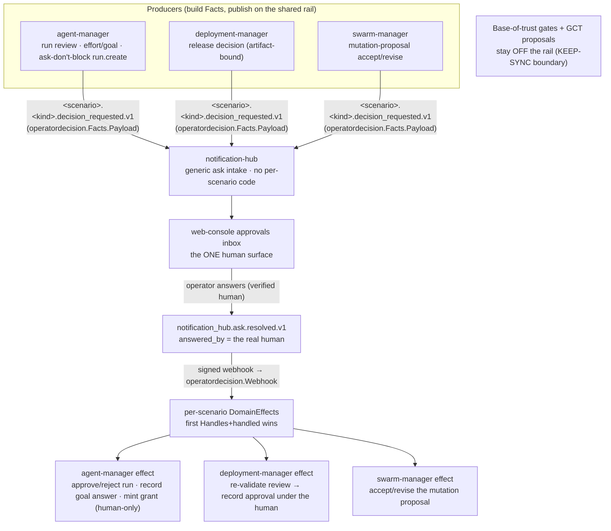
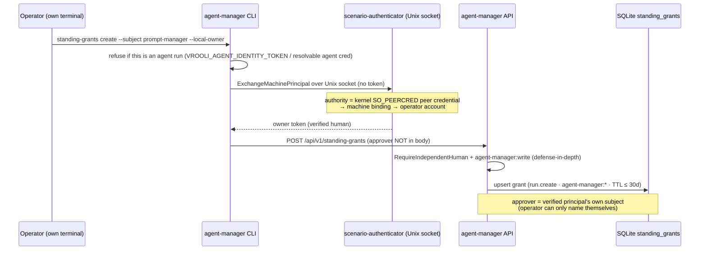
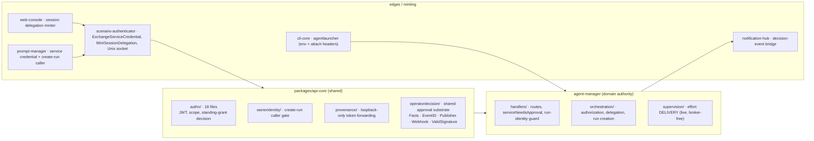

# Authorization & Approval — Current-State Map

> **Current repair checkpoint — October 18:** grants apply only to explicitly
> governed operations. Ordinary operator-authorized maintenance needs no new grant.
> A verified owner-launched Web Console run retains its session-bound baseline
> capabilities; an operation grant is separate. A71 preserves verified owner
> scopes through launch and attachment, bounded by the source proof's expiry.
> A75's separate baseline/operation transport is published and adopted; A183's
> ordinary scheduler-read/request-boundary repair is adopted, with the same
> native caller changing from403 to200 and API readiness passing. See
> [A75 evidence](../internal/delivery-reliability-research/sources/A75-baseline-and-grant.md)
> and [A183 adoption](../internal/delivery-reliability-research/sources/A183logs/ADOPTION.md).
> Missing, expired or revoked identity is a separate diagnosis from operation
> approval; never infer that a maintenance permission exists or broaden a grant
> to repair identity. A224 now qualifies native same-run renewal of the legacy
> investigator identity after24hours; that ownerless identity retains zero scopes.
> This establishes identity continuity, not an owner-capability delegation or a
> new operation grant. Existing named-action approval is separate. Ordinary
> maintenance needs no invented permission, while explicitly governed mutations
> retain their actual object/operation checks. See
> [current reliability handoff](../internal/delivery-reliability-research/RESUME.md).
> **The detailed ratings, source descriptions and incident diagnoses below are
> the October16 assessment.** They are historical, not current fleet certification
> or an explanation of every subsequent scheduled-task refusal.


> **What this is.** A single visual map of how authorization and human approval work in Vrooli
> *today* (traced from source on branch `agi`, 2026-10-16), after the consolidation efforts that
> removed the finite effort-authority broker, added the invariant/smoke rigor net, and unified human
> approval onto one shared `operatordecision` substrate with per-scenario domain effects and a single
> web-console approvals inbox. It
> answers five questions: **what requires approval**, **how approval is provided**, **how authority
> crosses boundaries**, **where the logic lives**, and **how reliable it is / where the gaps are**.
>
> **How it relates to the other auth docs.** The normative model lives in
> [`AUTHORIZATION.md`](./AUTHORIZATION.md) (the four decisions) and
> [`IDENTITY-AND-AUTHENTICATION.md`](./IDENTITY-AND-AUTHENTICATION.md). The test-pinned rules live in
> [`AUTHORIZATION-INVARIANTS.md`](./AUTHORIZATION-INVARIANTS.md). The two behavioural contracts live in
> [`AUTHORIZATION-APPROVAL-LIFECYCLE.md`](./AUTHORIZATION-APPROVAL-LIFECYCLE.md) and
> [`AUTHORIZATION-CROSS-BOUNDARY-PROPAGATION.md`](./AUTHORIZATION-CROSS-BOUNDARY-PROPAGATION.md). The
> operator safety procedure is [`../guides/working-on-auth-infra.md`](../guides/working-on-auth-infra.md).
> **This file is the picture that ties them together** — a current-state synthesis, not a new contract.

---

## 1. Executive summary & reliability verdict

The system is **highly centralized** (one shared auth package, one standing-grant authority, one
approval registry, one service-principal endpoint — no duplicated decision logic) and **fails closed
on every cryptographic axis** (anonymous, forged, expired, wrong-audience, service-impersonating-human,
run-identity-creating-runs are all refused and each is pinned by a test).

The residual risk is **operational, not cryptographic**. The system fails *closed* on bad tokens, but
on the unattended heartbeat edge it fails toward *unqualified-proceed* when two conditions coincide:
`VROOLI_AUTH01_ENFORCE` is off (the default) **and** the caller's service-principal credential/standing
grant is unprovisioned. That exact combination was the week-long "fleet heartbeat 401" — **a provisioning
gap, not a code defect**. The remedy is operational (issue the service principal + create the standing
grant), not a code change.

| Axis | Verdict |
|---|---|
| Cryptographic refusal (anon/forged/expired/audience/impersonation/run-identity) | **Strong** — fails closed, each pinned by a test (§7) |
| Centralization / absence of duplicate logic | **Strong** — one evaluator, hub-and-spoke approval (§8) |
| Dead-code cleanliness (finite broker) | **Clean** — fully purged, zero residual references (§9) |
| Sub-agent & inter-scenario propagation | **Strong by design, with known cliffs** — loopback-only forwarding, single-use delegation (§6) |
| Regression *prevention* (vs detection) | **Contingent** — the net detects in-test; it blocks a merge only if CI runs the suite (§7) |
| Operational robustness (provisioning / outages) | **Weakest link** — provisioning gaps and best-effort notification/self-check degrade loudly-in-logs, not blocking (§10) |

> **Scope of this map.** Human approval in Vrooli now runs on **one shared substrate** —
> `packages/api-core/operatordecision` — which several scenarios emit onto and resolve back through their
> own **domain effects**, surfaced in the **single web-console approvals inbox** (§3). Sections §4–§5
> detail the richest producer (agent-manager authorization); deployment-manager and swarm-manager are now
> peers on the same rail, not separate mechanisms. A small, deliberate set of gates stays **off** the rail
> on principle — the base-of-trust gates and GCT's git proposals — documented in
> [`AUTHORIZATION-KEEP-SYNC-BOUNDARY.md`](./AUTHORIZATION-KEEP-SYNC-BOUNDARY.md). Don't read §4–§5 as "the
> only approval in the system."

---

## 2. System overview

Three ways a human grants approval converge on **two durable primitives** — a *standing grant*
(Paths 1 & 2) or a *session delegation token* (Path 3). Every privileged run-creation is then checked
by **one evaluator** (`StandingGrantAuthority` → `authn.AuthorizeStandingGrant`), and any sub-agent or
inter-scenario hop can only **narrow** authority, never widen it.



**Reading the diagram:** the left column is *how approval enters*; the center is *the single gate*; the
bottom is *how authority propagates without widening*. Paths 1 and 2 are the **same evaluator** — Path 2
is literally the `ErrNeedsApproval` branch of Path 1, closed later by an operator decision.

---

## 3. The approval landscape — one substrate, per-scenario effects, one inbox

"Human approval" is now **one shared pattern** with per-scenario tailoring. The consolidation extracted the
generic "ask a human, act on the answer" primitive into **`packages/api-core/operatordecision`**: a
scenario builds a `Facts` payload, publishes a `<scenario>.<kind>.decision_requested.v1` event, and
registers a **`DomainEffect`** that applies the operator's `ask.resolved.v1` answer. notification-hub turns
any such event into an Ask with no per-scenario code, and the **single web-console approvals inbox** is the
one surface where a human sees and answers them. agent-manager, deployment-manager, and swarm-manager are
now **peers on this rail**, not four structurally different mechanisms.

What is deliberately **not** on the rail is a small, principled set — the **base-of-trust gates** (minting
a machine identity, a standing grant, or the live-human approval itself; releasing raw secrets; opening an
interactive session) and **GCT's git proposals** — because asking those out-of-band would be circular or
unbounded. That boundary and its test are documented in
[`AUTHORIZATION-KEEP-SYNC-BOUNDARY.md`](./AUTHORIZATION-KEEP-SYNC-BOUNDARY.md).



| Producer | Decision kind | Event type | A human's "yes" does | Resolution effect |
|---|---|---|---|---|
| **agent-manager** | run review · effort/goal · ask-don't-block run.create · interactive authorization (push-only) | `agent_manager.{run,effort,authorization,interactive_authorization}.decision_requested.v1` | apply/discard a run · answer a goal · **mint a standing grant** (human-only, at resolution) | `operatordecision.Webhook` → run/authorization/effort effects (fan-out order preserved) |
| **deployment-manager** | release decision (artifact-bound, re-validated) | `deployment-manager.release.decision_requested.v1` | record the approval under the verified human (`approved_by`) after re-validating current evidence | `ReleaseDecisionResolver` (single-use, artifact-bound; mirrors the approvals ledger) |
| **swarm-manager** | mutation-list proposal accept/revise | `swarm-manager.*.decision_requested.v1` | accept the selected mutations (or request a revision) | the single authority `DecideMutationListProposal` |

All three share the **same substrate**: `operatordecision.Facts`/`EventID`/`Publisher`/`Webhook` and the
same signed-webhook verification (`operatordecision.ValidSignature`). The producer event-building and the
resolution effect are the only per-scenario code; the ask intake, the inbox, and the resolution transport
are shared.

> **"Wired" ≠ "exercised live" — read this before trusting the round-trip.** All three producers are
> *wired* onto the substrate (code + unit tests). Only **agent-manager**'s round-trip is **verified
> live-capable** end to end today. deployment-manager, swarm-manager and autoheal are wired but their live
> resolution round-trip depends on the signed-webhook secret resolving at each service — now zero-config via
> the `credential-authority` fallback (so the four resolve the secret without manual env), but the full
> live raise→inbox→answer→effect path for the non-agent-manager producers **has not been witnessed live**
> in this trace. Treat their live round-trip as *expected-to-work, not yet observed* until a live witness
> runs (needs the control plane up). The secret dependency itself is tracked in §10 (H7).

**Three things adjacent to approval — don't confuse them:**
- **autoheal remediation — notify-then-manual fallback (by design, high-risk+privileged).** The risk-gated
  autoheal loop auto-applies *low-risk* remediations; a **high-risk + privileged** candidate is **not**
  auto-resolved — it raises a notification and waits for the operator to approve via the **manual
  `POST .../approve` route**, which is retained as the documented risk-gated fallback, not retired
  (`scenarios/vrooli-autoheal/api/internal/incidents/service.go`).
- **Cryptographic, not human-in-the-loop** — `release-authority` signs release manifests with an OS-keystore
  key (production trust mode); it gates by *signature*, independent of human approval
  (`docs/configuration/release-authority.md`).
- **Not approval at all** — the parallel FYI rail `**.notification.v1` (agent-manager run outcomes,
  web-console session notices, GCT's "proposals waiting" daily digest) carries **no operator choice**.

Sources: shared substrate `packages/api-core/operatordecision/` (`Facts`/`EventID`/`Publisher`/`Webhook`/
`ValidSignature`); `notification-hub/api/internal/integrations/decision_events.go` (`DecisionRequestPattern
= "**.decision_requested.v1"`); agent-manager `handlers/decision_events.go` (`DecisionResolvedWebhook` →
run/authorization/effort effects); deployment-manager `handlers/readiness/decision_effect.go`
(`ReleaseDecisionResolver`) + `handlers/readiness/connect_handler.go` (`approveReviewCore`) +
`deployments/approvals_handler.go:123` (`Decide`, the preserved direct-human ledger surface); swarm-manager
`internal/agentsessions/handler.go:145` (`DecideMutationProposal`) → `service_mutation_proposals.go:138`
(`DecideMutationListProposal`, single authority); the KEEP-SYNC exceptions in
[`AUTHORIZATION-KEEP-SYNC-BOUNDARY.md`](./AUTHORIZATION-KEEP-SYNC-BOUNDARY.md) (git-control-tower
`api/internal/proposals/apply.go`; base-of-trust gates in `packages/api-core/authn`).

---

## 4. agent-manager — what triggers an *authorization* approval

> This section and the next zoom into the **agent-manager** producer — the richest one, whose ask-don't-block
> `run.create` path mints a standing grant. deployment-manager and swarm-manager are peers on the same shared
> rail; their producers and effects are summarized in §3.

The "needs operator approval" (HTTP **202**) surface *in agent-manager* is **narrow and precise**: today
it is **`run.create` on target `agent-manager:*`, and only for a verified _service_ principal with no
covering standing grant.** Everything else is allow/deny, not an approval ask.

| Caller / operation | Check | Outcome when nothing is pre-approved |
|---|---|---|
| **Service principal** → create run/task, no standing grant | `authn.RequireOperation("run.create", agent-manager:*)` → `ErrNeedsApproval` | **202 approval_pending** — raises an operator decision (ask-don't-block) |
| **Service principal** → create run, grant exists but over concurrency/budget | `AuthorizeStandingGrant` → `ErrStandingGrantLimit` | **403** (approving cannot help; a *limit*, not a *gap*) |
| **Anonymous / unattended** → create run, no identity | AUTH-01 switch `CreateRunCallerEnforced()` | Switch **OFF (default)** → **admitted** (pre-AUTH-01 anonymous path); switch ON → **401** |
| **Human** → create run | must be independent verified human + `agent-manager:write` | **403** if not independent or missing scope (no approval flow) |
| **Bare agent run identity** → top-level create without an exact `run.create` grant, or resume-as-new | `CreateRun` + `denyRunInitiatedLifecycleOperation` (INV-6) | **403** — identity alone does not authorize arbitrary run creation |
| **Agent run identity** → top-level create with exact current `run.create` on `agent-manager:*` | canonical `RequireOperation` check | Admitted within that grant; exact-parent child creation remains a separate lineage-bound route |
| **Agent run identity** → named stop/stop-by-tag/continue/wake/recover | exact object-bound `agent.manage` grant or allowed lineage route | Admitted only for the covered operation/target; the refusal names the `vrooli agent authorize` request command |
| **Agent run identity** → stop-all | `agent.manage` grant covering every run (`agent-manager:run/*` or `agent-manager:*`), checked in the middleware and the handler | Admitted only under that grant |
| **Agent run identity** → delete a named run | exact `run.delete` grant (`run-deletion` policy) on `agent-manager:run/<id>` | Admitted only for covered runs; the refusal names the `vrooli agent authorize` request command |
| **Agent run identity** → approve/reject a run, apply-investigation, sandbox-sync | human/operator decision path | **403** — these record an operator decision; run review and a waiting investigation raise it in the inbox |
| **Agent run identity** → whitelisted ops (investigate, receipts, lineage) | `agentOperationRoute` whitelist + grant in identity token | Admitted iff the grant `Allows` it |
| **Agent** → reviewed policy grant (interactive) | `RequestAuthorization` → operator | Pending grant; minted only by `ApproveAuthorization` under live independent-human proof |

**Key facts:**
- `ErrNeedsApproval` (`packages/api-core/authn/standing_grant.go:38`) fires **only** for a *verified
  KNOWN caller with no covering grant* — distinct from `ErrOperation` (hard refuse for
  anonymous/forged) and from a human's 403.
- The 401/202/200 split is in `scenarios/agent-manager/api/internal/handlers/authorization_routes.go`
  (`AgentOperationMiddleware`): service branch `:121-144`, anonymous/AUTH-01 branch `:155-172`, human
  branch `:174-182`, agent branch `:195-199`; `serviceNeedsApproval` raises/202 at `:32-61`.
- AUTH-01 is **off by default** (`packages/api-core/owneridentity/create_run_enforcement.go:20`,
  operator decision P-18). So in practice the service-principal path is the only hard approval gate
  that fires; the broad anonymous gate is behind an off-by-default switch.
- **Budget/concurrency are not approval cases** — an over-limit covered grant is a 403, because
  approval cannot raise a limit.

---

## 5. agent-manager — the three ways *authorization* approval is granted

All three mint a forgeable-proof-anchored primitive. They differ only in **how the grant/delegation is
minted**; Paths 1 & 2 share the same downstream evaluator. (These are the three provision paths *for
agent-manager authorization*; the other producers in §3 record their answer through their own domain effect.)

### Path 1 — Operator-issued standing grant (CLI, `--local-owner`)

Canonical script: `docs/internal/auth-consolidation/provision-prompt-manager-grant.sh`



**Trust root:** kernel `SO_PEERCRED` on the authenticator's local Unix socket → machine binding →
operator account, re-verified server-side as a verified independent human with `agent-manager:write`.
Agent runs are affirmatively blocked both client- and server-side.
Refs: `scenarios/agent-manager/cli/cmd_standing_grants.go:57-75,116-132`;
`packages/api-core/authn/local_exchange.go:82-106`;
`scenarios/scenario-authenticator/api/main.go:265-272`;
`scenarios/agent-manager/api/internal/handlers/standing_grants.go:49-54,136-145`;
`scenarios/agent-manager/api/internal/orchestration/authorization.go:178-218`.

### Path 2 — Ask-don't-block decision loop

```mermaid
sequenceDiagram
    participant Svc as Verified service principal
    participant AM as agent-manager
    participant Hub as notification-hub
    participant Op as Operator

    Svc->>AM: POST /api/v1/runs (no covering grant)
    AM->>AM: AuthorizeOperation → ErrNeedsApproval
    AM->>AM: idempotent raise (corr = sha256(subject·op·target)); per-subject cap 3
    AM->>Hub: publish agent_manager.authorization.decision_requested.v1
    AM-->>Svc: 202 approval_pending
    Hub->>Op: Ask (hub owns copy; producer supplies facts)
    Op->>Hub: Answer RPC (answerer = verified subject, else Unauthenticated)
    Hub->>AM: notification_hub.ask.resolved.v1 (echoes answered_by)
    AM->>AM: DecisionResolvedWebhook verifies signed event signature
    AM->>AM: refuse to mint if AnsweredBy empty; else CreateStandingGrant(Approver=answerer)
    Svc->>AM: retry → now admitted
```

**Trust root:** the verified owner subject at the notification-hub Answer RPC, propagated
`answered_by → ask.resolved.v1 → CreateStandingGrant.Approver`, with two agent-manager-side defenses
(webhook signature verification + refusal to mint on empty `AnsweredBy`).
Refs: `scenarios/agent-manager/api/internal/handlers/standing_grant_authority.go:129-145`;
`scenarios/agent-manager/api/internal/orchestration/authorization_decision_events.go:111-179,333-406`;
`scenarios/notification-hub/api/internal/integrations/decision_events.go:12-120`;
`scenarios/agent-manager/api/internal/handlers/decision_events.go:32-78`.

> ⚠️ **Trust-root asymmetry (honest gap).** Path 2 has the **weakest** root of the three: it mints a
> *durable* standing grant (up to 30 days) while trusting notification-hub's attestation of who answered
> plus the webhook signature — it does **not** require a live independent-human proof or process binding
> *at mint time*. Contrast the *interactive* `ApproveAuthorization` path, which does require
> `RequireIndependentHuman` + unexpired external proof (`authorization.go:485-499`). This is a
> deliberate trade (an operator answering a notification shouldn't need to re-prove at a terminal), but
> it is the single place a durable grant rests on a non-cryptographic attestation. Worth a conscious
> review if Path 2 grants ever widen beyond `run.create`.

### Path 3 — Web Console human-owner session delegation (October 17 correction)

```mermaid
sequenceDiagram
    participant Br as Browser (Cf-Access tunnel)
    participant WC as web-console API
    participant Auth as scenario-authenticator
    participant Launch as agent launcher
    participant AM as agent-manager

    Br->>WC: request with Cf-Access-Jwt-Assertion
    WC->>WC: copy bearer + Cf-Access into HumanOwnerCredentials<br/>(NEVER persisted / never in agent env)
    WC->>Auth: pre-spawn hook: MintSessionDelegation(sessionID, cred)
    Auth->>Auth: verify human (bearer OR Cf-Access re-verify); subject from proof
    Auth-->>WC: actor_kind=human token, wc_session_id, verified scopes, proof-bounded expiry
    WC->>WC: inject ONLY minted token as WC_HUMAN_OWNER_DELEGATION
    WC->>Launch: spawn coding agent
    Launch->>AM: /api/v1/runs/attach + X-Human-Owner-Delegation + X-Wc-Session-Id
    AM->>AM: verifiedDelegationOwner: verify JWT, require IsHuman(), wc_session_id == session
    AM->>AM: retain verified baseline scopes; optional session run.create grant, proof-bounded
    Launch->>Launch: strip WC_HUMAN_OWNER_DELEGATION from child env (single-use)
```

**Trust root:** Cloudflare Access JWT at the tunnel edge (verified against the tunnel-manager–published
team-domain + audience binding, JWKS-checked) → authenticator human verification → signed short-lived
delegation → agent-manager JWT re-verification + session binding.

> ✅ **The raw browser Cf-Access credential NEVER enters the agent environment.** It lives only in
> `HumanOwnerCredentials`, consumed exclusively by the server-to-server pre-spawn mint hook. Only the
> *derived minted token* reaches agent env, and even that is stripped after a single-use forward.
> Refs: `scenarios/web-console/api/handlers/sessions/connect_handler.go:122-135`;
> `scenarios/web-console/api/session_delegation_minter.go:32-71`;
> `scenarios/web-console/api/session_factory.go:64-72`;
> `packages/cli-core/cliutil/agentlauncher.go:406-412,663-671`;
> `scenarios/agent-manager/api/internal/orchestration/attached_run.go:164-202`.
>
> *(Note: `web-console/api/internal/continuity/publisher.go` is the transcript-import/tombstone path for
> the search projection — it carries no delegation and is **not** part of this flow.)*

---

## 6. How authority crosses boundaries

Two boundary types, one rule: **a hop can only narrow authority.**

### Sub-agent spawn (attenuation)

```
effective child scopes = Attenuate(parentScopes, requested)
                         ∩ OwnerScopes
                         ∩ profile.IdentityScopeCeiling()
                         ∩ child.RequestedScopes
expiry ≤ parent ; owner unchanged
```

- `MintDelegatedIdentity` verifies the **parent token from the authenticated request header, never the
  body**; confirms lineage, active+unrevoked child, same owner; clamps expiry.
  (`scenarios/agent-manager/api/internal/orchestration/delegation.go:102-192`).
- `IntersectScopes` treats **nil = "did not narrow"** but **explicit empty = "grants nothing"**; a
  candidate survives only if it matches *every non-nil layer*
  (`scenarios/agent-manager/api/internal/identity/scopes.go:12-38`).
- Interactive operator grants are **non-inheritable** by design: a child under an interactively-approved
  parent inherits nothing from that grant and must obtain independent admission
  (`.../identity/attenuation.go:28-30`).
- Proven end-to-end by `TestInvariantChildRunNeverBroadensParent` and
  `TestChildUnderApprovedParentInheritsAttenuatedAuthorityEndToEnd`
  (`.../orchestration/delegation_test.go`, `child_authority_inheritance_test.go`).
- A spawned child inherits exactly **one** credential env key (`VROOLI_AGENT_IDENTITY_TOKEN`); the
  human-owner delegation is forwarded once on attach then stripped (`cliutil/agentlauncher.go`).

### Inter-scenario call (scenario A → scenario B)

- A service principal mints a short-lived JWT by exchanging a credential at scenario-authenticator
  `ExchangeServiceCredential`; the **profile fixes audience + scopes**, not the request. The caller
  caches with a refresh margin and re-reads the credential each exchange so rotation/revocation take
  effect without restart (`scenarios/prompt-manager/api/internal/heartbeat/service_credential.go`;
  `scenarios/scenario-authenticator/api/internal/accounts/service_principal.go:138-222`).
- The run-identity header `X-Agent-Identity-Token` is forwarded **only to loopback destinations** and
  **only when the inbound token was itself verified**; an unverified inbound header is stripped before
  any outbound hop (`packages/api-core/provenance/provenance.go:181-220`).

### Where propagation can drop (the cliffs)

| # | Boundary | Failure mode | Current mitigation |
|---|---|---|---|
| 1 | Service credential unprovisioned | Mint fails → falls through to unqualified path → 401 (AUTH-01 on) or anonymous run (off) | Operational: issue service principal + standing grant |
| 2 | Attach attribution (2s timeout, fail-open) | Slow/absent agent-manager → run left **unattributed (zero-scope)**, delegation consumed single-use and lost | Deliberate fail-open; run still bounded to zero scopes |
| 3 | Non-loopback agent-manager | `X-Agent-Identity-Token` dropped → receiver sees anonymous | Correct for security; a real cliff for cross-host topologies |
| 4 | Two-leg task→run | Task leg must carry the same proof as run leg, else 401 before the run | Both legs carried via one context value |
| 5 | Interactive grant non-inheritance | Child inherits nothing from parent's interactive grant | Intended; child must get independent admission |
| 6 | nil-vs-empty scope wire round-trip | Serializing `[]` where `nil` meant "inherit" collapses child to zero scopes | Convention at call sites; sandbox struct guarded by test |

---

## 7. The rigor net — how an agent can't break auth for everyone

The concern "an agent improving scenario-authenticator or agent-manager must not break auth fleet-wide"
is addressed by a **one-invariant-one-test** suite plus an **end-to-end smoke gate**, all self-contained
(in-process JWKS, no running services).

| # | Invariant | Pinned by |
|---|---|---|
| INV-1 | Anonymous refused for any protected op | `invariants_test.go:22`; `smoke_test.go:109` |
| INV-2 | Forged/bad-signature fails closed; verified locally vs JWKS | `invariants_test.go:41-65` |
| INV-3 | Expired token **or** grant refused on every lookup | `invariants_test.go:68-82` |
| INV-4 | Over-limit (concurrency **and** budget) refused as a *limit*, not an ask | `invariants_test.go:87-103` |
| INV-5 | A service cannot impersonate a human | `invariants_test.go:108-127` |
| INV-6 | Run identity cannot create runs | `run_identity_guard_test.go` |
| INV-7 | A child never broadens its parent | `delegation_test.go` |
| INV-8 | One decision path per operation | `auth01_header_multiplicity_test.go` |
| INV-9 | Secret custody separate from identity | package boundary |
| INV-10 | Third-party (Cf-Access) proof never trusted as human without an explicit verified human claim | `managed_cloudflare_test.go` |
| INV-11 | Audience mismatch rejected (no cross-app replay) | `invariants_test.go:189-221` |
| INV-12 | Scope-catalog wildcard matrix is exact | scopecatalog tests |

Plus:
- **Cross-scenario smoke gate** `TestCrossScenarioAuthSmoke` (`packages/api-core/authn/smoke_test.go:30-118`)
  — real issue→verify→decide, no fakes on the hot path.
- **Cf-Access binding startup self-check** `CheckBindingReachable`
  (`packages/api-core/authn/managed_cloudflare.go:55-72`), wired at
  `scenarios/scenario-authenticator/api/main.go:~229` — **best-effort, not boot-fatal**: logs a loud
  `WARNING` and still boots native logins + JWKS.

> **Honest limit.** This net **detects** a regression in test; it does not by itself **prevent** one from
> shipping. Enforcement depends on CI/pre-merge hooks actually running `go test ./authn/…`, and the
> Cf-Access check is detection + loud log, not enforcement. The coverage is genuinely strong and the
> negative paths assert *refusals* (not happy-path theatre), but the "can't break it for everyone"
> guarantee is a review/CI discipline, not an in-code gate. See
> [`../guides/working-on-auth-infra.md`](../guides/working-on-auth-infra.md).

---

## 8. Where the logic lives (scatter map)

**Verdict: HIGH centralization, MODERATE-and-deliberate distribution.** One shared authn package, one
standing-grant authority, one approval registry, one service-principal endpoint — no duplicated decision
logic.



**Single decision owner per scope:** principal authentication → scenario-authenticator only; capability
grants → shared scopecatalog + standing grants; domain authorization → agent-manager; service-principal
credentials → scenario-authenticator + credential authority; human delegation minting → web-console's
one minter; **human approval → the shared `operatordecision` substrate + per-scenario domain effects,
answered in the one web-console approvals inbox.** **Legitimately distributed:** per-scenario domain rules,
each scenario's `Facts` producer + resolution effect, platform-specific OS credential storage, and effort
*delivery* (goal homes / operator decisions — live and deliberately per-team). **Deliberately off the rail:**
the base-of-trust gates and GCT git proposals ([`AUTHORIZATION-KEEP-SYNC-BOUNDARY.md`](./AUTHORIZATION-KEEP-SYNC-BOUNDARY.md)).

---

## 9. Dead-code / residue status — finite broker fully purged

The finite effort-authority broker (100% dark at runtime, `VROOLI_FINITE_ENABLED` unset everywhere) was
**removed in full**. Repo-wide greps return **zero** hits for `effortauthority`, `finiteinstallation`,
`finitesigning`, `nativeisolation`, `VROOLI_FINITE_ENABLED`, `VROOLI_FINITE_OWNER_PHASE`, `BrokerClient`,
`finite_owner_loader`, `PrepareFiniteOwnerStartup`. The deleted packages
(`packages/api-core/effortauthority/`, `packages/finiteinstallation/`,
`packages/credential-authority-go/finitesigning/`, `packages/nativeisolation/`,
`internal/nativeisolation/`) and every scenario `finite_*` file are gone; the **effort-proof admission
seam** (`effort_admission.go`, the `EffortProof` request field) was deleted too — it is **not** a dormant
live seam.

> **Two things named "broker" — don't confuse them.**
> - ❌ *finite effort-authority broker* — **deleted** (the subject of the cleanup).
> - ✅ `scenarios/agent-manager/api/internal/orchestration/authorization_broker_linux.go` — a **separate,
>   live** Unix-domain-socket broker for local run-authorization proofs via kernel peer-credential
>   verification. This stays.

Historical records: `docs/internal/auth-consolidation/` (`DELETE-KEEP-MANIFEST.md` authoritative;
`phase7-broker-deletion-DEFERRED.md` now carries a RESOLVED banner).

---

## 10. Reliability gaps & fragility hotspots

The G1/G2/G3 gaps the prior effort tracked are **all implemented and wired**:

| Gap | Status | Evidence |
|---|---|---|
| **G1** budget from live run CostEstimate | **Implemented (honest lenient floor)** — sums owner runs' `Summary.CostEstimate`; errs toward admitting; concurrency is the firm bound | `.../wiring/standing_grant_usage.go:33-79` |
| **G2** LoopbackOnly route (attach/import-transcript/tombstone) | **Implemented & mounted** | `authorization_routes.go:268-272,93`; handlers in `import_transcript.go`, `external_publication.go` |
| **G3** distinct push-only authorization-requested event | **Implemented** | `authorization_decision_events.go:53,251`; `authorization.go:387` |

Fragility hotspots (what could still silently misbehave):

| # | Hotspot | What could go wrong | Mitigation |
|---|---|---|---|
| H1 | AUTH-01 off by default (`create_run_enforcement.go:20`) | Unattended heartbeat with no proof not held at the prompt-manager edge | agent-manager still verifies at CreateRun; the "no anonymous fallback" guarantee is env-gated |
| H2 | Service-token mint failure falls through to unqualified (`heartbeat/client.go:852-856`) | **This is the heartbeat-401 class** — unprovisioned service credential → anonymous/401 | Credential re-read each exchange; remedy is operational provisioning |
| H3 | Two-leg task→run proof must match (`client.go:761-781`) | Proof on run leg but not task leg → confusing early 401 | Both carried via one context value |
| H4 | Cf-Access self-check best-effort (`main.go:229-234`) | Broken tunnel binding → every tunnel login fails, only signal is a startup WARNING | Primes cache on success; loud warning; native logins + JWKS still serve |
| H5 | G1 budget is a lenient floor | Just-started runs contribute 0, so an owner can momentarily exceed `MaxRunBudgetUSD` | Concurrency is the firm bound |
| H6 | Best-effort approval notification (`authorization_decision_events.go:168-177`) | notification-hub down → operator never *pushed*; waits until they open the UI | Durable pending record + re-raise retry + 24h aging |
| H7 | **Resolution-webhook secret (`VROOLI_EVENTS_WEBHOOK_SECRET`)** gates every `ask.resolved.v1` round-trip | If a producer scenario cannot resolve the signed-webhook secret, the operator's answer verifies nowhere → the decision is raised and shown but **never resolves back** (the effect never fires) | Now resolved **zero-config** via the `credential-authority` fallback (each of the four producers derives the secret without manual env); the substrate returns an explicit `413`/`401` on a bad body/signature rather than failing silently. Still a hard precondition for the *live* round-trip — see the §3 "wired ≠ exercised live" caveat |

Minor code-hygiene items worth a cleanup pass (not bugs): the `"agent-manager:*"` run-create target
constant is duplicated across two packages to dodge an import cycle (`authorization.go:139` vs
`standing_grant_authority.go:19`) and must stay in step; `localOwnerAPIForResource` is a near-verbatim
copy of `localOwnerAPI` with the security-relevant agent-guard branches copy-pasted; the
`InteractiveAuthorizationDecisionEventType` rides the hub subscription but no resolver mints from it (a
benign no-op on answer); and there's a duplicated comment block in `session_delegation_minter.go:51-55`.

---

## 11. Bottom line

- **"Approval" is now one substrate, not four mechanisms** (§3). agent-manager, deployment-manager and
  swarm-manager all build `operatordecision.Facts`, publish `<scenario>.<kind>.decision_requested.v1`, and
  resolve the operator's answer through their own `DomainEffect` — surfaced in the one web-console approvals
  inbox. A principled few gates stay **off** the rail (the base-of-trust gates and GCT's git proposals), per
  [`AUTHORIZATION-KEEP-SYNC-BOUNDARY.md`](./AUTHORIZATION-KEEP-SYNC-BOUNDARY.md).
- **Clear and centralized.** One shared substrate, one evaluator, one approval inbox, one minter per path;
  the convoluted duplicate/conflicting approaches that caused a week of friction are gone, and the finite
  broker is fully purged. Per-scenario code is now just the `Facts` producer and the resolution effect.
- **Secure where it counts.** Fails closed on every cryptographic axis, each pinned by a test; sub-agent
  and inter-scenario hops can only narrow authority.
- **The remaining risk is operational.** Provisioning gaps and best-effort notification/self-check
  degrade loudly-in-logs rather than blocking — the heartbeat-401 was exactly this, and the fix was
  provisioning, not code.
- **The weakest *design* seam** is Path 2's trust root (a durable grant minted on a hub-attested answerer
  rather than a live cryptographic human proof) — fine today because Path 2 only grants `run.create`,
  but the thing to watch if that scope ever widens.
- **Prevention vs detection.** The rigor net is strong at detecting regressions; turning that into
  *prevention* depends on CI running the suite and (optionally) flipping `VROOLI_AUTH01_ENFORCE` on.

*Traced from source on branch `agi`, 2026-10-16. Line numbers are accurate as of that trace; treat them
as pointers, not contracts — the contracts are the sibling docs linked in the header.*
