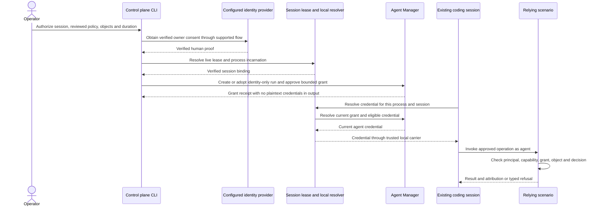

# Identity, Authentication, Desktop, and Entitlement Migration Ledger

> **SUPERSEDED — historical provenance only (2026-10-15).** This ledger halted mid-migration
> awaiting operator input. The cross-scenario authorization and approval model it was converging
> toward is now shipped and documented canonically in
> [`docs/concepts/AUTHORIZATION.md`](../concepts/AUTHORIZATION.md) (the auth-consolidation effort:
> standing grants, ask-don't-block approval, and human-session delegation; see
> [`auth-consolidation/CONSOLIDATION-PLAN.md`](auth-consolidation/CONSOLIDATION-PLAN.md) for the
> delivery record). **Read the concepts page for current guidance.** This file is retained as the
> detailed consumer-matrix and evidence history that produced that model; it is no longer
> authoritative and should not be used to plan new work. Its still-open items were harvested into
> the "Remaining migration items" box below before supersession.
>
> ## Remaining migration items (not covered by the auth-consolidation effort)
>
> The auth-consolidation effort delivered the cross-scenario *run-creation* authority path
> (standing grants, gate reconciliation, ask-don't-block, human-session delegation, one primitive
> family) and the five selected scenario policy changes. The following open items this ledger
> recorded are **outside** that scope and remain to be addressed on their own:
>
> 1. **Resource-audience migration is still incomplete.** Consumers still rely on the frozen
>    `scenario-authenticator:default` audience rather than their declared per-resource audience
>    (contract/gates L45–48, L74; consumer-matrix rows for scenario-authenticator L27, vrooli-bridge
>    L28, device-sync-hub fallback L30). An audience/token-shape migration, orthogonal to run authority.
> 2. **Legacy strict-caller / compat adapters persist in several scenarios.** System Monitor,
>    Knowledge Observatory, and Switchboard still call strict caller adapters (L292–294, L886–889);
>    device-control, notification-hub, and switchboard still carry residual owneridentity legacy-JWT
>    compat adapters (L105–108). Phase 6 collapsed the primitive *families* and Phase 5 migrated only
>    Swarm's strict caller; migrating these to the shared provider-neutral principal is separate.
> 3. **Unenforced human boundaries.** Swarm goal close-out / review decisions carry operator-only
>    comments with no principal check, and editorial approval treats ordinary requests as operator
>    provenance (L300–304). The operator chose to keep these as-is (L323); left out of scope.
> 4. **Four-mode desktop identity journey never exercised live** (`personal_local`,
>    `local_multi_user`, `remote_vrooli`, `shared_provider`) plus local-provider bootstrap (L34, L78,
>    L159–165, L187–189). Desktop supervisor-credential scope, not an agent-grant concern.
> 5. **LPBS desktop link:** Google federation hand-off and offline revocation bounded only by lease
>    expiry (L33). Commercial-entitlement, LPBS-owned.
> 6. **React Component Library adoption/accessibility evidence missing** and per-mutation
>    API-refusal tests absent (L36, L79). UI-presentation adoption, not an auth path.
> 7. **scenario-to-desktop gate defect** `UNIT_REQUIRED_ROLE_MISSING` + three API
>    `TEST_EXECUTION_FAILURE`s — tracked as bug `knw-1788817672292741730` (L180–183).
> 8. **Deployment Manager release-recover:** unresolved recovery binding + invalid contract
>    (shipped-corpus regression FAIL) — tracked as bug `knw-1791485729347157154` (L1153–1159);
>    explicitly noted as outside the agent-proof transport repair.
> 9. **Full interactive run-create via the native path was never exercised** (service-principal
>    section, L1351–1356): the verifying session lacked task-creation authority at the time.
> 10. **The motivating whole-portfolio Swarm backlog/goal reconciliation is unfinished** (L1168–1174,
>    L1221–1229, L1257); the prior Swarm bookkeeping grant expired and needs fresh consent — the
>    original operator task, not an auth-mechanism item.
>
> **Borderline (flagged, not cleanly orphaned):** Web Console *live ingress* activation remains
> STAGED behind the operator no-restart hold (L398, L442–443, L927–929, L999–1000, L1176–1177,
> L1249); it is Phase-5-adjacent and partially overtaken by the 2026-10-14 service-principal restart.
> Swarm backlog batch-archive/update governed-binding gaps (L836–858, L1003–1056, L1125–1130) were
> built during the grant work but are Swarm-domain plumbing.
>
> File any of these as their own scoped efforts if they resurface; do not reopen this ledger.

Status: implementation delivered within the declared plan boundary; post-execution contract audit and
targeted repairs captured 2026-09-07. This ledger is the implementation matrix for the full identity
migration plan. It records observed behavior, the target contract, and the
evidence that retires each legacy path. A `partial` entry is not a claim that
the target behavior is shipped.

## Contract owners

| Boundary | Owner | Must not be moved into |
| --- | --- | --- |
| Person, service, machine, and agent principal verification | `scenario-authenticator` plus configured external providers, composed by `packages/api-core/authn` | A relying scenario or browser UI |
| Canonical principal shape and failure/status vocabulary | `packages/api-core/identity` | Scenario-local claim structs |
| Coarse capability vocabulary and catalog | `packages/api-core/scopecatalog` from governed manifests | Authenticator domain-policy code |
| Scenario/object/mutation authorization | Each relying scenario | The identity provider or LPBS |
| Agent attenuation and provenance | `agent-manager` | Human identity claims |
| Desktop shell-to-supervisor process credential | `scenario-to-desktop` runtime | Human authentication |
| Business accounts, subscriptions, downloads, and commercial entitlements | LPBS | `scenario-authenticator` |
| Reusable account/security presentation | `react-component-library` | Scenario authorization decisions |
| Cloudflare Access verification and shared gated-UI policy | Active `cloudflare-access-human-authority-shared-gated-ui` plan | This plan |

## Consumer matrix

| Consumer | Current observed provider / credential | Current audience or scope behavior | Current browser/storage behavior | Target migration | Status and retirement evidence |
| --- | --- | --- | --- | --- | --- |
| `scenario-authenticator` | Owns local account, password, MFA, session, machine exchange, RS256/JWKS, and refresh rotation | Realm audience is persisted and minted; default is `scenario-authenticator:default`; authorization service owns coarse grants | Hosted login uses HttpOnly same-origin access/refresh cookies; i18n/preferences remain unrelated UI state | Provider authority plus secure same-origin session or code/device flow; publish resource-audience migration and capability catalog | `partial`; cookie, first-admin, scope-RBAC, refresh, audit, and audience tests pass; resource-audience and broader management evidence remain |
| `vrooli-bridge` | Normal bearer verification delegates to `api-core/authn`; enrolled/break-glass paths remain distinct | Frozen default authenticator audience and bridge-specific scope handling | API/CLI credentials are process or client credentials; no browser bearer persistence in the provider package | Canonical principal plus explicit resource audience; preserve local enrollment and break-glass as distinct credential kinds; use shared scope grammar | `partial`; bridge auth tests and private-parser scan pass; resource-audience conformance remains |
| `agent-manager` | Owner-token verification now consumes `api-core/authn.TokenVerifier`; scenario-local agent claims/attenuation remain domain-owned | Owner scopes are narrowed by agent profiles and requested scopes; agent identity is separate from human authority | Run identity is carried as server-side/provenance state; no browser token persistence in the inspected API seam | Canonical owner principal plus explicit agent provenance; attenuation must never create human authority | `partial`; wiring/orchestration tests and focused consumer conformance pass; unrelated full-suite baseline failures remain |
| `device-sync-hub` | Normal bearer verification delegates to `api-core/authn` | Lifecycle-injected `scenario-authenticator:device-sync-hub`; compatibility default remains only for direct unconfigured construction | Device token remains local pairing state; owner JWT now uses an HttpOnly same-origin cookie and legacy localStorage values are migrated out | Canonical verifier with a `device-sync-hub` resource audience and explicit device/owner distinction | `partial`; focused auth/cookie/migration tests and same-`kid` rotation pass; configured audience path is covered; compatibility fallback and live browser evidence remain |
| Git Control Tower | `policygate` normal authenticator verification delegates to `api-core/authn`; Cloudflare/provider composition remains adjacent-plan-owned; personal-local is a loopback/OS-user provider | Manifest separates Cloudflare application audience from `scenario-authenticator:git-control-tower`; mode selects provider set | Browser login now receives an HttpOnly same-origin cookie; UI has no bearer-token cookie/localStorage writer | Canonical authn provider, explicit resource audience transition, and preserved domain/human-control policy | `partial`; adversarial policy, personal-local, mode-matrix, canonical verifier, UI build/typecheck tests pass; live desktop/browser evidence remains |
| `portal` | Context/chat handlers now consume `api-core/authn.TokenVerifier` and `identity.Principal` | Human kind, verified state, subject, expiry, and lifecycle-injected resource audience are checked before account binding | API interceptor accepts request credentials; no password store in portal | Canonical principal adapter; portal remains a relying party and never stores LPBS/local account credentials | `partial`; `go test ./...` passes for portal API; no owneridentity imports remain in portal API |
| LPBS | Owns magic-link user auth, admin auth, customer/business account, subscription, download, and entitlement services | LPBS consumer JWT and signed entitlement lease use LPBS-owned keys/audiences; local Vrooli identity is not email-matched | Browser consent issues a one-use scoped desktop-link code; the desktop template redeems it only with a verified local proof and persists website tokens only through Electron safeStorage, while leases remain authority-backed | Keep LPBS commercial authority; explicit scoped local-account link and entitlement lease consumption without copying website sessions | `delivered compatibility path`; durable account/membership selection, link/revocation, signed scoped lease, exact resource audience/scope validation, browser consent/client redemption, encrypted desktop token persistence, customer/admin passkeys, and wrong-installation/expiry/replay tests pass; Google federation remains a scenario-authenticator hand-off and offline revocation remains bounded by lease expiry plus status refresh |
| Desktop runtime/templates | Supervisor loopback bearer authenticates Electron to supervisor; template has auth manager and encrypted credential/lease paths | Bundle/resource route is separate from human identity; four documented modes need typed manifest/runtime enforcement | Personal-local must work offline; desktop tokens must use credential authority/native secure storage | Add manifest-declared mode/provider/audience/status/recovery semantics and explicit setup/recovery for `personal_local`, `local_multi_user`, `remote_vrooli`, and `shared_provider` | `partial`; runtime and template tests pass; mode profiles, protected selection/rollback, atomic non-secret state, and shared-lease refusal are implemented; local-provider bootstrap and live mode evidence remain |
| Deployment/bundle manifests | Service manifests have versioned authentication profiles; GCT now separates Cloudflare and scenario audiences | `VROOLI_AUTH_MODE` selects provider composition; personal-local avoids authenticator and Cloudflare runtime binding | Non-secret metadata is manifest state; secrets remain credential-authority state | Versioned authentication profile with mode, resource audience, public routes, capability namespace, agent eligibility, and recovery behavior | `partial`; service/CLI schemas, mode-provider matrix, six reference profiles, shared capability matching, and startup dependency checks pass; desktop bundle projection and live mode evidence remain |
| React Component Library | Account/monetization/auth/entitlement assets exist in catalog/library | Components must be presentation/state surfaces only | No authority should be encoded in component visibility | Standardize account, session, machine, link, entitlement, sign-in, refusal, offline, and recovery surfaces with API-enforced mutation tests | `partial`; reusable assets are present; authenticator and LPBS adoption/accessibility evidence remains |

## Contract decisions and bounded transition

1. `api-core/identity.Principal` is the only provider-neutral principal model.
2. `api-core/authn` is the only shared request-authentication composition seam.
3. `owneridentity`, bridge auth, device-sync auth, GCT auth, and secrets-manager
   verifiers are compatibility adapters during migration, not additional
   authority models.
4. `scenario-authenticator:default` remains accepted only during the declared
   migration window. New relying-party declarations must use a resource
   audience such as `scenario:<scenario-name>`; each consumer records the old
   audience removal test before switching.
5. Equal subjects from different providers cannot be merged merely because
   their strings match. A durable explicit mapping is required.
6. `personal_local` is the default bundled desktop mode and has no required
   human sign-in or hidden network dependency. Selecting any other mode is an
   explicit security-sensitive configuration change.
7. LPBS remains authoritative for business accounts, subscriptions, downloads,
   and entitlements. A local identity link is scoped, one-use, auditable, and
   revocable; email equality is not a link protocol.
8. The supervisor credential is a process credential and must never be accepted
   as proof of human identity.

## F1 D3 — Deployment Manager export trust

Operator decision (DPF-FB-010): plan metadata is not secret. Development-local
builds need no publisher authentication. Production release authentication is
deferred until a production release ships and should use machine-bound operator
identity. Deployment Manager therefore requires release-preparation authority
only for production exports that include secret plans; development-local plan
exports remain available without a publisher principal.

## Legacy-path retirement gates

| Legacy path | Required removal gate | Owner |
| --- | --- | --- |
| Consumer-local JWT parsing | Consumer package conformance tests pass through `api-core/authn`; repository scan finds no consumer parser outside an explicitly owned provider adapter | `api-core/authn` + consumer owner |
| Frozen `scenario-authenticator:default` audience | Resource-audience issuance, verifier compatibility window, and wrong-audience negative tests pass for every migrated consumer | Authenticator + relying scenario |
| Duplicate scope matchers | Shared grammar/wildcard/attenuation tests cover exact, wildcard, malformed, and human-only cases | `api-core/scopecatalog` + bridge/agent-manager |
| Authenticator hosted-login bearer `localStorage` | Same-origin cookie or code/device flow is exercised; scan excludes only non-credential preferences and fixtures | scenario-authenticator UI |
| Copied LPBS session into desktop | PKCE/device link and signed entitlement lease tests prove one-use, scope, expiry, revocation, and encrypted safeStorage persistence for website tokens | LPBS + desktop |
| Implicit desktop mode switching | Manifest/runtime validation proves mode selection, provider outage, offline behavior, and recovery path | deployment-manager + scenario-to-desktop |
| UI-only authorization | API refusal tests exist for every mutation represented by an account/security component | RCL + adopting scenario |

## Phase 9 resilience evidence

- Refresh-token rotation now consumes a live refresh entry with an atomic
  compare-and-swap in the shared hot-state store. Memory, SQLite, Redis, and
  namespaced stores implement the same conditional primitive; concurrent
  presentation tests prove one successful rotation and fail-closed replay
  handling.
- `scenario-authenticator` session/redisstate race tests pass, including the
  concurrent refresh-rotation regression. The full `api-core` race run retains
  unrelated catalog-manifest baseline failures.
- LPBS desktop-link race tests pass for scoped one-use link behavior. Browser
  consent, template `connectDesktop`, and IPC redemption tests now cover the
  one-use client path; the desktop-link service still never stores or returns
  an LPBS website token.
- LPBS business-account repository and transport tests cover idempotent personal
  account creation, multiple accounts, membership isolation, explicit browser
  selection, and selected-account propagation into desktop-link issuance. The
  template local-proof exchange test exercises the Unix-socket
  `scenario-authenticator` contract and proves the proof is obtained at the
  provider boundary rather than from a supervisor credential.
- Entitlement leases now expose binding-aware verification for business account,
  installation, resource, audience, link ID, and exact scope set. Cached leases
  use the same binding check before an offline caller can consume them; LPBS
  link issuance rejects cross-resource audiences and scopes.
- The remaining `owneridentity` package and consumers are explicit
  compatibility paths. Current remaining consumers are device-control,
  notification-hub, and switchboard; they remain retirement work rather than
  undocumented authority models.

## Active adjacent-plan boundary

`cloudflare-access-human-authority-shared-gated-ui` is active in Plan Manager.
It owns Cloudflare Access token verification, provider-specific key handling,
and shared gated-UI middleware. This migration consumes its provider-neutral
output and does not duplicate Cloudflare management or policy work.

## Baseline evidence

- Focused Go tests passed on 2026-09-07 for `packages/api-core/identity`,
  `packages/api-core/authn`, `packages/api-core/owneridentity`,
  `packages/api-core/scopecatalog`, `scenarios/scenario-authenticator/api`,
  and `scenarios/scenario-to-desktop/runtime`.
- The repository is a shared dirty worktree with unrelated staged, modified,
  and untracked changes. Attribution is intentionally unknown; this ledger
  does not reset, stash, or replace those paths.
- A scoped baseline report and scan output are stored outside scenario source
  under the Plan Manager artifact directory.
- Full cross-scenario validation has not been run. Its absence is an explicit
  baseline limitation, not evidence of failure or success.

## Phase 10 release evidence and operator handoff

## Post-execution contract audit and repairs

- The prior Plan Manager completion did not prove the repository end state. A
  requirement audit found and repaired GCT mode drift, missing separation of
  Cloudflare and scenario audiences, JS-readable browser token storage in GCT
  and Device Sync Hub, and
  private JWT verification adapters in Token Economy and Secrets Manager.
- `personal_local` now selects a loopback/OS-user principal in GCT, rejects
  verified agent provenance, and never consumes the desktop supervisor token.
  `local_multi_user`, `remote_vrooli`, and `shared_provider` select explicit
  provider sets through `VROOLI_AUTH_MODE`.
- The shared manifest model and JSON schemas now expose `scenario_audience`.
  Device Sync Hub, Bridge, Portal, Agent Manager, GCT, Token Economy, and
  Secrets Manager consume lifecycle-injected audiences through `api-core/authn`.
- The desktop manifest now supports explicit non-secret `mode_profiles`. The
  authenticated runtime exposes mode listing, selection, status, and rollback;
  it persists only selected-mode transition metadata through an atomic state
  file, preserves application data, and refuses shared-provider selection when
  its scoped lease is absent, invalid, or expired. The supervisor bearer is
  used only to reach this local control surface and is never a human identity.
- Focused post-repair evidence: GCT API `go test ./...`, Device Sync Hub
  `go test ./...` plus cookie/migration/UI tests, Secrets Manager
  verifier/API tests, Token Economy access tests, Agent Manager wiring tests,
  Portal API tests, API Core identity/authn tests, scenario/lifecycle
  authentication tests, scenario-to-desktop runtime `go test ./...`, and GCT
  UI typecheck/build. Device Sync Hub's changed UI files pass focused ESLint;
  its full UI lint/typecheck retain unrelated baseline defects. The governed desktop evidence inventory contains 100
  historical captures and the latest generic lifecycle journey is `pass`; it
  is not a four-mode identity journey. GCT UI's full suite still has
  nine unrelated pre-existing FileList/DiffViewer failures.
- Live four-mode desktop/browser journeys, Test Genie cross-scenario capacity,
  full restart/backup/restore, and multi-replica Redis remain unavailable and
  are not represented as passing evidence.

- The migration ledger is registered in `docs/manifest.json`; the ledger and authenticator docs
  pass scoped documentation health checks for local links and marked references. Repository-wide
  health still reports four unrelated broken local links and pre-existing Tier 2 reference
  findings; those findings remain recorded rather than hidden.
- JSON manifest parsing, scoped whitespace checks, and the agent-manager/portal `owneridentity`
  removal scan pass.
- Passing focused evidence includes authenticator UI tests/build/lint/typecheck, portal API tests,
  canonical auth tests for agent-manager, device-sync-hub, vrooli-bridge, Git Control Tower, and
  secrets-manager, plus race tests for authenticator refresh state and LPBS desktop linking.
- The final Test Genie attempt was server-owned. LPBS was admitted but ended with a typed
  `provider_unavailable` unit phase; authenticator, portal, and agent-manager were rejected at
  admission because shared preview capacity was saturated. These are validation-environment
  limitations, not passing scenario-suite evidence.
- The affected `scenario-to-desktop` unit run `20260907-214452-54b12663` also failed at the
  scenario gate with `UNIT_REQUIRED_ROLE_MISSING` for the declared UI surface and three API
  `TEST_EXECUTION_FAILURE` findings. The runtime package passes independently; this gate defect
  was filed as Scenario QA bug `knw-1788817672292741730`.
- The operator runbook, exact commands, rollback guidance, and complete limitation register are
  stored in the Plan Manager handoff artifact:
  `~/.vrooli/plan-artifacts/full-vrooli-identity-authentication-desktop-entitlement/RELEASE-HANDOFF.md`.
- Live browser-width evidence, the four-mode desktop matrix, full restart/backup/restore rehearsal,
  and multi-replica Redis rehearsal were not available in this shared worktree and remain explicit
  follow-up evidence rather than undocumented claims.

## 2026-10-07 interactive Web Console authorization investigation

Trigger: the operator approved archiving the obsolete Swarm ntfy resource item.
The selected workflow attempted to start a Swarm advisory session and received
HTTP 401 `verified agent-manager caller required`. The operator asked for a
shared authentication repair and an authorization command for existing agents,
without restarting Web Console.

Observed boundaries:

- The current coding session is live in a control-plane editor lease with a
  verified Web Console session owner and `origin=ui`. Its owner subject is empty
  and its process environment has no `VROOLI_AGENT_IDENTITY_TOKEN`. Session
  liveness and launch attribution do not establish a verified human principal.
- Web Console's inspected server has no shared `authn` middleware or declared
  authentication profile. Its browser ingress does not currently produce a
  canonical owner principal for the coding session. This does not establish
  whether its external Cloudflare application policy is correctly configured.
- The launcher sends `working_dir` and `scope` to Agent Manager attachment,
  although neither field exists in `AttachRunRequest`. The live API rejected a
  non-mutating, intentionally invalid diagnostic with HTTP 400 and unknown field
  `working_dir`. The original session's attach response was not recovered; this
  confirmed defect can explain missing attribution, but its exact original
  launch cause remains unproven.
- Swarm session start unconditionally uses the legacy human-bearer adapter.
  It ignores a canonical Cloudflare principal and refuses an offered agent
  identity. The compatibility verifier fixes the authenticator audience to
  `scenario-authenticator:default`, unlike Swarm's declared resource audience.
  Swarm is explicitly listed as an unmigrated strict caller in Agent Manager's
  AUTH-01 migration document; its behavior differs from the default-off creation
  policy rather than proving a new regression.
- Swarm's direct archive handler has no operation authorization check. A unique
  nonexistent item returned HTTP 404 with both absent credentials and an invalid
  bearer. No item was mutated. The direct operation avoids needing another
  advisory agent, but its missing guard is a defect to repair, not a recovery
  mechanism.
- Attachment issues an agent identity with no scopes. Human account scope
  assignment and runner permission-policy reload do not authorize an existing
  coding run. CLI request identity discovery currently reads only an inherited
  environment token; no supported live grant/resolution command was found in
  the inspected control-plane and Agent Manager command surfaces.

Source repair: the launcher now sends only supported attach fields. Its existing
transport regression strictly decodes the published descriptor's real
`AttachRunRequest`, retaining tree/containment metadata in the editor lease.
Generated contract verification passed. The new contract check first failed on
the unsupported launch fields; the focused launcher regressions subsequently
passed. No scenario was restarted and no run grant was issued.

Focused validation also preserves tree/scope metadata in the editor lease and
the child's session marker. The broader `cliutil` package run failed at
`TestDetectPortFromVrooliFallsBackToBareCommand`: installed control-plane binary
discovery disagreed with the test's mocked PATH-only expectation. That failure
reproduced independently; neither port lookup source nor that test was changed.
The broad package run is not claimed as passing.

The bounded `agent-manager.friction-digest` operation
`prog_0c0e4a65-8a45-4668-930a-89f5f029e6f7` read 60 recent runs and 75 episodes
without transcript bodies. No fingerprint appeared in three distinct runs in
that sample; the run cap truncated the requested window, so it cannot establish
whole-window recurrence or absence of recurring authorization friction.

The target live-consent contract is now shipped and documented in
[`AUTHORIZATION.md`](../concepts/AUTHORIZATION.md#interactive-grants-for-already-running-agents).
Reuse the shared Cloudflare verifier, canonical principal, capability catalog,
run identity/revocation and control-plane leases. Replace consumer-private
bearer reparsing with shared operation decisions. Add human-approved grants and
dynamic CLI credential resolution to resume existing sessions. Preserve distinct
human approver and agent actor identities, explicit object/action boundaries,
same-user trust limitations, and the separate frozen finite-authority rules.
The proposed `vrooli agent authorize` command does not yet exist.

### Human-gate inventory before implementation

The operator approved the proposed repair and requested a review of the current
human gates before implementation. This inventory is a source and manifest
review, not a live qualification of every protected route. No gate was changed.

- Eleven scenario service profiles declare 21 capabilities with
  `agent_eligible=false`. Swarm Manager, Agent Manager, Git Control Tower,
  Deployment Manager, Device Sync Hub, Portal, Onboarding, and Scenario to
  Desktop each restrict both write and destructive capabilities. Nutrition
  Planner also restricts read. Bridge restricts destructive; Scenario to Cloud
  restricts write. These declarations do not themselves prove runtime enforcement.
- Command governance has a separate `run_eligible` vocabulary. Swarm declares
  78 run-eligible mutation commands; Agent Manager and Git Control Tower each
  declare 11. Examples include Swarm backlog create/update and GCT worktree and
  commit-proposal preparation. Coarse capability eligibility and governed command
  eligibility therefore require explicit reconciliation, not synonymous labels.
- GCT's repository writer boundary requires human identity and a consumed intent
  for stage/unstage, file content edits, branch creation/switching, pull, grouping
  and ignore settings as well as commits, push, discard and credential changes.
  Exact commit approval matches the retained operator decision. Routine preparation
  is a candidate for bounded delegation while retaining index/worktree ownership.
- Agent Manager blocks run-token holders from investigation/apply, recovery,
  approval/rejection, deletion, sandbox sync and global stop operations. It admits
  exact linked child creation, scoped direct-child stop/continue/wake and worker
  parent wake. These lineage exceptions are a useful existing delegation pattern.
  Absent run proof bypasses the actor guard; absence is not verified human consent.
- AUTH-01 creation enforcement is documented as default-off under P-18. Swarm,
  System Monitor, Knowledge Observatory and Switchboard retain strict caller
  adapters. Their advisory/research/healing/dispatch starts are candidates for
  task- and budget-bound agent authorization rather than fresh human bearer proof
  at every adapter hop.
- Explicit decision boundaries include governed Swarm Development approval,
  revocation and acceptance; deployment approvals and release-readiness judgments;
  credential reveal assurance and access-grant decisions; editorial draft approval;
  operator promotion of offer candidates; and owner-specific notification answers.
  Their operation and evidence bindings should be retained independently of login.
- Some intended human boundaries lack human-proof enforcement: Swarm goal close-out
  and review decisions contain operator-only comments without a principal check in
  the inspected domain mutation. Editorial approval rejects verified agent
  provenance but treats ordinary requests as operator provenance. These are not
  proof that the submitting person approved the decision.
- Scenario to Cloud already has an explicit expiring, reason-bound agent validation
  window for deployment mutations, while secret and interactive-terminal operations
  remain human-only. This source exception is not a claim that a live window is
  configured or authorization for a new deployment.

Recommended classification: require human consent to establish or expand authority,
make explicitly retained strategic/final decisions, and approve sensitive effects
outside a grant. Delegate routine work within a reviewed action/object/budget
boundary. Keep evidence, freshness, concurrency, lineage and expiry checks as
machine-enforced conditions. A human-only actor check must not substitute for a
recorded approval, and an existing recorded approval must not require the human to
perform every subsequent execution step personally.

## Approved implementation work package and continuation record

**Authority:** the operator approved the shared authentication/live-grant repair,
then selected this policy scope verbatim:

> I'd remove all nutrition planner human approval, weaken deployment to only release and evidence, allow agents to do agent investigations and support delegated management, allow swarm manager bookkeeping, and keep the rest as-is.

**Workflow constraint:** the operator subsequently instructed: `Don't use plan manager`.
This repository document owns the implementation sequence and progress record.
Do not use Plan Manager to execute or track this work. An empty authoring session
was created before that instruction; it was neither filled nor finalized and is
not the execution source. Do not resume it or create a replacement plan.

**Target authority:** read the approved interactive-grant and operation-policy
sections in [`AUTHORIZATION.md`](../concepts/AUTHORIZATION.md) before code changes.
That document specifies desired behavior. This ledger retains observations,
implementation progress, validation, unresolved questions and live/staged state.
The latest approved selection supersedes earlier recommendations to loosen Git
preparation or other unrelated policies.

### Outcome and consequence

The operator can approve a bounded grant for an already running coding session.
Later CLI requests use that grant without replacing the agent or changing its
parent environment. Selected routine operations support delegation. Retained
human decisions remain protected, and records preserve the agent and approver
as separate identities.

Without this outcome, authorized agent work continues to fail at inconsistent
caller checks, or callers exploit unguarded routes and lose meaningful approval
and attribution. A source-only command or permissive actor flag is insufficient.

### Design and ownership



Agent Manager owns grants and active run credentials. The control plane owns
host lease/process binding and local resolution. Shared API/CLI packages own
principal interpretation, capability matching, transport and common decision
semantics. Each scenario owns exact objects, mechanical acceptance and retained
human decisions. Cloudflare or the configured authenticator owns human identity;
the credential authority owns secret custody.

Use provider-neutral identity and existing token issuance/revocation. Avoid a
parallel signer, identity realm, private JWT parser, generic bypass header or new
standalone daemon when an existing owner can carry the function. Approval records
must remain durable independently of browser request cancellation. A fresh grant
does not reset consumed execution budgets or rewrite historical admission.

### Implementation sequence

| Work item | Implementation and acceptance | State |
| --- | --- | --- |
| 1. Pin operation policies and identity contracts | Resolve operation identifiers and grant boundaries from current owner contracts. Reconcile coarse and command eligibility for the four selected areas. Preserve all other gate outcomes. Add positive delegation and protected-decision regressions before changing enforcement. | In progress |
| 2. Implement owner-approved live grants | Add typed grant issuance, inspection and revocation to Agent Manager's existing run domain. Qualify the human consent carrier, current owner binding, duration, operations and targets. Bind unmanaged sessions through verified host leases and identity-only attachment. Prove self-grant, replay, wrong owner and wrong session refusals. | In progress |
| 3. Implement control-plane commands and dynamic CLI resolution | Implement authorize, inspect and revoke commands through existing owners. Resolve current agent credentials for each request through the trusted local carrier. Prove an existing tokenless session adopts an approved grant without environment changes or replacement. Explain typed failures and the exact recovery action. | In progress |
| 4. Apply the selected scenario policies | Remove Nutrition Planner-specific human approval gates. Delegate ordinary deployment operations and retain release/evidence decisions. Delegate investigations and authorized run management. Delegate Swarm bookkeeping through guarded deterministic owners. Preserve strategic acceptance, self-approval restrictions and unrelated policies. | In progress |
| 5. Connect Web Console and shared caller adapters | Add configured canonical human identity and verified owner metadata at Web Console ingress. Replace legacy audience-fixed bearer reparsing with shared principal/grant decisions. Support admitted delegated agent callers without substituting a human credential. Stage Web Console changes without restarting its current process. | In progress |
| 6. Consolidate diagnostics and retire redundant paths | Remove replaced parsers/matchers and per-consumer credential handoffs. Restrict proof forwarding to declared trusted destinations. Make grant diagnostics identify missing, invalid, expired, revoked, out-of-scope and unavailable states. Correct misleading permission-health reporting if its owner confirms the observed defect. Keep unrelated port-test findings separate. | In progress |
| 7. Verify and resume the original bookkeeping | Run focused shared/domain tests and scoped Test Genie phases. Publish the operator's exact live authorization command. Verify an owner-approved grant in this existing session. Archive the already approved ntfy item through the guarded deterministic operation, verify its retained history/status, and continue evidence-based backlog/goal reconciliation. | In progress; live consent requires external input |

Work items describe dependency order rather than a new permission request at
each step. Record implementation choices within the approved target. Resolve
routine code and owner prerequisites autonomously. A required human login or
consent action remains a real external input; do not simulate or mint it.

### Implementation checkpoint — 2026-10-07

Implementation is in progress; the following is source state, not a live grant
or a completed rollout. Web Console has not been restarted. Plan Manager is
not used.

- Shared identity now separates the agent actor, verified owner account and
  interactive grant approver. Operation grants contain reviewed operations,
  explicit domain/object targets and expiry. Provider-subject owner bindings
  are explicit deployment policy, never email or tunnel-reachability inference.
- Agent Manager now has a separate domain-owned durable consent table and
  request/approve/inspect/revoke service. Requests carry no authority; approval
  requires independent verified human proof and the policy's capability ceiling.
  Existing finite/delegated runs cannot replace their retained authority.
- Linux live credential resolution uses an API-owned Unix listener, kernel peer
  credentials, boot ID, process start time, parentage and cgroup. Each request
  consults current consent. Revocation and broker failure cannot resurrect an
  older inherited credential. Same-UID secret/process compromise remains the
  explicitly documented containment limit.
- Control-plane authorize/authorization/revoke-authorization commands are in
  source. Authorize requires explicit targets and produces an authenticated
  browser consent URL. It does not exchange local OS identity for human proof.
  Consent origin must match the configured Agent Manager browser URL, including
  when a UI proxy changes the backend Host header.
- Nutrition capability eligibility and account ownership, ordinary deployment
  admission, bounded Agent Manager investigation/management, Swarm item/goal
  bookkeeping, and protected review/goal/release boundaries have been updated.
  The temporary deployment delegation window has been retired.
- Shared middleware ordering now verifies agent provenance before resolving the
  principal. The local-session provider reports absence before refusing offered
  local credentials from an agent. This retains authenticated agent reads while
  preventing a local credential from upgrading an agent into a human.
- Verified canonical human context can enter CreateRun admission and request-local
  caller adapters. The Swarm compatibility verifier now selects its declared
  resource audience. Browser proof remains in the immediate trusted server hop;
  it is not persisted into agent grants or handed to the coding process.
- Ambient identity forwarding is bounded to local scenario HTTP destinations.
  The duplicated provenance capability matcher now uses the shared scope owner.
- Permission doctor distinguishes incomplete resource assessment from the
  vacuous absence of mandatory hard-enforcement requirements.

Focused checks already passed: generated-contract verifier; shared API identity,
authentication, provenance, owner adapter and server tests; grant adoption and
revocation against isolated SQLite; attached-run tests; selected Agent Manager
lifecycle/admission/permission regressions; Nutrition handler tests; Deployment
Manager authorization/release/server tests; Scenario to Cloud authorization tests;
Web Console create/provenance tests; and the updated Swarm backlog/goal package
checks. Remaining verification includes additional socket/consent/owner-privacy
regressions, complete affected package checks and scoped Test Genie receipts.

Deployment evidence: Tunnel Manager reports the existing public Agent Manager
route as `https://agent-manager.itsagitime.com` and Web Console as
`https://web-console.itsagitime.com`. Those route records do not prove a human
identity or capability assignment. Canonical owner/provider bindings and a safe
Agent Manager rollout still need to be qualified before live consent is claimed.
No grant has been issued, and the ntfy archive remains pending that live boundary.

### Implementation checkpoint — 2026-10-08

This checkpoint supersedes the earlier source/rollout checkpoint. Implementation
and qualification continue under the approved work package; Plan Manager is not
used. Web Console and the existing coding session have not been restarted.

**Live state:** `make build` and `make install` succeeded, including the required
supervisory build checks. The installed control plane exposes `agent authorize`,
`agent authorization`, and `agent revoke-authorization`. Agent Manager completed
a managed restart and reports healthy on API 18800 / UI 21238. Its Unix broker
is present. The live API has the explicit browser origin
`https://agent-manager.itsagitime.com`; anonymous identity and consent reads return
401. Subsequent enforcement edits remain source changes until the next governed
Agent Manager rollout. No human grant has been approved or issued.

A real authority-free request was prepared through the installed command:

```bash
vrooli agent authorize codex-84e54d6e9b10aa832f7701e0366c17ef \
  --policy swarm-bookkeeping --target 'swarm-manager:*' --expires-in 2h \
  --approval-base https://agent-manager.itsagitime.com
```

Receipt `b2b9684b-9270-4633-aa6a-dc6e5c8b4eb5` was pending, bound to PID 1692706,
its start time, boot ID and the session's systemd cgroup. Its 15-minute request
expiry was `2026-10-08T04:54:13.546936512Z`; do not treat that old receipt as an
active authorization. Reissue the command after expiry. The real process chain
for shell tools was observed to descend through Codex PIDs 1693925 and 1692727
from the bound node process, inside that same cgroup.

**External input still required:** no `VROOLI_AUTH_OWNER_BINDINGS` is configured
for this deployment. The operator was asked to open the live authenticated
`/api/v1/authorizations/identity` endpoint and supply only `subject` and `source`,
never a token. Use that independently verified subject to configure the explicit
approved owner capability policy. Do not infer it from email, Unix UID, tunnel
reachability, a session label or an agent's assertion. The operator then confirms
the reviewable consent page. These inputs cannot be simulated by this agent.

**Additional boundary repairs:**

- All three live Tunnel Manager authentication bindings (Agent Manager, Swarm
  Manager, Web Console) returned the same signed Cloudflare application audience
  and team domain. This qualifies the current immediate Cloudflare adapter hop;
  it does not assign owner scopes or prove a login occurred.
- Managed Cloudflare verification now resolves that existing owner metadata
  lazily, requires an application user assertion, and leaves capability/owner
  assignment to explicit policy. Absent proof makes no metadata/network call.
- Native forwarding is deliberately bounded to the existing Swarm-to-Agent
  Manager `POST /api/v1/runs` adapter. The ordinary Agent Manager audience remains
  mandatory on consent and global management; other scenario audiences are
  refused. The original human subject, scopes and expiry are retained.
- A missing run ID cannot disguise a live managed run as an unmanaged session.
  Kernel process relationships select the authoritative run before approval.
  New admissions freeze the original owner/profile/request scope intersection.
  Historical managed runs without that frozen ceiling cannot acquire a broader
  interactive grant; finite/delegated admission cannot be replaced.
- Agent Manager and Swarm route boundaries restrict coarse write eligibility to
  reviewed operations. Removing an agent header cannot turn an anonymous caller
  into an operator on a retained human mutation. Domain handlers still own exact
  objects, lineage, profile, evidence and budget checks.
- REST and Connect investigation start/cancel now share current identity and
  subject-run checks. Agent caller attribution overrides request labels and
  namespaces idempotency by its verified run. Global approvals remain protected.
- Swarm bookkeeping needs authoritative inactive-work state. Failed, executing
  or reviewing work cannot be accepted by an agent's status patch. Forced goal
  cascade is refused to a bookkeeping agent: archive each authorized inactive
  target through its owner first. Goal/milestone changes add an attributed grant
  receipt while retaining existing graph history. Milestone creation/update
  cannot manufacture or replace independent delivery verdicts.
- Deployment release decisions stay human; execution and observation use a
  separate authorization hook. Agent release execution requires immutable
  candidate/destination identity and an exact approved readiness review. Stale
  evidence remains refused. Scenario to Cloud's CLI/API capability declarations
  now agree on write eligibility; credential operations and existing reviewed
  plan/rollback/restore confirmations remain protected.
- A nested authentication failure clears an earlier principal. Retained human
  decisions reject mixed agent attribution even when a human credential also
  verifies. Local credential absence is distinguished from an offered local
  credential, preserving legitimate agent authentication.
- Both CLI and request-local proof forwarding strip agent headers on external
  redirects. Go's automatic custom-header copying must not leak a credential
  after a trusted local first hop. Broker refusals expose bounded reason codes;
  revocation/unavailability never resurrect older authority.

**Observed verification:** generated-contract verification passed. Focused shared
API packages, CLI credential/process/launch/redirect tests, live-broker grant and
revocation tests against isolated SQLite, Agent Manager admission/handler/wiring
checks, Nutrition owner/capability checks, Deployment release/authz/server checks,
Scenario to Cloud authz and complete CLI checks, Web Console canonical-owner
create tests and compile check, and Swarm backlog/goals/event/graph checks passed
at their recorded inputs. A further source edit requires relevant checks again.
Graph integration fixtures now declare verified operator authority. CLI primitive
evidence and Scenario to Cloud command documentation were refreshed only through
their owning regression commands.

**Scoped Test Genie observations (not blanket certification):**

| Scenario | Run | Observed result |
| --- | --- | --- |
| Swarm Manager | `20261008-042928-be451a3b` | Terminal FAIL, two unit execution findings. Follow-up focused full Go runs identified graph fixtures missing operator authority and stale CLI primitive evidence; those were repaired. Producer index/artifacts for this initial run were unavailable on subsequent inspection, so retain the terminal stream and avoid inventing the missing receipt. |
| Agent Manager | `20261008-043134-14815f14` | Failed before assertions: unit-health readiness/ownership deadline, 120 seconds. First admission attempt was also saturated. |
| Nutrition Planner | `20261008-043422-66c04397` | Provider readiness deadline; no assertion pass is claimed. |
| Deployment Manager | `20261008-043955-54b59490` | Unit PASS; terminal producer read also confirmed PASS. Advisory coverage/seam findings remain separate. |
| Scenario to Cloud | `20261008-043956-2cb55a50` | Unit FAIL. CLI eligibility/doc regressions were repaired and the full CLI check passed. API preflight/activation failures remain under relevance investigation. |
| Web Console | `20261008-043958-9869014e` | Unit FAIL, two findings; source qualification is still pending inspection. No restart occurred. |

Continuation: finish relevant failure triage and source checks; update the next
Agent Manager rollout with the qualified owner binding; obtain actual owner
consent; verify credential adoption and guarded Swarm archive against the live
owners; then resume the already approved ntfy archive and backlog reconciliation.
Do not claim the original cleanup or live authorization complete before those
boundaries have actually succeeded.

### Qualification checkpoint — 2026-10-08

This checkpoint extends the preceding source/live checkpoint. **Live completion
still requires the operator's externally verified subject/source, explicit owner
policy, browser consent, and positive live credential/Swarm write evidence.**
No grant has been issued; the expired request is metadata only. Web Console and
this coding session have not been restarted. Plan Manager is not used.

Additional source repairs and their purposes:

- Direct WebSocket upgrades use the same current credential resolver as HTTP;
  local WS/WSS handshakes retain attribution and remote hops strip agent proof.
  The complete Agent Manager CLI suite passes, including its first-command
  authenticated WebSocket fixture. Lifecycle tests now admit approved bounded
  investigation/recovery while still refusing operator-only global commands.
- Mixed human proof and interactive agent proof preserve the agent actor and
  exact grant target. Current owner scopes intersect the signed agent scopes;
  conflicting owner subjects fail. Independent human decisions remain separate.
- Managed-run detection occurs both at preparation and approval. A managed run
  appearing after preparation invalidates that request rather than replacing
  retained authority. Tests cover that race as well as omitted run identity.
- Unknown native typed mutations cannot inherit global-management authority
  from a procedure prefix. Only reviewed native operations retain their owner
  checks. The control plane's four exact lifecycle maintenance procedures retain
  their existing loopback owner contract and maintenance fence.
- Swarm activity-store errors block mutation; neither unavailable executions
  nor unreadable agent activity establishes inactive work. Swarm and Agent
  Manager use one shared native-provider configuration helper; explicit provider
  configuration is preserved and each native scenario audience remains distinct.
- Scenario to Cloud credential operations refuse agent attribution even when
  a human credential also verifies. The focused authz suite passes.

Verification at these inputs:

- Full Agent Manager API Go output `/tmp/agent-manager-api-auth-final.jsonl`
  contains no failing package/test; orchestration finished with PASS. Complete
  Agent Manager CLI also passed. Subsequent provider-helper wiring checks pass.
- Shared authentication/identity/owner/provenance/server packages pass, including
  mixed-proof target limits. Shared CLI credential/process/redirect regressions
  pass. Root authorize/agent/registration checks pass and `make install` completes
  build plus supervisory build/vet gates (`/tmp/authorization-root-cli-install.log`).
- Complete Swarm API/CLI Go checks passed after graph-fixture/evidence repair;
  subsequent main wiring and activity/execution checks pass. Fresh Test Genie
  unit run `20261008-054347-94ca92a1` reached terminal FAIL: the sole execution failure is UI `BacklogDetailsPage.rich-read-workflows.test.tsx:79`, which cannot find Show more. Its producer findings and terminal receipt are retained; API/CLI qualification passed.
- Web Console canonical-owner creation and invalid-proof/no-effect regression
  passed. The broader API suite has three unrelated failing tests: dedicated
  tmux probe and two deletion-idempotency cases. Complete CLI passes.
- Nutrition retry `20261008-054821-fe9bd574` reached terminal provider_unavailable: unit-health ownership/readiness deadline, before assertions.
  The preceding retry was refused at admission (caller preview saturation),
  without a run or assertions. Focused owner/capability checks already passed.
- Scenario to Cloud focused authz and complete CLI pass. Its broader API has
  bundling, host preparation, edge fixture, architectural ownership, reviewed
  setup and activation/recovery failures; do not claim blanket scenario PASS.

Out-of-scope observations were published through the report-bug skill:
`knw-1791438361534250295` (Scenario to Cloud qualification drift),
`knw-1791438361534563924` (Web Console tmux probe), and
`knw-1791438425223239743` (Web Console deletion replay). Additional reports: `knw-1791438816879036971` (Swarm description UI), `knw-1791438816879215291` (missing historical Test Genie receipt), and `knw-1791439275308202213` (Prompt Manager CLI source rebuild). These are observations
in a concurrently modified workspace, not proof of a regression caused here.

Final Agent Manager scenario qualification: Test Genie unit run
`20261008-055340-d897a659` finished PASS in 145 seconds; its terminal producer
snapshot is `/tmp/agent-manager-auth-final-receipt.json` and immutable owner
artifacts are under
`~/.vrooli/test-runs/agent-manager/coverage/runs/20261008-055340-d897a659`.
A subsequent narrow route change preserves the launcher's local, zero-scope
`POST /api/v1/runs/attach` before human consent; remote callers remain denied.
Focused route/attachment/grant regressions passed after that change. This
exception supplies identity only and cannot authorize operations. The existing
four exact local maintenance procedures retain their independent owner fence.
Deployment Manager release/authz and actual `server` package checks pass;
Nutrition's complete handler/middleware/server checks pass. Swarm's affected
backlog/goals/event/activity/execution package checks pass.

The latest source enforcement is **staged**, beyond the earlier healthy managed
Agent Manager rollout. A live interactive run
`9fd7099a-48aa-4432-998c-36e1723d7077` appeared in the live owner. Avoid disrupting
it to finish a source checkpoint. Configure the verified owner policy and
complete the next governed rollout when its owner contract permits it. No
Nutrition, Deployment, Swarm or Web Console production write is claimed from
these tests. The ntfy archive and original backlog reconciliation remain pending.

### Verified operator binding and live handoff — 2026-10-08

The operator supplied the authenticated identity endpoint's metadata:
source `cloudflare_access`, subject
`d47163a3-1ba3-5e7b-96dd-e6f8fc450b3f`, proof expiry
`2026-10-22T09:14:13-04:00`, and no prior scopes. This is configuration input,
not a bearer token or substitute for subsequent verified browser consent.
The canonical subject is exactly that verified subject; no email or native
account equivalence was inferred.

Persisted one explicit binding at the private host policy file
`~/.config/vrooli/owner-bindings.json` (0600). Its 14 capabilities are
Agent Manager read/write plus read/write/destructive for Swarm Manager,
Nutrition Planner, Deployment Manager and Scenario to Cloud. No unrelated
scenario capability was added. Shared FromEnvironment supports this durable
file and an explicit file override; configuration regression verifies fresh
loads and fail-closed invalid/missing explicit policy. Shared package and
focused Agent Manager route/wiring checks pass after this extension.

Agent Manager's manifest preserves its actual authenticated approval origin,
`https://agent-manager.itsagitime.com`, across future lifecycle starts.
Its documented recovery-first restart is underway with an audited reason to
retain runs `9fd7099a-48aa-4432-998c-36e1723d7077` and
`8ad257a4-3096-4eca-9cd7-ff3af33db8c8`. Verify their post-rollout state;
never restart Web Console. No browser consent has yet occurred and no grant
is issued by persisting this policy.

### Live owner rollout and consent ready — 2026-10-08 13:35 UTC

Agent Manager's governed restart finished healthy at 13:25:24 UTC. Its actual
API environment retains the authenticated approval origin and operator HOME;
the private host binding is available to shared authentication. The interactive
run `9fd7099a-48aa-4432-998c-36e1723d7077` is still running. Codec run
`8ad257a4-3096-4eca-9cd7-ff3af33db8c8` is retained as parked and its report has
no error; no duplicate or resume operation was issued. Do not claim both are
still running or attribute the park without its own event evidence.

Swarm Manager's governed restart finished healthy at 13:32:06 UTC. A harmless
PATCH against a nonexistent backlog item now returns 403 with no proof and 401
with an invalid agent token. No item is mutated. The post-rollout execution read
has 87 records, nine with active/review states; bookkeeping must respect those
activity guards. An earlier pre-rollout read used the wrong collection key and
cannot establish an empty execution inventory.

Fresh request `06875dfb-20f0-49dd-b89f-b6fc35b972f7` was prepared through the
installed CLI for this existing session, policy `swarm-bookkeeping`, target
`swarm-manager:*`, duration two hours. It remains pending and expires
`2026-10-08T13:42:21.472221952Z`. Its authenticated review URL is
`https://agent-manager.itsagitime.com/api/v1/authorizations/06875dfb-20f0-49dd-b89f-b6fc35b972f7/approve`.
Preparing it gives this agent no authority. Actual browser confirmation remains
required; then verify current credential adoption and the already approved ntfy
archive's attributed event before broader cleanup.

The host binding is limited to the five reviewed relying scenarios through its
optional `resources` field. A subsequent shared configuration regression proves
that unrelated provider authority is preserved. That narrow source refinement
postdates the two live builds; both live owners receive the same approved
capabilities, and other scenarios have not been restarted with this loader.
Nutrition/Deployment/Scenario-to-Cloud changes remain qualified source unless
separately rolled out. Web Console and this coding session were not restarted.

### Asynchronous approval window repair — 2026-10-08

The operator tried the second consent link after its 15-minute expiry and
requested a much longer review window because they are not always at the
screen. This explicitly supersedes the earlier 15-minute request limit.
New requests remain reviewable for **seven days**. Pending requests grant no
authority; the requested permission duration begins at actual approval, with
fresh independent human verification and the unchanged live process/run checks.
Existing expired requests remain expired and are replaced by fresh requests.
The consent page now displays the approval deadline and describes the permission
lifetime as starting at confirmation; the CLI prints the review deadline too.

Clock-controlled regression covers successful approval after three days away,
no authority while pending, a full two-hour grant beginning at that approval,
and refusal at the seven-day deadline. Existing adoption/revocation, consent
origin, active-session and retained-admission checks remain in the focused
validation. Focused checks and root build/install gates passed. Test Genie unit run
`20261008-172614-7c888521` failed its API workspace; the direct Go reproduction
identified `TestRunConfigFieldLivenessRegistryIsComplete` for
`RunConfig.MaxWeightedTokens`, outside this timing change. No production budget
bypass or known-good baseline is claimed. The observed failure was reported
separately as `knw-1791480833988681046`. The current focused reproducer is
`cd scenarios/agent-manager/api && go test ./internal/contracts -run
TestRunConfigFieldLivenessRegistryIsComplete`; the consumer moved under
`internal/contracts`, so the report's older root-only command is insufficient.
The governed recovery-first rollout is underway; verify it and
create a fresh seven-day request. No Web Console restart is authorized or needed.

### Seven-day consent window live — 2026-10-08 17:36 UTC

The governed Agent Manager rollout finished healthy at 17:35:50 UTC. All four
previously observed active run IDs remain running afterward; Web Console and
this coding session were not restarted. The installed CLI prepared request
`da6a1ae4-bde7-4cf8-b303-c2c5ff2776ed` with a stored review lifetime of exactly
seven days and a requested permission lifetime of 7200 seconds. It is pending,
with no authority issued, and expires `2026-10-15T17:36:39.282202196Z`.
Its actual authenticated consent URL is
`https://agent-manager.itsagitime.com/api/v1/authorizations/da6a1ae4-bde7-4cf8-b303-c2c5ff2776ed/approve`.
The attempted work-record journal append returned `unavailable: unexpected EOF`
without an entry receipt; no journal persistence is claimed. Task evidence stays
in this ledger and the observation is being reported separately.
The old expired links were not revived. Clock-controlled timing/expiry and
existing consent/adoption/revocation checks passed. The broader unit receipt's
independent field-liveness failure is retained above, rather than claiming
blanket certification. Next: operator confirms this new link; verify live
credential adoption and perform the already approved guarded ntfy archive.

### Existing-session adoption and guarded bookkeeping proven live — 2026-10-08

The operator approved request `da6a1ae4-bde7-4cf8-b303-c2c5ff2776ed` at
17:51:34 UTC. The current CLI discovered its credential without a new agent,
parent-environment change, browser-token forwarding, or Web Console restart.
A concurrent Agent Manager restart temporarily stopped the credential socket;
the owner wait returned healthy for that operation at 17:57:43 UTC. A normal
`swarm-manager backlog get` then succeeded from this session.

The already-approved `execute/ntfy-vrooli-resource` archive succeeded through
the guarded PATCH owner route at 17:58:12 UTC. It is now `dropped` and archived,
with a note citing Notification Hub's canonical Web Push decision. Event IDs
7601/7602 retain the agent run and authorization/approver metadata. The live
receipt exposed a further audit defect: interactive claims carry the human
owner in Subject, which WriteFields incorrectly used as the agent actor ID.
The prior fixture omitted that real Subject field and therefore missed it.

Shared WriteFields now identifies interactive agents by their verified run;
legacy actor behavior is unchanged. The regression includes the actual owner
subject. Swarm centrally adds grant/approver metadata to every attributed
event, including status transitions, and archive history preserves the original
status before settling unfinished work. Shared provenance/authn/identity and
complete Swarm eventlog/backlog Go checks passed. Scoped Test Genie unit run
`20261008-180019-60704cad` finished **PASS** in 476 seconds after a single
owner wait. The producer retains advisory coverage and injectable-seam findings;
this is a scoped unit verdict, not full scenario certification. Its terminal
receipt is `/tmp/swarm-audit-attribution-terminal.json` and immutable owner
artifacts are under
`~/.vrooli/test-runs/swarm-manager/coverage/runs/20261008-180019-60704cad`.

Swarm's governed restart finished healthy at 18:02:19 UTC. Normal CLI note
update produced event 7603: actor type agent, actor/run ID
`70757cc9-f4aa-4be3-b2d9-ac6cfbaaafca`, authorization ID
`da6a1ae4-bde7-4cf8-b303-c2c5ff2776ed`, and independent approver
`d47163a3-1ba3-5e7b-96dd-e6f8fc450b3f`. This is positive live attribution
evidence; historical event rows were not rewritten. Diagnostic receipts are
`/tmp/swarm-ntfy-approved-archive-receipt.json` and
`/tmp/swarm-approved-bookkeeping-attribution-proof.json`.

Fresh archived-inclusive inventory: 1,175 backlog items, 652 unarchived after
ntfy archival; 80 goals, 31 active and 49 archived. Of the unarchived items,
43 are already completed and 127 already dropped. Their retained verdicts can
support reversible archival without accepting new delivery. Fresh execution
inventory has 87 records, including nine `needs_review`; these review decisions
remain protected. Scenario/resource goal targets are valid non-backlog target
types, not missing backlog records. Broader reconciliation remains in progress.

### First resumed bookkeeping cohort — Notification Hub

Applied under the same live grant after reading current owner records and the
canonical Notification Hub PRD/decision log:

| Record | Disposition | Evidence and retained boundary |
| --- | --- | --- |
| `execute/ntfy-vrooli-resource` | Dropped and archived | Recorded 2026-08-18 Web Push decision supersedes the resource. |
| `chore/archive-legacy-notification-hub` | Dropped and archived | Recorded 2026-08-17 regeneration already discarded the legacy scaffold; the same slug now owns the replacement. Old removal instructions would target that replacement. |
| `research/notification-hub-signal-extraction` | Dropped and archived | Current PRD/domain decisions supersede the old extraction brief and its rejected API-key/SaaS prescriptions; remaining domain qualification stays in the core item. |
| `execute/notification-hub-greenfield-core` | Refreshed; remains backlog | Tracks current P0 owner delivery qualification, references current P1 requirements, and removes superseded ntfy/extraction prerequisites. Current code is not treated as proof of complete delivery. |
| `execute/notification-hub-event-subscriptions` | Refreshed; remains backlog | Uses current P1 webhook contract and explicit vrooli-events fan-out dependency instead of the old SSE prescription. |
| Goal and same-name milestone `notification-hub-greenfield` | Refreshed; goal remains active | Current owner notification spine replaces obsolete scope prose. Milestone acceptance still requires independent review against PRD/owner evidence. Archived member history is retained. |

Archive events 7611 and 7614 prove corrected acting-agent identity, independent
approver, grant ID, and original `backlog` status. A harmless close-out attempt
against a nonexistent goal with the valid bookkeeping credential returned
permission_denied/403: the live grant cannot perform strategic acceptance.
No actual goal was closed out. Work record
`dee6c91c-8125-4562-8091-3d54c5df6384` was successfully persisted through
Vrooli Memory; the earlier failed seven-day append still has no receipt.

Batch capability discovery found 52 governed Swarm bindings. Archive bindings
exist for goals and milestones, but none for backlog archival; no matching
terminal-backlog archive library program was found. The 170 previously identified
terminal candidates have **not** been mass-archived through an ad hoc loop.
This is an owner operation/program gap, not another failed human approval.
The current registry and search snapshots are
`/tmp/swarm-bookkeeping-governed-bindings.json` and
`/tmp/swarm-bookkeeping-program-search.json`. A governed bounded backlog archive
surface is the next implementation seam for that cohort; do not equate its
absence with inability to continue supported individual bookkeeping operations.

The repair is a typed Swarm-owned terminal-archive operation and a declared
bounded program, not another advisory agent. Each request names at most 50
items with expected status and update timestamp; only already `completed` or
`dropped` items qualify. Preview is the default. Execution rechecks current
item state, verified object authority and work/review activity, and returns a
per-item receipt for archived, already archived, changed, refused or unavailable
records. The program consumes explicit targets and reports bounded counts and
examples; it cannot discover and retire new work implicitly. Existing REST
archive behavior shares the domain archive implementation. Preserve terminal
outcomes, graph references, human strategic acceptance, grant expiry and replay
visibility. Qualified source and actual authorized execution must both be
recorded before mass archival is claimed.

The operator has been asked whether Desktop Deploy and Monetization remain
priorities. The operator replied **keep both active; reconcile against current
work**. Their goals remain active. The rest of the unarchived items and 31 active
goals are not claimed fully reconciled. Non-bookkeeping release, evidence,
strategic acceptance and unrelated scenario policies remain intact.

### Concrete implementation seams

- Shared identity/policy: `packages/api-core/authn`, `identity`, `cloudflareaccess`,
  `scopecatalog`, `owneridentity` compatibility consumers and `provenance` transport.
- Shared CLI/launch: `packages/cli-core/cliutil/identity.go`, invocation headers,
  launcher attachment and existing descriptor-backed transport tests.
- Host binding and command: `internal/cli/vroolicli/agent*.go`, `internal/agentsession`,
  `internal/scenarioruntime/editor_lease.go` and the existing local runtime owner.
- Grant authority: Agent Manager's run identity, attached-run orchestration,
  verification/revocation, caller admission, lifecycle guards, API/CLI contracts
  and domain-owned storage. Keep schema next to its interpreting domain.
- Selected consumers: Nutrition Planner API/CLI/profile; Deployment Manager and
  Scenario to Cloud operation admission and approval/evidence owners; Agent
  Manager investigation/lifecycle operations; Swarm backlog/goals/proposals,
  session start, queue/adapters and authentication profile.
- Web Console: configured ingress authentication, session creation/owner metadata,
  agent launch integration and recovery UI. Its live lifecycle is excluded now.
- Governed protobufs, scenario manifests, CLI metadata, requirements and tests
  belong in scope when an approved interface or policy change requires them.

Legacy System Monitor, Knowledge Observatory, Switchboard and Portal caller
adapters may need shared identity migration when reached by this change. Preserve
their operation eligibility except approved investigation/delegation behavior;
do not use the migration to broaden unrelated capabilities.

### Runtime boundaries

- Keep the current Web Console process and this coding session running.
- Avoid Web Console start/restart/stop, promotion and implicit consumer refresh.
- Stage its source and validate with unit tests, fixtures or qualified isolated surfaces.
- Use scenario lifecycle owners for other required runtime updates.
- Inspect affected running work before any update that could interrupt it.
- Preserve existing finite-authority deadlines, ceilings and rollout holds.
- Preserve Git Control Tower writer policies and the operator's commit control.
- Use Scenario Dependency Analyzer for dependencies and governed protobuf generation.
- Do not toggle global enforcement flags or remove offered identity to evade a refusal.
- Do not copy browser credentials to agents, emit plaintext tokens, or trust caller-supplied actor labels.
- Preserve unrelated shared-worktree changes; do not reset, restore or stash them.

No cloud publication, arbitrary host isolation setup, new paid provider use or
unrelated gate relaxation is implied. Existing local human sign-in and external
Access application bindings must be observed, not invented from a hostname.

### Validation and retained evidence

Use `docs/TESTING.md` to select focused regressions and scoped Test Genie phases.
Show each required check's output in the transcript and record its durable ID
here. For a server-owned suite, use its exact wait command once. Verify generated
artifact freshness before diagnosing generated-contract failures.

The acceptance matrix includes owner consent; existing-session adoption; grant
revocation/expiry; invalid and conflicting proof; wrong run/owner/object; attempted
self-grant/self-approval; preserved parent/finite ceilings; delegated Nutrition,
deployment, investigation, management and bookkeeping; and unchanged retained
human gates. Test direct owner entry points and HTTP/Connect/CLI composition.

For deployment, distinguish approval of a release from its delegated execution,
and human evidence acceptance from automated evidence collection/evaluation.
For Swarm, distinguish historical completion reconciliation from accepting a
worker's active delivery or declaring strategic goal success.

Source completion and live qualification are separate. Report Web Console
activation as staged while its live process remains unchanged. Record an absent
owner login or consent as an unavailable live input, not a passing fixture result.
Assess credible failures against the promised outcome; retain unrelated or
uncertain findings for triage rather than requiring a green whole repository.

Known observations remain in scope context:

- Generated contract verification passed during attachment repair.
- Launcher/lease regressions passed after the unsupported attach fields were removed.
- The broader CLI package has the separately reproduced port-fallback test failure.
- Swarm missing archive authorization: `knw-1791425892589372995`.
- Permission doctor healthy-with-failed-plans report: `knw-1791425514966254955`.
- Port-fallback test isolation report: `knw-1791426037973206223`.
- Existing Cloudflare and identity migration plans supply prior source evidence;
  this work reuses those implementations without reopening Plan Manager.

### Resume and checkpoint protocol

Read this work package and the approved `AUTHORIZATION.md` target after every
context compaction. Re-read the latest operator instructions before acting.
Update each work item's state with file references, checks, limitations and the
next concrete action. Preserve typed operation, grant and validation identities
across disconnects. Store no credentials or transcripts in this document.

Reusable harness handoff:

```text
Work until the approved target in docs/concepts/AUTHORIZATION.md is implemented and verified through the acceptance matrix in docs/internal/IDENTITY-AUTHENTICATION-MIGRATION-LEDGER.md. Read the Approved implementation work package and latest checkpoint first. Use those repository files for execution tracking; do not use Plan Manager. Preserve the four selected policy changes and every retained gate. Keep Web Console and the current coding session running. Prove live owner-approved authorization of an existing session separately from source/fixture validation. Use focused checks and scoped Test Genie phases under docs/TESTING.md; show outputs and retain receipts. Repair understood in-scope blockers through their owners. A missing human credential or consent is an external input, not permission to impersonate the owner. Checkpoint changed, verified, remaining, unverified and the next action before interruption. Continue the original Swarm bookkeeping through guarded deterministic operations after the owner-approved grant is live. Do not claim completion while required outcomes remain unmet.
```

### Original bookkeeping resume anchors

The original task remains backlog/goal reconciliation with the operator supplying
missing context. The approved archival of `execute/ntfy-vrooli-resource`
completed at 17:58:12 UTC on 2026-10-08. Notification Hub's
`scenarios/notification-hub/docs/internal/DECISIONS.md` records its rejection of
an ntfy server in favor of Web Push; the candidate ntfy resource blueprint is
not proof that this old implementation item remains relevant. The same cohort
also retired two obsolete legacy tasks and refreshed the remaining goal, milestone,
core and event-ingress scope. Recheck current owner data before each future
bookkeeping operation; retain actual actor/grant/approver evidence.

Retain `rec-b20431145868d24d` as the August 29 staleness-work reference. Initial
portfolio observations were 1,175 items and 80 goals; these are historical counts,
not a current inventory. Earlier Phase 11 session data contained 50 canceled
staleness sessions. A join to unarchived backlog items returned 26 targets; that
does not mean only 26 sessions existed. Refresh archived-inclusive owner reads
before consolidating those old proposals. Temporary dumps under `/tmp` are
diagnostic snapshots, not authoritative current state.

Latest checkpoint — 2026-10-08 18:13 UTC: the shared grants, current-request
credential resolver, operation guards, selected scenario policies, and staged
Web Console ingress are implemented and qualified as recorded above. Agent
Manager and Swarm guards have been rolled out; Web Console remains unchanged.
The operator approved request `da6a1ae4-bde7-4cf8-b303-c2c5ff2776ed` at
`2026-10-08T17:51:34.542154143Z`, granting run
`70757cc9-f4aa-4be3-b2d9-ac6cfbaaafca` `swarm.bookkeeping` for
`swarm-manager:*` until `2026-10-08T19:51:34.542154263Z`. The live owner API
confirmed this metadata independently of the operator's screenshot.

The concurrent Agent Manager restart finished healthy; normal CLI adoption and
guarded writes succeeded. Live audit checking identified and repaired actor/owner
conflation, then verified independent actor/approver receipts after the governed
Swarm rollout. Scoped Swarm unit run `20261008-180019-60704cad` passed. Three
obsolete Notification Hub items are archived, and its current goal/milestone and
remaining core/event items are refreshed without delivery acceptance.

Next: continue source-backed reconciliation from current records; resolve the
governed backlog batch-archive gap before mass archival of the 170 terminal
candidates; incorporate operator context on Desktop Deploy and Monetization.
Preserve the live grant's 19:51:34 UTC expiry. Other selected scenario policies
remain qualified source unless separately activated; Web Console ingress remains
staged by explicit operator instruction. Do not claim the full portfolio or all
scenario certification complete.

### Bounded archive owner and program-hop qualification — 2026-10-08 18:46 UTC

The typed `BacklogService.ArchiveTerminalItems` and CLI
`swarm-manager backlog archive-terminal` now support the documented 1–50
explicit terminal snapshots, preview default, object/activity checks and per-item
receipts. REST and typed calls share the archive domain implementation. The
filesystem writer compares and archives under its owner mutation lock, preserves
the latest non-archive fields, and uses shared atomic file replacement. Focused
regressions cover preview, retained verdict/evidence, replay, changed snapshots,
intervening operator edits, missing authority, active reviews, duplicate targets
and the 50-item bound. Complete affected API packages and full CLI checks pass
after correcting the new CLI fixture's missing health endpoint. Primitive
evidence was regenerated through its owning test.

Governed protobuf generation/verification published artifact
`bce914f00545f89becf470dae9d5cf6b0cde813f072f9ef3300135ead1019538`,
scope swarm-manager. Swarm's governed rollout finished healthy at 18:30:43 UTC.
The declared `swarm-manager.archive-terminal` program is source-owned under
`.vrooli/program-runtime`, registered in the usage skill/manifest, and invokes
only that exact destructive binding. Invalid selection is rejected before effects;
kernel confirmation uses the actual `_confirm` argument. Current pinned digest
is `09f951661178b83b28c5b7d30f44d783bbd237010a3b07a9cfc52d69c0c4e1b1`.

Live preview `prog_2c94caa1-03b4-5e13-ba2a-4079655e9bb6` refused all 50
targets with required-capability-not-granted; **no archival occurred**. This
revealed missing verified caller proof across Program Runtime's execution pipe
and kernel HTTP bridge. Earlier preview `prog_26242264-352d-5b68-8574-91d730e2e81d`
was refused before domain dispatch for missing `_confirm`. Both are retained
terminal observations, not permission to bypass either guard or replay their
immutable keys with changed intent.

The program-hop repair reuses shared provenance verification/forwarding:
Program Runtime verifies the offered agent token at ingress; its runner passes
only that verified agent proof over the private execution pipe; kernel bridge
requests carry it only to loopback HTTP(S) targets, with no proxy/redirect; the
execution-local token is reset afterward. Browser/human proof, source, receipt,
caller metadata, environment and durable session storage never carry this token.
Target owners still verify the original run, grant, expiry, revocation and object
authority on every request. No Program Runtime operation policy is loosened.
Kernel forwarding/handle/execution regressions: **56 PASS**. Program Runtime
server, programs, bindings and library package checks: **PASS**. Its governed
rollout is underway after observing 11 recent programs and no running/accepted
programs. Web Console is untouched.

Swarm run `20261008-182828-b08f312e` finished FAIL for unit, with programs PASS;
the new CLI health fixture was repaired after its admission. Fresh scoped
unit/programs run `20261008-184603-72bf4e65` has one wait attached. Program Runtime
unit admission was refused for caller-preview saturation, without a run; retry
once capacity advances, and retain its eventual exact wait identity. Next:
verify Program Runtime rollout, re-preview under a new immutable key with the
same independently approved agent grant, execute only eligible terminal targets,
and qualify through the fresh scoped receipts. Desktop/Monetization are active
per the operator and still need current-work reconciliation. Grant expiry remains
19:51:34 UTC; do not renew or widen it yourself.


### Live bookkeeping and final qualification — 2026-10-08 19:17 UTC

**Context and outcome.** The operator's Cloudflare approval authorized this
existing run, not a replacement agent. Normal CLIs and governed programs now
adopt the bounded grant through the private broker. Web Console has not been
restarted. The original distinction is preserved: Cloudflare proves the human,
Agent Manager identifies the agent and stores the consent, the CLI obtains the
current credential, and the target owner enforces the operation and object rule.
The acting run and independent human approver are separate audit fields.
Pending approval requests remain reviewable for seven days; approved permission
starts at confirmation and has its independently requested lifetime. The live
bookkeeping grant still expires at **19:51:34 UTC**; no renewal or widening occurred.

Program Runtime's governed rollout finished healthy at 18:47:15 UTC. The repaired
private agent-proof hop is exercised by actual guarded owner writes, not only
mocks. Kernel state does not persist proof in source, caller metadata or receipts;
concurrent `gather` calls use copied context and preserve the agent proof, and
failed execution clears it before the next submission. Targets retain the
original agent grant rather than acquiring human/browser authority.

**Terminal cohort.** From the explicitly retained 170-item terminal snapshot,
169 items were archived in four bounded owner batches (49, 50, 50, 20). The
remaining `fix/visited-tracker-tools-command-drift` was refused for active/pending
review and remains unarchived. All 170 original completed/dropped statuses were
verified unchanged against fresh owner records. No implicit selection of newly
created records, review acceptance, delivery verdict or forced archival occurred.
Each batch had a read-only preview and separate immutable execution intent:

| Batch | Preview program | Execution program | Archived |
|---|---|---|---|
| 1 | `prog_e045b387-db67-5627-b1c5-82fa4f35215f` | `prog_e3acb16b-c214-547b-ac79-9f33502c6a18` | 49; one refused |
| 2 | `prog_5344546c-d3cf-5dd8-ad32-02fe9fc3bf4e` | `prog_86fbeef2-0790-5a92-b313-b7566b988bcd` | 50 |
| 3 | `prog_cdb502b5-c599-5623-b4a2-9245860ad152` | `prog_ab720815-f7b0-54b1-97bd-21e0495cffd1` | 50 |
| 4 | `prog_a43a7537-2659-53c8-8c3c-a6983758def4` | `prog_9cfa9835-5157-52f8-8b70-5a0bfecd4a06` | 20 |

Archive event **7619** independently confirms agent actor/run
`70757cc9-f4aa-4be3-b2d9-ac6cfbaaafca`, grant
`da6a1ae4-bde7-4cf8-b303-c2c5ff2776ed`, separate Cloudflare approver,
verified attribution and the original dropped status. The three obsolete
Notification Hub archives recorded earlier are additional to this cohort.
The archive RPC compares its exposed status/updated snapshot under the filesystem
writer lock and preserves latest other fields. This is not a claim that every
Swarm write is transactional or that second-resolution timestamps detect all
possible simultaneous edits.

**Source-backed initiative reconciliation.** The operator explicitly confirmed
Desktop Deploy and Monetization remain active. Their goals now describe current
Linux packaging/limited macOS evidence, retained Windows/signing/installer/update
requirements, and commercial catalog/actuals plus paid desktop bundle proof.
Their priorities and delivery acceptance were not changed. The native LPBS auth
item and bundle-account milestone now acknowledge the implemented proof-key
account-link flow and separation of local identity from commercial entitlement.
Bridge artifact-byte transport now acknowledges its production Hub streaming
adapter and preserves the remaining real-node/checksum/placement receipt proof.

The LPBS domain goal and same-name milestone now use the current
`api/internal/<domain>` and `api/handlers/<domain>` architecture rather than the
obsolete parallel `api/domain` tree. The nine linked briefs were refreshed by a
bounded governed program: preview `prog_3d1f4564-2be1-4969-9925-d883610694a1`,
execution `prog_c699b7df-e177-4039-a3e2-9ae09e3fc450`. Fresh reads verify all
nine descriptions changed and status, dependencies, acceptance criteria/bounds,
plan reference and creator remained unchanged. These are residual-work and
qualification briefs, not assertions that code presence delivered the work.
The brief program compares the current exposed snapshot before its sparse
metadata write; it does not claim an atomic compare-and-write guarantee.

This exposed a missing governed update binding despite an existing typed owner
RPC. The CLI `backlog update` now uses `BacklogService.UpdateItem`; its manifest
exposes that typed operation. Explicit fields preserve omitted values and empty
list/null clears. Regressions exercise actual protobuf transport, exact item identity,
sparse status patches, empty tags, cleared execution limits and retained execution
contracts. No new schema, owner permission or credential handoff was added.

Portal's goal now points to current PRD obligations and separates delivered
foundation plumbing from remaining native workspace/target/embed/composition
proof. The commit-bound Command Center diagnostic goal
`readinesscommand-centerbb928628673b338c9d50bbcb133bb0cb49ffa259` had no targets
or milestones. It was annotated and archived as historical diagnostic state;
its original `approved=false, findings=21` is retained, and no current readiness
or delivered claim was made. Phone Agent disposition is pending the operator's
answer: there is no current scenario directory, but that alone does not cancel
its intended browser/Twilio/scheduled-call outcome.

**Qualification and limitations.** Fresh, uncached Swarm run
`20261008-185733-c02c8352` passed **unit and programs**, both with `cacheHit=false`,
509 seconds total. Prior runs `20261008-184603-72bf4e65` and
`20261008-185514-7e6647bb` reused the failed unit result from
`20261008-182828-b08f312e`; these are historical cached observations rather than
new fixture failures. The CLI update migration came during this shared-worktree
run; its current focused regression and full CLI suite are separately passing,
and primitive evidence was refreshed through its owning test. Preserve this
applicability distinction rather than claiming an isolated exact-source run.

Program Runtime server/programs/bindings/library package checks pass. Full API
checks and scoped run `20261008-184850-7ffd5d0c` fail the shipped-corpus regression
because Deployment Manager's `release-recover` declares an unresolved recovery
binding and an invalid contract. This is outside the agent-proof transport repair;
no recovery effect was attempted. It is recorded to scenario-qa as
`knw-1791485729347157154`, with the exact source/test evidence. Do not report the
full Program Runtime suite as green or repair another actor's recovery work by
inventing a binding or dropping a contract obligation.

All twelve archive/description attempts, including the two earlier refusals,
have individual immutable task records. Journal program
`prog_f403691b-57ad-4369-9c68-111af1628e90` confirmed twelve entry IDs; its own
attempt is recorded as `97961967-b280-4169-bbb8-2ff5dac1a899`. All bookkeeping
kernels were reclaimed after terminal confirmation. The earlier complete
Notification Hub work record remains `dee6c91c-8125-4562-8091-3d54c5df6384`.

**Continuation.** Latest observed backlog has 481 unarchived items (475 backlog,
one completed-but-review-guarded, one queued, one ready, one review_pending and
two in_review). Counts are observations in a concurrent workspace, not a fixed
portfolio denominator. The original whole-portfolio audit remains unfinished;
continue source-backed cohorts and ask for actual priority gaps rather than
archiving by age. Keep Desktop Deploy and Monetization active. Do not accept
milestones/goals or worker evidence through bookkeeping. No Plan Manager was
used. Nutrition/deployment selected policies are source-qualified unless their
activation is separately recorded; Web Console ingress remains staged by the
operator's explicit no-restart instruction.


Additional qualification — 2026-10-08 19:25 UTC: final Program Runtime
forwarding/handle/execution regressions passed **57 tests**, including concurrent
calls and proof reset after failed execution. Current changed Go packages passed
again. Current full Swarm CLI suite passed (27.468 seconds for its main package),
including regenerated primitive evidence. Complete work record:
`bbdd9526-b3d0-4b8d-b555-851273e36f2d`.

The separate uncached Swarm API audit `20261008-191912-edb8b102` is **FAIL**:
two startup-integration errors (`preflight_missing_or_late` and
`server_runner_missing` in `api/main.go`) and 38 runtime-hygiene warnings.
These are broader architecture/maturity findings; the scoped owner mutation
regressions and live granted effects remain passing observations. No full Swarm
API certification is claimed. The failure was retained for scenario-qa owner
triage rather than broadening this auth repair into a main/server migration.

The selected deployment policy owners are **Deployment Manager and Scenario to
Cloud**; spell them out to avoid the ambiguous `STC` abbreviation. Scenario to
Desktop is separately relevant to the backlog's delivery evidence, and received
no policy/lifecycle change in this checkpoint. Current owner reads show Nutrition
Planner's API running with a degraded UI endpoint, Deployment Manager healthy,
and Scenario to Cloud stopped. A desktop pipeline read returned no active
pipelines. These observations do not prove that Deployment Manager has no
in-flight owner effects. No additional scenario restart or live grant occurred.
Only Swarm, Agent Manager and Program Runtime activation has been established by
this workflow; preserve the other policy changes as source-qualified until an
explicit rollout receipt establishes activation. Web Console is unchanged.


Receipt update — 2026-10-08 19:26 UTC: the owning protobuf committed-generation
verifier passed against the newly active shared artifact
`e5d6adafec61151eb7caba2f545dbf06d74589b4ca2752cc1f81363c409dbc0c`
(source digest `b3a93c2c5345cff1be209c81d1cce39a809367e9ac5515d8de8e587e1db9f461`),
which changed concurrently after the archive schema publication. No generated
output was hand-edited. Swarm startup-audit triage is recorded as
`knw-1791487499025059245`. Current authorization inspection was performed again;
retain the same approved grant and its original 19:51:34 UTC expiry.


Status check — 2026-10-09 02:11 UTC (October 8, 22:11 EDT): control-plane
inspection confirms Swarm Manager is running and healthy. The existing
bookkeeping consent still records its historical approved state, but its grant
expired at 2026-10-08 19:51:34 UTC (15:51 EDT). Normal backlog/goal CLI reads fail
closed with `agent authorization token expired`; their reachability wrapper must
not be interpreted as an API outage or a reason to restart Swarm. The 481-item
remaining count is therefore the last successfully observed inventory, not a
fresh count at this status check. No grant was renewed, policy widened, backlog
mutated, or scenario restarted during the check. A fresh authenticated owner
consent is required to continue guarded bookkeeping; the CLI supports a requested
lifetime up to eight hours, bounded by owner proof/run ceilings. Pending review
links remain a separate seven-day window.


Implementation activation — 2026-10-09 03:36 UTC (in progress). The operator authorized activation of Nutrition Planner, Deployment Manager, and Scenario to Cloud; Web Console must remain running unchanged. All three builds and scoped authorization regressions pass. Deployment Manager Test Genie unit receipt `20261009-032726-edff9b5a` passes. Nutrition Planner unit receipt `20261009-032651-6c72a552` failed a concurrently evolving generated TypeScript field; the owning committed-generation verifier and subsequent UI type-check pass. Scenario to Cloud unit receipt `20261009-032918-9a2ce388` fails architecture checks (os/exec ownership, credential-library ownership, and shell syntax in six plan fixtures); focused authorization tests pass. Broader certification is not claimed.

Scenario to Cloud activation succeeded at 03:28 UTC. Nutrition Planner restart stopped its predecessor, then failed startup at 03:29 UTC because `inventory_events.amount_mode` and `.expression` are missing in the pre-existing database. Its repository migration helper is reached after the bootstrap drift verifier. Data remains intact; preserve it with a manager-owned backup, apply the storage-steer one-shot migration with the service stopped, then start through the control plane. Automatic backup-target derivation points at the canonical data root while the live database uses the lifecycle scenario/data directory; this mismatch requires an explicit target, not an assumed backup success. Deployment Manager's actual live database was inspected read-only: no queued/running/ambiguous release operations. Restart is now in progress. No external deployment or release was requested.

Existing Swarm bookkeeping consent is expired. Pending independent-owner consent `1c343a13-ac07-40c2-9490-f45160292a2a` requests deployment-operations and nutrition-management for exactly deployment-manager:*, scenario-to-cloud:*, nutrition-planner:*, eight hours from approval, with a seven-day review deadline of 2026-10-16T03:24:09Z. No live grant has been approved by the agent; positive granted live probes remain pending.


Activation receipt — 2026-10-09 03:41 UTC. All selected owners now serve updated artifacts and both API and UI endpoints return HTTP 200:

| Owner | Start time (UTC) | Serving build identity |
| --- | --- | --- |
| Scenario to Cloud | 03:27:47 | `sha256:4cd59cbfc210f188c3d7b983be522f00d765098dfd69eb060af348981e46a63c` |
| Deployment Manager | 03:36:25 | `sha256:322141cc381ce1f7e2872326f0f205cc5c9c5a1ce4b7117556c45bdb25e9dfc0` |
| Nutrition Planner | 2026-10-09T03:37:21.158191493Z (healthy 03:37:22) | `sha256:2626689222966adaa0198fe88c955b8f1bd585eafd98b3332186085aa90fce0c` |

Nutrition restoration followed storage-steer’s existing-data policy: register the actual live SQLite target `12563dbe-0c77-4cab-9521-6d281af3a85f`, obtain completed backup run `29aad5b8-0fe5-4983-89b5-ad858d9c3734` and its actual database snapshot `6b9d70026459343048536f8677abb617`, inspect the snapshot inventory (`snapshot.db`, 409600 bytes), then run a guarded transactional one-shot migration while the service is stopped. The migration added only amount_mode (default exact) and expression (default empty), compared the old-column row digests for all 38 tables before/after, preserved the one existing row, and passed SQLite quick_check. A second invocation added nothing and preserved the same data. Healthy governed startup confirmed the declared schema; the temporary script was removed. No production source workaround, database deletion, or generated-code edit was introduced. The pre-existing repository migration helper’s order was diagnosed but not rewritten: local column evolution was handled with the required one-shot migration.

Web Console’s API/UI PIDs remain `1114147` and `1114179`, its start time remains `2026-10-08T00:36:35.656052015Z`, and its serving build remains `sha256:a4943b091709f7b1e2af7571190ea9e34ef828c628734a7f9e1c11b3b51d5bb9`. Shared dependencies were reused or rebuilt without restarts when they had other live consumers.

Live denial probes used published product paths: Nutrition WorkspaceService/ListWorkspaces rejects absent/invalid proof with 401; Deployment ProfilesService/ListProfiles rejects both with 403; Scenario to Cloud deployment listing rejects invalid proof with 401. An initial guessed REST/Connect path produced 404; that is route absence, not authorization evidence. Only the corrected published paths support the denial conclusion. No release, external deployment, credential issuance, or personal planning mutation was requested.

Nutrition Test Genie receipt `20261009-033725-a138d32d` is also FAIL, explicitly `cacheHit=true`, reusing source run `20261009-032651-6c72a552`. It is retained, not overwritten. Fresh uncached owner execution `uh-20261009-033857-a28ab996d1d20786a297a0eb465c26f5` (`unit-health validate scenario nutrition-planner --workspace ui --execution --fast-test-only`) passed 361 UI tests and TypeScript checking, with zero blocking findings. Focused Nutrition API regressions passed 32 tests, Deployment Manager focused packages passed 189 tests plus its scoped Test Genie unit suite, and Scenario to Cloud authz passed. Scenario to Cloud broader architecture failures remain tracked by earlier report `knw-1791438361534250295`; no blanket scenario certification is claimed.

New out-of-scope observations: automatic backup registration omits the lifecycle live data location (`knw-1791517060095900118`), and unit cache reuse ignores the changed generated dependency (`knw-1791517185812950907`). Both were captured through report-bug; they were not used as reasons to bypass checks.

Remaining boundary: independent owner consent is still pending for `1c343a13-ac07-40c2-9490-f45160292a2a`; no approved agent can self-mint it from OS UID or chat text. The exact review URL is `https://agent-manager.itsagitime.com/api/v1/authorizations/1c343a13-ac07-40c2-9490-f45160292a2a/approve`. It covers only nutrition-management and deployment-operations for the three selected resources, starts an eight-hour grant at approval, and remains reviewable until October 16 at 03:24 UTC. After approval, this existing session resolves the credential dynamically; granted ordinary-operation admission and retained human-only release/evidence/credential denial probes can finish without restarting Web Console or replacing this agent. The current CLI now defaults future requested grants to 24h and allows up to 168h, bounded by proof/run/session ceilings; the older eight-hour maximum recorded above is historical. Broader Swarm portfolio bookkeeping requires a separately reviewed Swarm grant, since the old one is expired.

Completed activation work record: `5eb4b60a-4fae-40d6-884d-5fce9814cb9a` (2026-10-09 03:41 UTC). Pending consent remains the only prerequisite for this session’s positive delegated live probes; the broader qualification defects and original portfolio audit remain separately unfinished.


Approved-session verification — 2026-10-12 01:29 UTC (October 11, 21:29 EDT). Independent Cloudflare consent `1c343a13-ac07-40c2-9490-f45160292a2a` was approved at `2026-10-12T01:18:42.434938948Z`; its grant expires at `2026-10-12T09:18:42.434938988Z` (Monday, October 12, 05:18 EDT). Rules remain exactly deployment.manage for deployment-manager:* and scenario-to-cloud:*, plus nutrition.manage for nutrition-planner:*. The pending link therefore survived the several-day review delay and started the permission lifetime at approval. No new consent was requested, no owner policy was widened, and the existing session remains active.

The first granted probes exposed two production integration gaps that synthetic principal tests had not covered. Nutrition WorkspaceService/ListWorkspaces passed. Deployment Manager ProfilesService/ListProfiles returned permission_denied even with the approved broker credential: its private Server.Start HTTP/signal loop omitted the shared provenance verifier. Scenario to Cloud accepted that same broker proof directly, but its CLI unconditionally exchanged a separate local-machine operator bearer, so its combined request failed authentication. Direct credential probes distinguished server wiring from CLI composition without stripping a refused credential or impersonating a human.

Repairs applied within the authorized implementation scope:
- Deployment Manager Server.Start now calls api-core/server.Run. This removes the private HTTP listener, panic wrapper, and signal/drain loop and inherits verified provenance, access logging, and graceful shutdown. Existing request-level authn middleware and domain policy remain in place. Shutdown cancels the optional fact publisher and closes the owned DB. No queued/running/ambiguous release operation was present before governed restart. The target restarted healthy at 01:25 UTC; Web Console was not restarted.
- Scenario to Cloud CLI checks the live agent broker before automatic local operator exchange. A current agent proof travels through the existing shared transport and is never written into operator token configuration. An authoritative revoked/unavailable refusal is returned rather than falling back to operator login. Explicit configured operator credentials retain their existing semantics. Regressions cover an approved session, revoked authority, unavailable authority, and unbound operator login. No Cloud API restart was necessary.

Validation: committed protobuf generation verification passed for the current shared artifact `0b8c433d0fee360ca664c9509e46ac7813df3975839226fa5abfed6577b331e7`, source `a6124242b8e1981b67cf9006f5573c38a98029783626d5805bf927b592d0c98c`. Deployment focused API packages passed 189 tests; Cloud CLI main/transport packages passed 42 tests. Deployment Test Genie `20261012-012358-ccba9788` passed both api and unit phases. Cloud Test Genie `20261012-012510-3d283a15` ended provider_unavailable in unit (wait for provider unit-health ownership: context deadline exceeded), with no assertion verdict; preserve that receipt and do not label the broad Cloud suite green. Existing broader Cloud architecture findings also remain tracked separately. Scoped formatting/diff checks pass.

Live approved ordinary reads pass through all three actual CLIs. Safe write-admission probes reached the domain layer without persisting records: Nutrition RecordEvent returned not_found for a deliberately nonexistent workspace; Deployment CreateProfile returned invalid_argument because name/scenario were absent; Cloud POST /api/v1/deployments returned HTTP 422 manifest_invalid for the deliberately missing manifest. An initial harness expectation of HTTP 400 for that Cloud validation error was corrected against the published error contract; it was not an authorization failure. Post-repair Deployment reader probes rejected absent and invalid proof with 403 while admitting approved proof with 200. Cloud audit records explicitly show kind=agent, source=agent_provenance and the exact consent ID.

Retained decisions are verified live: readiness approval and waiver routes reject the approved agent with verified-human-reviewer failures; EvidenceService/ReportTargetVerdict rejects it with permission_denied requiring the authenticated producer service; Cloud RevokeCredential rejects it with forbidden_scope requiring an independent human operator. Empty ReadinessService/ReportEvidence only failed input validation before producer authorization and is NOT evidence of that guard. No release, deployment, credential rotation/revocation, or personal nutrition record was effected.

Web Console retains its original API/UI PIDs, start time and build identity from the October 9 receipt. Nutrition's API still admits the granted session; current lifecycle health separately reports a missing UI_PORT/UI endpoint (different from the previous successful API/UI receipt). That external runtime change was observed, not attributed to these authorization fixes, and no Nutrition restart was attempted. Full portfolio bookkeeping remains unfinished and its prior Swarm grant is expired; this three-service consent does not authorize Swarm writes. The authorization rollout's previously pending positive admission and retained-boundary checks are now complete.

Approved-session verification work record: `ae40eb27-f55d-48b7-a420-59a6805f727d`.

## 2026-10-14 Agent Manager service principal for Web Console stable create

Trigger: interactive launches failed before Create with `web-console stable-create
identity unsupported; no Create submitted`. Examples are run
`2d2177df-973c-4a36-abdb-849a1ede5fc1`, Nooch E30 and Desktop E3, and scenario-qa
`knw-1791946188667278785`. The cause was confirmed live. An anonymous Web Console
`SessionsService/List` returned `supportsStableCreateIdentity=true` and an empty
`stableCreateOwner`. Agent Manager built its Web Console client with no
credential. Web Console accepted only Cloudflare Access, and the authenticator
had no way to issue a service principal.

Owner authorization, verbatim: "A, OK to restart." Option A was operator-issued
service-principal issuance in `scenario-authenticator`. The owner also authorized
issuing the `agent-manager` service principal and restarting
`scenario-authenticator`, `web-console` and `agent-manager`.

Contract:

- `scenario-authenticator` adds `IssueServicePrincipal` and
  `ExchangeServiceCredential` (accounts proto, generated by protogen).
- Profiles are operator-owned in `VROOLI_AUTH_SERVICE_PRINCIPALS` (service.json).
  Each profile names the principal, its single registered resource, its fixed
  scopes and its authorized issuers. The request cannot widen any of these.
- Issuance requires a verified human. That human must be a named profile issuer
  or a realm administrator. No realm administrator exists today, and `SetRoles`
  cannot bootstrap one, so the profile names the operator's machine-bound account.
- The 256-bit credential is written directly to the credential authority at
  `scenario-authenticator/service-principal/agent-manager/web-console`, field
  `credential`. It is never returned or printed.
- Exchange compares the presented credential with the stored value in constant
  time. It issues a short-lived token (posture TTL) with `actor_kind=service`,
  subject `agent-manager`, audience `scenario-authenticator:web-console` and
  scope `web-console:write`. It issues no refresh token or session.
- Exchange is rate-limited with Login and Register.
- Service tokens are rejected as account authority by the authenticator's own
  `Validate`.
- Rotation means reissuing. Revocation means deleting the credential entry.
- `web-console` resource audience is registered.
- Web Console adds `WithScenarioAuthenticator("web-console")` ahead of managed
  Cloudflare.
- Agent Manager's Web Console client sends the service bearer and strips
  forwarded agent identity, `Authorization` and cookie headers. If the credential
  or exchange is unavailable, it calls anonymously, so reserved Create is still
  refused.

Evidence:

- Focused tests pass:
  - authenticator `internal/accounts` (issue, exchange, rotation, revocation,
    issuer and profile refusals, service token rejected by `Validate`);
  - authenticator handlers and CLI, including manifest coverage;
  - Web Console `handlers/sessions`, which drives real `authn.Middleware` and
    JWKS. A service token yields owner `agent-manager` and an owner-bound reserved
    create. Anonymous, wrong-audience and unknown-key callers get no owner;
  - Web Console provider-chain guard;
  - Agent Manager `adapters/webconsole`, `orchestration/interactive` and `wiring`.
- Generated output verifies.
- The authenticator `internal/localexchange` test fails only under the host's long
  `GOTMPDIR` socket path, and passes with `GOTMPDIR=/tmp`.
- Issuance succeeded at 04:06:35Z, with the audit event recorded.
- Web Console restarted with 37/37 tmux sessions recovered. Anonymous List still
  returns no owner.
- The restarted Agent Manager exchanged at 04:11:13Z.
- A live check through Agent Manager's own adapter succeeded:
  - authenticated List returned owner `agent-manager`;
  - anonymous reserved Create was refused before submission;
  - authenticated reserved Create returned the requested ID and owner
    `agent-manager` with a fingerprint;
  - input reached the shell and executed;
  - the probe session was archived.

Remaining: a full interactive run through `run create` was not exercised. The
verifying session held only an attached-agent credential, which lacks task-creation
authority, and `--local-owner` is refused inside an identified agent session. The
first owner- or leader-authorized interactive run qualifies prompt delivery
through the native path. Uncertain-response Get recovery against the live service
is covered by unit tests only.
