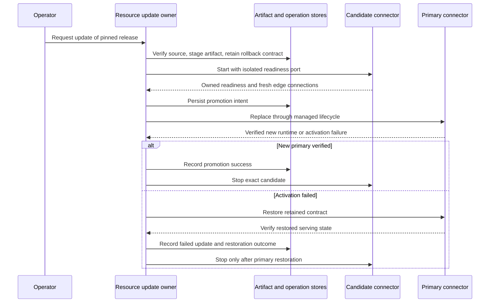

# Resource Deployment Contract

This document defines the target contract for taking a resource from a source
checkout to a supported deployment target, including native desktop bundles.
It is the design authority for schema, template, control-plane, and
`scenario-to-desktop` work. The `deployment` shape below is implemented by the
resource manifest parser and required for every active resource's desktop
profile.

## Why This Contract Exists

A Go implementation alone does not make a resource deployable. A resource may
still depend on Bash, a local Go toolchain, Docker, a GPU, a proprietary host
tool, a cloud account, or a Linux-only capability. Those facts must be visible
before a scenario is bundled, not discovered by an end user after install.

The target model separates these questions:

```text
Archetype  → Which deployment modes are plausibly feasible?
Resource   → Which modes does this particular resource support and require?
Readiness  → Is that claimed support implemented and evidenced today?
```

An archetype provides a feasible envelope, not an unconditional promise. For
example, `cloud-api` is normally a good desktop fit, but a provider may still
need network access, credentials, or a region-specific entitlement. A
`managed-service` may be usable on Windows with Docker Desktop, but that is not
the same claim as a native, self-contained Windows service.

## Terms

### Deployment target

A target is a context in which a resource may be used, such as `desktop`,
`server`, `cloud`, or `remote-client`. A target includes OS/architecture where
relevant; "desktop" is not one platform.

### Deployment mode

The mode says how the resource reaches and runs on that target:

| Mode | Meaning |
|---|---|
| `bundled-client` | A signed Go client/configuration component ships; no local service is owned. |
| `bundled-service` | A signed controller and a separately pinned server binary ship; the desktop runtime uses an app-private background component unless the embedding application has explicit shared-use consent and a broker-issued scoped binding. |
| `native-host-tool` | The resource uses a separately installed host executable after discovery/version preflight. |
| `docker-desktop` | The resource requires Docker Desktop or Docker Engine; this is an explicit conditional path. |
| `remote-service` | The bundle validates and connects to a user- or organization-managed endpoint. |
| `manual` | Vrooli can document/validate prerequisites but does not own lifecycle. |

### Host requirement axes

Every host tool, safeguard, and resource carries two independent declarations.
They are inputs to desktop admission; neither is an informal label.

| Axis | Values | Meaning |
|---|---|---|
| `privilege` | `none`, `user`, `elevated` | The maximum privilege needed to install or operate the requirement on a Vrooli-owned host. `elevated` work is confined to the explicit project setup boundary. |
| `bundling` | `vendorable`, `host-required`, `prohibited` | Whether a desktop application may supply the requirement itself, must discover it on the target, or must never ship it. |

`privilege` and `bundling` answer different questions. For example, a package
may require elevation to install on Linux yet still be vendorable; a host
safeguard is elevated and prohibited from bundles. A required resource that is
not eligible for a target is recorded as a named build limitation, while its
runtime readiness remains terminal rather than silently degraded.

### Support status

| Status | Meaning |
|---|---|
| `supported` | The mode is intended to work on this target and has required evidence. |
| `conditional` | It works only with explicit host requirements, permissions, hardware, or user setup. |
| `degraded` | The scenario can still run, but a declared capability/fallback changes. |
| `unsupported` | The target cannot satisfy a required resource at runtime. A validation artifact may still be built with an explicit limitation, but it is non-promotable and the runtime must refuse the unavailable service. |

### Deployment readiness versus maturity

Deployment readiness is an automatable target-specific admission check.
Resource maturity is broader: it also covers architecture, configuration/data
migration, capability correspondence, maintainability, and consumer evidence.

Do not infer one from the other. A resource can be M5 for a Linux server-only
contract while correctly reporting `unsupported` for native Windows desktop.

## Declared Inputs and Derived Verdicts

The manifest boundary is deliberately one-way: owners declare facts, and the
deployability resolver computes conclusions from those facts. A computed value
must not be copied back into a manifest as if it were an authored claim.

| Manifest surface | Declared input | Derived verdict/evidence |
|---|---|---|
| `resource.json` | `driver`, `platforms`, `bundling`, `privilege`, `requirements`, `deployment.profiles` | Per-resource deployability, supply eligibility, platform gaps, and provenance digest |
| `tool.json` / `safeguard.json` | `platforms`, `bundling`, capability and capability role, acquisition/handler data | Capability peer resolution and host admission verdict |
| `service.json` | dependencies, tier requirements, adaptations, secrets, artifacts, overrides | Tier/OS verdict, aggregate requirements, ordered reasons, and stale status |
| operator state | trusted-base and core-seed grants | Closure validation and trusted-base membership |
| native gate evidence | observed machine, OS, target, run result | Verified cross-OS evidence; never an input to the manifest |

`portability_tier`, tier `status`, tier `fitness_score`, tier `constraints`,
`aggregate_requirements`, analyzer identity, and analysis timestamps are
derived outputs. They are not resource or scenario manifest fields. Persisted
reports carry analyzer identity, computation time, and an input digest so a
consumer can distinguish a current prediction from stale evidence.

The capability ledger is a generated readout, never an authored manifest. Run
`vrooli capability ledger --json` to derive per-OS implementation, mechanism,
and peerless status from the checked-in tool and safeguard manifests. The
related `vrooli capability fleet` queries derive scenario blockers, Docker
requirements, peerless capability use, tier-upgrade candidates, and the
desktop-bundling verdict from the same resolver inputs. Do not copy those
results into `service.json`, resource manifests, or a prose table.

## Native Artifact Principle

Go is a build-time tool, not a required dependency of a deployed resource.

```text
CI/release environment (has Go)
  → cross-builds signed resource artifacts per OS/architecture
  → packages binary + sibling manifest + build metadata

Desktop device (does not need Go or Bash)
  → receives the matching verified artifact in the desktop bundle
  → desktop runtime starts it directly or uses its typed control contract
```

The current project bootstrap uses this same broad pattern for `vrooli`: a
small bootstrap selects a platform artifact, authenticates the signed release
manifest, verifies checksums, and installs a prebuilt native binary. The
current POSIX bootstrap uses `/bin/sh` and `curl`, but not Bash or Go. A native
desktop installer can avoid even that bootstrap because it contains the
verified artifacts itself.

`cli-installer` remains useful for source/developer workflows: it builds a Go
module, writes a sibling manifest and build metadata, and supports freshness
rebuilds. It is not the deployed-desktop installer. See
[`packages/cli-core/README.md`](../../packages/cli-core/README.md).

### One acquisition contract

The arrival of a native artifact is separate from the launch artifact. The
`managed_service.acquisition` block is the source contract: it declares an
ordered `targets` list, a URL or digest-pinned OCI image, download digest when
applicable, archive/layout, launch path, and a `when` predicate over host
facts. The `managed_service.artifact` block remains the launch gate and holds
the executable checksum or tree digest.

The same contract is consumed by `vrooli resource install`,
`vrooli-dist --resource-artifacts`, and the desktop bundler. `os` and `arch`
are build-time facts. GPU and other machine facts are runtime-only and cannot
be used by a `vendorable` item. This keeps signed releases deterministic while
allowing host-required resources to resolve a more precise target on the
machine where they run.

A managed private or user-hosted restart acquires and verifies the declared
artifact before stopping the serving instance. An unavailable download or
checksum failure preserves that instance and its companions. This preparation
step does not prove that a candidate will start or pass readiness; rollback
after an activation failure requires a separate verified recovery path.

Verified artifact staging and version reporting are implemented for cloudflared.
Its host requirement delegates to SDA and the resource acquisition owner; the
serving process remains unchanged. Managed-service status verifies retained
running bytes independently of desired/staged release availability. The CLI
reports those versions separately, so a new declaration cannot manufacture an
outage. [CODE: internal/resources/managed_service_artifact_owner.go]
[CODE: internal/cli/resourcecli/reports_proto.go]

Frequent monitoring uses `vrooli resource status --health-only --json` (or a
named resource with the same flag). This explicitly observes native process
ownership, companions and the selected health probes without hashing entire
installed runtime trees. Managed-service records report
`artifact_verification: not_evaluated` and do not claim a newly verified staged
version. Installed/running health does not authorize artifact activation.
The default status path still audits current retained bytes; acquisition,
staging, start and restart keep their full verification gates. Typed callers use
`ResourceHealthStatuses` or `ResourceHealthStatus` for monitoring, and retain
`ResourceStatuses` / `ResourceStatus` for current integrity inspection.

#### Target: recoverable updates for stateless managed services

The composed control-plane owner now implements the Linux stateless update path
below, with Cloudflared as its first live target. Artifact staging and ordinary
restart remain separate operations. Authenticated remote continuity, legacy
connector retirement, enrollment and native safeguard activation rollback still
require their outstanding delivery and qualification.
The managed-service owner in the control plane owns the operation; scenarios
observe and request it. Tool installation, resource launch, tunnel recovery and
the UI must use that same artifact and operation identity.

The opt-in declaration is `managed_service.update_policy` with
`strategy: rolling-stateless` and `candidate_port` naming the single remapped
port. Declaration validation is implemented: the initial strategy requires
static checksum-pinned URL artifacts and only the managed-private provider.
It initially supports single native executable files. It rejects bootstrap,
declared data bundles/data-path templates, environment files, account switching,
legacy process-limit declarations, target runtime environment overrides, companions,
exclusive groups and runtime environment commands. An explicit HTTP 200
readiness probe must address the remapped loopback port, and every launch
variant must render that port. The resource and launch validators use the same
port environment-name projection. These are declaration checks; live process,
listener, readiness and recovery proofs remain required before promotion.
Both braced and bare environment references are checked. Update contracts
cannot override owner `RESOURCE_*` / `VROOLI_*` variables or depend on undeclared
caller environment. Declared service variables and controlled owner paths remain
valid inputs. Candidate config, cache, logs and credential directories must be
isolated from serving-instance paths before any materialization.

The control plane also contains a checkpoint model and resource-local file
repository in `internal/resources/managed_update_workflow.go` and
`managed_update_store.go`. These foundations are implemented and race-tested;
the composed runner now connects admission, rollback qualification, candidate
launch, primary promotion, durable serving publication and bounded restoration.
Isolated native drills qualify those paths; the real connector and authenticated
remote continuity still need their own witnesses.
Checkpoints retain frozen
launch declarations, platform-selected artifact identities, OS process
incarnations and logical credential references. The repository admits one active
operation, compares revisions, reconciles identical request retries, and refuses
a new automatic attempt of a failed release. It never automatically discards
old request keys: the initial 128-record / 16 MiB capacity fails closed until a
governed archival policy preserves deduplication. An inspection read does not
authorize resumption: `Confirm` durably recommits the exact reconstructed
revision before the effect owner reconciles native identity. File and directory
sync failures return an unconfirmed-commit error even when a rename is visible.
Durable writes reconfirm all ancestor entries on retry, including physical
ancestors behind directory aliases. Merely seeing a directory from an earlier
failed acknowledgement does not establish that its entry was synced.
A terminal receipt proves the health observation recorded at its commit time;
it is not a claim about current health.

Artifact retention now pins both frozen releases for every nonterminal update,
even when no process is alive. An unreadable update ledger refuses pruning and
ordinary lifecycle mutation. Ordinary start, restart, stop and uninstall, including
the shared broker's owner path, check that ledger under the resource lifecycle
lock. Terminal receipts release this operation fence. These interlocks are
implemented and integrated with the composed promotion and recovery runner.

An unresolved rollback reuses its recorded intent while the native identity is
still live or unknown. A new rollback identity requires a durable retirement
checkpoint with fresh, exact-identity evidence that the old native unit,
processes and listener are absent. The checkpoint retains all retired identities
and refuses reuse. The initial limit is four restoration attempts per operation;
exhaustion leaves recovery unresolved and preserves the candidate. Caller death
and a missing launch acknowledgement do not establish quiescence. This is the
implemented checkpoint contract; producing its native proofs remains the effect
owner's obligation.

The platform owner now exposes a Linux-first `ServiceIntent` / `ServiceRef`
boundary for the composed runner. It reuses bounded operations' exact native
invocation and recursive process-tree proofs, with a distinct service namespace,
resource ceilings and an explicitly infinite serving lifetime. Bounded jobs
retain mandatory deadlines. Native host drills recovered the service from its
persisted intent after dispatcher exit and forced dispatcher death, then proved
owned descendant cleanup and unit release. A manager transport interruption
leaves the outcome unknown; it never acknowledges cleanup. Other backends remain
unsupported and fail closed. This primitive is connected to isolated candidate
execution and primary promotion. A separate bounded supervisor worker now resumes
already-admitted requests without delaying scenario lease renewal. Its blocked-owner
heartbeat and panic-containment tests pass. On the receiving host, the supervisor
completed the same native primary invocation after the foreground owner was
forcibly killed while holding the resource lifecycle lock. This qualifies that
connector operation's takeover; it does not establish authenticated remote
session continuity.
Role checkpoints now retain that native intent/ref and bind it to the resource
instance, exact root PID and process incarnation. A committed native invocation
cannot be replaced by a later observation. Receipt identity validation is pure;
it neither asserts current ownership nor qualifies native effects on another OS.

The resource owner also provides `RetainManagedServiceRollbackArtifact` for
single-file legacy launches. It opens the actual running image, streams and
verifies its retained checksum before publication, then reconfirms serving
ownership. It leaves the supervisor record and process unchanged. Directory
launch adoption remains unqualified. Retaining image bytes does not adopt a
launch contract or admit an update; those remain separate obligations.

`ObserveManagedServiceLegacyLaunch` now verifies exact argv boundaries/order,
declared environment, the canonical credential-file path's current equality
with logical authority, actual retained image and native resource scope. It
reconfirms the serving process and supervisor bytes without adopting or stopping
them. Credential comparisons stay in memory; receipts retain only logical IDs
and optional authority-version metadata. The current connector's credential has
no version metadata. A live-file binding is not proof of every historical input:
the observation explicitly requires isolated rollback qualification. Operation
credential pinning now copies the union of logical fields into private mode-0600
files before admission, with keyed integrity over the exact contracts and bytes.
Receipts contain metadata and an integrity digest, never secret values. Rotation,
corruption, missing files and lost acknowledgement tests verify that an admitted
operation cannot silently recapture a different credential. This is a runtime
snapshot, not invented authority-version metadata.

Historical primary checkpoints can retain a typed `ServiceScopeRef`, bound to
their exact resource scope, PID/start time, native invocation and cgroup inode.
Replay and transitions cannot replace that identity. Its Linux stop boundary
uses a held PID handle for graceful termination and the held native cgroup
directory for forced descendant cleanup. It never sends a stop to a possibly
recycled PID or unit name. Native fixtures proved later-child cleanup, repeated
stop after scope removal, refusal of stale receipts and refusal after the actual
scope name was reused by another invocation. An adversarial stale-incarnation
case initially reached a force-stop path; the corrected implementation refuses
that inconsistency before signaling. Kernfs removal is checked through the held
directory identity, including its kernel deleted-FD link.

The resource-domain original-stop boundary additionally rechecks the candidate's
current full readiness before any original stop. A real-process fixture changed
the candidate to HTTP 503 after its durable ready checkpoint: the original stayed
alive. Returning HTTP 200 permitted only the exact original stop and left the
candidate healthy. The composed runner additionally keeps a qualified old-image probe live until
promotion or restoration is verified. It publishes the exact native serving owner
with a durable compare-and-swap before cleaning shadows; ordinary stop uses that
owner and reconciles a lost native release acknowledgement. Isolated native drills
now pass successful promotion, failed-candidate preservation, failed-primary
restoration, caller death after primary dispatch, and a second sequential update
from a published native owner. The receiving connector has also completed a real
2025.10.0 to 2026.10.7 promotion, a receipt-backed rollback, a subsequent promotion,
and forced-caller-loss continuation. A separate live drill stopped only the exact
new primary during startup, with both shadows freshly healthy: the owner restored
2026.10.7, recorded `failed_restored`, and released the failed primary, shadows and
capacity reservation. The restored connector's actual image and four fresh edge
connections were verified. The public resume command retains the failed outcome
and exits nonzero. These observations do not prove authenticated remote API or
terminal continuity, and the separate legacy root connector remains live pending
route coverage and safe-retirement evidence.

Additional isolated native fixtures cover loss of every update role after
forced caller death and loss of the original after admission but before owner
execution. Fresh owners respectively restored the retained image and completed
the update, retaining exact exec fences and releasing fixture units. These are
total-process-loss proofs on the current kernel, not host-reboot or changed
kernel-namespace qualification.

For retained process states, native release reconciliation now also binds the
root to its recorded `boot-id:start-ticks` incarnation. Once both the exact
native unit and cgroup are absent, a different validated boot excludes that
old root even if the current host reuses its PID and start ticks. Same-boot
roots, unavailable manager/boot observations and remaining native ownership
still prevent release. Legacy callers and lost launch acknowledgements without
a retained process state keep the conservative PID/start-ticks check. A focused
namespace-change regression covers this decision; it is not a host reboot drill.

Native-unit absence after ambiguous submission is not permission to redispatch
an intent. The effect runner must fence future resource exec before acknowledging
quiescence, including a late native-manager submission. Caller cancellation,
launcher reaping and a missing unit alone do not establish that fence. The native
service primitive does not supply a domain exec fence by itself.
The resource-local exec-fence store is now implemented: preparation creates no
process permission on its own; a wrapper may consume one durable claim after
checking the admitted role, and revocation permanently blocks later claims.
An unconfirmed claim returns no exec permission. Its native invocation remains
retained after revocation. Duplicate JSON fields, malformed identities and owner
path mismatches fail closed. A native host probe submitted a fixed wrapper after
revocation and verified that its resource marker was never executed; the exact
unit was then stopped and released.
The fence also retains the first exact native delivery rejected after revocation,
with its observation time. Lost audit acknowledgements never restore permission.
This bounded owner receipt supplies rejection evidence independently of journal
delivery; a native exit status alone does not prove which wrapper check rejected it.

The production wrapper now validates the exact admitted starting role, the native
root PID and incarnation, frozen launcher image, explicit native specification,
private ownership token and retained resource checksum before consuming that fence.
It executes the verified open ELF image rather than resolving its pathname again.
Unsupported image execution has no pathname fallback. The launcher itself is
retained from the executing control-plane image before dispatch, so a later CLI
installation does not silently change that role's wrapper. Runtime receipts retain
non-secret paths, the remapped port and service ceilings; they contain no token
value or inherited caller/agent environment. The initial ceiling is 512 MiB,
128 tasks and CPU weight 100. This is distinct from legacy process-limit metadata.

Each role has separate home, config, cache, logs, state and credential directories.
The wrapper retains operator context to locate its pinned operation inputs; the resource
exec receives its private home, so implicit application defaults do not share
the operator's home files.
Preparation retries retain the same token, port and native intent. Cyclic or
undeclared environment inputs and directory aliases within a role fail closed.
The internal `managed-update-candidate` command advances only a request already
admitted in the resource-local ledger. It commits before its sole dispatch edge;
subsequent calls reconcile the same intent and never redispatch because a native
unit or caller acknowledgement is missing. Exact image/argv/environment/native
ownership, exclusive listener PID attribution and HTTP 200 readiness are checked
before the candidate-ready checkpoint. Declared readiness gauges are fetched from
that same loopback listener with bounded responses and no redirects or proxy. A
gauge must be one finite, unlabelled sample without an explicit timestamp; missing,
duplicate, stale and insufficient samples fail closed. Ready-state rechecks return the original
durable receipt; promotion still needs its own fresh proof. This candidate path
never stops or publishes a primary and is not an update-admission command.

Isolated native host drills exercised the installed production CLI, verified
resource execution and HTTP readiness at the same native root PID, rejected an
actual delayed submission after revocation, and reached durable candidate-ready
state through the candidate owner. Repeated candidate reconciliation retained the
same intent and invocation. A stopped/revoked candidate did not become ready or
redispatch. The fixtures' original serving records are synthetic: these results
do not qualify actual connector continuity, a promotion, rollback or remote access.

The supervisor now records the OS process incarnation for new launches. A live
matching ownership token continues to identify older launches. An unavailable
or cleared environment can use executable provenance only with the recorded,
matching incarnation; an executable path alone cannot establish launch
ownership, and a contradictory token is refused. Older launches with neither
proof need explicit ownership reconciliation before lifecycle mutation.

Eligibility is explicit. The service must declare a stateless update policy,
checksum-pinned artifacts, a readiness probe and a parallel candidate probe.
The first implementation must reject data migrations, destructive bootstrap,
unknown serving ownership and unsupported update strategies. Ordinary resource
restart remains available for resources without this update policy.

The source contract remains `managed_service.acquisition` and
`managed_service.artifact`. A host-tool adapter may delegate acquisition to
Scenario Dependency Analyzer and inspect the resource-owned artifact; it must
not keep an independent downloader, version pin or PATH-based success claim.
Review and record new dependency sources through the governed owner.
Archive integrity and the extracted executable/tree digest are separate proofs.
Platform claims must match actual declared and qualified targets.

Parallel launch admission reserves the peak additional RAM for three bounded
roles (qualification, candidate and primary/restoration) through the canonical
capacity owner. Each role has a 512 MiB native ceiling. Protected pending RAM
reservations remain above measured resident usage, preventing concurrent strict
placements from spending the same headroom. Strict no-reclaim decisions and
recording share a cross-process ledger lock; external reclaim callbacks never run
under it. No resident is evicted for an update. The ten-minute operation lease is
renewed during preparation and supervisor reconciliation; after a lapse, a new
row requires a fresh decision. The canonical capacity-ledger path is frozen in the budget, so a wrapper does
not reinterpret an absent caller environment as a different ledger. The wrapper
checks a current lease before and after its once-only exec claim; preparation
has a bounded thirty-second wrapper budget.
Only a terminal operation with verified cleanup releases the reservation. Ordinary
advisory admissions retain their existing policy; this does not assert global
memory enforcement for unrelated consumers.

`resource update-check <name>` now dispatches inspection by resource owner.
Managed-service inspection reports desired/running images, the latest operation,
declaration support and unknown evidence without retaining images or renewing
claims. `resource update <name> --request <id> --version <version> --sha256 <digest>`
admits an already-staged release for the supervisor to execute. It requires a fresh
supervisor running the same control-plane build. The supervisor records its own
build identity and process incarnation at session claim; inspection never
substitutes the inspecting CLI's identity, and historical missing metadata remains
unknown. Update admission also compares the actual open running supervisor image
with the requesting CLI image and reconfirms the process incarnation. Reuse the
request after a lost
response; `--action status|resume|abort --request <id>` operates on its frozen
checkpoint even if the current source manifest is unavailable. A failed release
requires a new request and explicit `--retry`. `--action rollback --rollback-of
<completed-request>` selects that qualified receipt's retained previous image,
with a new request and explicit version/checksum. It verifies the retained bytes,
requalifies the current image as rollback, and uses the same candidate/promotion
owner. It changes neither the desired manifest nor an old receipt. Missing,
changed, active or unqualified rollback sources are refused. Coding-agent update
semantics remain owned by the existing harness path.

Certain rejected admissions remove their private inputs and release only their
exact operation reservation while the lifecycle lock is held. A visible admitted
receipt, unreadable ledger or unconfirmed ledger write retains inputs for
reconciliation. An ordinary restart from a dead native serving record first
retires that exact native unit and its tree before publishing a replacement.
For enrolled Linux services, failed or unverified dedicated-scope placement
refuses recovery success and stops the newly launched root; it cannot silently
leave a reported recovered service dependent on its caller's scope.

After terminal cleanup, the native reconciler removes operation-wide private
credential snapshots and launcher copies. It preserves the canonical serving
role's runtime files, ownership token and credential copies. Retired role inputs
are removed only after fresh exact native quiescence and permanent exec-fence
revocation; immutable operation and fence receipts remain. A durable cleanup
receipt makes repeated passes cheap, and a later canonical-owner change permits
retiring the formerly preserved inputs. Cleanup refuses aliases and corrupt
receipts. Each pass rotates across at most four resources, using a short lifecycle
lock attempt and a separate bounded cleanup budget. A native sequential-update
and ordinary-crash-recovery fixture verifies both live-input preservation and
eventual retired-input removal.

The resource command surface must expose update inspection, execution,
rollback and reconciliation. Extend the existing `resource update` and
`resource update-check` dispatch by owner type. Keep coding-agent update
semantics distinct from managed-service update semantics. Inspection must
report desired, running and retained release identities, current operation,
eligibility and any unknown evidence. It must not mutate the serving process.

Before the first serving mutation, persist an operation receipt, the exact
source revision, and a credential-free rollback contract for the verified
current instance. Receipts store logical credential references and templates;
they never contain resolved credentials or a copied process environment. Private
operation files pin required runtime secrets independently of receipt metadata.
Retain the previous
artifact while rollback remains possible. Serialize operations with the
existing resource lifecycle and artifact locks.

Start a separately owned candidate using the verified new artifact and an
isolated loopback metrics/readiness port. For cloudflared, use the canonical
tunnel credential reference and verify the candidate's own fresh edge
connections. Both `/ready` HTTP 200 and a current
`cloudflared_tunnel_ha_connections` sample meeting the declared minimum of four
are required for the exact role. The
[2026.10.7 readiness implementation](https://github.com/cloudflare/cloudflared/blob/2026.10.7/metrics/readiness.go)
uses its active connection tracker; the same logic exists in the retained
2025.10.0 release. The gauge alone is insufficient: Cloudflare has documented a
[failed-dial accounting bug](https://github.com/cloudflare/cloudflared/issues/1633).
A listener or a Cloudflare Access redirect alone is insufficient.
The old primary remains serving until this candidate is verified.

Persist each transition before its destructive effect. Replace the primary
through the managed-service owner and verify its executable identity, owned
listener, readiness and fresh edge connections. Keep the candidate serving
until the new primary passes those checks. Stop the candidate only after
successful promotion or verified restoration of the previous primary.

If activation fails, restore the retained primary contract through the same
owner. Record the failed candidate separately from successful restoration;
rollback success is not update success. Prevent automatic retries of that same
failed release until an explicit retry policy or operator action admits them.
An interrupted operation must reconcile its exact primary and candidate
identities before another lifecycle action proceeds. Unknown process or
receipt state must preserve recovery material and report the uncertainty.
The native supervisor must recover an interrupted operation after its caller
dies; an in-memory goroutine is not the recovery owner.



Legacy system cloudflared services require explicit ownership reconciliation.
Do not stop one merely because a managed connector is ready. Establish the
tunnel identity and routes it serves, verify replacement coverage, then retire
it through the supported host-service owner while retaining rollback material.
Unresolved identity remains an unmet migration outcome.

Verification must include corrupt or unavailable artifacts, wrong executable
identity, readiness failure, failed restoration, caller death at each persisted
transition, repeated reconciliation and duplicate update requests. Live
qualification must witness the receiving client version and fresh connectivity,
plus authenticated remote API/terminal continuity. Source tests or public
login redirects do not replace those live witnesses. Scope host-verified claims
to tested platforms; retain unqualified platform cases explicitly.

Automatic updating is policy-controlled. Only explicitly enrolled services may
use it, with bounded retries, retained receipts and a verified rollback policy.
Update orchestration never creates operator authority or bypasses a human-only
approval. Native safeguard refreshes retain their existing control-plane owners
and must verify the running image after installation.

The watchdog executable owner now has a bounded current/prior pair, strict
durable publication receipts, staged and installed-image canaries, failed-image
suppression and independent native-supervisor recovery after caller loss.
This executable-publication recovery does not substitute for scheduler-definition
activation rollback or root CLI/supervisor self-update rollback. A completed
scheduled watchdog report separately carries its producer build and native
invocation so activation witnesses can be checked against the native unit.
See [Watchdog executable updates](../configuration/host/safeguards.md#watchdog-executable-updates).

##### Root control-plane activation target

Root CLI/API freshness and the governed local builder use the same canonical
target list: the selected command, `internal/`, shared Go packages and root
module manifests. Go sources and `go.mod`/`go.sum` changes invalidate the stamp,
including shared launcher changes that previously escaped the root source list.
This is conservative source freshness, separate from the narrower persistence
contract. It does not establish adoption by an already running process or a
complete inventory of every embedded non-Go asset.

Root CLI preparation now freezes a bounded candidate, verifies its Go package
role and native target, requires its embedded build and runtime-home identities through a version
canary, and publishes only the checksum-bound bytes. Basic version queries run
before host initialization. Prior canonical bytes are retained with a streamed
durable write. Preparation does not complete the native activation transaction.

`internal/coreactivation` now owns the bounded, strict operation receipt,
initialization witness, once-only native submission and worker claim, durable
revocation, restoration intent and failed-release suppression. Recovery retries
the same idempotent restoration after a lost acknowledgement. Missing previously
admitted state is an explicit conflict. Native fencing verifies the live root's
process incarnation, native invocation and recursive tree membership; recovery
requires a durable revoke and native quiescence before restoring artifacts.
Native definitions must retain the store location resolved at admission, so
opening the recovery store does not require the source repository.

Frozen input sets bind the prior/candidate image and unit definition, retained
worker image and canonical target layout by digest. Publication rejects changed
inputs or unexpected installed image/definition bytes. Cleanup is bounded to
reserved regular files, confirms directory durability even after a lost removal
acknowledgement, and preserves unexpected content for owner inspection. The
native worker verifies its actual running image through the process-image owner.
Ordinary installer, self-rebuilder and unit convergence paths check the operation
fence under the shared binary install lock; convergence lock waits honor context
cancellation. A failed fallback copy now stops self-rebuild publication.
The shared installation-ownership record also serializes its complete
read/merge/write transaction across processes and confirms directory durability;
independent binary/unit locks do not protect that shared inventory.

The opt-in current-host transaction fixture exercises caller SIGKILL, native
deadline termination of a lock-holding worker and its descendant, source
unavailability, fresh-process restoration, repeated reconciliation and late
worker rejection. It executes a retained worker and restores an isolated image
and unit definition, then retires their private inputs. This does not qualify
activation of the serving CLI or persistent-state rollback compatibility by itself.
Admission derives persistent-state compatibility from both frozen actual root
executables before native qualification or an operation commit, and rechecks
cancellation and its deadline afterwards. Equal hashes supplied in a proposed
record cannot substitute for executable evidence. Layout identity (the
runtime-home contract) is checked separately.

The bounded coding-agent worker declares its broker and admission records and
its versioned execution sidecar as the `coding-agent-recovery` persistence
owner. Deployment of the complete native coding-agent change is tracked
separately from its isolated native execution qualification.

###### Persistent-state contract

`persistent_state_contract_sha256` (`vrooli version --json`) answers one
question: can the serving image read everything the candidate writes before
the activation verifies? It describes what is stored
([`internal/statecontract`](../../internal/statecontract/doc.go)):

- Every persistence owner on the native root path declares its stored
  envelopes and format facts in `persistent_state.go` (`PersistentState()`);
  [`internal/app/runtime/statecontract.go`](../../internal/app/runtime/statecontract.go)
  lists the owners. Facts are named format-version constants, SQL DDL, witness
  bytes and samples of derived stored identities (timestamp layout, process
  incarnation, credential MAC framing, artifact cache keys).
- The executable reads the recursive compiled JSON shape of every envelope:
  each exported field's stored JSON key and `json` options, its type,
  promotion and field order (several envelopes are self-hashed by
  re-encoding). Go field names behind unchanged tags, unexported and
  `json:"-"` fields do not participate.
- Governed builders stamp, per stored named type, its enum constants and, for
  a custom JSON/text codec, its type declaration, its encoder source and the
  transitive same-package closure (constants, variables, types, functions and
  named methods) its codec methods reach (`buildinfo.PersistentStateBuildFlag`).
  A stored type from a checksum-pinned dependency module is bound by its
  version and sum. An unstamped executable, an uncovered stored enum or codec
  type, or a codec type missing from the stamp is unqualified.
- Whole-source owners hash their complete source: the activation store
  (`internal/coreactivation`), the watchdog (`internal/safeguards/emergency-watchdog`),
  coding-agent recovery (`internal/recovery`), the platform native
  operation, owned-service and containment identities, binaryfetch
  (`acquisition`: the acquisition declarations resources stores and the
  artifact identity digests the prior recomputes) and the resource storage
  root layout (`resource-storage`). They are the rollback
  machinery itself or keep their format in inline literals behind strict
  readers, and are rarely edited, so any edit there needs a rebaseline. The
  credential store (`secure-store`) is hybrid: its sealing, key-wrapping and
  unlock sources and the shared `internal/credentialpolicy` envelope are
  hashed whole, because their cryptographic framing lives in function bodies;
  the rest of `internal/securestore` is precise.
- The two SQLite owners (runtime registry, capacity) store untyped status,
  kind and reason strings that an older binary queries by value, so every
  package-level constant of their packages participates
  (`statecontract.ConstantSources`).
- Every other owner's package-level untyped string constant is classified in
  `internal/statecontract/notstored.go` as stored (`StoredConstants`: a status,
  kind, file name or format version) or not stored (`NotStoredConstants`: an
  environment name, a command verb, a message). Stored constants participate
  by name and value (`statecontract.PreciseSources`). An unclassified constant
  is treated as stored when the executable is built, and fails its package's
  `TestPersistentStateSourceChecks`, so it is classified during development.
  `NotStoredConstants` also lists tunables of the SQLite owners (for example
  `DemandAuditRetention`), which are otherwise stamped wholesale.
- The time layouts each owner formats and parses participate as a set, so a
  changed stored timestamp layout changes the contract. One field switching
  to another layout the package already uses elsewhere is not seen (a
  documented residual).
- The Go release (major.minor) participates; patch releases do not.

The builder also checks the owners' sources when it stamps, and any failure
makes the executable ineligible for automatic activation, with the reason in
its refusal: a format version field (json key `schema_version`,
`format_version`, `*_schema_version`, or an integer `*version`) written or
compared with anything but a named package constant; a version constant that
is not a fact of its owner; a stored vocabulary value written as a string
literal; and a custom codec that calls into another module package the stamp
cannot follow.

A stored vocabulary value is a word a reader branches on. In an owner package,
a field is vocabulary when it is declared with one of the package's own
string types or the package compares or switches on it against a constant or
a string literal; the compared words are what a reader accepts, wherever the
stored value comes from (this code, operator input, manifest data). A string
literal assigned to such a field (composite literal or assignment), compared
with it or used as its switch case is a violation (directly, or through a
local variable assigned that literal), and so is a literal passed where
`statecontract.StoredValueCalls` names a stored argument (process-ref
statuses, demand-audit operations). It must be a named constant of the owner,
which constant stamping covers. The builder records each candidate as
`importpath.Type.Field@file:line`; the executable keeps those whose field is a
string field of a type reachable from a declared envelope, so a literal on a
type no owner stores, or on a reason or message field nothing branches on,
is not one. The builder resolves a field's receiver from composite literals,
receivers, parameters, declared variables, range variables, field chains,
index expressions and the package's own call results; a field of another
package's type carries that package's vocabulary and is skipped. Each owner
package runs these checks in its own `TestPersistentStateSourceChecks`, and
`TestStoredVocabularyIsNeverWrittenAsALiteral` (`internal/app/runtime`) holds
composite literals of owner types anywhere in the repository to the same rule.

For the frequently edited owners, function bodies, comments, tests and
classified constants do not participate, so a behaviour-only change keeps the
contract and activates through `make install` with automatic rollback. Tests
keep the inventory honest: every struct with a format-version JSON key in the
native supervisor's or watchdog's import closure (and any `*version*` key in
an owner package) must be a declared envelope or carry a stated exemption;
every package on that path that calls a durable writer (the repository's
write helpers, whole-file writes, files created or opened for writing or
appending, SQL statements) must be an owner or a listed, reasoned writer; and
every `NotStoredConstants` entry must name an existing constant. The listed
writers say why a restored prior never reads what they write during the
window: the privilege broker's protocol belongs to its separately installed
daemon, credential recovery bundles are read only by explicit operator
recovery commands, removal receipts are never read back by a binary,
operator-session enrollment is already a cross-version contract with every
scenario API binary, and the rest write host configuration, caches,
temporary files or build outputs. Artifact leases and the credential store are
owners because reclamation and unattended unlock read them in other processes.

The resource manifest (`resource-manifest`) and the scenario CLI contract
(`scenario-contract`) are precise owners: resources stores their declarations,
so the words their validators accept are stored vocabulary.

Documented residuals: a value computed at run time (a function result or a
parameter, not a literal) written into a vocabulary field; a field whose
readers all reach it through receivers the builder cannot resolve; values
formatted into SQL text; and event types appended to the registry's
`runtime_events` log that nothing branches on (the demand audit, the only
reader by type, uses a stamped constant; lifecycle and ports name theirs as
registry constants too). A change of that kind must bump a declared format
version.

When the contracts differ, admission names each change by owner and stored
type and field, by fact, or as a whole-source edit.
`vrooli version --state-manifest` prints an executable's per-owner manifest
and the coordinator diffs both images' manifests. The opt-in drill
`VROOLI_STATE_CONTRACT_BUILD_PROBE=1 go test ./internal/app/runtime -run TestActualBuildsAdmit`
builds actual root CLI variants and checks the admitted and refused outcomes
through admission.

The companion binaries (`vrooli-api`, `vrooli-agent-launcher`,
`vrooli-policy-runner`) write through the same owners but have no activation
transaction. `make install` installs them only after the root CLI activates,
so a refused or rolled-back root never leaves them newer than the serving
image.

###### Operator rebaseline

A candidate that changes the persistent-state contract cannot use automatic
rollback. `make install` refuses it, lists the owner-level changes and says
that the operator must decide: the operator runs `make rebaseline`; an agent
must not, and reports the refusal instead. `make rebaseline` runs
`vrooli runtime update rebaseline` from the same checkout and installs the
companion binaries only after it succeeds. The transition:

1. builds the watchdog from the same checkout and qualifies it against the
   candidate (`ProbeWorkerIdentity`), qualifies the pair from the actual
   images (same runtime-home layout; only the state contract differs), shows
   the changes and asks for confirmation;
2. retains the serving root image, watchdog image and supervisor unit with
   checksums in `~/.vrooli/state/root-rebaseline/<id>/` (`receipt.json` is
   audit evidence only), outside the rotating fallback slots;
3. pauses automatic root updates when they are enabled now, and records the
   exact enrollment record its pause wrote;
4. installs the candidate through the atomic root installer;
5. publishes exactly the watchdog image it qualified, bound by digest, through
   the watchdog owner's receipts and canaries, without re-reading the live
   tree;
6. converges and restarts the native supervisor onto the candidate, unless it
   already serves it with a fresh lease;
7. verifies the serving image and a fresh, fleet-renewed supervisor lease;
8. restores enrollment while a rebaseline's pause is still in effect;
   enrollment qualification rechecks the watchdog/root contract pairing, the
   recovery timer and native readiness.

No file grants anything on a rerun. Every run re-derives its state from the
installed images: while the candidate is not serving, a run is a fresh,
fully qualified and confirmed transition; once it serves, a rerun only
finishes steps 5-8, each idempotent and verified against live state. A pause
stays in effect only while the enrollment record is exactly the one it wrote;
if the operator enables or disables enrollment afterwards, that decision
stands and the marker is cleared. While a pause is in effect, a rebuilt
candidate with the installed build's contract continues the transition
without asking again, and the next successful rebaseline restores
enrollment. Every stop and refusal reports the live enrollment state and never
promises automatic rollback while enrollment is paused. The run uses the
checkout it is started from: the candidate must be inside it, and a
`VROOLI_SOURCE_ROOT`/`VROOLI_ROOT` override that names another checkout is
refused.

It refuses a candidate that keeps the contract (use `make install`), a
runtime-home layout change, an unstamped image, a watchdog that does not pair
with the candidate, and a host with an unresolved activation. Agents are kept
out in layers: the agent policy runtime treats `make rebaseline`,
`vrooli runtime update rebaseline|enroll|disable|retry` and the watchdog's
`--enroll-core-updates`, `--disable-core-updates` and `--retry-core-update`
modes as operator-only, wherever the binary lives
(Claude Code's PreToolUse hook asks the person at the keyboard, or denies in
an unattended session; Codex hook enforcement is a pending operator decision,
see [the agent policy runtime](../architecture/agent-policy-runtime.md#operator-only-commands)),
and those commands, the watchdog modes included, refuse inside a coding-agent
session (`agentscope.SessionEvidence`): the canonical caller detector
(`cliutil.DetectCallerKind`: launcher identity, sandbox and per-harness
markers) or a launcher-minted `vrooli-agent-*.scope` in its cgroup path. The surrounding `vrooli-agents.slice` is not evidence, because
web-console operator panes live there too. These layers and the terminal prompt stop agents that follow
the rules; they are not an authority boundary against a same-user process. A
verified-human decision gate needs a control-plane-readable notification-hub
decision, which does not exist yet; its specification is filed as Scenario QA
bug `knw-1794105623434595536`. It has no automatic restoration, because the prior may
not read what the candidate wrote; the retained images and the owner tools
below support a reviewed manual return.

The first activation after this contract format was introduced is always a
rebaseline: an image built before it reports only a whole-source digest, so
every candidate differs from it once. The same command covers it; step 5
republishes the watchdog, which must carry the new contract because the
coordinator requires the watchdog's contract to equal the serving root's.
Because the activation machinery and native identities are hashed whole, an
edit there also needs a rebaseline.

An older terminal activation record remains historical audit evidence after a
rebaseline. Identify the new baseline through the installed root and watchdog
identities, the loaded supervisor image and its fresh lease; do not relabel the
older record as a new activation.

A retained maintenance installer must be compiled before source loss with the
canonical `RuntimeHomeBuildFlag`; its entrypoint pins that snapshot before file
mutation. `vrooli-atomic-install SOURCE DEST EXPECTED_CURRENT_SHA256` compares the
current candidate or already-restored prior bytes under the same canonical
binary-install lock. An unknown replacement is refused before fallback rotation.
The guarded root path requires automatic enrollment to be disabled; it does not
bypass enrolled activation or root executable-role qualification.

`emergencywatchdog.RestoreRetainedBaseline` is the focused watchdog owner API for
an explicitly reviewed retained baseline. It binds the exact current image,
whole verified receipt, retained image/canary, and all four watchdog/recovery
native definitions. It validates the retained definitions and refuses foreign
bytes or native overrides before publication. Known owned inactive/disabled
timers may be repaired; completion requires both timers enabled and active.
The supervisor's fifth definition remains with its existing convergence owner.
Its bootstrap guard prefers a valid compiled runtime-home digest over source;
invalid compiled metadata refuses instead of falling back. Guarded retained
convergence binds the executable, current definition and retained definition
hashes under the same install lock before its atomic file write, while ordinary
convergence preserves its existing contract.
The canonical previous-image slot first retains the actual current image and
stamp named by the new receipt; retained input may not be that rotating slot.
The target image is published and canary-qualified before exposing a six-field
`publishing` receipt. An old reconciler therefore no-ops on the original verified
receipt before target visibility, or verifies the already-visible target after
publication. It cannot turn a pre-copy restoration into a failed release.
Restoration writes a new honest publication using the original six-field receipt
codec; it never edits an old verified receipt backwards. Immutable previous
receipt and terminal evidence remain separate from that compatibility surface.

A bounded separate restoration journal binds partial writes to the exact
request. Normal watchdog update and generic interrupted-publication reconciliation
refuse while that journal is active. Exact replay completes known old/new bytes;
foreign receipt/image/definition state refuses further mutation. Completion and
lost-ack replay verify image, all definitions, native identity and timer health
before retiring the matching active journal. Complete fsynced history is
published without replacing any existing immutable evidence, so caller loss
cannot create a truncated final record. Old readers continue to accept the six
canonical fields and ignore completed sidecar history. Keep the journal-aware new supervisor loaded through watchdog restoration.
The manual reverse order is retained root/CLI image paths first, watchdog plus
its four definitions second, and the fifth supervisor definition/loaded process
last. Do not replace the running owner with an older owner while a restoration
journal is pending. Neither this API nor a retained installer is an
automatic cross-contract rollback policy or a general host-repair framework.

Historical coding-agent receipts keep their JSON format. New execution state
lives in its own versioned sidecars, with retained native worker images. Before
reversing this transition, stop new coding-agent admission and use the new owner
to prove every new native tree excluded and retire its inputs; preserve its
receipts. Then restore the retained images through the same atomic installer and
native owners, verify their serving identities and re-enroll. An old CLI ignoring
sidecars is not proof that their workers stopped. No stored-format rewrite or
operator-supplied digest is part of this transition.

A pre-initialization fence prevents an unverified candidate from using general
CLI commands to register sessions, repair shims or reach other state writers.
Its fixed native supervisor invocation is allowed only at the admitted claimed
activation/verification edge with matching running-image, build and state
identity. Version queries remain read-only, and the prior image remains available
for recovery. The guard resolves the compiled state location without pinning a
different global layout or requiring a source checkout. An isolated actual-CLI
probe qualifies frozen-image compatibility, rejects spoofed equal record hashes,
and confirms that denied commands and version queries create no runtime files.
The serving-root transaction below uses the same fence.
Governed project, distribution, self-rebuild and watchdog builds now carry the
canonical runtime-home snapshot. The contract owner validates its bounded
canonical encoding and permits only an immutable process pin; it does not guess
paths or override source discovery. Native supervisor startup pins this authority
before session, shim or source initialization, and its native working directory
is the user home. Watchdog reports also pin their compiled authority. Unstamped
development binaries retain source-bound behavior and have no qualifying digest.
Version probes expose the compiled authority digest without initializing user
state; ordinary native convergence checks it against the definition's source
authority before replacing a unit. Layout changes also invalidate freshness.

An isolated actual-CLI native probe starts from a frozen governed image with
both source hints, CWD and executable ancestry lacking a checkout. It verifies
the matching private registry lease and periodic heartbeat, then stops and
releases that exact native job. This qualifies bootstrap and lease renewal,
not source-dependent scenario builds, migrations or root activation rollback.

The Linux production transaction now connects the root installer/self-rebuilder,
runtime supervisor owner and independently installed watchdog. Its command surface
is `vrooli runtime update <status|apply CANDIDATE|retry CANDIDATE|enroll|disable|reconcile>`.
Status is read-only and remains available during candidate probation. Apply is a
one-shot operation; retry explicitly admits a previously suppressed release.
Enrollment durably routes canonical root installs and self-rebuilds through the
same transaction. Missing previously initialized enrollment state is a conflict.
Other CLI installations retain their existing installation owner.

Admission holds the watchdog publication lock, freezes the exact worker and both
native definitions, and requires the installed recovery image's verified receipt
and enabled native recovery timer. It derives definitions and identity through
bounded read-only probes in a private home, without inheriting caller source or
runtime state. A single deadline binds admission and the native worker's bounded
lifetime. Admission and recovery use operation-before-install lock order.

The worker publishes checksum-bound inputs and restarts only the fixed supervisor
unit. Success requires the running image, native invocation and registry owner to
agree, followed by a fresh heartbeat and renewal of the running managed fleet.
Existing operator drop-ins are bound by path/content digest and preserved;
changed or unreadable overrides refuse native effects. Restoration checks frozen
inputs before stopping anything, pins the exact supervisor cgroup, and proves it
quiescent before restoring the prior image and definition.

`vrooli-root-update-recovery.timer` runs the retained watchdog's fixed reconcile
entrypoint every minute and after boot. It requires neither a source checkout nor
a working candidate CLI. Recovery revokes the worker fence and excludes the exact
native worker before restoration. Terminal cleanup releases that native unit and
only the bounded reserved inputs. Failed image and source-build identities remain
suppressed until explicit retry; changing build timestamps cannot evade policy.
Caller cancellation stops observation without aborting or resubmitting the native
operation.

Current-host qualification includes a verified serving-root update, a successful
update after caller SIGKILL, and independent scheduled restoration after SIGKILL
of the caller, coordinator and exact claimed native worker at verification. The
last drill restored the exact prior bytes in approximately 32 seconds, recorded
`failed_restored`/`worker_lost`, retired the worker unit, and retained suppression.
Local Web Console, Agent Manager and Autoheal APIs remained healthy afterward;
the managed connector reported readiness and four edge connections. These
witnesses do not prove authenticated remote continuity, every destructive edge,
actual host reboot recovery or non-Linux runtime support.

The transaction preserves these obligations:

- One durable operation binds the admitted candidate, qualified prior native
  image, native unit definition, compatibility evidence and failed-release policy.
- The existing installer and supervisor convergence owner share that operation;
  ordinary competing updates cannot cross an unresolved activation.
- Activation runs under independent, bounded native ownership. A late worker
  must consult the durable effect fence before any native definition or process
  change. Caller loss cannot leave an unbounded activation child holding a lock.
- The independent watchdog can reconcile and restore the retained image and
  definition without a source tree, compiler, API, or working candidate CLI.
  An unexpected image or definition remains an explicit conflict.
- Success requires the admitted image and build to own the running supervisor,
  with fresh recovery/lease observations. Restoration preserves the failed
  update outcome and suppresses that exact failed release.
- Native rollback requires a qualified persistent-state compatibility contract;
  artifact bytes alone do not make database/schema rollback safe.
- Further qualification must cover interrupted dispatch, every persisted destructive
  edge, failed activation/restoration, caller death, source unavailability,
  changed boot identity, repeated reconciliation and competing requests.

Explicit automatic-update enrollment and operator authorization remain separate
from readiness, drain and compatibility proofs. Existing human-only decisions
retain their approval boundary.

#### Per-target acquisition kind

`acquisition.kind` sets the default source mechanism, and a single target may
override it with its own `kind`. This exists because one item can have genuinely
different upstreams per platform. PostgreSQL is the worked example: on Linux it
stages a digest-pinned OCI filesystem tree, because the official image carries
the shared libraries the server links against, while on macOS and Windows it
stages a checksum-pinned upstream archive, because no equivalent image exists
and the published archives are self-contained. Declaring one acquisition-wide
kind would force one of those two to be wrong.

Use a per-target `kind` only when the upstreams really differ. A single kind for
every target remains the normal case and the easier contract to read.

#### Per-target launch and bootstrap differences

Three fields express platform variation without a `runtime.GOOS` branch in the
driver:

| Field | Replaces | Use when |
|---|---|---|
| `acquisition.targets[].bin_path` | `artifact.entry_path` | The staged tree roots the executable differently per target |
| `managed_service.arguments_by_platform` | `managed_service.arguments` | A launch argument is meaningless or harmful on a platform |
| `managed_service.bootstrap.executable_by_platform` and `bootstrap.arguments_by_platform` | the matching `bootstrap` fields | The first-run tool or its flags differ per target |

Keys are `os` or `os-arch`; an exact `os-arch` key wins over the bare `os`. Each
override replaces the declared default entirely rather than merging, so the
effective value is readable in one place. PostgreSQL on Windows uses two of
these: `-k` names a Unix-domain socket directory, and Windows PostgreSQL has no
Unix-domain sockets, while `--auth-local` writes a `pg_hba.conf` `local` line
that exists only on Unix.

Managed services may also declare `data_artifacts`. These are non-executable,
checksum-verified inputs such as model files staged below `RESOURCE_DATA_DIR`.
They use the same fact-predicated acquisition contract and are installed by
`vrooli resource install` before the service starts, but are never accepted as
the supervisor's launch artifact. Keeping model delivery explicit prevents a
native server archive from silently depending on hand-staged model bytes.

## Pinned Runtime Principle

The Native Artifact Principle pins managed-service binaries by checksum. The
same determinism requirement applies to the container archetypes: a mature
`managed-service` or `managed-service` resource references every pulled image
by an immutable reference — a version tag at minimum, a digest preferred.

Floating references (`latest`, `stable`, `latest-*`) are not acceptable in a
normal path. With a floating tag, `install` (a pull) can silently replace the
running engine, which makes regressions indistinguishable from upstream
changes and makes two hosts running "the same" resource behaviorally
different. Upgrades must be explicit manifest/compose edits reviewed like any
other change, never side effects of a lifecycle verb.

Locally built images (a compose `build:` directive) are exempt: their content
is pinned by the repository's own Dockerfile and base-image pins.

Enforcement:

- the closed resource-driver validator rejects `managed-service` declarations
  unless an explicit operator override carries both a reason and an ISO review
  date (`vrooli capability conformance --declarations-only`;
  `internal/deployability.CheckResourceDeclarations`); this keeps the Docker
  driver available for control-plane observation while preventing new resource
  runtime dependencies from silently acquiring a daemon
- manifest validation rejects floating `runtime.image` references for
  `managed-service` resources (`internal/resources/manifest`,
  `ValidatePinnedImageRef`)
- a fleet lint walks `managed-service` compose files and their GPU overlays
  and rejects floating pulled-image references
  (`internal/resources/manifest/runtime_pinning_realmanifest_test.go`);
  grandfathered debt is listed there explicitly and must shrink, not grow

## Target `resource.json` Shape

Existing manifest fields remain authoritative for runtime, ports, health,
storage, environment, and host requirements. The target adds a deployment
section rather than hiding delivery behavior in shell installers.

```json
{
  "name": "example-resource",
  "template": "managed-service",
  "driver": "managed-service",
  "template_version": "3",
  "managed_service": {
    "provider_policy": {
      "target_defaults": {
        "control-plane": "managed-shared",
        "desktop-bundle": "managed-private"
      },
      "allowed_modes": ["managed-private", "managed-shared", "attach-only", "remote-vrooli", "managed-discovered"],
      "shared_reuse_requires_consent": true,
      "external_management": "forbidden",
      "external_access_capabilities": ["read-only", "read-write"]
    },
    "artifact": {
      "path": "bin/example-service",
      "version": "1.0.0",
      "bundle_artifact": "example-service_${os}_${arch}",
      "sha256": "0123456789abcdef0123456789abcdef0123456789abcdef0123456789abcdef"
    },
    "acquisition": {
      "kind": "url",
      "targets": [
        {
          "when": { "os": "linux", "arch": "amd64" },
          "url": "https://example.invalid/example-service-linux-amd64.tar.gz",
          "sha256": "0123456789abcdef0123456789abcdef0123456789abcdef0123456789abcdef",
          "archive": "tar.gz",
          "layout": "file",
          "bin_path": "example-service"
        }
      ]
    },
    "attach_health_path": "/v1/sys/health",
    "arguments": ["serve", "--config", "${VROOLI_RESOURCE_CONFIG_DIR}/service.json"]
  },
  "cli": {
    "command": "resource-example-resource",
    "adapter": { "kind": "go_module", "module_dir": "cli" },
    "artifacts": {
      "binary": "resource-example-resource",
      "manifest": { "location": "sibling" },
      "build_metadata": { "location": "sibling" }
    },
    "source_build": {
      "kind": "go_module"
    },
    "freshness": { "inputs": ["cli/**", "docs/**", "README.md", "resource.json"] },
    "distribution": {
      "kind": "prebuilt_artifact",
      "artifact_name": "resource-example-resource_${os}_${arch}"
    }
  },
  "deployment": {
    "profiles": {
      "desktop": {
        "windows": { "support": "conditional", "mode": "bundled-service", "architectures": ["amd64", "arm64"], "limitations": ["Requires a signed, target-specific service artifact and bundle smoke evidence."], "evidence": ["manifest-validation", "artifact-checksum"] },
        "macos": { "support": "conditional", "mode": "bundled-service", "architectures": ["amd64", "arm64"], "limitations": ["Requires a signed, target-specific service artifact and bundle smoke evidence."], "evidence": ["manifest-validation", "artifact-checksum"] },
        "linux": { "support": "conditional", "mode": "bundled-service", "architectures": ["amd64", "arm64"], "limitations": ["Requires a signed, target-specific service artifact and bundle smoke evidence."], "evidence": ["manifest-validation", "artifact-checksum"] }
      }
    }
  }
}
```

### Required information in a target profile

Every claimed profile must declare or derive:

- support status and deployment mode
- supported OS and architecture coverage
- delivery artifact or external dependency
- host requirements: Docker, GPU, microphone, administrator permission,
  entitlement, network, credentials, and so on
- capability-specific limitations and safe fallback/degradation behavior
- validation evidence required before the claim is admitted

The manifest must never use `supported` as shorthand for "might compile." A
support claim means the declared normal path is Go-native or a declared
external runtime, contains no Bash or source build requirement on the target,
and has the corresponding validation evidence.

## Archetype Baselines

Use these as starting policies. A resource profile narrows or qualifies them;
it cannot silently claim more than its runtime can deliver.

| Archetype | Best desktop mode when feasible | Typical limitation |
|---|---|---|
| `cloud-api` | `bundled-client` | Network, credentials, provider availability; not offline. |
| `native-cli` | `bundled-client` | Must cross-build and package the owned binary. |
| `managed-service` | `bundled-service` | The resource declares provider authority explicitly; a bundled runtime may only start a Vrooli-owned verified artifact. |
| `external-cli` | `native-host-tool` or bundled companion | Upstream binary, licensing, and version support determine feasibility. |
| `managed-service` | `docker-desktop` | Docker Desktop/Engine is a conditional host dependency. |
| `managed-service` | `docker-desktop` | Same host dependency plus multi-container resource cost. |
| `native-cli` | `native-host-tool` | Platform-specific install/discovery and permissions. |
| `native-cli` | `manual` | Never claim automatic lifecycle ownership. |

`managed-service` is the canonical contract for a Vrooli-owned local process.
It does not authorize a resource to adopt an arbitrary process or open port:
only a verified Vrooli-owned instance may be reused. An external endpoint is
always attach-only and may never be initialized, unsealed, stopped, or
rewritten by Vrooli.

### Bootstrap readiness for stateful managed services

Generic supervision proves only that a verified child process was started and
that its transport can be reached. A stateful resource must add its own
readiness transition before generic health can be reported to consumers. Vault
uses the following ordered states: `process-started`, `reachable`,
`uninitialized`, `sealed`, `unsealed`, and `usable`. An HTTP `501` from Vault
means `uninitialized`: it is reachable, but not healthy or consumable.

The resource-native bootstrap adapter owns initialization and recovery. It
stores recovery material only in supported platform secure storage, unseals an
already initialized service after restart, creates a scoped application
credential, and proves a harmless scoped operation before publishing the
service to a broker or application. Secure-storage failure, missing recovery
material, a sealed service that cannot be recovered, or a failed scoped probe
are terminal readiness failures; callers must not downgrade them to transport
health or silently expose a root credential.

Managed-service policies declare `target_defaults` rather than one static
default: `control-plane` selects the Vrooli-owned shared host, while
`desktop-bundle` selects an app-private verified artifact. An explicit provider
request may override the target default only when the mode is allowed; desktop
shared reuse also requires explicit consent. Non-service host-tool policies
continue to use `default_mode` because they have no desktop service lifecycle.

A shared-use lease carries no credential and never grants management authority.
After authorization, the resource-specific policy adapter may issue an
ephemeral credential for exactly that lease's app scope and expiry. The broker
persists ownership and leases, not bearer credentials or a shared root token.

`remote-vrooli` is not a direct resource endpoint mode. A thin desktop or
mobile client receives the scenario's API URL and leaves all resource calls on
the remote Vrooli server. A resource client running with this provider MUST
reject direct Vault endpoint operations rather than accepting `VAULT_ADDR` or
other endpoint overrides.

Attach-only use is explicit at runtime: the operator supplies a credential-free
HTTP(S) endpoint and the managed-service driver requests only the declared
`attach_health_path`. Successful validation does not register ownership or
grant start, stop, configuration, initialization, or unseal authority.

`managed-shared` means a verified Vrooli-owned **user resource host**, not a
network-shared endpoint. It owns bootstrap, recovery, upgrades, and the
credential-free broker state once per user. Its secure management material is
stored only through a credential-store adapter — a native platform store, or
the encrypted file store on a host that has none. The host must fail before
Vault initialization when no adapter can store a value. A mode-0600 plaintext
state file is not an acceptable fallback, because its protection is the file
mode alone. `managed-discovered` is reserved for a verified executable
candidate. It never adopts a running process or external
endpoint; after checksum/version or trusted-distribution verification, Vrooli
may supervise that executable with Vrooli-owned state and configuration.

### Credential-store adapters

Every supported platform has a native credential-store adapter, and every
adapter passes one shared conformance suite in
`internal/securestore`:

| Platform | Adapter | Value path |
|---|---|---|
| Linux | libsecret (`secret-tool`) via the Secret Service | value on stdin |
| macOS | Security framework (`SecItemAdd`/`SecItemCopyMatching`/`SecItemUpdate`/`SecItemDelete`) via cgo | value in a `CFData` |
| Windows | Credential Manager (`CredWriteW`/`CredReadW`/`CredDeleteW`) | value in a `CREDENTIALW` |
| Any host with no native store | Encrypted file store (AES-256-GCM per entry) under a key wrapped by the host TPM or an operator passphrase | value sealed in the file, key held outside it |

Every native adapter requires a logged-in desktop session, so a headless host —
a server, a CI runner, a Raspberry Pi — has none of them. The encrypted file
store is the floor under that host class. It is selected only when the native
adapter reports `ErrAbsent`; where a native store works it stays the authority.
A native store that is merely unreachable (`ErrUnavailable`) never falls back,
because splitting credentials across two backends according to transient
session health is worse than an honest degraded state.

No adapter places a credential value in a process argument. The encrypted file
adapter never writes a credential value that is recoverable from the file alone.
An AES-256-GCM sealed entry whose data key is wrapped by the TPM or by an
operator passphrase satisfies that rule: reading the file yields ciphertext,
and the key that opens it is not in the file. Native stores have
platform-specific semantics: a GNOME passwordless `[keyring]` file can be
readable as a GKeyFile even though Secret Service is the authority, and
`vrooli credentials doctor` reports that caveat explicitly. A mode-0600
plaintext Vrooli fallback does not qualify, because any root process, backup,
disk image, or wrong file mode recovers the value from the file by itself.
Owner-only permissions stay required on every file the credential path writes;
they are no longer what the encrypted protection rests on.

This amends, and does not reverse, the Tier-1 decision recorded in swarm record
`rec-72cedb904accee1c`, which removed plaintext local-store provisioning from
Secrets Manager. Vrooli-owned fallback storage remains encrypted; native
platform semantics are reported rather than silently overstated. Environment
variables are injection targets for explicit deployment/runtime configuration,
not a durable credential authority or an implicit fallback.

A darwin build without cgo reports an absent provider rather than failing to
build, and therefore reaches the encrypted file store like any other host with
no native adapter.

Adapters must keep three conditions distinct, because each has a different
operator action: the backend answered and holds no value (`ErrNotFound`), the
backend exists but is unreachable (`ErrUnavailable`), and this host has no
adapter at all (`ErrAbsent`). Collapsing them is what once let an unreachable
keyring session read as an unset API key.

Credential state never blocks a start. A resource whose credential cannot be
resolved reports unhealthy with a named remediation while the scenario runs;
see [Secrets and credentials](../configuration/secrets.md). Write paths are the
exception and stay fail-closed: durable recovery material is only written after
`securestore.ProbeWritable` proves the backend accepts a write.

The generic user-resource host stays resource-agnostic: it owns secure-store
readiness, broker state, loopback ownership checks, and bootstrapper
registration. Resource-native initialization, recovery material, credential
issuers, and control wiring belong to that resource's adapter. Vault is the
reference implementation of this boundary; generic lifecycle code must not
gain Vault-specific branches.

An attach-only resource must declare `external_access_capabilities`. A
read-write capability allows application data writes only; it never converts
the external resource into a Vrooli-managed service.

### Bundled-service provenance and lifecycle

`bundled-service` stages independent artifacts: the resource controller
and the server selected through `managed_service.artifact.bundle_artifact`.
The release pipeline verifies the signed Vrooli checksum manifest and the
manifest-pinned server digest before copying either into a bundle. The runtime
verifies both again before launch. By default, it starts only the plan-selected
server as a background, app-private component. An embedding application can
instead supply a user-consented broker resolver. The resolver must return an
already-authorized, app-scoped binding; the desktop runtime does not discover
host services, select a broker scope, or receive management authority. If that
binding is unavailable or rejected, the runtime uses the verified private
artifact. Scoped connection settings are injected only into the bundle's own
service environment and are never reported through status, logs, or telemetry.
Private state and logs reside under the application data root and are visible
through the authenticated runtime status and log surfaces; the resource does
not create a launcher entry or adopt a host process.

## Native audio resource contract

The audio stack follows the same managed-service rules, but its native runtime
artifacts have an additional portability constraint: a server binary that
loads sibling shared libraries is one artifact tree, not one executable.

- `resources/whisper` supervises the checksum-pinned whisper.cpp server and
  GGML model. Its platform claim is earned independently for each upstream
  target; an XCFramework or an upstream archive that has not been smoke-tested
  as a server is not macOS evidence.
- `resources/sherpa-onnx` owns the Vrooli HTTP/WebSocket adapter for Kokoro
  TTS, streaming STT, speaker operations, and source separation. The server
  bundle contains `server/sherpa-onnx-server` plus the matching sherpa and ONNX
  Runtime libraries under `lib/`.
- A sherpa executable bundle must therefore declare `layout: "dir"`, an
  explicit `entry_path`, and a deterministic tree digest. Its acquisition
  target must also provide the archive layout and `artifact_sha256`; the
  upstream sherpa runtime package alone is not the Vrooli adapter and cannot
  be substituted for it.
- A target remains explicitly `unsupported` until a target-native Vrooli
  adapter bundle is signed, published, acquired into an empty artifact root,
  and smoke-tested through the managed lifecycle. Cross-compilation and
  library availability are build evidence only.

This boundary keeps optional model data (voices, punctuation, speaker, and
separation models) as independently checksum-pinned data artifacts while the
supervised executable tree remains immutable and lifecycle-owned.

## Canonical Mature Source Layouts

All mature resources use the common Go-first skeleton. Generated binaries,
user configuration, secrets, state, logs, and data do not live in this tree.

```text
resources/<name>/
  resource.json
  README.md
  docs/
    OPERATIONS.md
    CONFIGURATION.md              # when configuration exists
  config/
    capabilities.yaml             # declarative capability contract, if needed
  api/internal/<domain>/                 # repo-owned seed assets only, if needed
  cli/
    go.mod
    go.sum
    main.go
    main_test.go
    integration_test.go            # when a runtime exists
    internal/
      ... Go implementation and tests ...
```

The archetype determines the content below `cli/internal/`, not whether it is
allowed to reintroduce shell helpers.

| Archetype | Resource-local Go specialization | Runtime files that belong in source |
|---|---|---|
| `cloud-api` | typed provider client, auth, policy, validation | no daemon or container files required |
| `external-cli` | discovery, version/auth/config adaptation | only declarative host-tool metadata |
| `native-cli` | command domains and owned capability implementation | Go executable code and tests |
| `managed-service` | service, config, migration, health, platform adapters | Go service code; explicit `*_windows.go` gates where necessary |
| `managed-service` | config renderer and Docker API/controller adapter | declarative image/volume/env metadata in manifest |
| `managed-service` | topology/config translation and readiness policy | declarative graph/template assets only when genuinely required |
| `native-cli` | discovery, permissions, launch/status integration | platform adapter code and docs |
| `native-cli` | validation and diagnostics | instructions/validation data, not fake lifecycle scripts |

The target layout declares a Go module, its manifest contract, and only the
runtime assets genuinely required by the selected archetype.

## Examples

### Cloud API: portable client, not a fake local service

```json
{
  "name": "openrouter",
  "template": "cloud-api",
  "driver": "cloud-api",
  "cli": {
    "command": "resource-openrouter",
    "adapter": { "kind": "go_module", "module_dir": "cli" },
    "distribution": {
      "kind": "prebuilt_artifact",
      "artifact_name": "resource-openrouter_${os}_${arch}"
    }
  },
  "deployment": {
    "profiles": {
      "desktop": {
        "windows": { "support": "supported", "mode": "bundled-client", "requires": ["network", "openrouter_api_key"] },
        "macos": { "support": "supported", "mode": "bundled-client", "requires": ["network", "openrouter_api_key"] },
        "linux": { "support": "supported", "mode": "bundled-client", "requires": ["network", "openrouter_api_key"] }
      }
    }
  }
}
```

### Docker service: Go-native controller, conditional desktop support

```json
{
  "name": "example-docker-resource",
  "template": "managed-service",
  "driver": "managed-service",
  "cli": {
    "command": "resource-example-docker",
    "adapter": { "kind": "go_module", "module_dir": "cli" },
    "distribution": {
      "kind": "prebuilt_artifact",
      "artifact_name": "resource-example-docker_${os}_${arch}"
    }
  },
  "runtime": { "image": "registry.example.invalid/example:<pinned-version>" },
  "deployment": {
    "profiles": {
      "desktop": {
        "windows": { "support": "conditional", "mode": "docker-desktop", "requires": ["docker-desktop"] },
        "macos": { "support": "conditional", "mode": "docker-desktop", "requires": ["docker-desktop"] },
        "linux": { "support": "conditional", "mode": "docker-desktop", "requires": ["docker-engine"] }
      }
    }
  }
}
```

This example describes the remaining Docker-service archetype only; it is not
the SearXNG contract. SearXNG is now a `managed-service` with a `composed`
acquisition tree and a `bundled-service` desktop profile, so its desktop bundle
does not require Docker. The Docker requirement remains visible for resources
that still intentionally use this archetype.

## Desktop Bundle Decision Model

`scenario-to-desktop` must build from the scenario's declared dependency graph,
not from a raw list of names or an assumption that every resource can be
embedded. For every required resource and requested target it should:

1. resolve the resource's deployment profile for OS/architecture and tier
2. evaluate host requirements and artifact availability
3. select a declared fallback only when the scenario permits it
4. produce an explicit bundle plan and an operator-facing decision

| Result | Meaning | Packager behavior |
|---|---|---|
| ready | Every required capability has a supported, evidenced route. | Include selected artifacts/configuration. |
| warning | A conditional/degraded route is valid. | Require acknowledgement; include remediation and limitation text. |
| ineligible | A required resource has no valid runtime route on this target. | Build an explicitly non-promotable validation artifact, record the named limitation in `resource-deployment-plan.json`, and keep runtime readiness terminal. |
| error | The plan or its verified inputs are invalid. | Refuse to create any bundle. |

Example: a Windows desktop request that needs a `managed-service` should report
that Docker Desktop is required. A resource declared `unsupported` may still
produce a non-promotable validation artifact with its limitation recorded; it
must not reach a healthy runtime unless the scenario explicitly accepts a
compatible fallback. The system must not discover this by trying to source a
Linux shell script during desktop startup.

## Desktop Runtime Boundary

The desktop runtime/supervisor is a thin, generic local host. It owns:

- verified bundle/update installation
- authenticated local IPC
- process supervision, health, logs, ports, data paths, secrets, and recovery
- OS integration such as app lifecycle, keychain, notifications, and autostart
- preflight and reporting of declared requirements/degradation

It must not build Go code, invoke Bash/PowerShell resource scripts, contain
scenario business logic, or reimplement each resource's configuration and
lifecycle semantics. Resource implementations and their typed contracts remain
the source of truth.

## Readiness Evidence and Validation

Before a profile can claim `supported`, require all applicable evidence:

- manifest/schema validation and a static no-shell/no-source-build check
- target artifact exists for the claimed OS/architecture
- artifact signature/checksum verification in the bundle/release path
- unit tests for configuration, platform gates, and fallback selection
- integration test of the declared runtime or host-tool preflight
- target-platform smoke test exercising one real capability
- scenario consumer smoke test when the capability has consumers

For `conditional` or `degraded`, test the unavailable/unsupported path too:
the user must receive a structured, actionable explanation before a broken
operation occurs.

## Agent Workflow

An assessment or implementation agent should read this document together with
[architecture.md](architecture.md), [resource-templates.md](resource-templates.md),
and [maturity-migration.md](maturity-migration.md).

For an individual resource, the agent should:

1. identify its current archetype and all normal shell/source-build paths
2. select the cleanest feasible deployment mode per target
3. record explicit support, requirements, limitations, and fallbacks
4. distinguish current readiness from target M5 capability
5. propose artifact, schema, template, control-plane, and test changes in that
   order; do not delete old paths before compatibility validation

For a scenario deployment, the agent should:

1. resolve all required resource dependencies and the requested target
2. produce `ready`, `warning`, or `error` for each dependency
3. explain host requirements, unsupported platforms, and permitted fallbacks
4. refuse to call a bundle portable merely because its Go sources cross-compile

## Implementation Status and Follow-up Sequencing

The contract's schema/types, archetype baseline validation, canonical
templates (including `managed-service`), fleet profiles, signed prebuilt
release artifacts, and desktop admission/staging path are implemented.
`scenario-to-desktop` verifies the release signature and selected artifact
checksums before it writes
`resource-deployment-plan.json` into a bundle; it refuses bundled profiles
without a supplied signed artifact root.

### Resource release handoff

### Release trust versus installer signing

Release trust proves that every bundled resource executable and vendored tool
is the exact byte set approved for a Vrooli release. It is not Windows,
macOS, or Linux installer code signing. A staged release contains one
deterministic `release-manifest.json`, listing every shipped file, its SHA-256,
role, platform metadata where applicable, and upstream-provenance evidence.

`development-local` verifies that manifest and every staged file, but does not
require a Vrooli authority signature. Bundles built this way are explicitly
non-promotable and must not be published. `production` additionally requires
`release-manifest.sig.json`, a detached RSA/SHA-256 envelope signed by the
project-managed release authority. `vrooli release-authority` generates and
retains the private half in the native credential authority and publishes only
the public trust anchor at `install/vrooli-release.pub`; releases identify the
signing key with `key_id`. Missing or invalid production signatures fail before
packaging. Installer code-signing remains separately optional and is documented
by scenario-to-desktop's code-signing guide. See
[`docs/configuration/release-authority.md`](../configuration/release-authority.md).

Release automation may verify the staged directory independently before
bundling:

```bash
vrooli-dist --verify-release-manifest \
  --release-artifact-root /path/to/staged-release \
  --trust-mode production \
  --release-public-key /secure/trust/vrooli-release.pub
```

`vrooli-dist --resource-artifacts` is the source-build boundary. It stages the
controller artifacts, any separately pinned managed-service server artifacts,
and a deterministic `SHA256SUMS` manifest. It deliberately does **not** create
`SHA256SUMS.sig`: the release signer is a separate authority and must sign that
exact manifest using the key whose public half is distributed with Vrooli.

For example, a Linux release operator stages the artifacts, has the release
signing system produce `SHA256SUMS.sig`, and only then passes the directory to
the desktop pipeline:

```bash
go run ./cmd/vrooli-dist --root "$PWD" --out-dir /secure/release-stage --resource-artifacts
# Release signing authority writes /secure/release-stage/SHA256SUMS.sig.
scenario-to-desktop pipeline run <scenario> --platforms linux-amd64 \
  --deployment-mode bundled --resource-artifact-root /secure/release-stage --wait
```

An unsigned directory is useful for inspection but is intentionally not
deployable. This prevents a developer machine from substituting locally built
resource bytes for an authorized release.

The control plane now has a managed-service driver. It validates a relative,
manifest-pinned artifact, verifies its SHA-256 before direct argv execution,
and persists only credential-free instance/lineage state. It deliberately
refuses to manage attach-only or shared providers without their respective
broker paths. A target must also provide a process-ownership verification
adapter before it can claim managed lifecycle support; a PID, port, or marker
file is never enough evidence on its own.

The remaining work for a conditional bundled-service target should sequence as
follows:

1. run the target-host smoke test against the signed release artifact on every
   claimed OS/architecture pair, then promote only the verified profile to
   `supported`
2. exercise private, shared, remote, and attach-only provider paths through
   their declared consumer contracts
3. migrate the fleet using the maturity playbook and delete transitional shell
   paths only after validated replacement
