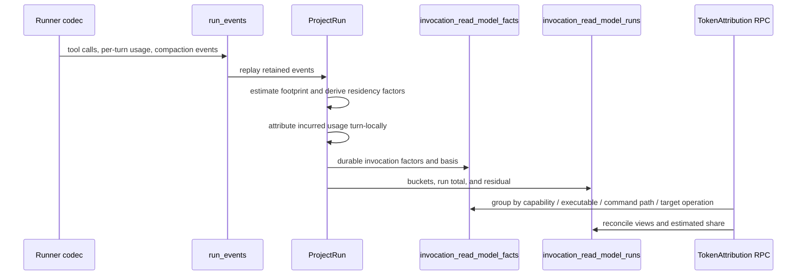

# Measures and Operational Stats — CLI and API Reference

The Phase 3 operational-stats surface is the read-side of the typed-event
log. Every metric on this page is derived from `run_events` rows whose
`event_type` is in the typed-operational set (see
[Event Taxonomy](../internal/EVENT_TAXONOMY.md)) — none of it reads from
the live SQL run tables, so the same query answers "what just happened"
and "what happened last week" the same way.

The HTTP endpoints, CLI commands, and the UI's Health (`/observability`) page sit on
the `internal/health` audit store and the Measures service.

## One command per question

Every analytical question has exactly one command. `agent-manager measures list`
prints every measure the API declares (id, question, parameters);
`agent-manager measures get <id> [--window TOKEN] [--param name=value]...`
runs one. `<id>` is `domain.name` or the bare name with dashes
(`run-volume` for `throughput.run_volume`). There are no per-measure verbs: a
measure the API declares is available to `get` and `list` with no CLI change.

| Question | Command |
|---|---|
| Which measures exist and what do they answer? | `agent-manager measures list` |
| How many runs finished, and how did they end? | `measures get run-volume`, `run-status-distribution`, `run-success-rate` |
| How long do runs take, and what do they cost? | `measures get run-cycle-time`, `run-cost` |
| How do runners, models, profiles or workloads compare? | `measures get runner-breakdown`, `model-breakdown`, `profile-breakdown`, `workload-breakdown`, `workload-efficiency` |
| Where are tokens going, by capability or command? | `measures get token-attribution --param group_by=<dim> --param view=<view>` |
| Which commands fail, guess shapes, return heavy output, get polled or bypassed? | `measures get tool-friction` (rates and coverage), `tool-profiles` (one row per command path), `error-signatures` (failures clustered by error line, with owner); `usage friction` for owner-level findings |
| What should become a program, CLI command, flag or smaller skill? | `agent-manager usage opportunities [--since RFC3339]` (registry measure `usage.opportunities`): repeated command sequences vs the program library, bypass clusters, jq field extractions, in-session skill reloads, by owner |
| What should I change first? | `agent-manager usage recommendations [--run ID]`: one ranked list of owner-level actions (quota levers, tool findings, opportunities, gate-proven operator corrections), each with its effect in its own unit, the share of that kind of harm it removes, evidence and the verify command |
| What is burning my subscription quota? | `agent-manager usage burners` (also `usage forecast`, `usage recommendations`, `usage friction`, `usage coverage`, `usage compare`) |
| What did one run do, spend, and break? | `agent-manager run report <id> [--children] [--weights sol=10,luna=1] [--facts]` |
| What recurring friction exists across runs? | `measures get tool-profiles`, `cohort-report` (cohort selector below) |
| Diagnose a set of runs | `agent-manager investigation start --file request.json`, then `investigation wait <id>` |

`measures get` prints the value and the registry's rows. Rates carry
`validity`, `sample_size` and `validity_reason` rows; an `unreliable` verdict
means the number is not a trustworthy result (see the classifier-validity
gate below). `--json` prints the registry response unchanged. Window tokens:
`this_week` (default), `last_7d`, `last_30d`, `this_month`, `last_month`,
`this_quarter`.

Program Runtime's offline typed measure projection is separately governed by
`RuntimeBindings` in `api/internal/measures/measures.go`. It admits only the
explicit owner-reviewed read methods, retains their permissions, and preserves
their typed responses. Registry membership alone does not add a program binding.
After an intentional policy or measure change, regenerate its projection with
`cd scenarios/agent-manager/api && UPDATE_RUNTIME_MEASURES=1 go test ./internal/measures -run '^TestRuntimeMeasureBindingsCurrent$'`;
run the same command without the environment assignment to verify freshness.
Its direct source-file digest detects edits to the policy source; it is not a
complete dependency or generated-descriptor freshness proof.

## HTTP endpoints

### Efficiency report

There is no efficiency REST endpoint. The bounded, read-only efficiency report is
the Program Runtime program `agent-manager.efficiency-report` (inputs `preset`,
`start`/`end`, `tag_prefix`, `group_by=runner|model|profile`, `limit`,
`compare=previous`); per-workload consumption is `agent-manager measures get workload-efficiency`.

The same freshness evidence is available on governed `MeasuresService` responses
under `provenance`: `projection_at`, `projection_age_ms`, `projection_stale`,
and `projection_stale_reason`. The Program Runtime program
`agent-manager.efficiency-report` uses these fields and returns
`stale_evidence` with `status: "partial"` when the projection is older than its
requested window. It composes existing read-only measure bindings and keeps its
output bounded; it does not call an inference model or change team policy.

All endpoints live under the existing API base. JSON in, JSON out.

### Fallback insights (Measures)

Runner and model fallbacks and policy-candidate outcomes are the Health
measure `health.fallback_insights` (`MeasuresService.FallbackInsights`, CLI
`agent-manager measures get fallback-insights [--window TOKEN]`). It counts the
`runner.fallback.*`, `model.fallback.*` and `policy.candidate.attempt` events
still retained in the window: attempts, exhausted walks, the most frequent
from/to/reason pairs, reasons, and policy outcomes and failure classes. The
former `/api/v1/stats/operational` and `/api/v1/stats/fallback` routes, the
`internal/stats` engine and `agent-manager ops` were deleted (P2-2); sandbox,
heartbeat, checkpoint and retry counters have no consumer and no replacement.

### `GET /api/v1/health/models`

Flat snapshot of every (runner, model) pair the system has observed.
Source of truth: `internal/health.Store.Snapshot`.

```json
{
  "models": [
    {
      "runner": "codex",
      "model": "<observed-model>",
      "status": "ok" | "unknown" | "failed",
      "last_checked": "2026-05-07T17:32:00Z",
      "reason": "rate_limit",
      "message": "anthropic 429"
    }
  ]
}
```

### `GET /api/v1/health/runners`

Same shape but at the runner level (no `model` field).

### `GET /api/v1/health/audit`

Paginated history. Filters: `scope=model|runner` (default `model`),
`runner`, `model`, `status`, `since` / `until` (RFC3339), `limit`
(default 100). Rows are `health.AuditRow` with `id`, `timestamp`,
`runnerType`, `modelId`, `status`, `reason`, `message`, `triggeredBy`.

### `GET /api/v1/events`

Read the typed-operational event log. Filters: `run` (UUID), `type`
(must be a typed-operational event_type — others return 400),
`since` (RFC3339), `limit` (max 1000, default 100). Each row exposes
the decoded `payload` keyed by `(event_type, schema_version)`.

## CLI

The CLI groups mirror the endpoint surface. Defaults are human-readable;
add `--json` for scripting.

```
agent-manager events ...    # query the typed event log
agent-manager health ...    # current snapshots and audit history
agent-manager measures ...  # declared measures: list, get <id>
```

Run `agent-manager <group> --help` for the full subcommand list. The
canonical workflow:

| Question | Command |
|---|---|
| Are any models currently failing? | `agent-manager health models` |
| Which models does Codex currently offer? | `resource-codex models list --json` (the runner catalog; use the resource policy command for role selection) |
| Show last 7 days of failures for a model | `agent-manager health audit --runner=codex --model=<observed-model> --since=7d` (substitute a model returned by `health models`) |
| How often does CHEAP fall through? | `agent-manager measures get fallback-insights` |
| Show every fallback event for a run | `agent-manager events list --run=<id>` |
| Tail the typed event log for a specific type | `agent-manager events list --type=runner.fallback.attempted --since=1h` |

The CLI never bypasses the API — every command exercises the same HTTP
surface above, so anything the CLI can answer is something a downstream
script or skill can also fetch from the API.

`agent-manager health models` is a persisted execution-observation snapshot. It
answers whether a model has recently succeeded or failed in managed runs; it is
not a runner inventory and must not be used to infer that a model is absent.
For Codex, runner availability comes from the resource-owned catalog
(`resource-codex models list --json`), which queries the installed Codex runner
first and uses the local compatibility cache only when that probe is
unavailable.

## Honesty contract

### Invocation denominators

Invocation rates never divide by all retained rows. Each response exposes a
`classifiedBase`, `unclassifiedCount`, and `unclassifiedShare`; the base is
the set of command facts the classifier could safely interpret. Paired-call
counts are the outcome evidence for failure rates, while unpaired and
unclassifiable facts remain visible. A zero classified base is `unavailable`;
coverage below the declared 90% minimum is `unreliable` with a reason.

For the Meta Optimization sweep, the reproducible command sequence is:

```bash
agent-manager measures cohort show imported-baseline-2026-08 --json
agent-manager measures select-cohort --cohort imported-baseline-2026-08 --json
agent-manager measures cohort-report --cohort imported-baseline-2026-08 --json
```

Every response that an operator could mistake for a stable trend
includes a `history_window`:

```json
{
  "history": {
    "earliest_event_at": "2026-04-30T00:00:00Z",
    "history_days": 7.04,
    "has_history": true,
    "min_sample_meaningful": 5
  }
}
```

The UI:

- Renders `HistoryBanner` above Usage › Details (`/usage?tab=details`) when `history_days < 30`.
- Renders `InsufficientDataCard` in place of any card whose underlying
  sample size is below `min_sample_meaningful`.

The same constants are used across endpoints — the threshold is a
product judgment, not a per-card setting.

## Measure classifier-validity gate

Every typed measure response includes `validity`. A response is `unreliable`
instead of a trustworthy analytical result when its sample is smaller than the
configured meaningful minimum, or when one classifier fingerprint accounts for
more than the configured share of the measured population. The response keeps
its counts for diagnosis and states the reason; CLI human output does not print
a bare repeated-work percentage in that state.

The product defaults are a minimum sample of `5` and a maximum fingerprint
bucket share of `0.90`. Operators may set
`AGENT_MANAGER_MEASURE_MIN_SAMPLE_MEANINGFUL` and
`AGENT_MANAGER_MEASURE_MAX_FINGERPRINT_BUCKET_SHARE` (a fraction in `(0,1]`)
at startup. These are global analytical-honesty settings, never per-measure
tuning knobs.

## Token attribution

`agent-manager measures get token-attribution --param group_by=capability --param view=footprint`
reports durable token rows grouped by `capability`, `executable`, `command_path`,
or `target_scenario_operation` (`--param group_by=`), in one of three views
(`--param view=`). Every response includes estimated share and keeps the
`unattributed` row visible when a run residual exists. Usage › Details
(`/usage?tab=details`) exposes the same selectors; footprint additionally shows
p50, p95 and maximum, residency is labelled as the compaction attenuation
approximation, and an empty retained corpus is an empty state, not a zero-cost claim.

Agent Manager stores token attribution below the run boundary in the durable
invocation read model. The measure answers three different questions; the
numbers must not be compared as though they were interchangeable costs.

### The three views

| View | Question | Basis |
| --- | --- | --- |
| `footprint` | How large was this command's returned payload intrinsically? | Estimated from the invocation payload; measured provider usage is not rewritten. |
| `residency` | How much context did this payload occupy while it remained resident? | Footprint multiplied by turn residency factors, with compaction attenuation. |
| `incurred` | What provider-reported turn usage was attributed to this action? | Measured per-turn usage, with an explicit unattributed residual. |

Footprint is the optimization surface for shrinking command output. Residency
is the context-bloat surface. Incurred is the accounting surface. A row carries
its `token_basis` (`estimated`, `measured`, or `unknown`) wherever a token
number is persisted; consumers must not present an estimate as provider billing.

### Factors, not products

The durable fact stores independent factors: result tokens, residency turns,
compaction attenuation, turn-local usage, and attribution basis. It does not
persist a precomputed product as if that product were a measured provider
charge. Aggregates may calculate a view-specific product at read time, but the
underlying factors remain inspectable and replayable. This prevents a later
change to the residency approximation from being mistaken for a change in
historical provider usage.

### Run-level conservation buckets

Run token accounting uses one stable bucket vocabulary:

| Bucket | Meaning | Source |
| --- | --- | --- |
| `preamble_injected` | Agent Manager instructions injected into the run | `BuildSplitPrompt` estimate |
| `preamble_fixed` | Runner system prompt and tool definitions | Minimum input observed in a compaction segment |
| `tool_result_residency` | Tool-result payload carried through later turns | Per-fact result tokens and residency factors |
| `assistant_output` | Assistant output tokens not otherwise attributed | Per-turn usage |
| `compaction` | The context read to produce a compaction summary | Compaction boundary usage |
| `unattributed` | Explicit residual when available evidence cannot explain the total | Run total minus known buckets, with a reason |

The conservation invariant is:

```text
run_total = preamble_injected + preamble_fixed +
            tool_result_residency + assistant_output +
            compaction + unattributed
```

The residual is never silently discarded or normalized away. A non-zero
residual is a signal that the ranking is incomplete, not evidence of zero
cost. The typed constants and invariant live in
`api/internal/tokenaccounting`; the conservation tests include empty usage,
terminal-only usage, per-turn usage, and two compaction boundaries.

### Compound commands and segment apportionment

A shell tool call carries one input payload and one result payload, but the
read model emits one fact per shell segment so that each command in a compound
line stays independently rankable. `cd /repo && rg pattern | head -20` becomes
three facts from one call.

Token quantities therefore have to be apportioned. Argument tokens and each
incurred usage field are divided evenly across the call's segments, with the
remainder assigned to the leading segments so the shares sum back to the call
total exactly. Result tokens follow the output: each command's output is held
by one segment, the one holding its duration (the last that is neither a pipe
reader nor an `echo`/`printf`: `rg` in `cd /repo && rg pattern | head -20`),
and its other segments have unknown result tokens. A Codex exec batch splits
its result by the nested result of each command (printed bytes capped by
`max_output_tokens`), giving the remainder to the script's own unit
(`runsignal.OutputShare`, `invocation-fact.v32`). Residency turns are a
multiplier rather than a token quantity, so they stay whole; the residency
product apportions through the result share it multiplies.

The even split of argument and incurred tokens is a declared approximation,
not a measurement. Consumers distinguish an apportioned fact by
`segment_count > 1`.

Two rejected alternatives are worth recording, because both look simpler:

- **Charging the whole call to the leading segment** concentrates the plurality
  of all shell token spend onto `cd`, which begins most compound lines in this
  corpus. It produces a confidently wrong ranking.
- **Leaving the whole call value on every segment** is what facts at
  `invocation-fact.v16` and earlier did. Any `SUM` over those rows overcounts a
  run in proportion to how compound its commands were, and attributes the full
  turn cost separately to every command in the line. The run-level ledger was
  never affected, because it sums the by-call attribution map rather than the
  fact rows — so conservation stayed green while the per-command ranking was
  inflated. That asymmetry is why the regression test reconciles the fact rows
  against the run ledger rather than checking either one alone.

Because a fact row is a segment, `p50`, `p95`, and `max` footprint columns
describe segment shares rather than whole calls whenever the grouped commands
appear in compound lines. `SUM` columns are unaffected — they conserve.

### Run totals: one usage account

Every token total for a run — the read-model run fact, the run report, time
accounting buckets, the token cap recount, workflow metering,
`RunAccounting`/`run report`, the terminal run summary and effort usage — reads
one function, `runsignal.AccountUsage(events)`. It returns a per-event
contribution whose sum is the run total, so a subset sum (a time slice) can never count a provider report twice.

| Usage shape | Rule |
| --- | --- |
| Codex (rollout `token_count`, exec `turn.completed`) | Each report carries the session's raw cumulative counter (`cumulative`, `sessionId`) and the provider's explicit amount for that report (`last_token_usage`, the difference from the same parser's previous counter, the whole counter when the parser saw the session start, otherwise zero). A session's usage is its last counter minus the counter before the run's first report. Each distinct counter value is credited once. |
| Claude (per assistant message) | Claude repeats a message's usage on every streamed content block, with partial output on early blocks. Each `messageId` counts once, at its largest report. Sub-agent usage from the stream keeps `parentToolUseId`. |
| Print-mode closing receipt (Claude `result`) | The receipt is the invocation total and replaces that invocation's per-message usage; the messages keep their amounts for attribution only. |

The result is invariant under re-tails, restarts and recovery replays. A parser
that starts mid-transcript (an interactive tail, a recovery drain, a
continuation) names the resumed session (`TranscriptSessionSetter`) and claims
no amount for a counter it cannot difference, so it can only under-, never
over-, count. Usage events written before `invocation-fact.v20` carry no
counters; the account cannot correct those inflated rows, and their run totals
stay as captured until the transcript is re-indexed.

Closing receipts (`reconciliationAuthority`) still mark an invocation as
settled for workflow metering. A Codex receipt repeats the turn's summed amount
and latest counter, so it stands alone after transcript recovery and adds
nothing beside the turn's own reports.

Projection is driven by a durable needs-projection mark that every terminal
writer sets, plus the reconcile sweep, which also re-projects ended runs whose
watermark was written by another fact classifier. Bumping
`InvocationFactVersion` therefore re-projects
history after a restart; `agent-manager usage
reindex` (refresh by default) does the same on demand.

The retained-fixture regressions are
`internal/adapters/runner/codecs/usage_accounting_test.go`,
`internal/orchestration/interactive/usage_accounting_test.go` and
`internal/orchestration/usage_accounting_test.go`. The opt-in, read-only
`TestLiveUsageComparison` (`internal/orchestration`) compares named live runs
against their rollouts.

### Whole-stream projection

Projection reads a run's entire retained event stream, paging by sequence.
A single capped read is not sufficient and is a defect, not a tuning choice:
the run total is derived from the same slice as the invocation facts, so a
truncated load still produces a ledger that reconciles — against a partial run.
The result is that the longest and most expensive runs are measured least
accurately, which inverts the signal the measure exists to provide.

### Compaction and preamble approximations

Residency does not reset at compaction. A tool result is carried at full weight
within its segment and at an attenuated weight after the boundary. The ratio
`TokensAfter / TokensBefore` is observed for the whole context and applied to
surviving results. Because the stream does not report per-item survival, this
is an approximation: it can overstate small survivors that compress unusually
well and understate survivors preserved unusually well. Treating compaction as
a reset would systematically bias long-run residency downward.

The fixed preamble uses the minimum observed input in each segment, less the
known injected instruction estimate. The shortest turn still contains some
conversation history, so this approximation is biased upward relative to the
true fixed prefix. Runs without per-turn usage leave the preamble basis
`unknown` instead of inventing a number.

### Measured estimator error

The recorded fixture corpus measures the payload estimator at **13.8095238%
mean relative error** and **25.0000000% p95 relative error**. The test gate is
50% p95. These are measured corpus results, not a provider guarantee; the
fixture and the constants are pinned by
`internal/tokenaccounting/tokenaccounting_test.go::TestEstimateTextMatchesProviderGroundTruthWithinRecordedError`.

### Projection and query flow



### Per-run cost and token distribution

`throughput.run_cost` also reports the per-run distribution, not only the
aggregate. Percentiles (`p50`, `p90`, `p95`, `p99`, `max`) use nearest-rank over
runs with observed token usage, so every value is a real observed run rather
than an interpolation. A fixed token histogram (`<100K`, `100K-500K`,
`500K-1M`, `1M-5M`, `5M-25M`, `25M+`) answers "how many runs land in each
band" without a per-query bucket choice.

The distribution declares its denominator. `distribution_sample_size` counts
runs with observed usage; `distribution_unobserved_runs` counts matching runs
without it. A consumer must not present the percentiles as covering every
matching run. Cost percentiles follow the same billing basis as the aggregate:
a subscription run's charge is zero, so cost percentiles describe declared
charge, while token percentiles describe consumption.

`measures get run-cost` prints the aggregate; the distribution is on the typed
`RunCost` response. Usage › Details (`/usage?tab=details`) renders it as a `CostDistributionCard` with token/cost
percentile tables and a token-volume histogram.

## Cohort investigations

Every cohort command under `agent-manager measures` (`select-cohort`,
`cohort-report`) takes one selector:
`--cohort NAME` (a named cohort; `measures cohort define|list|show|delete` manages them),
`--run-ids ID,ID` (at most 100), or `--filter-json '<InvocationFilter>'`, each over
`--window`. `usage compare` takes the same selector with `left-`/`right-`
prefixes. `cohort-report` returns friction signals, time accounting and goal
progression together.

New diagnosis requests use the finite typed investigation lifecycle and require
an explicit bounded run set. Resolve a cohort first, inspect its omitted count,
then pass only the selected IDs:

```bash
agent-manager measures cohort-report --run-ids run-a,run-b --json
agent-manager investigation start --file investigation-request.json
agent-manager investigation wait <investigation-id> --timeout-seconds 180 --json
```

The request names the bounded run set as its subject; cohort and goal
selectors are not accepted, because they could hide an unbounded or changing
subject behind a convenient writer. Explicit approval/apply remains a separate
authorized operation (`run apply-investigation`).

## Cross-scenario receipt ledger

`agent-manager run ledger <run-id>` exposes project-owned calls correlated to
one agent run. The ledger preserves the generic receipt envelope target,
operation, outcome, status, duration, verifier state, and policy-governed
projection only; it does not interpret target-specific projection keys.

Projection values are bounded to sixteen keys and two KiB per receipt. Every
evidence surface uses the closed availability vocabulary: `available`,
`unavailable`, `degraded`, `unobserved`, `unknown`, `resolved`,
`policy_absent`, `oversized`, `not_captured`, `external`, `empty`, and
`complete`. The accompanying `reason` explains non-self-evident states, so a
missing receipt policy is never presented as a zero result. In particular,
`unobserved` means collection was armed but found no verified receipt; `empty`
means a policy returned no projection fields; and `policy_absent` means no
applicable capture or projection policy exists.

### Capability usage

Which Vrooli capabilities agents use, and how well, is read from the
invocation facts: every command fact carries its catalog owner and command
path, so `measures get tool-profiles` reports calls, failure rate, output
weight and latency per scenario command (`--param owner=<scenario>` narrows
it). Verified receipts (`run ledger <run-id>`) remain the cross-check that a
call reached the scenario and what it returned; they are not the usage count.

The shared API-core runtime emits receipts after an instrumented request only
when the local vrooli-events policy cache authorizes a bounded projection and
the inbound Agent Manager provenance is verified. Ledger rows are limited to
verified receipts with non-empty target and operation; empty sentinel rows are
not evidence.

### Corpus import selection

`agent-manager run import-session-corpus` supports `--strategy deterministic-per-month`,
`--strategy stratified`
(deterministic runner-month coverage), `--strategy recent` (newest governed
sessions first), and `--strategy all` (bounded by `--limit`). Every response
reports selected, imported/existing, replayed, unreplayable, failed, and named
skipped counts. Imported runs remain terminal and are replayed through pinned
classifier versions; partial import is visible in the returned coverage.

### Evidence-spine answer surfaces

The retained projection answers the plan's twelve target questions through
these bounded surfaces:

- `run report <run-id>`: time accounting, suspected ownership,
  self-report spans, receipt availability and the run's weighted token spend
  (`--children` adds direct child runs; `--weights sol=10,luna=1` sets tier
  weights).
- `run report <run-id> --facts`: ownership, unclassified reason, capability,
  intent class, segment, outcome, and classifier version per invocation.
- `run ledger <run-id>`: verified capability calls, outcomes, duration,
  population, and receipt validity.
- `measures get tool-profiles` and `measures get error-signatures`: per command
  path calls, failures and their clustered error lines, shape guesses, output
  weight, context tax, latency and polling, each with its owner.
- `run report <run-id> --json`: self-reported struggle spans (`selfReportSpans`).
  Operator corrections are classified per message (`usage friction`).
- `usage friction`, `usage friction-report` and `usage friction-dismiss`:
  owner-level tool findings of the window (failure clusters, degradations,
  shape guessing, heavy output, polling, bypasses) in plain words with owner,
  counts, cost in the unit of the harm, evidence runs, example commands and
  status, beside the coverage line; reporting files one scenario-qa bug per
  fingerprint. Operator interventions follow, from the intervention classifier
  under its accuracy gate: counts per category, owner and agent-hour, the agent
  work before them, example messages with run links, or the coverage and why
  nothing is shown.
- `run import-session-corpus` and `usage reindex`: named sampling strategy,
  candidate/omitted counts, checkpoint, per-item failure, transcript time
  basis, cost basis, and pinned classifier replay (`usage reindex [<run-id>]`
  refreshes by default; `--full` rebuilds every selected run).

Every surface carries either a validity or availability contract. Missing
receipts, too-small comparison populations, unclassified calls, and absent
transcript usage are reported explicitly rather than converted to zeroes.

## See also

- [Usage Intelligence](../concepts/USAGE-INTELLIGENCE.md) — the concept doc: capture, forecast, attribution, the ranked action list (T-6), friction.
- [Event Taxonomy](../internal/EVENT_TAXONOMY.md) — every typed event_type, its payload, and the schema_version contract.
- [Error Semantics](../internal/ERROR_SEMANTICS.md) — the `fallback.Reason` enum that drives `*.fallback.*` events.
- [Seams](../internal/SEAMS.md) — testability boundaries (stats engine, health store, eventlog).
