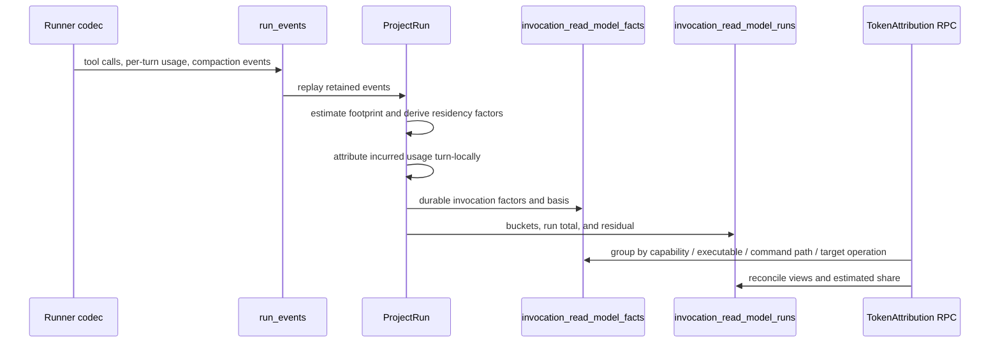

# Measures and Operational Stats — CLI and API Reference

The Phase 3 operational-stats surface is the read-side of the typed-event
log. Every metric on this page is derived from `run_events` rows whose
`event_type` is in the typed-operational set (see
[Event Taxonomy](../internal/EVENT_TAXONOMY.md)) — none of it reads from
the live SQL run tables, so the same query answers "what just happened"
and "what happened last week" the same way.

The HTTP endpoints, CLI commands, and the UI's Health (`/observability`) page sit on
the `internal/health` audit store and the Measures service.

## One command per question

Every analytical question has exactly one command. `agent-manager measures list`
prints every measure the API declares (id, question, parameters);
`agent-manager measures get <id> [--window TOKEN] [--param name=value]...`
runs one. `<id>` is `domain.name` or the bare name with dashes
(`run-volume` for `throughput.run_volume`). There are no per-measure verbs: a
measure the API declares is available to `get` and `list` with no CLI change.

| Question | Command |
|---|---|
| Which measures exist and what do they answer? | `agent-manager measures list` |
| How many runs finished, and how did they end? | `measures get run-volume`, `run-status-distribution`, `run-success-rate` (share that **completed**, Agent Manager executed runs only; completed is not accepted) |
| Does every session get the same measures, however it started? | `agent-manager usage parity [--window TOKEN] [--json]` (registry measure `usage.parity`) |
| What does an accepted outcome cost, by model, role or usage mode? | `agent-manager usage outcomes --by model\|role\|mode\|arm [--window TOKEN] [--json]` (registry measure `usage.outcomes`) |
| Does a lower model earn its keep for a role, by chance assignment? | `agent-manager usage experiment plan\|start\|status\|end\|propose` (registry measure `usage.experiment`) |
| Are operator signals on, and what is stored? | `agent-manager usage signals status\|off\|on\|purge` |
| How long do runs take, and what do they cost? | `measures get run-cycle-time`, `run-cost` |
| How do runners, models, profiles or workloads compare? | `measures get runner-breakdown`, `model-breakdown`, `profile-breakdown`, `workload-breakdown`, `workload-efficiency` |
| Where are tokens going, by capability or command? | `measures get token-attribution --param group_by=<dim> --param view=<view>` |
| Which commands fail, guess shapes, return heavy output, get polled or bypassed? | `measures get tool-friction` (rates and coverage), `tool-profiles` (one row per command path), `error-signatures` (failures clustered by error line, with owner); `usage friction` for owner-level findings |
| What should become a program, CLI command, flag or smaller skill? | `agent-manager usage opportunities [--since RFC3339]` (registry measure `usage.opportunities`): repeated command sequences vs the program library, bypass clusters, jq field extractions, in-session skill reloads, by owner |
| What should I change first? | `agent-manager usage recommendations [--run ID]`: one ranked list of owner-level actions (quota levers, tool findings, opportunities, gate-proven operator corrections), each with its effect in its own unit, the share of that kind of harm it removes, evidence and the verify command |
| What is burning my subscription quota? | `agent-manager usage burners` (also `usage forecast`, `usage recommendations`, `usage friction`, `usage coverage`, `usage compare`) |
| Is a usage mode lowering what new work runs on, what has quota burned since, and who can it reach? | `agent-manager usage mode status` (RPC `ListUsageModes`; start and end are operator-only: `usage mode start --preset one-tier-down --until 5h-reset\|weekly-reset\|off\|<RFC3339>\|<72h> [--runner R --role R --profile P --model X --effort E --context-limit N]`, `usage mode end <id>\|--all`). Burn is observed use since start from `usage burners --since`, not a saving; the reach table splits each current window by operator sessions, profile runs and unattributed, as estimates |
| What did one run do, spend, and break? | `agent-manager run report <id> [--children] [--weights sol=10,luna=1] [--facts]` |
| What recurring friction exists across runs? | `measures get tool-profiles`, `cohort-report` (cohort selector below) |
| Diagnose a set of runs | `agent-manager investigation start --file request.json`, then `investigation wait <id>` |

`measures get` prints the value and the registry's rows. Rates carry
`validity`, `sample_size` and `validity_reason` rows; an `unreliable` verdict
means the number is not a trustworthy result (see the classifier-validity
gate below). `--json` prints the registry response unchanged. Window tokens:
`this_week` (default), `last_7d`, `last_30d`, `this_month`, `last_month`,
`this_quarter`.

Program Runtime's offline typed measure projection is separately governed by
`RuntimeBindings` in `api/internal/measures/measures.go`. It admits only the
explicit owner-reviewed read methods, retains their permissions, and preserves
their typed responses. Registry membership alone does not add a program binding.
After an intentional policy or measure change, regenerate its projection with
`cd scenarios/agent-manager/api && UPDATE_RUNTIME_MEASURES=1 go test ./internal/measures -run '^TestRuntimeMeasureBindingsCurrent$'`;
run the same command without the environment assignment to verify freshness.
Its direct source-file digest detects edits to the policy source; it is not a
complete dependency or generated-descriptor freshness proof.

## HTTP endpoints

### Efficiency report

There is no efficiency REST endpoint. The bounded, read-only efficiency report is
the Program Runtime program `agent-manager.efficiency-report` (inputs `preset`,
`start`/`end`, `tag_prefix`, `group_by=runner|model|profile`, `limit`,
`compare=previous`); per-workload consumption is `agent-manager measures get workload-efficiency`.

The same freshness evidence is available on governed `MeasuresService` responses
under `provenance`: `projection_at`, `projection_age_ms`, `projection_stale`,
and `projection_stale_reason`. The Program Runtime program
`agent-manager.efficiency-report` uses these fields and returns
`stale_evidence` with `status: "partial"` when the projection is older than its
requested window. It composes existing read-only measure bindings and keeps its
output bounded; it does not call an inference model or change team policy.

All endpoints live under the existing API base. JSON in, JSON out.

### Fallback insights (Measures)

Runner and model fallbacks and policy-candidate outcomes are the Health
measure `health.fallback_insights` (`MeasuresService.FallbackInsights`, CLI
`agent-manager measures get fallback-insights [--window TOKEN]`). It counts the
`runner.fallback.*`, `model.fallback.*` and `policy.candidate.attempt` events
still retained in the window: attempts, exhausted walks, the most frequent
from/to/reason pairs, reasons, and policy outcomes and failure classes. The
former `/api/v1/stats/operational` and `/api/v1/stats/fallback` routes, the
`internal/stats` engine and `agent-manager ops` were deleted (P2-2); sandbox,
heartbeat, checkpoint and retry counters have no consumer and no replacement.

### `GET /api/v1/health/models`

Flat snapshot of every (runner, model) pair the system has observed.
Source of truth: `internal/health.Store.Snapshot`.

```json
{
  "models": [
    {
      "runner": "codex",
      "model": "<observed-model>",
      "status": "ok" | "unknown" | "failed",
      "last_checked": "2026-05-07T17:32:00Z",
      "reason": "rate_limit",
      "message": "anthropic 429"
    }
  ]
}
```

### `GET /api/v1/health/runners`

Same shape but at the runner level (no `model` field).

### `GET /api/v1/health/audit`

Paginated history. Filters: `scope=model|runner` (default `model`),
`runner`, `model`, `status`, `since` / `until` (RFC3339), `limit`
(default 100). Rows are `health.AuditRow` with `id`, `timestamp`,
`runnerType`, `modelId`, `status`, `reason`, `message`, `triggeredBy`.

### `GET /api/v1/events`

Read the typed-operational event log. Filters: `run` (UUID), `type`
(must be a typed-operational event_type — others return 400),
`since` (RFC3339), `limit` (max 1000, default 100). Each row exposes
the decoded `payload` keyed by `(event_type, schema_version)`.

## CLI

The CLI groups mirror the endpoint surface. Defaults are human-readable;
add `--json` for scripting.

```
agent-manager events ...    # query the typed event log
agent-manager health ...    # current snapshots and audit history
agent-manager measures ...  # declared measures: list, get <id>
```

Run `agent-manager <group> --help` for the full subcommand list. The
canonical workflow:

| Question | Command |
|---|---|
| Are any models currently failing? | `agent-manager health models` |
| Which models does Codex currently offer? | `resource-codex models list --json` (the runner catalog; use the resource policy command for role selection) |
| Show last 7 days of failures for a model | `agent-manager health audit --runner=codex --model=<observed-model> --since=7d` (substitute a model returned by `health models`) |
| How often does CHEAP fall through? | `agent-manager measures get fallback-insights` |
| Show every fallback event for a run | `agent-manager events list --run=<id>` |
| Tail the typed event log for a specific type | `agent-manager events list --type=runner.fallback.attempted --since=1h` |

The CLI never bypasses the API — every command exercises the same HTTP
surface above, so anything the CLI can answer is something a downstream
script or skill can also fetch from the API.

`agent-manager health models` is a persisted execution-observation snapshot. It
answers whether a model has recently succeeded or failed in managed runs; it is
not a runner inventory and must not be used to infer that a model is absent.
For Codex, runner availability comes from the resource-owned catalog
(`resource-codex models list --json`), which queries the installed Codex runner
first and uses the local compatibility cache only when that probe is
unavailable.

## Honesty contract

### Invocation denominators

Invocation rates never divide by all retained rows. Each response exposes a
`classifiedBase`, `unclassifiedCount`, and `unclassifiedShare`; the base is
the set of command facts the classifier could safely interpret. Paired-call
counts are the outcome evidence for failure rates, while unpaired and
unclassifiable facts remain visible. A zero classified base is `unavailable`;
coverage below the declared 90% minimum is `unreliable` with a reason.

For the Meta Optimization sweep, the reproducible command sequence is:

```bash
agent-manager measures cohort show imported-baseline-2026-08 --json
agent-manager measures select-cohort --cohort imported-baseline-2026-08 --json
agent-manager measures cohort-report --cohort imported-baseline-2026-08 --json
```

Every response that an operator could mistake for a stable trend
includes a `history_window`:

```json
{
  "history": {
    "earliest_event_at": "2026-04-30T00:00:00Z",
    "history_days": 7.04,
    "has_history": true,
    "min_sample_meaningful": 5
  }
}
```

The UI:

- Renders `HistoryBanner` above Usage › Details (`/usage?tab=details`) when `history_days < 30`.
- Renders `InsufficientDataCard` in place of any card whose underlying
  sample size is below `min_sample_meaningful`.

The same constants are used across endpoints — the threshold is a
product judgment, not a per-card setting.

## Session parity and the outcome ledger

Package `internal/outcomeledger` holds the pure computations; table `run_ledger_facts` (one row per
run, in `runProjectionTables`) stores their inputs and results. A background job refreshes the rows of
changed runs, newest first and at most 500 per pass, from `runs`, `transcript_usage`,
`invocation_read_model_facts`, `transcript_files` and `operator_interventions`. It never reads
`run_events`, so it adds nothing to API startup. Marker `2026-10-30-run-ledger-backfill` records that
the 90-day backfill finished. `usage parity` prints the rows still pending.

### Time window

A run belongs to a window by its **activity**: the first and last usage report of its transcript.
A run with no usage report uses the transcript file's modification time (imported) or its lifecycle
times (other paths). `runs.started_at` and `ended_at` of imported runs are not activity: an imported
session with no event timestamps gets the import time, and 5,080 old Codex sessions carry an `ended_at`
of the 2026-10-29 re-index. Counting by `created_at` or `occurred_at` therefore counts old sessions
imported this week as this week's work. `usage parity` reports those separately as `backfill`.

### `usage parity`

One row per start path and harness. Paths:

| Path | Meaning |
|---|---|
| `imported` | Transcript read from a default harness home (terminal, desktop, or a Claude session in Web Console) |
| `imported_web_console` | Transcript read from a Web Console per-session Codex home |
| `am_interactive` | Agent Manager interactive run |
| `am_headless` | Agent Manager headless (codec pipe) run |
| `attached` | Identity-only row from the launcher shim. It holds no transcript or usage of its own |

Each measure has a numerator, a denominator, a share, a count it does not apply to, and a stated reason
when the share is below 90%.

| Measure | Numerator | Denominator | Not applicable |
|---|---|---|---|
| `usage` | runs with usage | runs with requests or a usage expectation | `no_requests`: the transcript holds no model request |
| `tool_facts` | runs with projected facts | runs whose transcript records tool calls | runs with no tool calls: "no commands", never a friction gap |
| `tool_outcomes` | commands with a known outcome | commands read by the current parser. A compound command is known when any segment's outcome is proved. A Codex `exec` wrapper is not a command: the parser reports the commands inside it | commands read by an older parser, counted in the reason (SPEC AM-12a) |
| `message_signals` | top-level runs with classified operator messages | top-level runs | sub-agents, headless runs, and worker threads linked to a session by goal or Web Console session with no operator message: their prompts are not operator messages |
| `model` | runs with an actual model | runs with requests | `no_requests` |
| `mode` | runs with a mode relation | runs with requests | `no_requests` |
| `outcome` | runs whose work unit has an outcome: not `unknown`, and not `completed`, which is lifecycle only | runs with requests | `no_requests` |

An attached row is classified and only its class decides whether it enters a denominator:

| Class | Meaning | In denominators |
|---|---|---|
| `linked_imported` | Same Web Console session (confidence 0.95), an unlinked imported transcript of the same harness started within 60 s (0.6), or one started during a row that lived 3 minutes or longer (0.4) | no: the imported run carries the facts |
| `helper` | Lived under 3 minutes and no transcript matched: a helper process or CLI call, not a session | no |
| `no_transcript_reader` | Ran 3 minutes or longer on a harness Agent Manager cannot read | yes, as a stated gap |
| `unlinked_session` | Ran 3 minutes or longer on Codex or Claude with no transcript matched | yes, as a stated gap |

The `helper` class relies on the launcher attaching any invocation outside a closed list of informational
flags, and on the reconciler closing dead attached processes about two minutes later, so duration has that
resolution. OpenCode, Grok and Antigravity have no transcript reader. `usage parity` lists each as a gap with
its reason; see the plan's non-goals.

### Transcripts that could not be read

An API restart during a capture leaves the file's durable capture intent behind. Until 2026-10-30 every such
file became `unreadable` for good, including live sessions, whose usage then stopped being captured. The
checkpoint commit is atomic and consumes the intent, so an intent left behind means the cursor did not move. The
indexer now retries from the cursor when the checkpoint's head hash still matches the file. Replay cannot double
count: usage rows and events have stable ids, and for transcript events the first stored record of a source line
stays when a resumed parser derives a different payload. Rows left unreadable by the old rule retry once.
Only a file that no longer matches its cursor still needs reconciliation. A few large old files stay `unreadable`
with "source exceeds replacement staging": an older parser read them, their prior usage and events are kept, and
`usage parity` reports them apart as explained.

### Facts per run

| Fact | Source | Limit |
|---|---|---|
| Requested model | `runs.requested_model` | empty for imported: nothing was requested through Agent Manager |
| Actual model | model with most usage reports in `transcript_usage`, then `runs.actual_model` | a run may use several; `usage outcomes` splits points by model |
| Effort | `resolved_config.effort` and the policy candidate | unknown for imported: not in durable usage rows |
| Usage mode | exact from `usage_mode:<id>` or `usage_mode_skipped:` in the selection reason; otherwise inferred from `usage_mode_periods` | periods are recorded from 2026-10-30; a mode that ended earlier is known only from selection reasons |
| Active and idle time | gaps between usage reports; a gap over 5 minutes is idle | a tool call over 5 minutes counts as idle; not lifecycle duration |
| Requests | distinct usage reports | |
| Edits | `file-edit` tool kinds | an edit made through a shell command is not counted. Never an outcome |
| Validation | known outcomes of test commands (`vrooli scenario test`, `go test`, `make test` and similar) | unknown when the command outcome is unknown |

Mode relations: `applied` and `skipped` are exact. `ran_during_on_target` (the session began in a mode
period and its actual model is the mode's target) and `ran_during_not_changed` are inferred. `predates_mode`
(already running when the mode began) and `no_mode` are by time.

### Work units

A work unit is one run, or linked runs pursuing the same task. Each run stores its link kind and
confidence; a unit's confidence is the lowest of its links. A unit holds at most **40 runs**
(`MaxUnitRuns`): one outcome cannot speak for more. A run that would pass the cap starts a new unit (link
`over_cap`), and the later runs of that work join it, so the cost is still together. Over the 90 days to
2026-10-30 this took the largest unit from 93 runs to 40 and the count from 498 to 545.

| Link | Evidence | Confidence |
|---|---|---|
| `child` | `parent_run_id` | 1.0 |
| `successor` | `source_run_ids` | 0.95 |
| `resume` | same base harness session id, or the same managed session id | 0.95 |
| `task` | same non-synthetic `task_id` | 0.9 |
| `goal` | same native goal id | 0.85 |
| `workload_retry` | same workload key after a failed or cancelled attempt, within 48 hours | 0.8 |
| `workload_successor` | same workload key after a finished attempt, within 48 hours | 0.6 |
| `web_console_session` | same Web Console session, within 12 hours | 0.5 |

Rows from imported transcripts share one synthetic task, so `task` ignores it. A workload key used by
many unrelated tasks (`draft` over 54 workflow nodes) is not evidence: a key that spans more than 12 runs
links nothing.

`workload_successor` and `web_console_session` are circumstantial: a shared key or tab, no evidence of one
task. They cannot chain. The window runs from the **unit's first run**, not the previous run, so a tab left open
all day does not become one unit; a unit takes at most 3 of them; and they never join a run to a unit on a
different task or goal, so their costs stay apart. Before this rule 42 runs joined by web-console link over the
same 90 days; one still qualifies.

### Outcome estimates

An outcome estimate is an **estimate** for a work unit: `accepted`, `completed`, `corrected`, `failed`,
`abandoned` or `unknown`, with the source of the evidence. **Acceptance has two tiers, and only the first is
acceptance.** `accepted` needs evidence beside the run's own lifecycle: an operator approval, a passing
validation, or an explicit positive verdict. `completed` is lifecycle only: a headless run finished and nothing
says whether anyone wanted the result. A `completed` unit passes no acceptance gate and is never called accepted.
Rules apply in this order and the first match wins:

| Label | Source | Rule |
|---|---|---|
| `unknown` | `in_progress` | a run of the unit is still running |
| `accepted` | `operator_approval` | the last attempt was approved by a person. A change the sandbox policy applied at run end (`approved_by` `applyAtRunEnd`) is `auto_approved`: applied, not judged, and no evidence |
| `failed` | `operator_rejection` | the last attempt was rejected |
| `failed` | `operator_reported_failure` | the last operator message of the unit's last attempt reached the `reported_failure` operating point (operator signal), and the label's measured precision is at least 0.5 |
| `corrected` | `operator_reported_failure` | an earlier operator message in the unit reached that point: the agent kept working on it |
| `corrected` | `operator_correction` | an operator message classified `quality_miss`, `wrong_claim` or `early_stop` at probability 0.5 or higher |
| `corrected` | `operator_signal_correction` | an operator message reached the `correction` operating point, and the label's measured precision is at least 0.5 |
| `failed` | `run_status` | the last attempt of a managed unit failed |
| `abandoned` | `run_status` | the last attempt was cancelled, or crashed with no successor |
| `corrected` | `retry` | an earlier attempt failed and the last attempt finished |
| `failed` | `agent_verdict` | the last interactive verdict was `blocked` |
| `failed` | `validation` | the last known validation in the unit failed |
| `accepted` | `validation` | the last known validation passed |
| `accepted` | `agent_verdict` | the interactive verdict was `complete`: the agent's own statement, weaker than the two above and named as such in the UI |
| `completed` | `headless_status` | a headless run finished. Says nothing about usefulness |
| `unknown` | `no_signal` | nothing above applied |

The estimate carries its source, not a score. The old confidence numbers were set by hand, read by nothing and
looked measured, so they are gone; the `unit_confidence` column stays in older databases, unused.

The same rules read an imported session and a managed run: an imported session with the same validation
and operator messages gets the same estimate. Imported `complete` only means the transcript ended, so it
is never evidence. `approval_or_info`, `scope_change`, `too_dense` and `false_inability` messages are not
outcome evidence. Operator classifier categories have not passed the accuracy gate. The operator-signal labels `reported_failure` (hold-out precision 0.80) and `correction` (0.64) are also not individually proven; only the pooled `explicit_negative` bucket is. A reported failure outranks a correction; a run row is rebuilt when a new signal is recorded for it. Operator messages exist for few Claude sessions (a harness-launched or sub-agent session has none), so these sources can only move the outcome coverage of sessions that have operator messages.

#### Where independent acceptance evidence exists for managed runs (2026-10-30, last 30 days)

Searched for evidence that is both independent of the run and tied to that run's change. Counts are work units with requests.

| Candidate | Linkable by | Real count | Used |
|---|---|---|---|
| Operator approval of a `needs_review` run | run id | 89 approved runs, all by `applyAtRunEnd` (auto) and none with requests; 4 pending | yes, human approvals only |
| Passing or failing validation in the transcript | run id | 9 accepted and 2 failed units, all imported or operator sessions; 0 of 77 headless runs ran a recognised validation | yes (`validation`) |
| Agent verdict `complete` / `blocked` | run id | 3 accepted, interactive only; headless runs record no verdict | yes, named weaker and counted as assumed |
| Delivery-effort accepted units, goal homes | `work_references` effort id | 252 runs carry an effort reference; all 21 effort observations read `unknown` or `unverified` and say acceptance is workspace self-report | no: not independent |
| Effort `feedback` signals | run id | 785 free-text lines written by agents | no: not a verdict |
| `run_result.structured` of headless code.default | run id | 68 runs; it is the schema-valid commit draft, not a judgement of it | no |
| Git Control Tower proposal state for those drafts | snapshot digest | 0 of 38 digests appear in GCT; GCT holds 29 open, 8 superseded, 1 withdrawn, none applied | no link exists |
| Reviewer child verdict | parent run id | 4 `code.supervision` children, none with a verdict; a child `complete` means it finished, not that it approved | no |
| Plan Manager phase completion, Test Genie runs attributed to a run | none stored in Agent Manager | not readable without a cross-scenario read | no |
| Successor run that corrects a completed run | `source_run_ids` | 0 runs carry one in the window; a failed or cancelled predecessor already reads `corrected` (`retry`) | already covered |

So headless acceptance stays 0 of 48 for Terra and 0 of 27 for Luna: the evidence does not exist, and no source above was loosened to raise it. The way to
get it is to make the work record it, for example Git Control Tower publishing what became of a draft against its snapshot digest.

### `usage outcomes`

Pure function `outcomeledger.Analyze`, also the input for later learn-mode analysis. Points are the same
attributed window points as `usage burners`, split by model. Points cannot be compared across providers,
so each row belongs to one runner. **Rows are also split by path** (`stratum`): `headless` or `operator`
(interactive and imported). A headless unit has no operator to correct it, so rework there means retries only,
and a model's corrected count mostly says which path it ran on: 12 of Sol's 15 known units read corrected because
all of them were operator sessions. A row is compared only with the baseline of its runner and path: the row with
enough data and the highest points per reference token, unless a baseline is named. A model on both paths has two rows.

| Field | Definition |
|---|---|
| Consumption (reference tokens) | `input + 0.1 × cached + 1.25 × cache creation + 5 × output` for **every** model. These are Claude-shaped weights used as a common yardstick so two models' use can be compared; they are not any model's price and the ratio between them is not a price ratio |
| Points per accepted | All points of units with a known outcome (failed attempts, rework and `completed` units' spend included) ÷ `accepted` units. Unknown units are excluded and counted |
| Points per completed | The same points ÷ `accepted` plus `completed` units. A separately labelled **weaker unit**: it counts work nobody checked as an outcome. Never gives a verdict |
| Consumption per accepted | Same, in reference tokens |
| Points and consumption per run | Median over the row's runs |
| Run length ratio | Median active minutes per run ÷ the baseline's |
| Rework rate | Units with several attempts or a correction ÷ units with a known outcome |
| Unknown rate | Unknown units ÷ all units. `completed` is reported apart |
| Break-even ratio | Baseline points per reference token ÷ this row's, **on the same known units and the same fixed weights as the consumption ratio**. It is the realized price: the model's price and the token mix it used, together. So `cheaper by = break-even ÷ consumption ratio`, exactly |
| Model price ratio | Baseline model price ÷ this row's at one fixed token mix (the runner's whole window), from the price book. `model_price_source` says `price_book`, `tier_prior`, `fallback` or `mixed`. It is the price alone, apart from what either model realized |
| Price source | `price_book`, `tier_prior`, `fallback` or `mixed`: where the pair's attributed points get their relative weights. A realized ratio is only as good as these |
| Cheaper by | Baseline points per accepted ÷ this row's. Above 1 is cheaper |
| Verdict | `cheaper` or `more_expensive` when the range excludes 1 and leaves the margin; `about_same` only when the whole range of the cost ratio lies inside **plus or minus 30%**; `inconclusive` otherwise; `baseline`, or `not_enough_data` |
| Completed reading | The same words for points per completed against the path's baseline on that weaker unit. It is not a verdict and is labelled so everywhere |

A range that merely crosses 1 is not "about the same". The row that read "about the same" at 0.97x (0.13x to 49.50x)
now reads inconclusive. The break-even of 2.54x, labelled a prior, was neither a prior nor comparable: it mixed every
unit of the row, known or not, against a consumption ratio read on known units only.

Ranges are 90% bootstrap intervals over units, 1,000 resamples, seeded from the row key so output is
reproducible. Below 5 accepted outcomes, or 10 runs for a per-run median, the row reads `not_enough_data`
with the reason, and keeps its counts but no ratios. Lines of code and edit counts are never outcomes.
`design` is `observational` for every comparison by model, role or mode: it compares models on the work each happened
to run, so it shows an association, not what the model caused. `--by arm` reads it from each unit's recorded assignment
basis: `randomized` (every unit's arm is a recorded canary arm), `day_block_randomized` (operator sessions took part;
the calendar assigned whole days and the operator saw the label) and otherwise `observational`.

The read model caches a window's inputs. A 30-day read spends nearly all its 6 to 9 seconds in one place: the
`transcript_usage` aggregate behind `PeriodUse` (2.3M rows, grouped per file and minute). The ledger only refreshes
every few minutes, so re-reading adds no accuracy. A read within 2 minutes reuses the inputs; within 15 minutes it reuses
them and refreshes in the background, so figures can lag by that much; a cold read still pays for the scan, once.
Measured on 2026-10-30: first read 7.6 s, next reads 0.4 s.

Mean wall time misleads for long-parked runs: an interactive run stays open between operator turns. Each
row prints wall mean, wall median, active median and runs over 24 hours; a note appears when the mean is
over three times the median and at least one run was open over 24 hours.

`usage outcomes` also reports `refit`, per runner and model: the price-book weight's source, how many
quota blocks a single model dominated (90% or more of the block's priced use), how many of those fall in
a recorded mode period, the points per million consumption those blocks imply, and whether the existing
calibration can use them. The calibration fits one scale per window, not one per model, so the implied
ratios are reported beside the priors and are not fed into attribution. Wiring needs at least 5 dominant
blocks for both models of a pair.

## Learn mode: arms, verdicts and power (`usage.experiment`)

Learn mode (`kind: "learn"`) turns a usage mode into a controlled comparison for one role. The design, the
analysis and the stopping rule are stated here before any live data exists, so a result cannot move them.

### Assignment and facts

- A managed run joins when an active, unpaused learn mode covers its role and no save mode applies. The overlay sets the
  selected candidate's challenger model and sample rate; the existing `SelectCanaryArm` assigns the arm once from the run id
  and the snapshot records `canary_arm`. The run's selection reason names the comparison (`usage_mode_learn:<id>`).
- `run_ledger_facts` carries `canary_arm` (the snapshot's arm) and the derived `arm`, `arm_mode`, `arm_basis`, `arm_exception`.
  `arm_basis` is `canary_arm` (exact), `launcher_marker` or `day_block_calendar` (inferred, operator sessions). The design shown is read from this
  basis: nothing reads as randomized unless the assignment is on record.
- Operator sessions join only when the operator opts in. The arm of a day block is fixed by the mode id and the block's first
  UTC day (`usagemode.SessionArm`), so the launcher, the ledger and any reader agree with no database. The launcher prints a
  visible label, exports `VROOLI_USAGE_ARM`, and appends a marker (`arms.jsonl` beside the mode file). A full-power or explicit-model
  launch on a challenger day is allowed once and recorded as an exception; it stays in its assigned arm.
- Exempt roles are never randomized, even when a mode is scoped to one. A save mode that applies takes priority; a forecast that a
  window will run out pauses new assignments (`paused_reason` starts `forecast:`) and resumes by itself. Work already assigned keeps its arm.

### Analysis

By assigned arm (intention to treat). `Analyze` is reused for each arm's rows (points per accepted outcome and rework rate with 90%
bootstrap ranges). The cost ratio is challenger over incumbent points per accepted outcome.

**The unit matches the randomization.** A managed run is randomized by itself, so a managed unit counts once. Operator sessions are
randomized by the day block, so all of a block's sessions move together: bootstrap resamples whole blocks and the permutation test
shuffles whole blocks, apart from managed runs. Eight day blocks are eight observations however many sessions they held, and 4 against
4 cannot reach significance at all. A retry stays in the arm its unit started in, whatever its own run id drew (links `resume`,
`successor`, `task`, `workload_retry`). A run in another arm for any other reason, or assigned work joined to a unit that began outside
the comparison, makes the unit span arms: it measures neither, so it is flagged, excluded and counted (`spanning_units`).

**One look.** The verdict is read once, at the planned sample: the units up to the moment both arms hold **80 accepted outcomes**, with
whole session blocks kept together. Before that the verdict is `not_enough_data` and no ratio is shown, however large the visible
effect. After it, later units are counted (`units_after_look`) and cannot move anything, so reading the status repeatedly cannot turn
into a verdict. There is no sequential boundary and no early stop: a look that settles nothing is final as `inconclusive`, and a further
question needs a new comparison. Only an outcome revised later (a late signal on a unit before the look) can change a read.

**Multiplicity.** The family-wise level is 5%, split over the cost and rework tests (2) and over every learn comparison started by the
look (roles): `alpha_per_test = 0.05 / (2 × comparisons)`. One role tests at 0.025, two at 0.0125. Comparisons started after the look do
not count, so a settled verdict stays settled. The verdict reads the range at the matching level (`decision_range`,
`decision_level`: 95% for one role); `cost_ratio` stays the 90% range. Two permutation tests (10,000 shuffles, fixed seed from the mode id)
give the p-values. This is Bonferroni: simple, valid whatever the tests' dependence, and conservative.

**Intention to treat and what was lost.** Unknown outcomes cannot be analysed as if they were missing at random. At the look the arms'
rates of `unknown` and of acceptance-unknown (`unknown` plus `completed`) are compared, and a gap over **10 points** withholds the verdict
(`withheld`). Every read reports each arm's total spend with the unknown units' part of it, and a worst-case bound: the cost ratio on total
spend if every outcome not known to be accepted went the best and the worst way (`cost_bound`).

Verdicts, with the rule fixed in `DefaultExperimentConfig`:

| Verdict | Rule |
|---|---|
| Not enough data | The planned look has not been reached. The reason says how many more accepted outcomes are needed |
| Withheld | At the look, the arms' unknown or acceptance-unknown rates differ by over 10 points |
| Higher looks better | Rework is up by at least 20 points at the corrected level, or the challenger costs at least 30% more at the corrected level with a decision range above 1 |
| Cheaper looks better | Significant at the corrected level, cost at least 30% lower, the decision range below 1, and the rework decision range's upper end under 20 points |
| About the same | The decision range lies inside 0.70 to 1.30 and the rework decision range's upper end is under 20 points |
| Inconclusive | At the look, none of the above. A wide range is this, not "about the same" |

"Looks better" reads the assigned arms. Even so, a verdict is about cost per accepted outcome as recorded: if acceptance is mostly an
agent's own verdict, the comparison inherits that.

### Power simulation (2026-10-30)

Per-unit cost is lognormal with mean 1 and the stated coefficient of variation (CV); a unit is accepted at 85%; the
challenger's cost is scaled by the true reduction. Each cell is the share of 1,000 simulated comparisons that reach the stated
reading at the corrected level for one role, 0.025 (499 permutations, 499 bootstrap resamples, Monte Carlo error about 1 point near
0.8). n is units per arm. Rework and blocks are not simulated: a session comparison has fewer independent units than n and less power.
`LEARN_POWER_REPORT=1 go test ./internal/outcomeledger -run TestPowerReport -v` prints this.

| CV | True reduction | n=40 | n=70 | n=100 | n=130 | n=180 | n=280 |
|---|---|---|---|---|---|---|---|
| 1.0 | 40% | 0.48 | 0.71 | 0.82 | 0.87 | 0.94 | 0.96 |
| 1.0 | 50% | 0.74 | 0.93 | 0.98 | 0.99 | 1.00 | 1.00 |
| 1.0 | 60% | 0.95 | 0.99 | 1.00 | 1.00 | 1.00 | 1.00 |
| 1.5 | 40% | 0.28 | 0.45 | 0.59 | 0.71 | 0.83 | 0.88 |
| 1.5 | 50% | 0.43 | 0.68 | 0.84 | 0.91 | 0.98 | 1.00 |
| 1.5 | 60% | 0.75 | 0.93 | 0.98 | 0.99 | 1.00 | 1.00 |
| 1.84 | 40% | 0.23 | 0.35 | 0.46 | 0.56 | 0.70 | 0.82 |
| 1.84 | 50% | 0.34 | 0.56 | 0.72 | 0.81 | 0.92 | 0.99 |
| 1.84 | 60% | 0.61 | 0.84 | 0.93 | 0.96 | 0.99 | 1.00 |

Reading "about the same" (decision range inside plus or minus 30%) when there is truly no difference:

| CV | n=130 | n=210 | n=380 | n=700 |
|---|---|---|---|---|
| 1.0 | 0.29 | 0.62 | 0.91 | 0.99 |
| 1.5 | 0.03 | 0.19 | 0.56 | 0.89 |
| 1.84 | 0.00 | 0.05 | 0.33 | 0.72 |

Under no difference, a false "cheaper looks better" appeared in 0.2% to 0.7% of runs (n=130), under the 2.5% level. Acceptance need not be
equal: a halving of cost per unit with the challenger accepted 0.8x as often is truly a 0.625x cost per accepted outcome, and reads cheaper
only 0.78, 0.56 and 0.44 of the time at n=130 for CV 1.0, 1.5 and 1.84. Two roles (level 0.0125) take CV 1.5 at n=130 from 0.91 to 0.88.
A true 30% reduction sits at the reading threshold, so it is found only about half the time at any size: **only large effects
(about 40% to 50% or more) are detectable at this volume**, and at the planned look "about the same" is rarely readable unless cost
is quiet (CV well under 1): a null at CV 1.5 usually reads inconclusive.

Thresholds set from this: the look of **80 accepted outcomes per arm** (about 94 units at 85%) is where a halving at the pooled CV of 1.5
reaches about 0.8 power at the corrected level of one role; the effect that counts is **30%** and the quality floor is 20 rework points; the earlier
placeholders (about 20 outcomes to show a result, about 40 per side, then 75 at an uncorrected level) are retired. The pooled CV of 1.5 is the value
assumed for a role with fewer than 8 finished units. A plan runs the same simulation with 400 simulations and 399 permutations and resamples, which
knows a power near 0.8 to about 2 points, and caches it per pilot.

### Time to a verdict from the real ledger (2026-10-30)

Pace is known-outcome units of the role's managed runs over the last 30 days, and acceptance is the share of those units with evidence of
it. `agent-manager usage experiment plan` recomputes this per role. The verified column is the only one that can give a verdict.

| Role (codex) | Known units | Accepted | Completed | Pace | CV | Time to the look, verified (power for a halving) | Completed-only reading, never a verdict |
|---|---|---|---|---|---|---|---|
| code.default | 68 | 0 | 68 | 2.3 a day | 1.04 (measured) | **no verdict is reachable** | about 71 days (61 to 84); power 0.96 |
| code.economy.delivery | 6 | 3 | 1 | 0.2 a day | 1.50 (assumed: 6 units) | about 1,600 days (1,050 to 3,350); power 0.89 | about 1,200 days (790 to 2,510); power 0.85 |
| code.inspection | 0 | 0 | 0 | none | | no finished work | none |

**In practice no verdict is reachable from managed runs today** (re-read after the evidence search above: code.default still shows no accepted outcome and no verdict is reachable; code.economy.delivery is over 4 years for a halving). The fast role records no acceptance at all: its 68 units finished and nothing
validated, approved or judged them. The role with evidence is too quiet. "About the same" is unlikely at the look for either (9% and 0%). Before
the tiers split, this table read 66 days for `code.default` because `headless_status` counted as accepted. The honest route to a verdict is to make
managed work record acceptance (a validation in the role's workflow, or an approval), not a longer wait.

By model over the same 30 days, by path (accepted of units): headless Terra 0 of 48 (47 completed), headless Luna 0 of 27 (22 completed); operator Terra
6 of 12, Sol 2 of 26, Luna 1 of 8, Opus 5.5 1 of 12, Opus 4.8 1 of 25. In all 12 accepted and 69 completed of 173 units, so only operator Terra has the 5
needed for a row, with nothing to compare against. Per completed, headless Luna against Terra reads inconclusive (0.24 and 0.36 points; cheaper by 1.5x,
range under 0.1x to 395x).

## Operator signals (`usage.operator_signals`)

Five broad labels on each verified human operator message, judged with the agent's preceding text:
`reported_failure` (the operator says what the agent built, fixed or claimed is broken, failing or
missing), `correction` (the agent was wrong, misunderstood, ignored an instruction, stopped, or its
approach is rejected), `frustration` (explicit irritation with no failure or correction named),
`satisfaction` (explicit praise or "it works"), `neutral` (everything else). Priority when several
apply: reported_failure, correction, frustration, satisfaction, neutral. These are rates of what the
operator reports, not moods.

### Gate (fixed on 2026-10-30, before any model was scored)

A label (or the pooled `explicit_negative` bucket, reported_failure plus correction by probability
mass) is **proven** for a model only if, on the session-disjoint hold-out of
`signal-turns.jsonl` (`split=holdout`), at the probability threshold picked on `split=train` only:
gold rows >= 10, precision >= 0.80, recall >= 0.70, and the Wilson 95% lower bound of precision >= 0.60.
The overall agreement between the two independent labellers must have Cohen kappa >= 0.60. Thresholds
are not changed after scoring. Below the gate nothing is shown as a rate: the measure reports the
label as `unproven` with its measured hold-out precision and recall. The existing `ProvenGate` for
intervention categories is separate and unchanged.

### Accuracy report (scored 2026-10-30, signal version in `interventions.SignalVersion`)

Corpus: `signal-turns.jsonl`, 270 turns with the agent's preceding text, drawn at random from 244 sessions in neither
the intervention corpus nor its validation set, split by session: 133 train turns (116 sessions), 137 hold-out turns
(128 sessions). Gold: neutral 172, reported_failure 45, correction 32, satisfaction 18, frustration 3.
Second labelling: a fresh read-only Claude run (`claude -p --model sonnet` with the researcher brief) saw only the
label definitions and blind messages. Agreement 254/270 = 0.941, **Cohen kappa 0.894** (reported_failure+correction against
the rest: kappa 0.903). Disagreements are not adjudicated; the first labelling is the gold. Both labellers are Claude
models, so kappa measures how reproducible the definitions are, not agreement with the operator's own reading.

Models compared: Winnow-E4B (`decide.accurate`, local) and Laya (`decide.fast`, local; 24 of 270 answers fell to the
`classify.fast` enum path without a distribution). Hosted Jev and Clef are excluded by the local-only profile. Wording
and thresholds were set on train only. One wording was tried (the shipped one). The only tuning step was the counting
rule: requiring the label to be the most likely one capped reported_failure recall at 0.62 on train, so a message counts
as a label when the model's probability for it reaches a threshold. Thresholds are the train-picked ones (highest
precision with recall >= 0.7). The hold-out was scored once per model, after the rule and the gate were fixed.

Winnow-E4B, hold-out (137 turns), Wilson 95% ranges:

| label | threshold | tp/pred/gold | precision | recall | gate |
|---|---|---|---|---|---|
| reported_failure | p >= 0.15 | 16/20/16 | 0.80 [0.58, 0.92] | 1.00 [0.81, 1.00] | **not proven**: precision lower bound 0.58 < 0.60 |
| correction | p >= 0.20 | 16/25/19 | 0.64 [0.45, 0.80] | 0.84 [0.62, 0.94] | not proven: precision |
| frustration | p >= 0.15 | 2/2/2 | 1.00 [0.34, 1.00] | 1.00 [0.34, 1.00] | not proven: 2 gold rows |
| satisfaction | p >= 0.10 | 9/12/9 | 0.75 [0.47, 0.91] | 1.00 [0.70, 1.00] | not proven: 9 gold rows |
| neutral | p >= 0.85 | 70/71/91 | 0.99 [0.92, 1.00] | 0.77 [0.67, 0.84] | passes; not published (the complement) |
| **explicit_negative** (reported_failure + correction mass) | mass >= 0.40 | 33/41/35 | 0.80 [0.66, 0.90] | 0.94 [0.81, 0.98] | **passes the gate** (33/41 = 0.805 against the 0.80 bar) |

Laya, hold-out: explicit_negative 30/109/35 (precision 0.28, recall 0.86); reported_failure 12/101/16 (0.12, 0.75);
correction 14/98/19 (0.14, 0.74); satisfaction 9/52/9 (0.17, 1.00); no label passes. It is not calibrated enough on
developer text; do not use `decide.fast` for this question.

Result: **the pooled bucket "operator reported a failure or corrected the agent" passes the gate for Winnow-E4B, by one
message; reported failure and correction separately do not; frustration and satisfaction cannot pass at this
operator's base rates (about 1% and 7% of messages).** The measure therefore publishes rates for `explicit_negative` only,
and lists the other labels as `unproven` with their measured precision and recall.

What this does not show. "Proven" in the code means the gate's rule was met, not that precision is known to be 0.80:

- **Selection.** Winnow-E4B was chosen because it was the better of two models scored on this hold-out, so the hold-out did not stay
  a pure test of the chosen model. The effect here is small, because Laya is far behind (0.28 against 0.80): the model choice would not have
  flipped on another draw. Allowing for two looks, the Wilson lower bound of precision is 0.64 (97.5% level) against the 0.60 bar, so the
  gate still passes. Nothing stronger can be said without fresh labelled turns.
- **The margin.** The 0.80 bar was met by one message (33 of 41; 32 of 41 would have failed it). The data cannot tell precision of 0.80 from
  0.70, and a repeat at the same true precision would fail the point bar about as often as it passes. The pass means a rule fixed in advance was met,
  not that precision is known to be 0.80.
- **Scope.** One operator, one wording, 41 predicted positives (the precision range reaches down to 0.66), and a labelled sample that is
  Codex only (every Claude transcript was already in the intervention corpus).

Consequences: the quality-drop sender stays on, because the rule was fixed before scoring and still passes after allowing for the selection,
and what it reports is a rise in flagged messages with its own 95% range, not a rate of true failures. If a re-score on fresh turns falls below
the bars, `ProvenSignalGate` is emptied and the sender is silent: it reads nothing unless the gate names the model. Re-run before trusting a shift
smaller than the ranges the measure prints.

**Operating point.** The measured precisions hold only at the thresholds they were measured at: `reported_failure` p >= 0.15 and `correction`
p >= 0.20, on the label's own probability, whether or not it is the most likely label (`interventions.SignalOperatingPoints`). Until 2026-10-30
the ledger read a message only when its most likely label was one of these and that probability reached 0.5: a point no one measured, carrying
precisions measured elsewhere. It now applies the measured point. The sender counts `explicit_negative` at mass >= 0.40, its measured point, and
always did. On the 497 classified messages of 2026-10-30 the measured points flag `reported_failure` on 26 and `correction` on 65, against 6 and 29 at the old cut.

Run: `AGENT_MANAGER_LIVE_SIGNAL=train|full go test ./internal/interventions -run TestLiveSignalBenchmark -v` (add
`AGENT_MANAGER_LIVE_DECIDE_ROLE=decide.fast` for Laya). Winnow ran on CPU on the day (about 6 s a message under host load),
so the full run takes about 14 minutes per 135 turns; a GPU makes it seconds.

### The measure

`agent-manager measures get usage.operator_signals --param window=last_7d --json` (registry measure, no typed RPC). One row
per mode period, model and label (`reported_failure`, `correction`, `frustration`, `satisfaction`, `neutral`,
`explicit_negative`). Columns: `mode` (usage mode id or `no_mode`), `model` (the model that did the work), `signal`, `state`
(`proven`, `unproven`, `off`, `no_data`), `messages`, `classified`, `coverage` (classified share), `count`, `rate`, `low`,
`high` (95% Wilson), `baseline_rate`, `baseline_low`, `baseline_high`, `baseline_classified` (this operator's preceding
period of equal length, outside any mode, same model), `difference`, `difference_low`, `difference_high` (95% Newcombe),
`comparison` (`higher`, `lower`, `no_clear_difference`, `not_enough_data`), `measured_precision`, `measured_recall`
(hold-out, shown for every label), `classifier_version`, `note`. An unproven label has empty `count`, `rate` and
comparison fields: empty is unknown, never zero. A cell under 20 classified messages has a count and no rate.


### Privacy and limits

- Only verified human operator messages are labelled. The source is `operator_interventions`, which the intervention job
  fills from `domain.MessageSource == operator`: agent output, teammate reports, injected prompts and fork replays are
  never recorded there, so they never receive a signal. A run's opening message follows no agent work and is skipped.
- Classification is local. The request carries `PROFILE_LOCAL_ONLY`, so ai-gateway skips every hosted decision candidate
  (Jev, Clef) even when its credentials are provisioned; message text does not leave the machine. The older
  intervention category classifier (`interventions.Classifier.Classify`) sends the same profile, including its shrunk retry;
  it did not until 2026-10-30, so a hosted candidate could have read message text. Test:
  `TestCategoryClassificationRequestsAreLocalOnly`.
- Stored: label, probabilities, answering model and timestamps (`operator_signals`). Never message text. Logs and
  notifications carry counts and rates only; the pass logs a count and a gateway error, not a message.
- Off switch: `agent-manager usage signals off` (operator only, no restart: the job asks before every pass) or
  `AGENT_MANAGER_OPERATOR_SIGNALS=off` in the environment, which always wins (see [configuration](configuration.md#operator-signals)).
  Off stops the job, the measure and the ledger feed; stored labels remain until `usage signals purge --yes` (`Store.PurgeSignals`)
  runs. The switch is `operator-signals.json` beside the usage mode file; an unreadable file counts as off, because this is a privacy control.
- Back-fill: the job never scans `run_events` by time. It walks `operator_interventions` newest first, 128 messages a pass,
  and reads a run's events only for the preceding agent text. Marker `operator-signal-backfill:<signal version>` in
  `schema_migrations_done` records that the walk finished; afterwards only interventions recorded in the last 6 hours and
  due retries are handled. A new signal version back-fills again. Unclassified messages are retried hourly, longer each
  attempt, and counted in coverage, never read as neutral.
- Rates are the classifier's counts, not corrected for its errors. Rates are per message, not per agent-hour. A cell
  under 20 classified messages reports no rate. The baseline is this operator's own preceding period of equal length, outside
  any usage mode, same model; there is no per-person breakdown, and nothing is split by person in any team-facing shape.
- Limits known from the literature and from this corpus: terse style, sarcasm and pasted logs; one operator's wording; the
  operator may behave differently when they know they are measured; `frustration` and `satisfaction` are rare in this
  operator's messages (3 and 18 of 270), so only the gate on the larger labels can be proven.
- The outcome ledger reads a label at its measured operating point, and only when its measured hold-out precision there is at
  least 0.5. Sources: `operator_reported_failure`, `operator_signal_correction`.


## Measure classifier-validity gate

Every typed measure response includes `validity`. A response is `unreliable`
instead of a trustworthy analytical result when its sample is smaller than the
configured meaningful minimum, or when one classifier fingerprint accounts for
more than the configured share of the measured population. The response keeps
its counts for diagnosis and states the reason; CLI human output does not print
a bare repeated-work percentage in that state.

The product defaults are a minimum sample of `5` and a maximum fingerprint
bucket share of `0.90`. Operators may set
`AGENT_MANAGER_MEASURE_MIN_SAMPLE_MEANINGFUL` and
`AGENT_MANAGER_MEASURE_MAX_FINGERPRINT_BUCKET_SHARE` (a fraction in `(0,1]`)
at startup. These are global analytical-honesty settings, never per-measure
tuning knobs.

## Token attribution

`agent-manager measures get token-attribution --param group_by=capability --param view=footprint`
reports durable token rows grouped by `capability`, `executable`, `command_path`,
or `target_scenario_operation` (`--param group_by=`), in one of three views
(`--param view=`). Every response includes estimated share and keeps the
`unattributed` row visible when a run residual exists. Usage › Details
(`/usage?tab=details`) exposes the same selectors; footprint additionally shows
p50, p95 and maximum, residency is labelled as the compaction attenuation
approximation, and an empty retained corpus is an empty state, not a zero-cost claim.

Agent Manager stores token attribution below the run boundary in the durable
invocation read model. The measure answers three different questions; the
numbers must not be compared as though they were interchangeable costs.

### The three views

| View | Question | Basis |
| --- | --- | --- |
| `footprint` | How large was this command's returned payload intrinsically? | Estimated from the invocation payload; measured provider usage is not rewritten. |
| `residency` | How much context did this payload occupy while it remained resident? | Footprint multiplied by turn residency factors, with compaction attenuation. |
| `incurred` | What provider-reported turn usage was attributed to this action? | Measured per-turn usage, with an explicit unattributed residual. |

Footprint is the optimization surface for shrinking command output. Residency
is the context-bloat surface. Incurred is the accounting surface. A row carries
its `token_basis` (`estimated`, `measured`, or `unknown`) wherever a token
number is persisted; consumers must not present an estimate as provider billing.

### Factors, not products

The durable fact stores independent factors: result tokens, residency turns,
compaction attenuation, turn-local usage, and attribution basis. It does not
persist a precomputed product as if that product were a measured provider
charge. Aggregates may calculate a view-specific product at read time, but the
underlying factors remain inspectable and replayable. This prevents a later
change to the residency approximation from being mistaken for a change in
historical provider usage.

### Run-level conservation buckets

Run token accounting uses one stable bucket vocabulary:

| Bucket | Meaning | Source |
| --- | --- | --- |
| `preamble_injected` | Agent Manager instructions injected into the run | `BuildSplitPrompt` estimate |
| `preamble_fixed` | Runner system prompt and tool definitions | Minimum input observed in a compaction segment |
| `tool_result_residency` | Tool-result payload carried through later turns | Per-fact result tokens and residency factors |
| `assistant_output` | Assistant output tokens not otherwise attributed | Per-turn usage |
| `compaction` | The context read to produce a compaction summary | Compaction boundary usage |
| `unattributed` | Explicit residual when available evidence cannot explain the total | Run total minus known buckets, with a reason |

The conservation invariant is:

```text
run_total = preamble_injected + preamble_fixed +
            tool_result_residency + assistant_output +
            compaction + unattributed
```

The residual is never silently discarded or normalized away. A non-zero
residual is a signal that the ranking is incomplete, not evidence of zero
cost. The typed constants and invariant live in
`api/internal/tokenaccounting`; the conservation tests include empty usage,
terminal-only usage, per-turn usage, and two compaction boundaries.

### Compound commands and segment apportionment

A shell tool call carries one input payload and one result payload, but the
read model emits one fact per shell segment so that each command in a compound
line stays independently rankable. `cd /repo && rg pattern | head -20` becomes
three facts from one call.

Token quantities therefore have to be apportioned. Argument tokens and each
incurred usage field are divided evenly across the call's segments, with the
remainder assigned to the leading segments so the shares sum back to the call
total exactly. Result tokens follow the output: each command's output is held
by one segment, the one holding its duration (the last that is neither a pipe
reader nor an `echo`/`printf`: `rg` in `cd /repo && rg pattern | head -20`),
and its other segments have unknown result tokens. A Codex exec batch splits
its result by the nested result of each command (printed bytes capped by
`max_output_tokens`), giving the remainder to the script's own unit
(`runsignal.OutputShare`, `invocation-fact.v32`). Residency turns are a
multiplier rather than a token quantity, so they stay whole; the residency
product apportions through the result share it multiplies.

The even split of argument and incurred tokens is a declared approximation,
not a measurement. Consumers distinguish an apportioned fact by
`segment_count > 1`.

Two rejected alternatives are worth recording, because both look simpler:

- **Charging the whole call to the leading segment** concentrates the plurality
  of all shell token spend onto `cd`, which begins most compound lines in this
  corpus. It produces a confidently wrong ranking.
- **Leaving the whole call value on every segment** is what facts at
  `invocation-fact.v16` and earlier did. Any `SUM` over those rows overcounts a
  run in proportion to how compound its commands were, and attributes the full
  turn cost separately to every command in the line. The run-level ledger was
  never affected, because it sums the by-call attribution map rather than the
  fact rows — so conservation stayed green while the per-command ranking was
  inflated. That asymmetry is why the regression test reconciles the fact rows
  against the run ledger rather than checking either one alone.

Because a fact row is a segment, `p50`, `p95`, and `max` footprint columns
describe segment shares rather than whole calls whenever the grouped commands
appear in compound lines. `SUM` columns are unaffected — they conserve.

### Run totals: one usage account

Every token total for a run — the read-model run fact, the run report, time
accounting buckets, the token cap recount, workflow metering,
`RunAccounting`/`run report`, the terminal run summary and effort usage — reads
one function, `runsignal.AccountUsage(events)`. It returns a per-event
contribution whose sum is the run total, so a subset sum (a time slice) can never count a provider report twice.

| Usage shape | Rule |
| --- | --- |
| Codex (rollout `token_count`, exec `turn.completed`) | Each report carries the session's raw cumulative counter (`cumulative`, `sessionId`) and the provider's explicit amount for that report (`last_token_usage`, the difference from the same parser's previous counter, the whole counter when the parser saw the session start, otherwise zero). A session's usage is its last counter minus the counter before the run's first report. Each distinct counter value is credited once. |
| Claude (per assistant message) | Claude repeats a message's usage on every streamed content block, with partial output on early blocks. Each `messageId` counts once, at its largest report. Sub-agent usage from the stream keeps `parentToolUseId`. |
| Print-mode closing receipt (Claude `result`) | The receipt is the invocation total and replaces that invocation's per-message usage; the messages keep their amounts for attribution only. |

The result is invariant under re-tails, restarts and recovery replays. A parser
that starts mid-transcript (an interactive tail, a recovery drain, a
continuation) names the resumed session (`TranscriptSessionSetter`) and claims
no amount for a counter it cannot difference, so it can only under-, never
over-, count. Usage events written before `invocation-fact.v20` carry no
counters; the account cannot correct those inflated rows, and their run totals
stay as captured until the transcript is re-indexed.

Closing receipts (`reconciliationAuthority`) still mark an invocation as
settled for workflow metering. A Codex receipt repeats the turn's summed amount
and latest counter, so it stands alone after transcript recovery and adds
nothing beside the turn's own reports.

Projection is driven by a durable needs-projection mark that every terminal
writer sets, plus the reconcile sweep, which also re-projects ended runs whose
watermark was written by another fact classifier. Bumping
`InvocationFactVersion` therefore re-projects
history after a restart; `agent-manager usage
reindex` (refresh by default) does the same on demand.

The retained-fixture regressions are
`internal/adapters/runner/codecs/usage_accounting_test.go`,
`internal/orchestration/interactive/usage_accounting_test.go` and
`internal/orchestration/usage_accounting_test.go`. The opt-in, read-only
`TestLiveUsageComparison` (`internal/orchestration`) compares named live runs
against their rollouts.

### Whole-stream projection

Projection reads a run's entire retained event stream, paging by sequence.
A single capped read is not sufficient and is a defect, not a tuning choice:
the run total is derived from the same slice as the invocation facts, so a
truncated load still produces a ledger that reconciles — against a partial run.
The result is that the longest and most expensive runs are measured least
accurately, which inverts the signal the measure exists to provide.

### Compaction and preamble approximations

Residency does not reset at compaction. A tool result is carried at full weight
within its segment and at an attenuated weight after the boundary. The ratio
`TokensAfter / TokensBefore` is observed for the whole context and applied to
surviving results. Because the stream does not report per-item survival, this
is an approximation: it can overstate small survivors that compress unusually
well and understate survivors preserved unusually well. Treating compaction as
a reset would systematically bias long-run residency downward.

The fixed preamble uses the minimum observed input in each segment, less the
known injected instruction estimate. The shortest turn still contains some
conversation history, so this approximation is biased upward relative to the
true fixed prefix. Runs without per-turn usage leave the preamble basis
`unknown` instead of inventing a number.

### Measured estimator error

The recorded fixture corpus measures the payload estimator at **13.8095238%
mean relative error** and **25.0000000% p95 relative error**. The test gate is
50% p95. These are measured corpus results, not a provider guarantee; the
fixture and the constants are pinned by
`internal/tokenaccounting/tokenaccounting_test.go::TestEstimateTextMatchesProviderGroundTruthWithinRecordedError`.

### Projection and query flow



### Per-run cost and token distribution

`throughput.run_cost` also reports the per-run distribution, not only the
aggregate. Percentiles (`p50`, `p90`, `p95`, `p99`, `max`) use nearest-rank over
runs with observed token usage, so every value is a real observed run rather
than an interpolation. A fixed token histogram (`<100K`, `100K-500K`,
`500K-1M`, `1M-5M`, `5M-25M`, `25M+`) answers "how many runs land in each
band" without a per-query bucket choice.

The distribution declares its denominator. `distribution_sample_size` counts
runs with observed usage; `distribution_unobserved_runs` counts matching runs
without it. A consumer must not present the percentiles as covering every
matching run. Cost percentiles follow the same billing basis as the aggregate:
a subscription run's charge is zero, so cost percentiles describe declared
charge, while token percentiles describe consumption.

`measures get run-cost` prints the aggregate; the distribution is on the typed
`RunCost` response. Usage › Details (`/usage?tab=details`) renders it as a `CostDistributionCard` with token/cost
percentile tables and a token-volume histogram.

## Cohort investigations

Every cohort command under `agent-manager measures` (`select-cohort`,
`cohort-report`) takes one selector:
`--cohort NAME` (a named cohort; `measures cohort define|list|show|delete` manages them),
`--run-ids ID,ID` (at most 100), or `--filter-json '<InvocationFilter>'`, each over
`--window`. `usage compare` takes the same selector with `left-`/`right-`
prefixes. `cohort-report` returns friction signals, time accounting and goal
progression together.

New diagnosis requests use the finite typed investigation lifecycle and require
an explicit bounded run set. Resolve a cohort first, inspect its omitted count,
then pass only the selected IDs:

```bash
agent-manager measures cohort-report --run-ids run-a,run-b --json
agent-manager investigation start --file investigation-request.json
agent-manager investigation wait <investigation-id> --timeout-seconds 180 --json
```

The request names the bounded run set as its subject; cohort and goal
selectors are not accepted, because they could hide an unbounded or changing
subject behind a convenient writer. Explicit approval/apply remains a separate
authorized operation (`run apply-investigation`).

## Cross-scenario receipt ledger

`agent-manager run ledger <run-id>` exposes project-owned calls correlated to
one agent run. The ledger preserves the generic receipt envelope target,
operation, outcome, status, duration, verifier state, and policy-governed
projection only; it does not interpret target-specific projection keys.

Projection values are bounded to sixteen keys and two KiB per receipt. Every
evidence surface uses the closed availability vocabulary: `available`,
`unavailable`, `degraded`, `unobserved`, `unknown`, `resolved`,
`policy_absent`, `oversized`, `not_captured`, `external`, `empty`, and
`complete`. The accompanying `reason` explains non-self-evident states, so a
missing receipt policy is never presented as a zero result. In particular,
`unobserved` means collection was armed but found no verified receipt; `empty`
means a policy returned no projection fields; and `policy_absent` means no
applicable capture or projection policy exists.

### Capability usage

Which Vrooli capabilities agents use, and how well, is read from the
invocation facts: every command fact carries its catalog owner and command
path, so `measures get tool-profiles` reports calls, failure rate, output
weight and latency per scenario command (`--param owner=<scenario>` narrows
it). Verified receipts (`run ledger <run-id>`) remain the cross-check that a
call reached the scenario and what it returned; they are not the usage count.

The shared API-core runtime emits receipts after an instrumented request only
when the local vrooli-events policy cache authorizes a bounded projection and
the inbound Agent Manager provenance is verified. Ledger rows are limited to
verified receipts with non-empty target and operation; empty sentinel rows are
not evidence.

### Corpus import selection

`agent-manager run import-session-corpus` supports `--strategy deterministic-per-month`,
`--strategy stratified`
(deterministic runner-month coverage), `--strategy recent` (newest governed
sessions first), and `--strategy all` (bounded by `--limit`). Every response
reports selected, imported/existing, replayed, unreplayable, failed, and named
skipped counts. Imported runs remain terminal and are replayed through pinned
classifier versions; partial import is visible in the returned coverage.

### Evidence-spine answer surfaces

The retained projection answers the plan's twelve target questions through
these bounded surfaces:

- `run report <run-id>`: time accounting, suspected ownership,
  self-report spans, receipt availability and the run's weighted token spend
  (`--children` adds direct child runs; `--weights sol=10,luna=1` sets tier
  weights).
- `run report <run-id> --facts`: ownership, unclassified reason, capability,
  intent class, segment, outcome, and classifier version per invocation.
- `run ledger <run-id>`: verified capability calls, outcomes, duration,
  population, and receipt validity.
- `measures get tool-profiles` and `measures get error-signatures`: per command
  path calls, failures and their clustered error lines, shape guesses, output
  weight, context tax, latency and polling, each with its owner.
- `run report <run-id> --json`: self-reported struggle spans (`selfReportSpans`).
  Operator corrections are classified per message (`usage friction`).
- `usage friction`, `usage friction-report` and `usage friction-dismiss`:
  owner-level tool findings of the window (failure clusters, degradations,
  shape guessing, heavy output, polling, bypasses) in plain words with owner,
  counts, cost in the unit of the harm, evidence runs, example commands and
  status, beside the coverage line; reporting files one scenario-qa bug per
  fingerprint. Operator interventions follow, from the intervention classifier
  under its accuracy gate: counts per category, owner and agent-hour, the agent
  work before them, example messages with run links, or the coverage and why
  nothing is shown.
- `run import-session-corpus` and `usage reindex`: named sampling strategy,
  candidate/omitted counts, checkpoint, per-item failure, transcript time
  basis, cost basis, and pinned classifier replay (`usage reindex [<run-id>]`
  refreshes by default; `--full` rebuilds every selected run).

Every surface carries either a validity or availability contract. Missing
receipts, too-small comparison populations, unclassified calls, and absent
transcript usage are reported explicitly rather than converted to zeroes.

## See also

- [Usage Intelligence](../concepts/USAGE-INTELLIGENCE.md) — the concept doc: capture, forecast, attribution, the ranked action list (T-6), friction.
- [Event Taxonomy](../internal/EVENT_TAXONOMY.md) — every typed event_type, its payload, and the schema_version contract.
- [Error Semantics](../internal/ERROR_SEMANTICS.md) — the `fallback.Reason` enum that drives `*.fallback.*` events.
- [Seams](../internal/SEAMS.md) — testability boundaries (stats engine, health store, eventlog).
