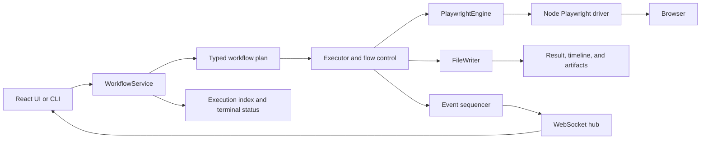

# System architecture

This page is the navigation index for Browser Automation Studio architecture. The authoritative architecture map is [Architecture](concepts/ARCHITECTURE.md); it records current system boundaries, invariants, owner decisions, and implementation evidence. This index routes readers to that map and to focused subsystem references.

## Runtime at a glance

The workflow service owns admission, index status, and workflow-level completion. The executor owns compiled instruction and graph behavior; the currently supported browser engine is Playwright. The execution writer persists result and timeline evidence, while the event sequencer streams ordered updates. See the [execution architecture](architecture/execution.md) for the full source-backed boundary and code map.

## Architecture references

| Topic | Owner reference |
| --- | --- |
| System boundaries, invariants, and cross-domain ownership | [Architecture map](concepts/ARCHITECTURE.md) |
| Workflow plans, flow control, browser sessions, events, and execution evidence | [Execution architecture](architecture/execution.md) |
| Driver and navigator interfaces | [Driver interface](architecture/driver-interface.md) |
| Manual recording and action persistence | [Recording architecture](architecture/recording.md) |
| Vision-based navigation | [AI navigation architecture](architecture/ai-navigation.md) |
| Runtime reconciliation | [Reconciliation architecture](architecture/reconciliation.md) |

## Implementation entry points

| Change area | Start here |
| --- | --- |
| Workflow request, plan compilation, execution status | `api/services/workflow/executions.go` |
| Instruction execution and retry/timeout coordination | `api/automation/executor/simple_executor.go` |
| Graph branches, loops, and subflows | `api/automation/executor/flow_executor.go` |
| Browser engine adapter and local driver | `api/automation/engine/playwright_engine.go` and `playwright-driver/` |
| Execution result, timeline, and artifact persistence | `api/automation/execution-writer/file_writer.go` |
| Live event sequencing and WebSocket delivery | `api/automation/events/ws_sink.go` |
| Manual recording behavior | `api/services/recording/` and [recording architecture](architecture/recording.md) |
| Vision navigation | `api/handlers/ai_service/` and [AI navigation architecture](architecture/ai-navigation.md) |
| Replay export and rendering | `api/services/export/`, `api/handlers/export/`, and `ui/src/export/` |

Read [Domains](concepts/DOMAINS.md), [Flows](concepts/FLOWS.md), [Data](concepts/DATA.md), and [Integrations](concepts/INTEGRATIONS.md) for product-specific domain contracts. Operational and test procedures belong to their [runbook](operations/RUNBOOK.md) and [testing guide](internal/TESTING.md).
