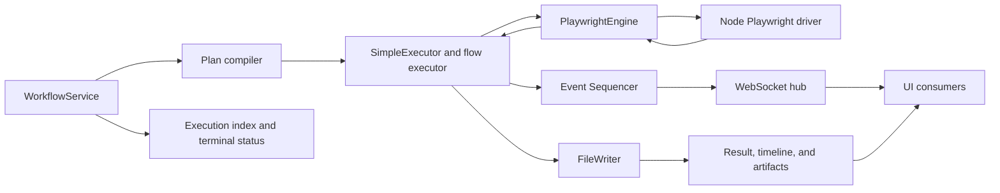

# Workflow execution architecture

This page describes the live execution path. The [scenario architecture map](../concepts/ARCHITECTURE.md) owns the overall system boundaries; this spoke follows a workflow from request through browser execution, evidence, and status. Source paths below are relative to `scenarios/browser-automation-studio`.

## Runtime path

1. `api/services/workflow/executions.go` resolves the saved workflow and its inputs, settles initial navigation readiness, creates the durable execution index, and compiles the workflow through `automation/executor/plan_builder.go` before building an executor request. The workflow service remains responsible for that index and terminal status.
2. `api/automation/executor/simple_executor.go` validates the request, resolves the configured engine, checks required capabilities, and applies the plan's timeout and session policy.
3. `api/automation/executor/simple_executor.go` owns the execution shell: instruction attempts, per-step deadlines, retries, heartbeat and telemetry emission, outcome normalization, and recording. `flow_executor.go` owns graph traversal, branches, loops, variable state, and subflows.
4. `api/automation/engine/playwright_engine.go` adapts the engine contract to the local Node Playwright driver. The engine runs one compiled instruction in a browser session and returns a normalized `StepOutcome`; it does not own workflow persistence or policy.
5. `api/automation/execution-writer/file_writer.go` sanitizes and writes result and timeline files and artifact metadata. Screenshot bytes use the configured storage path; the writer owns artifact identifiers and size limits. The workflow service commits the execution's terminal index status after the executor returns.
6. `api/automation/events/` sequences execution events and bridges them to the WebSocket hub. The sink applies bounded per-execution queues and backpressure policy before UI consumers receive updates.

## Ownership and behavior

| Concern | Owner | Contract |
| --- | --- | --- |
| Workflow and execution status | `services/workflow/` | Creates the index record and commits its terminal state; artifact recording does not replace that authority. |
| Plan and action payloads | `automation/contracts/` and `packages/proto/` | Versioned, bounded payloads shared across Go, Node, and UI. Do not add an engine-specific wire dialect. |
| Flow control | `automation/executor/` | Graph edges, condition/failure routing, loop handlers, variable interpolation, subflow depth, retries, and execution/step timeouts stay in the executor. Legacy `workflowCall` nodes are rejected; use `subflow`. |
| Browser operations | `automation/engine/` and `playwright-driver/` | Playwright is the currently supported engine. Driver actions cross the typed contract and return normalized outcomes. |
| Durable execution evidence | `automation/execution-writer/` | Result and proto timeline files plus bounded artifacts are written separately from the workflow status index. |
| Live events | `automation/events/` | Events are sequenced per execution; queue pressure may discard configured low-priority updates, while terminal completion/failure events are retained. |

The executor resolves session reuse from the request, then plan metadata, then `BAS_SESSION_STRATEGY`; the default is `reuse`. The session manager receives `reuse`, `clean`, or `fresh` in its session specification. A new execution establishes fresh navigation bookkeeping; workflows do not implicitly become separate sessions at each step. See `executor/session_lifecycle.go` and `automation/session/manager.go` for the boundary policy and its tests.

The engine's capability declaration is checked against the compiled plan before execution. Per-step and plan-level time limits are enforced by executor contexts. Workflow status finalization and required-video checks remain at the workflow service boundary, not in the engine.

`automation/contracts/events.go` names lifecycle events (`execution.started`, `execution.progress`, `execution.completed`, `execution.failed`, `execution.cancelled`, and `execution.interrupted`) plus `step.started`, `step.completed`, `step.failed`, `step.screenshot`, `step.telemetry`, and `step.heartbeat`. The WebSocket sink maps these contract envelopes to the shared timeline protobuf.

## Extension path

Add a workflow action through the shared action contract and compiler, declare its capability requirements, implement it in the Playwright driver, normalize its outcome, and cover its behavior at the owner boundary. Keep graph and retry policy in the executor, durable shape in the writer, and consumer event shape in `automation/contracts/events.go`. Tests live beside these owners; `docs/internal/TESTING.md` describes scenario validation.

## Source map

- [Automation package guide](../../api/automation/README.md)
- [Executor guide](../../api/automation/executor/README.md)
- [Driver interface](driver-interface.md)
- [Recording architecture](recording.md)
- [System architecture index](../SYSTEM_ARCHITECTURE.md)
- [Test Genie guidance](../internal/TESTING.md)
