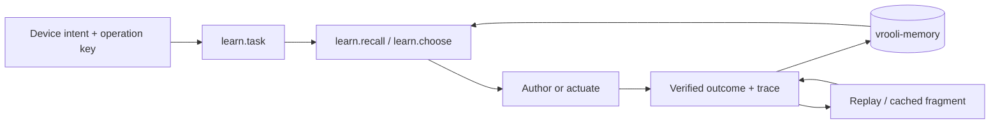
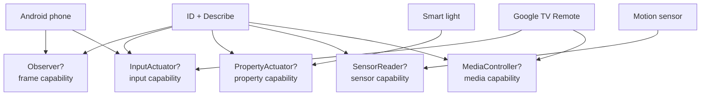

# Strategy contract

## TV qualification target (22 October 2026)

Observation must perform no device writes. Flow cleanup restores only fields
the flow changed. Android rotation cleanup preserves raw settings, including
absent values, and authentication cleanup preserves the original keyguard.
Exact-device inspection must not depend on unrelated transport discovery.
Verified reconnect refreshes reachability; capability evidence retains its own
probe time. Application launch distinguishes command acceptance from observed
foreground and visible readiness. The operator sees both a captured frame and
directional controls when the selected healthy transport supports them.

Qualification uses bounded leases, repeated stock-Home/app/Back cycles, captured
frames, explicit assertions, and verified lease release. Stock Home stays selected.
Portal owns the native TV client; Device Control owns its maintenance and tests.
These are acceptance targets, not claims of current implementation or TV readiness.

The mandatory strategy floor is deliberately small:

```go
type Strategy interface {
    ID() string
    Describe(context.Context) (Declaration, error)
}
```

`Observe` and `Actuate` are not required. A screenless sensor cannot produce a
frame, and a read-only device cannot accept an input event. They are optional
interfaces, alongside the existing `SessionRecorder` and `SemanticResolver`:

- `Observer` — `Observe(context.Context) (Frame, error)`.
- `InputActuator` — `Actuate(context.Context, Actuation) error`.
- `PropertyActuator` — typed `GetProperty` and `SetProperty` over declared
  attributes.
- `SensorReader` — read-only typed sensor readings.
- `MediaController` — play, pause, stop, next, previous, and volume.
- `StateReader` — returns the typed mobile subset plus every declared property
  and explicit unavailable reasons.
- `StateObserver` — runs until cancellation and publishes one event per changed
  attribute. Push transports use it directly; poll transports declare their
  interval and use `StateReader` as a bounded fallback.
- `Pairer` — performs an interactive pairing exchange from a non-serializable
  secret request and returns only a redacted outcome.

The capability constants added by this model are `CapProperty`, `CapSensor`,
and `CapMedia`. `CapProperty` describes state that can be read or changed;
`CapSensor` describes observed readings; `CapMedia` describes transport
commands. A state-bearing device, such as a light, has a current value that can
transition. An event-bearing device, such as a doorbell button, reports an
occurrence without a durable current value. The distinction is preserved in
state-change events.

Strategies may also advertise semantic `Operations` such as `volume-up`,
`volume-down`, `volume-set`, or `mute`. Programs use those declarations and
writable property descriptors to choose a transport. They do not select a
transport from a room name, model name, or strategy-specific device label.

`DeviceState` keeps the existing named mobile fields and adds a typed property
bag. Every property declared by a transport is either present with its value
and supplying transport or appears in `Unavailable` with a reason; a zero value
is never used to hide an unreadable television property. Cast declares push
observation, while transports without push observation may declare a poll
interval.

Unavailable capabilities are never omitted. A declaration includes the
capability with `status: unavailable` and a reason or next action. This lets an
operator distinguish “not supported by this transport” from “not probed yet”.

## Learning loop for device operations

Device intent carries an explicit device and operation key. The learning trace
records the selected transport and verified outcome so later runs can recall
the decision or replay a cached fragment without hiding unavailable capability
state.





`Tiers` and `StepKinds` are derived from this declaration. A property-only
device receives a property rung and property steps; it receives no `observe`,
`tap`, `key`, or `wait` step. Screen rungs remain available for transports that
declare both screenshot and input, preserving the Android behavior.

Conformance accepts a floor-only strategy. It checks the declaration and only
probes an optional interface when the strategy implements that interface and
declares the corresponding capability. Existing strategies retain their
current capability sets: `android-adb` keeps screen/input/semantic and its
Android extensions; `host-desktop` keeps screenshot/input; `ios-mirror` keeps
its advisory visual capabilities; `ios-simctl` and `ios-xcuitest` keep their
simulator/test control capabilities. Their capability sets are transport
facts, not requirements imposed on new strategies.

## Flow-scoped reverse TCP development target

A `reverse-tcp` flow step may temporarily map one unprivileged device TCP port to one unprivileged host-loopback TCP port through the selected authorized ADB transport. It requires its own probed capability and typed strategy interface. The listener and destination use explicit `tcp:localhost:PORT`; bare device TCP listeners can bind all interfaces on Android 11. A narrowly typed owner client uses the existing default local ADB server protocol for creation because the CLI forwarding parser rejects explicit hostnames. List/remove remain owner CLI operations; nondefault daemon configurations are refused until qualified. A flow accepts at most four distinct device ports, refuses existing bindings and rebinding, and registers bounded cleanup under the current lease. Normal completion, failed downstream steps, and request cancellation remove and verify only mappings owned by that flow. Unknown or failed cleanup fails the run; a successful setup is not proof that an application used the route. Host firewalls, VPNs, assistant roles, and default Home are outside this operation. Abrupt process/host death is not equivalent to verified cleanup.

Android 11 rewrites a resolved listener's listed name to `tcp:PORT` even when
creation explicitly bound localhost. Verification and cleanup recognize that
listed alias while requiring the exact host-loopback destination. A successful
exact-name absence check alone is insufficient. `reverse-tcp-remove` provides
explicit recovery under the flow lease: the operator supplies the device port
and exact expected host port; a mismatched or ambiguous destination is refused.
It verifies removal and never restores the removed route. This recovery is not
permission to remove an unrelated binding.

## Read-only TV voice qualification

Runtime inspection may report the microphone feature flag, current Assistant
role holders, selected Assistant/voice-interaction components, installed voice
interaction services and input-type names mentioned by the OEM audio policy.
Each failed or unparseable probe remains unknown. These facts do not establish
permission to record, remote microphone delivery to ordinary apps, usable audio,
role replaceability or Assistant-button routing. The vocabulary is fixed and
read-only; recording, granting permissions, key injection and role mutation are
outside inspection. Raw audio policy dumps and device addresses are not returned.
