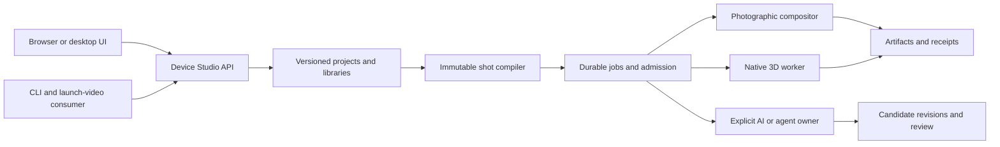

# Architecture — Device Studio

## Purpose Of This Document

Foundation contract with implementation status updated 2026-10-20. The project workspace and photographic still workflow have retained product evidence; video, native motion and the broader release remain in development. Target behavior below is not a release-completion claim.

Device Studio owns reproducible device presentation shots. It composes measured hardware, scenes, real application media, simulated presentation chrome and motion. It serves a direct UI, agent tools and CLI/Connect consumers. Its dominant ecosystem role is interface-enabler; deterministic shot compilation and shared revisions multiply future reuse.

## Scenario Shape

Use the governed Go/React/Vite/Connect template with per-domain repositories and SQLite for local metadata. Binary media uses shared blob/artifact storage. A dedicated browser stage previews the canonical frame schedule. A deterministic compositor handles pinned photographic plates. An isolated native renderer worker handles full 3D. Desktop packaging wraps the same API/UI and qualified local tools.

The diagram is a target interaction map. No arrows claim existing product endpoints.

## System Boundaries

Own physical device definitions, device adaptations, supports/mount compatibility, screen mappings and profiles, motion, compiled shots, job orchestration and device-specific qualification. BAS owns capture; Image Tools owns generic raster/provider operations; AI Gateway routes inference; Asset Studio owns generic shared media publication. LPBS owns commerce; credential authority owns secrets; control-plane/tool owners provision renderers. Launch-video/HyperFrames owns final-film editing, audio mix and CTA. Do not recreate these owners inside Device Studio.

A shared-library publication requires the Asset Studio adapter and its approval conditions. Private import/edit/render works independently. A missing publication owner leaves release pending; it must not create an alternate generic release authority.

## Contracts And Data Flow

Conceptual records in [DATA.md](DATA.md) are design inputs. Actual public messages and services belong in `packages/proto/schemas/device-studio/v1/<domain>/`. Generate clients/handlers through the governed proto owner; never hand-edit generated outputs. Prefer Connect for metadata/operations. Use the template's explicit REST exceptions for opaque bytes, third-party callbacks or probes; metadata remains typed.

UI and CLI submit intent, not authoritative balances, paths or approval claims. The API validates revision/ownership/capabilities, compiles immutable inputs and admits jobs. Workers receive resolved job-local artifacts, no ambient operator credentials. Results carry digests, render/profile versions, source timing, actual or unknown cost and cleanup state. Large artifacts use owner-issued opaque references with authenticated byte retrieval; absolute host paths are not portable wire contracts.

## Shared Infrastructure

Reuse api-core identity, authn, discovery, storage/blob and schema primitives; reuse platform-go owned process containment after target qualification. Engine-independent repository interfaces hide SQLite. Keep generic clock, storage, process and provider seams small and test-substitutable. Composition roots wire domains; business rules stay in their domain. Resource containment does not establish network/filesystem isolation for generated Blender Python.

## Extension Rules

Implement dependency roots before consumers. Begin with projects and imported artifact ownership; add device/scene/presentation/motion definitions needed by one photographic shot, then shots and local jobs. Add 3D adapters and creation/review flows against those contracts. Within each coherent domain slice: proto, API/domain persistence, transport, CLI, then UI and evidence. Do not postpone all UI integration until every API exists.

Keep the template reference domain until the first real product slice passes, then use governed detemplate. A foundation-only task does not fabricate that slice. Update requirements, experience and domain docs before expanding promised behavior.

## Architecture Maturity

| Area | Current | Completion evidence |
|---|---|---|
| Scaffold | Generated reference; lifecycle evidence in PROGRESS | Owner generation receipt and scoped checks |
| Domain design | Projects/media, immutable still shots and durable local render jobs implemented; broader domains remain specified | Narrow requirement-linked tests plus retained API/CLI/browser journeys |
| Photographic technique | Fixed still projection and phone/browser chrome implemented; public workflow, cancellation and graceful restart replay verified in E2 | Higher-resolution still qualification and fixed-look approval remain open; video is E2V |
| Full 3D | Prior scene finish rejected; motion unqualified | Reviewed actual-renderer still and continuous spin/hinge footage |
| Desktop/account | Shared code inspected; gaps retained | Native packaged journeys and account-bound funded operation |

A green schema/document validator establishes structure only.

## Intentional Deviations

The scenario was initialized before product implementation at the operator's request. Light-table Projects/Shot boards are approved and the still editor has runtime proof; remaining UX surfaces and broader requirements are unfinished. Requirement completion is earned through its validation owner, not inferred from these milestones. The experimental GLB viewer is inspection-only: it strips animations and replaces lighting, so it is not the shot stage. A full mesh/material-node editor, arbitrary reconstruction, 4K/HDR release and fully deforming fold animation are outside the initial completion boundary.

## Documentation Architecture

[DOMAINS.md](DOMAINS.md) owns boundaries; [FLOWS.md](FLOWS.md) owns lifecycle; [DATA.md](DATA.md) owns records/retention; [INTEGRATIONS.md](INTEGRATIONS.md) owns external contracts. [SEAMS.md](../internal/SEAMS.md) names test substitutions; [TESTING.md](../internal/TESTING.md) owns evidence method. Domain depth belongs in `docs/domains/`; historical research stays distinct from current decisions.

## Cross-References

[START-HERE](../START-HERE.md), [PRD](../../PRD.md), [research](../research/README.md), [decisions](../internal/DECISIONS.md).

## E2V storage and execution decision

This remains a pre-release app with development fixtures. Evolve one projects-owned source-media model for image and video rather than duplicating original-byte identity, paging and deduplication in per-format tables. Unknown inspected facts have explicit presence/readiness. Preserve existing local rows through the storage owner's greenfield-with-data conversion route at a coordinated lifecycle boundary; retain before/after evidence. No production migration framework is introduced by this development step. The shared jobs ledger and bounded pump own media-inspection attempts as explicit typed subjects; no dummy shot revision or second execution supervisor. Domain finalization must be retryable for success, rejection and cancellation without rerunning a terminal native attempt. Exact legacy still canonical bytes/hash remain a regression gate. These are admitted design constraints; video implementation and qualification remain pending.
