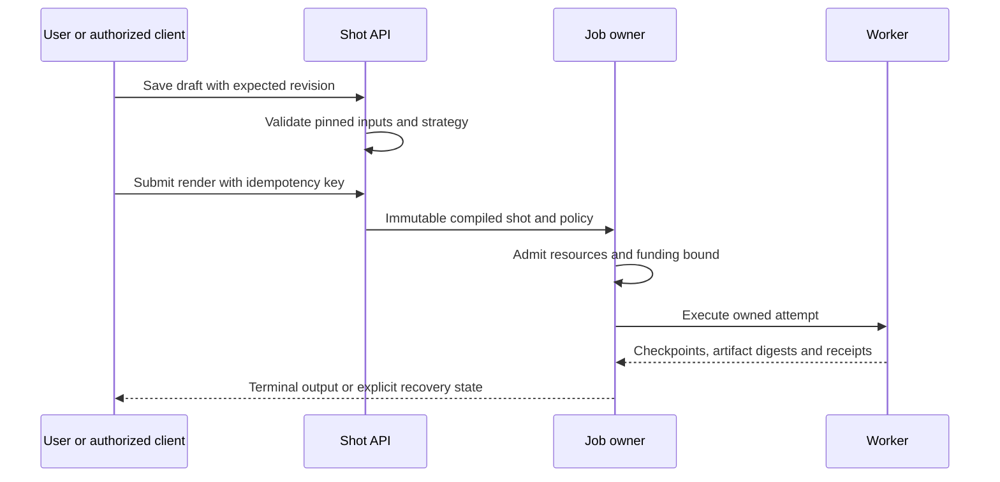
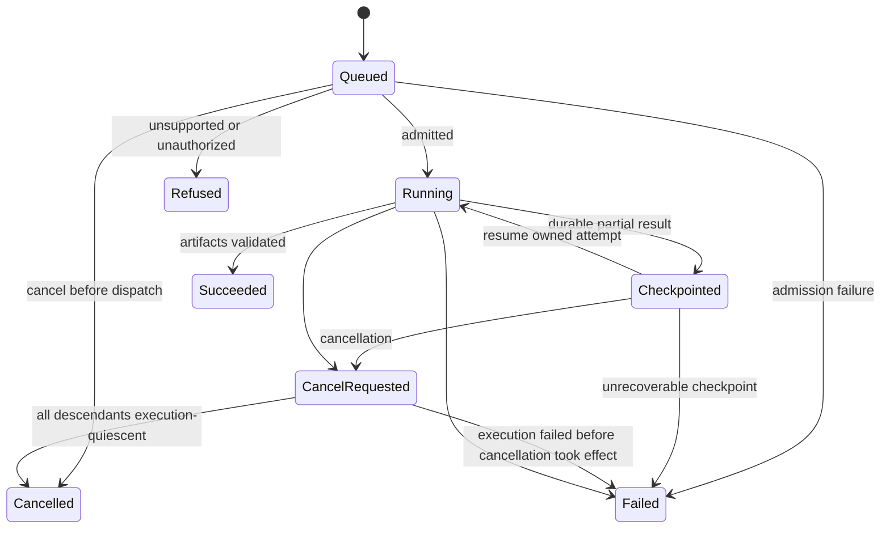

# Flows — Device Studio

## Purpose Of This Document

Foundation contract, 2026-10-19. Product behavior below is specified for implementation; the generated reference scaffold does not implement it. Research demonstrates individual techniques, not a released scenario.

State names describe proposed domain semantics. Public enums must be defined once during proto implementation, not copied from this document as generated code.

## Flow Inventory

| Flow | Trigger | Successful end | Exceptional end |
|---|---|---|---|
| Saved photographic shot | Import recording/plate | Reopen immutable shot and render direct media | Invalid calibration/rights/unsupported motion |
| Physical motion shot | Select device/scene/track | Qualified phone spin, lid motion or screen entry | Invalid rig/support/clearance/backend |
| AI creation | Explicit disclosed agent action | Reviewed candidate ready for scoped release | Needs input, budget exhausted, rejected, failed/cancelled |
| Shared release | Human accepts candidate | Owner-issued publication reference plus qualification scope | Release pending owner/rights/approval |
| Paid operation | Explicit selected funding and bounded admission | Authoritative usage settlement and output | Refused, cancellation or pending reconciliation |
| Desktop restart | Open existing local app | Recover projects and truthful jobs offline | Unsupported renderer/profile or corrupt input |

## Flow Details

Local render uses no paid reservation. Funded work first obtains an enforceable maximum/owner hold. A lost submission acknowledgment is resolved using the original operation ID; do not create a duplicate paid operation. Changed input with the same idempotency key returns conflict. Outdated worker completions cannot replace a newer attempt's accepted result.

Creation resolves exact/generic identity and references, acquires permitted originals, calibrates dimensions, imports/adapts/builds, compares held-out views, refines within the parent budget and presents candidate/rejected lineage. Reviewable output never auto-releases. Reusing approved assets does not start generation. Budget and privacy scope include children/retries and remote critique. Pinned policy revisions provide provenance, not permanent authorization. Re-evaluate current project consent, actor authority, selected account/grant, provider route, applicable rate and remaining aggregate cap immediately before every dispatch, child, retry or checkpoint resume. Revocation or a reduced limit prevents new external work and requests cancellation of active work where supported; it cannot recall already transmitted bytes or erase incurred costs. A changed account/route or increased scope requires fresh explicit authorization. Reconciliation of an existing charge is recovery, not permission to launch new work.

## State Machines

The job owner serializes cancellation and terminal commits with an expected-state transition. If Succeeded commits first, a later cancel returns already-terminal. If CancelRequested commits first, late output cannot promote the job to Succeeded; retain it as diagnostic/partial evidence while owned descendants stop or their remote outcome is reconciled. Queued cancellation avoids dispatch. Checkpointed cancellation does not require resuming execution. Cancelled requires terminal or quiescent execution evidence for every owned descendant: all local process trees have stopped and each remote execution has a terminal/reconciled outcome. Mixed local/remote child sets require both conditions, not either. Unknown remote outcome remains CancelRequested/reconciling, never falsely Cancelled. Financial settlement can still remain pending after execution is quiescent. A Failed transition records the actual cause and does not discard pending descendant cleanup. Terminal jobs are immutable. Safe automatic retries occur as owned attempts while the logical job is still nonterminal. A user retry after a terminal result creates a new job and initial attempt, linked to the prior job, with a fresh submission idempotency key. It rechecks current consent and available budget; attempts inside a bounded creation retain that parent budget and all prior cost history. A fresh submission key never permits replay of an unresolved external operation: first reconcile the prior provider dispatch identity. An unknown acknowledgement is recovery of the same operation, not authorization for a new charge.

Execution status and financial reconciliation are orthogonal. A cancelled or failed remote job may still have consumed work; retain pending/unknown settlement and holds until the owner resolves it. Succeeded means valid outputs exist, not artistic approval. Review states distinguish candidate-ready, approved within scope, rejected and invalidated. Publication can remain pending after domain approval. Do not call a cancelled job complete merely because one frame exists.

## Maturity Ladder

Declared here: transitions, inputs and failure conditions. Required implementation evidence: deterministic transition tests, worker cancellation/restart probes, provider replay fixtures and actual public workflows. No formal model checker or production job service has run for this scenario.

## Production Shape

Persist transition and artifact receipt atomically where possible; use an outbox/owner idempotency where external effects cross transactions. Worker claims expire and are reconciled by the authoritative job owner. Cancellation propagates to all owned descendants; unacknowledged remote cancellation remains visible. Active jobs pin tools/inputs even during updates. Deleting a UI tab does not cancel a server-owned job. Browser scrubbing is a preview request with stale-result suppression, not an implicit saved-shot mutation.

## Deferred / Unmodeled Flows

Distributed render-farm scheduling and cloud storage charging are future owner integrations. No assumed generative-video path exists. Flexible fold deformation requires its own motion model and evidence; static open/closed device states cannot satisfy it.

## Cross-References

[DATA.md](DATA.md), [INTEGRATIONS.md](INTEGRATIONS.md), [creation](../domains/creation.md), [SEAMS.md](../internal/SEAMS.md), [TESTING.md](../internal/TESTING.md).
