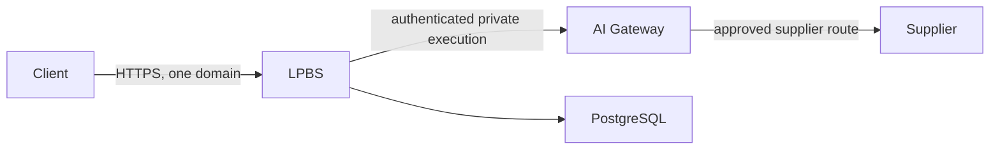

# Cloud reconciliation

This checked-in manifest records the declared production target for
`landing-page-business-suite` and the public hostname `vrooli.com`.

The manifest contains the production target address, but no deployment or remote
write is authorized by the hosted journey. Offline tests replace that address
with a documentation-only address and use isolated fixture archives.

LPBS requires AI Gateway and includes its code in the hosted bundle. The gateway
starts before LPBS and has private listeners. Only LPBS's UI and API are exposed
through the existing domain. The manifest explicitly deselects Ollama, Ollaya,
OpenRouter, OrcaRouter and Abliteration resources; the hosted release must not
start local inference or router resource wrappers.

The composed sign-in test injects a completed optional resource startup failure,
continues through the cloud executor into a separate LPBS test process, and
submits a real HTTP magic-link request. LPBS persists its token and email outbox
entry in isolated PostgreSQL. It does not send mail or prove external delivery.

Hosted inference still needs E26's embedded supplier catalog: the current gateway
reads resource-owned policy and endpoint files from the repository. Excluding
resource code must not silently remove the data needed by that catalog. The
offline shape checks alone do not qualify paid hosted inference.

The deployment still needs the tier-4-saas credential descriptors declared by
the LPBS service manifest. Unconfigured Stripe credentials remain an operator
gap; supplying them unlocks payment processing and the revenue rollup.

Before a live release, the operator must provision and verify the declared
credential bindings and recovery copy, consumer signing key and public JWKS,
transactional email delivery, supplier decisions and trust, and prices/payment
terms. The operator then authorizes the hosted deployment and live validation.
No fixture credential-presence observation, plan digest, or passing test grants
that authority.
