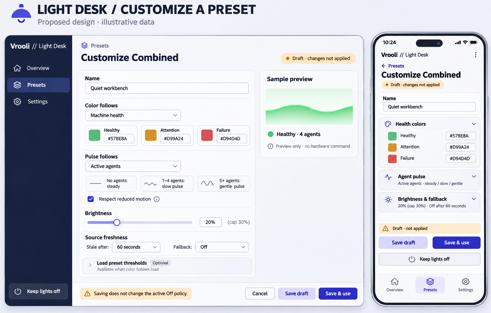

# Custom preset editor proposal



Built-in image generation; illustrative data. The operator ratified this board with the full Light Desk design on 2026-11-10; implementation and operated proof remain open. Source: `/home/matthalloran8/.vrooli/state/vrooli/web-console/sessions/codex/f4662e51-fc9b-4456-b89b-7d06c65220e9/generated_images/01a1c5f8-1401-7c81-a868-db7d17d7a50b/exec-451cf3da-c195-44e0-8973-4b3c853955ef.png`.

Visual review: readable paired editor closes the preset customization omission in the first five boards. Implementation must clarify the generated footer: **Save draft** preserves the current policy; **Save & use** explicitly replaces it. The broad generated statement “Saving does not change the active Off policy” applies only to Save draft. Threshold and agent-band values are examples, not adopted defaults. Reduced motion must distinguish browser preview preference from explicit physical pulse configuration. Colors must render their actual hex values.

## Exact prompt

```text
Use case: ui-mockup. High fidelity Light Desk paired desktop and phone mockup board for CUSTOM PRESET EDITOR, consistent restrained white/palegray panels, navy Vrooli // Light Desk sidebar, indigo primary actions, muted green/amber/red swatches. Landscape desktop 75% left, phone25% right, front-facing flat app screens. Board title "LIGHT DESK / CUSTOMIZE A PRESET"; subtitle "Proposed design · illustrative data". Desktop Presets selected sidebar Overview/Presets/Settings. Page "Customize Combined". Text "Draft · changes not applied". Form sections: Name "Quiet workbench"; Color follows dropdown "Machine health"; editable swatches Healthy green #57BE8A / Attention amber #D99A24 / Failure red #D94D4D. Pulse follows dropdown "Active agents"; "No agents: steady"; "1–4 agents: slow pulse"; "5+ agents: gentle pulse"; "Respect reduced motion" checkbox. Brightness slider20%, cap30%. Source freshness "Stale after: 60 seconds" / "Fallback: Off". Optional collapsed "Load preset thresholds" with small text "Available when color follows load". Inspector right "Sample preview", green wave, sample "Healthy · 4 agents", "Preview only · no hardware command". Bottom warning "Saving does not change the active Off policy." Buttons "Save draft", "Save & use", "Cancel". Global Keep lights off reachable. Phone is focused editor stack with name and expandable sections "Health colors" open with three swatches, "Agent pulse" summary, "Brightness & fallback" summary20%/Off after60s. Persistent footer concise "Draft · not applied", Save draft and Save & use plus Keep lights off. Bottom tabs Overview/Presets selected/Settings. Ensure legible polished visual hierarchy. This is illustrative customization UI, no developer technical data or neon gamer styling.
```

## Independent review of first five boards

Adequate for human visual-direction review. Implementation corrections: keep phone command/physical evidence visible; show source age and stale threshold; label fallback command acceptance precisely; label overview Desired output preview; retain Overview navigation context in controller detail. Mobile must expose brightness caps, verified capabilities, policy replacement explanation and capability-dependent effects. Additional loading, empty enrollment, permission failure, unsupported effect and command retry states require implementation and validation. Persistent Off reachability must be consistent; saved Off never proves physical darkness.

