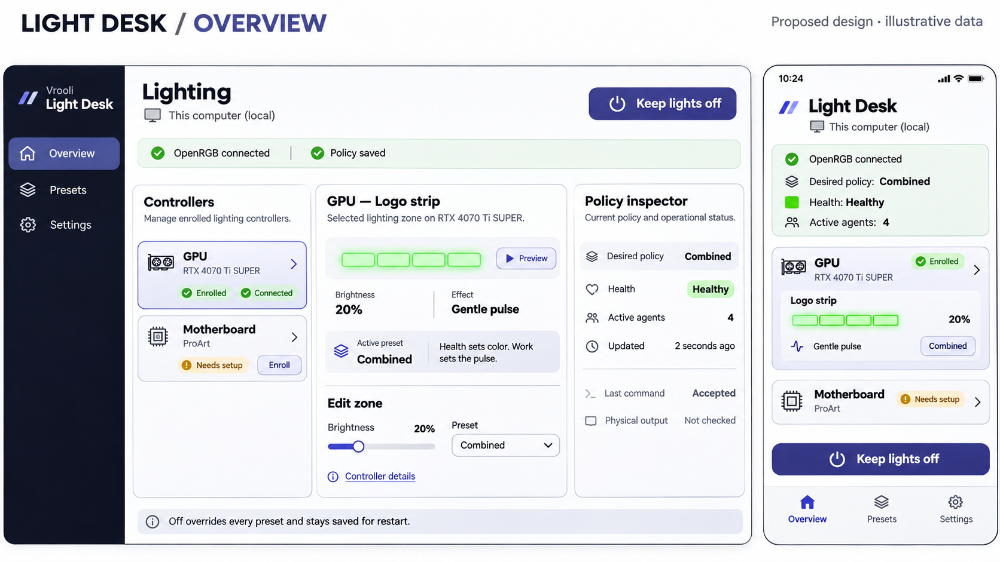
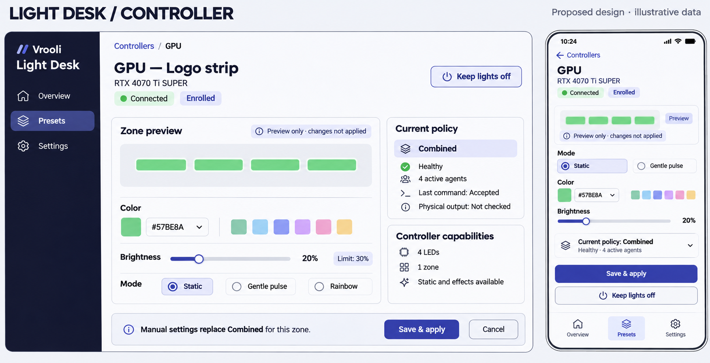
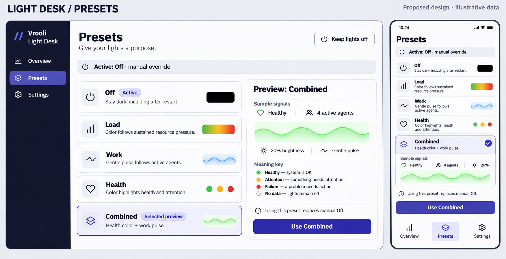
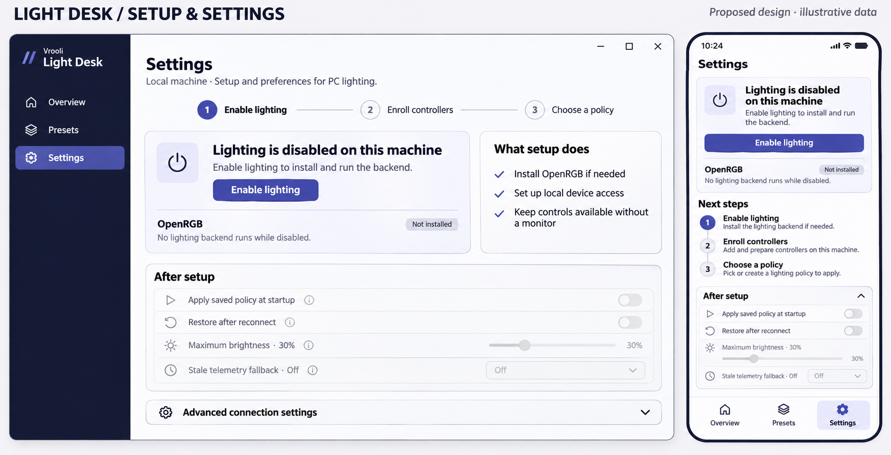
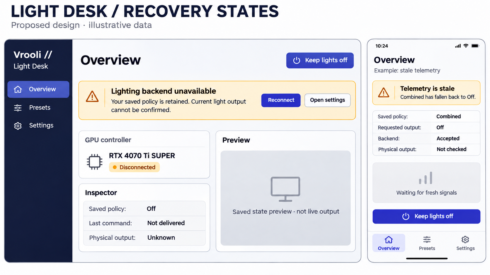

# Light Desk proposed mockups

Sixth board: [Custom preset editor and review corrections](CUSTOMIZE.md).

Status: concept and all six boards approved by the operator on 2026-11-10 in the originating conversation: “I approve of the full light desk design”. Approval recorded at 17:49Z. Generated with the built-in image generation tool on 2026-11-10. All hardware, signals and state shown are illustrative, not operated product evidence. Implementation corrections below and in CUSTOMIZE.md remain required.

## overview



Source: `/home/matthalloran8/.vrooli/state/vrooli/web-console/sessions/codex/f4662e51-fc9b-4456-b89b-7d06c65220e9/generated_images/01a1c5f8-1401-7c81-a868-db7d17d7a50b/exec-32fe42a3-ef12-4a4c-a942-c8f16cf774fd.png`

### Generation prompt

```text
Use case: ui-mockup. Generate a polished high-fidelity UI proposal image for Vrooli's "Light Desk", a calm practical operational app for headless PC RGB lighting. This is a design mockup, not a real product screenshot. Create ONE wide landscape presentation board with an entire large desktop app screen on the left (about 75% width) and a full readable phone app screen on the right. Flat front-facing screens, no perspective, no laptop/phone hardware photographs. Outside the screens write "LIGHT DESK / OVERVIEW" and small "Proposed design · illustrative data". Crisp readable typography, excellent hierarchy, generous spacing, restrained neutral white/light-gray surfaces, dark ink sidebar, muted indigo primary accents, thin borders, modest corner radii, elegant professional utility. Green/amber/red appear only for meaningful health and light previews, not a rainbow gaming aesthetic. Use the same design language across desktop and phone, with intentionally different layouts.

Desktop: narrow ink sidebar with Light Desk wordmark and navigation Overview (selected), Presets, Settings. Main header "Lighting" with local-machine context and a prominent persistent power action "Keep lights off". A concise backend strip says "OpenRGB connected" and "Policy saved". Three useful workbench columns: controller list left, selected zone controls center, policy inspector right. Controller list: "GPU", subtitle "RTX 4070 Ti SUPER", enrolled and connected; "Motherboard", subtitle "ProArt", badge "Needs setup" with secondary "Enroll". Selected GPU center has "Logo strip", four simple LED segments, a small soft green preview, "20% brightness", effect "Gentle pulse", and a clear label "Preview". Its active preset is "Combined" with a short explanation "Health sets color. Work sets the pulse." An editable zone panel shows a restrained brightness slider, preset selector, and link "Controller details". Right inspector groups "Desired policy: Combined", "Health: Healthy", "Active agents: 4", "Updated 2 seconds ago", then distinctly "Last command: Accepted" and "Physical output: Not checked" in subdued secondary text. Do not imply visible LED output was observed. Bottom small explanatory row "Off overrides every preset and stays saved for restart." Do not show developer details, raw SDK packets, ports, databases or logs.

Phone: focused sequential overview rather than squeezed desktop columns. Header Light Desk and local-machine subtitle. First card gives connected backend and "Combined" desired policy, green swatch and 4 active agents. Next a GPU card with Logo strip and 20% preview, then motherboard Needs setup card. Controller cards drill in. Persistent bottom thumb-zone dark power button "Keep lights off", above safe bottom tabs Overview / Presets / Settings. Keep key controls readable and above the fold; all content fits naturally without overlapping controls. This is a premium operational design, clean and plausible to implement.
```

## controller



Source: `/home/matthalloran8/.vrooli/state/vrooli/web-console/sessions/codex/f4662e51-fc9b-4456-b89b-7d06c65220e9/generated_images/01a1c5f8-1401-7c81-a868-db7d17d7a50b/exec-ee6a10e3-a814-489f-8168-de135a1d0373.png`

### Generation prompt

```text
Use case: ui-mockup. Generate a high-fidelity UI proposal for Vrooli's Light Desk, a calm practical app for headless PC RGB lighting. ONE landscape board with a large entire desktop screen left (75% board width) and a full readable phone screen right. Flat front-facing UI, no perspective or device photography. Clear outside-board label and "Proposed design · illustrative data". Design system: neutral white/light-gray surfaces, dark navy/ink desktop sidebar with small Vrooli double-slash mark and "Light Desk", muted indigo primary buttons/selected states, thin light borders, modest corners, crisp dark text, excellent hierarchy and spacing. Sidebar navigation Overview / Presets / Settings; phone bottom tabs same. No neon gaming decoration; color appears purposefully in light previews or status. Desktop composes space, phone uses focused sequential screens. Match a professional implementable operational workbench. Avoid SDK packet IDs, raw ports, database/debug detail and claims of measured physical lighting.
Outside title "LIGHT DESK / CONTROLLER".
Desktop controller-detail screen: header breadcrumb "Controllers / GPU", title "GPU — Logo strip", subtitle "RTX 4070 Ti SUPER" and Connected/Enrolled status. Prominent global "Keep lights off" button at upper right. Main left panel "Zone preview" shows four small LED segments in soft mint green and "Preview only · changes not applied". Below: color picker with selected swatch #57BE8A, a handful of restrained swatches, brightness slider 20%, mode choice Static (selected), Gentle pulse, Rainbow. A maximum brightness note "Limit: 30%". Main right panel "Current policy" shows Combined, Healthy, 4 active agents, "Last command: Accepted" and "Physical output: Not checked". Beneath it a small "Controller capabilities" card: 4 LEDs, 1 zone, Static and effects available. Bottom editing bar says "Manual settings replace Combined for this zone" with primary "Save & apply" and secondary Cancel. This screen is editing an unapplied manual preview, distinguish it from actual state. Typography and controls readable and uncluttered.
Phone detail view: back link Controllers, GPU title and small model subtitle; green four-segment preview and Preview badge; Static/Gentle pulse mode choice, color swatches and readable hex value; brightness slider and 20%; current-policy summary can collapse into a row. Thumb-zone "Save & apply" primary and separate small power action "Keep lights off", then safe bottom navigation. All labels fit; do not squeeze desktop panels into columns.
```

## presets



Source: `/home/matthalloran8/.vrooli/state/vrooli/web-console/sessions/codex/f4662e51-fc9b-4456-b89b-7d06c65220e9/generated_images/01a1c5f8-1401-7c81-a868-db7d17d7a50b/exec-8b110904-bb77-4ad1-9f23-550012da14e1.png`

### Generation prompt

```text
Use case: ui-mockup. Generate a high-fidelity UI proposal for Vrooli's Light Desk, a calm practical app for headless PC RGB lighting. ONE landscape board with a large entire desktop screen left (75% board width) and a full readable phone screen right. Flat front-facing UI, no perspective or device photography. Clear outside-board label and "Proposed design · illustrative data". Design system: neutral white/light-gray surfaces, dark navy/ink desktop sidebar with small Vrooli double-slash mark and "Light Desk", muted indigo primary buttons/selected states, thin light borders, modest corners, crisp dark text, excellent hierarchy and spacing. Sidebar navigation Overview / Presets / Settings; phone bottom tabs same. No neon gaming decoration; color appears purposefully in light previews or status. Desktop composes space, phone uses focused sequential screens. Match a professional implementable operational workbench. Avoid SDK packet IDs, raw ports, database/debug detail and claims of measured physical lighting.
Outside title "LIGHT DESK / PRESETS".
Desktop header "Presets", subtitle "Give your lights a purpose.", global "Keep lights off" power button. A compact active-policy strip "Active: Off · manual override". Main two-column card grid on left with five clearly readable presets: "Off" (Active badge, description "Stay dark, including after restart.", black swatch); "Load" ("Color follows sustained resource pressure.", green-amber-red spectrum); "Work" ("Gentle pulse follows active agents.", soft blue pulse icon); "Health" ("Color highlights health and attention.", status dots); "Combined" (Selected preview badge, indigo outline, "Health color + work pulse.", soft green pulse motif). These are functional previews, not gaudy cards. Right inspector titled "Preview: Combined" with "Sample signals" label, Healthy and 4 active agents, a soft green light preview, 20% brightness, gentle pulse. A compact meaning key: Healthy green / Attention amber / Failure red / No data Off. Inline note "Using this preset replaces manual Off." Primary button "Use Combined". Keep preview visibly separate from the current active Off state and show no false physical output claim.
Phone: Presets heading, active Off/manual-override strip, a vertical compact stack of five selectable preset rows with same names and short descriptions, Combined selected with a concise expanded preview (Sample signals, Healthy, 4 agents, 20%). Persistent lower "Use Combined" button and small note replacing manual Off, followed by bottom tabs Overview / Presets (selected) / Settings. Preserve comfortable touch targets and simple hierarchy.
```

## settings



Source: `/home/matthalloran8/.vrooli/state/vrooli/web-console/sessions/codex/f4662e51-fc9b-4456-b89b-7d06c65220e9/generated_images/01a1c5f8-1401-7c81-a868-db7d17d7a50b/exec-d7ba2af3-9380-4eeb-94d0-d13c5e8e53c9.png`

### Generation prompt

```text
Use case: ui-mockup. Generate a high-fidelity UI proposal for Vrooli's Light Desk, a calm practical app for headless PC RGB lighting. ONE landscape board with a large entire desktop screen left (75% board width) and a full readable phone screen right. Flat front-facing UI, no perspective or device photography. Clear outside-board label and "Proposed design · illustrative data". Design system: neutral white/light-gray surfaces, dark navy/ink desktop sidebar with small Vrooli double-slash mark and "Light Desk", muted indigo primary buttons/selected states, thin light borders, modest corners, crisp dark text, excellent hierarchy and spacing. Sidebar navigation Overview / Presets / Settings; phone bottom tabs same. No neon gaming decoration; color appears purposefully in light previews or status. Desktop composes space, phone uses focused sequential screens. Match a professional implementable operational workbench. Avoid SDK packet IDs, raw ports, database/debug detail and claims of measured physical lighting.
Outside title "LIGHT DESK / SETUP & SETTINGS".
Show initial opt-in state, not an already-installed backend. Desktop Settings selected in sidebar. Header "Settings" with local-machine subtitle. Main setup card title "Lighting is disabled on this machine", quiet power icon, text "Enable lighting to install and run the backend.", primary "Enable lighting" button. Backend row "OpenRGB" with neutral "Not installed" badge. Secondary explanation "No lighting backend runs while disabled." Adjacent panel "What setup does": "Install OpenRGB if needed", "Set up local device access", "Keep controls available without a monitor". A second section "After setup" shows muted inactive preference rows: "Apply saved policy at startup", "Restore after reconnect", "Maximum brightness · 30%", "Stale telemetry fallback · Off". All clearly disabled until setup; no fake healthy badge or scanned hardware list. A simple three-step progress indicator: 1 Enable lighting / 2 Enroll controllers / 3 Choose a policy. Advanced connection settings collapsed at bottom; do not expose technical defaults. Keep it warm, clear, and optional rather than alarming.
Phone: Settings header, focused initial setup card and Enable lighting action above fold; numbered next steps as a vertical stack; after-setup preferences in an expandable summary section. Bottom tabs Overview / Presets / Settings selected. Keep opt-in explanation and disabled/backend-absent distinction readable. No hardware facts are shown before enrollment.
```

## states



Source: `/home/matthalloran8/.vrooli/state/vrooli/web-console/sessions/codex/f4662e51-fc9b-4456-b89b-7d06c65220e9/generated_images/01a1c5f8-1401-7c81-a868-db7d17d7a50b/exec-5f81fcdc-0d7f-4dab-805f-0ae2f5edae84.png`

### Generation prompt

```text
Use case: ui-mockup. Create a high fidelity Light Desk proposed UI failure-state board, landscape. Large desktop app screen left 75%, phone app screen right 25%. Outside title "LIGHT DESK / RECOVERY STATES", subtitle "Proposed design · illustrative data". Consistent restrained professional utility style: white and pale gray surfaces, navy sidebar with Vrooli // logo and Light Desk, indigo primary buttons, modest corners, crisp readable typography, amber warnings. Not a gaming dashboard, no rainbow decoration. Desktop navigation Overview selected, Presets, Settings. Desktop is a BACKEND UNAVAILABLE example: title Overview; amber banner "Lighting backend unavailable" and explanatory text "Your saved policy is retained. Current light output cannot be confirmed." Actions "Reconnect" and "Open settings". Global "Keep lights off" button. GPU controller card RTX 4070 Ti SUPER, Disconnected badge. Inspector rows "Saved policy: Off", "Last command: Not delivered", "Physical output: Unknown". Preview is gray with explicit "Saved state preview · not live output". Do NOT indicate actual lights are off. Phone is a separate STALE TELEMETRY example with title Overview, small heading "Example: stale telemetry", warning "Telemetry is stale", body "Combined has fallen back to Off.", rows "Saved policy: Combined", "Requested output: Off", "Backend: Accepted", "Physical output: Not checked". Muted empty mini chart "Waiting for fresh signals", "Keep lights off" thumb button, bottom tabs Overview selected, Presets, Settings. Both states must distinguish policy/request, backend acknowledgment, physical verification. Flat front-facing UI board, no perspective or physical desk. Keep text legible and composition calm.
```

## Review notes

These raster boards specify direction and information hierarchy. Implementation must use the owning design system and verified capabilities. The controller board incorrectly highlights Presets while editing a controller; the implemented route must retain Overview navigation context. Generated swatch values are illustrative and must be reconciled with exact rendered hex colors. Settings shows disabled future preferences: enabling must establish explicit machine-local defaults. Recovery states must preserve the distinction between saved policy, requested fallback, backend acceptance and unknown physical output. No generated mockup proves hardware behavior.

