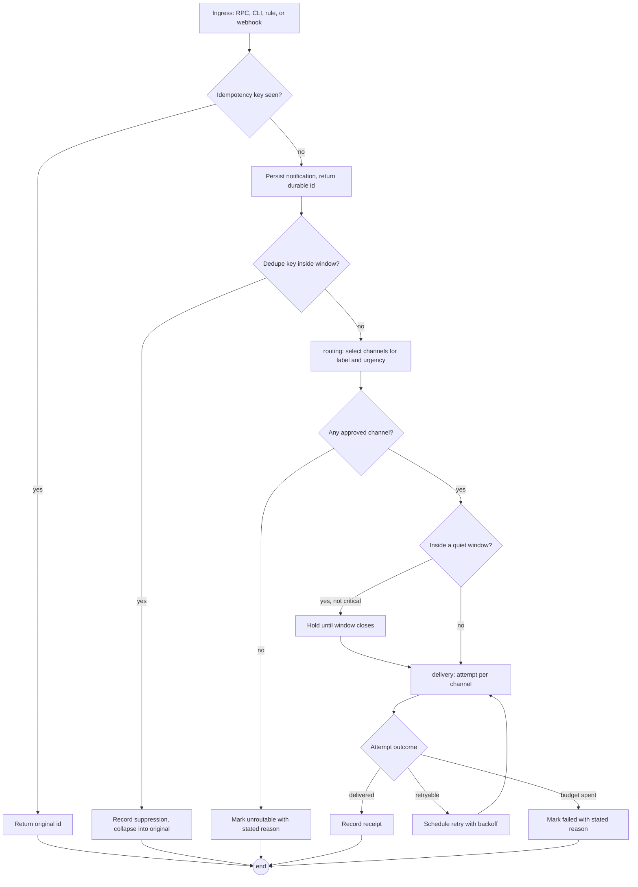
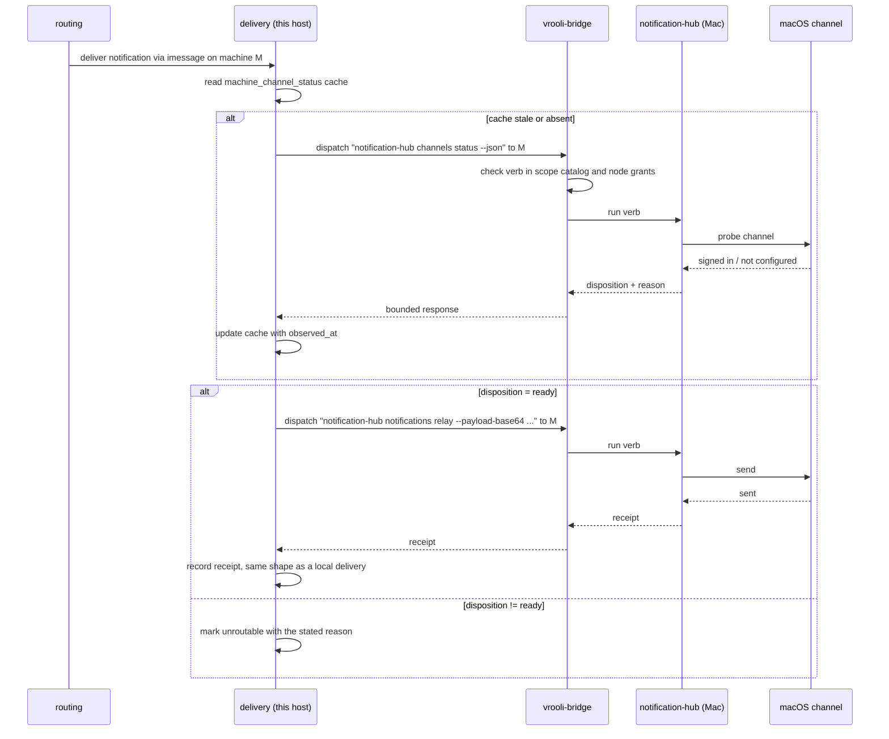
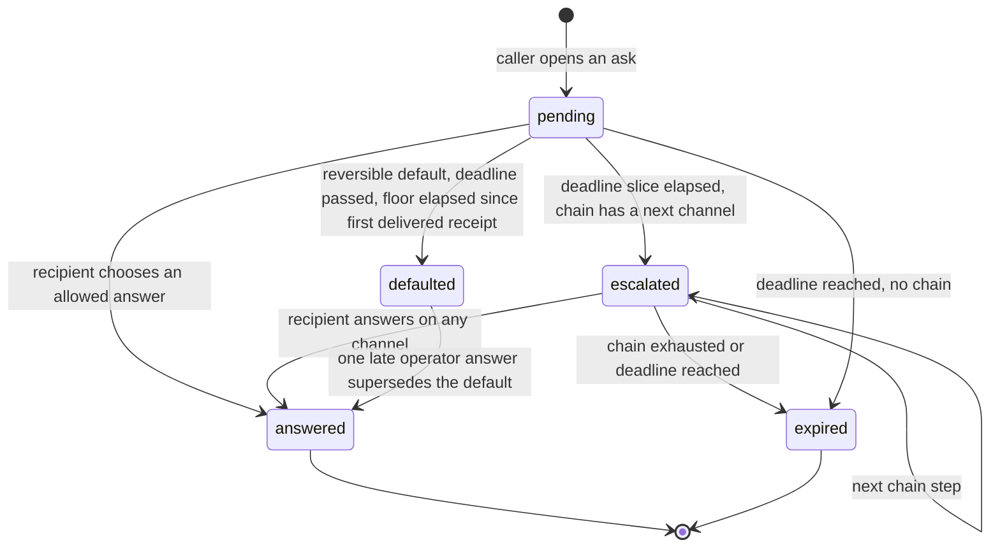

# Flows — Notification Hub

Ordered, stateful behavior in this scenario: what moves through the
system, in what order, and which states are illegal.

## Purpose Of This Document

A notification is not a CRUD record. It is accepted, judged, held,
attempted, retried, and finally resolved — and at several points it can
end in a state that looks like success from outside while nothing reached
a human. This document names those flows so the failure modes are
designed for rather than discovered.

## Current design target and amendments

This section is the current product amendment record. The selected design remains
Direction D, Night signal, with desktop working queues and mobile focused decisions,
across Needs you, Updates, History, Delivery detail and Settings/Reach. Read the
[selected atlas](../../../../docs/internal/delivery-operations/2026-10-12/sources/notification-hub-atlas.md),
[dossier](../../../../docs/internal/delivery-operations/2026-10-12/sources/notification-hub-dossier.md)
and [original-image manifest](../../../../docs/internal/delivery-operations/2026-10-12/sources/notification-hub-revision/selected-image-manifest.json)
alongside these amendments, the PRD and the flows below. These links resolve from this
document; the dated atlas remains original evidence rather than a competing current record.

The latest applicable explicit user decision supersedes an older visual choice within
governing product, safety and authority constraints. Preserve useful existing navigation,
filters, actions, recovery and accessibility even when absent from a screenshot. Agent
refinements follow `experiential-ui-design` §2a: retain the selected concept, demonstrate a
specific gain, operate the affected workflow and record authorship, evidence and disposition.
No full mockup regeneration is required. Verified implemented amendments/refinements are
expected differences; missing behavior, unverified changes and genuine defects remain open.

### NH-DESIGN-20261025-01 — retain mobile bottom navigation

- **Source and authority:** User instruction on 25 October 2026: “I do in fact want the
  bottom nav.” This is an explicit product amendment, not an agent preference.
- **Disposition:** User-approved requirement, implemented in the shared shell with focused and
  representative browser proof in `../../../../.vrooli/work/delivery/notification-hub-delivery/evidence/design-amendments-20261025/`. E43 acknowledged D4; whole-surface acceptance remains separate. It supersedes interpreting selected screenshots without bottom navigation
  as authority to remove it.
- **Scope:** Persistent primary navigation on mobile primary destination views, including
  History, Delivery and Settings/Reach. Keep all five destinations reachable and identify
  the active destination. Desktop retains its appropriate primary navigation. A modal or
  focused editing task may temporarily cover navigation while it owns focus; it must
  restore the destination/navigation on close and must not cause draft loss.
- **Preserve:** Safe-area top and bottom handling, unobscured scroll content and actions,
  keyboard/focus behavior, accessible labels and targets, routed-test context, nested
  routes, back behavior and unsaved work. Retaining the bar does not authorize recipient
  answers, external delivery/enrollment, or unresolved privacy choices.
- **Verification owed:** Current-build phone captures and operated destination changes,
  active states, nested back/recovery, nonzero safe-area insets and keyboard/focus; desktop
  capture/behavior check for shell parity. Link comparisons to this amendment rather than
  failing them because the original image omitted the bar.

### NH-DESIGN-20261025-02 — polish beyond imperfect mockups

- **Source and authority:** User instruction on 25 October 2026: the same general design
  should become more polished and professional. The supplied Vega examples illustrate
  unnecessary outer drawer padding and crowded editor controls versus a compact tools
  menu. These are user preferences for the refinement method, not proof of a tested
  Notification Hub component replacement or permission to remove a capability.
- **Disposition:** User-approved design direction. Individual material refinements remain
  proposed until their actual component/task fit and behavior are verified.
- **Apply:** Prefer a fitting governed shared drawer without an unnecessary outer gutter,
  retaining readable internal padding and safe areas. Group secondary tools behind a
  labelled menu when that clarifies the main task; preserve discoverability, frequent and
  primary actions, and the full expanded workflow. Expanded Find/Replace and a collapsed
  tools menu can be complementary states. Do not infer that every control should be hidden.
- **Record and review:** Add material agent refinements here with a stable ID, author/date,
  affected states, rationale/tradeoff, preserved behavior, matching before/after captures,
  operated checks, disposition and superseded ID if any. Link their IDs from the existing
  delivery comparison ledger and applicable assignments. Routine reversible adjustments
  can be grouped; material judgments use existing independent acceptance. Consequential
  ambiguous choices return to the decision owner. Never label agent taste user-approved.

### NH-DESIGN-20261025-03 — per-day quiet partial recovery detail

- **Source and authority:** E43 D4 directs stable IDs and evidence for material agent
  refinements. This is an implementation refinement, not a new user preference.
- **Affected states:** `quiet-partial-still-unknown` light and dark phone rows; E22's
  owner-routed partial-save result when one weekday remains uncertain after earlier
  weekday writes were confirmed.
- **Rationale and tradeoff:** The selected aggregate summary is compact, but does not show
  each requested value beside its latest confirmed value. The current result names the
  unresolved weekday, states that its write may have completed, that later days were not
  sent, and that no automatic retry occurred; it then shows each changed weekday's
  confirmed/uncertain/not-attempted status, requested window and latest value. This makes
  recovery decisions more precise and retains the draft. The five detailed rows use more
  vertical space than the selected grouped summary; actions remain sticky and reachable.
- **Preserved behavior:** Stop after the first uncertain result, do not retry, retain the
  attempted draft, show exact owner readback, and never send later weekdays after an
  uncertain write.
- **Before/after and operation:** Before captures are in
  `../../../../docs/internal/delivery-operations/2026-10-12/assets/notification-hub-revised/originals/`
  (`quiet-partial-still-unknown-{light,dark}-phone-p1-r3.png`). Current captures and
  source/build identities are in
  `../../../../.vrooli/work/delivery/notification-hub-delivery/evidence/E43-source-baseline-20261025/addendum-quiet-contextual-result-header/`.
  Light and dark owner journeys passed on the current managed source (Workflow Health
  runs `a8027c7a-4f03-4eb3-8ad6-2abe525774c0` and
  `2a1a4a69-0d09-47de-8485-485a707b8d13`; 150 test-pool requests each, zero primary
  requests/writes and zero test-root writes). Focused `QuietHoursPanel` tests pass 12/12.
- **Disposition:** Implemented and verified as a behavior-preserving refinement. The two
  selected rows remain visual mismatches for remaining warning-rail theme color and
  detailed-vs-aggregate layout differences; this ID explains the intentional detail and
  does not waive those remaining material comparisons.

#### Current surface-level disposition — 2026-10-26

The earlier mismatch note is superseded for the six selected quiet partial recovery rows
after current-serving review. On managed build `sha256:ab71b93e81a3ca37584e08530db771b6cb3a3b14d283c02105a32e52f3e864e7`, the light and dark owner journeys re-captured all four `quiet-partial-save` parts and both `quiet-partial-still-unknown` rows. The guidance rail now matches the selected theme colors; the per-day status/readback and visible no-retry/draft-retention explanations are verified against the recovery behavior. The persistent Chimesail header/navigation follows NH-DESIGN-20261025-01. Treat these six rows as **expected differences**, not pixel matches, under NH-DESIGN-20261025-01/-03. Exact identities, current captures, run/isolation receipts and row dispositions are in `.vrooli/work/delivery/notification-hub-delivery/evidence/E43-source-baseline-20261025/addendum-partial-save-density-current-20261026/capture-review.json`. This disposition does not resolve the 46 unavailable selected Reach rows or accept the Settings/Reach surface.

### NH-DESIGN-20261026-REACH-01 — contextual Reach recovery and validation

- **Source and authority:** Agent-authored refinement under E43 D4, not a user-approved
  preference. It records current implemented presentation and exact selected-row
  comparisons, preserving the approved Chimesail shell direction separately.
- **Affected states:** selected light/dark permission-denied recovery, light/dark device
  removal review, and light phone invalid channel-address review.
- **Rationale and tradeoff:** Keep owner, device and channel context visible within each
  recovery task. Label the destination field, identify its optionality, distinguish address
  validity from provider readiness, and state that invalid input does not replace the
  saved destination or approvals. Permission denial remains a browser settings recovery;
  device removal repeats the affected channel already shown in the device details. This
  adds context and vertical content while preserving the selected state and primary action.
- **Preserved behavior:** No native permission prompt, enrollment, removal confirmation,
  notification or recipient effect is triggered by these captures. Invalid input leaves
  saved values and approvals unchanged; device removal remains a separately reviewed
  action; browser permission and device registration remain distinct.
- **Evidence:** Current managed build, exact original identities, five before/after row
  captures and the isolated ten-case run are recorded in
  `.vrooli/work/delivery/notification-hub-delivery/evidence/E43-source-baseline-20261025/addendum-reach-capture-expansion-20261026/capture-review.json`.
- **Disposition:** Verified current visual differences are expected under this refinement
  and NH-DESIGN-20261025-01; these rows are not pixel matches. This does not close the
  remaining selected Reach rows or accept Settings/Reach.

### NH-DESIGN-20261026-REACH-02 — inline selected-device detail with explicit readiness

- **Source and authority:** Agent-authored refinement under E43 D4, using the approved
  direction to improve imperfect mockups. It is not a new user preference.
- **Affected selected rows:** `reach-readiness-unknown-light-phone-p1-r2.png` and
  `reach-readiness-unknown-dark-phone-p1-r2.png` (NH16-SET-03).
- **Rationale and tradeoff:** Keep the owner device list and selected device detail on
  the same Reach surface. On desktop they form list/detail columns; on phone the detail
  follows the selected device row, so device identity and its channel context remain
  visible without a separate route transition. The phone layout uses more vertical
  space and the captured viewport scrolls to the readiness disclosure.
- **Preserved behavior and accessibility:** The selected detail identifies Travel phone,
  demo-phone and demo-mobile; readiness stays unknown because there is no exact channel
  and machine match. It does not attach another machine's ready observation. The orange
  warning rail preserves the selected unknown-state emphasis. The Web Push endpoint
  remains masked; Edit content access, Add email channel and Remove device targets are
  each 44 CSS px tall. Selection and inspection do not enroll, remove or prompt.
- **Evidence:** Exact original identities, current captures, current managed serving
  identity and per-row dispositions are in
  `.vrooli/work/delivery/notification-hub-delivery/evidence/E43-source-baseline-20261025/addendum-channel-read-gap-20261026/readiness-unknown-capture-review.json`.
  The selected-device owner case is `workflow-health` run
  `8332869d-8183-4e4e-8ef1-d1159d5daccc` (1/1 passed, 44 test-pool requests, zero primary
  requests/writes, zero test-root writes and zero lease waits).
- **Disposition:** The inline composition is a verified expected difference under this
  refinement and the shared shell amendments; it is not a pixel match. The dossier's
  readiness rule permits the explicit unknown state without showing a different-machine
  observation. The rows remain part of the still-open whole Settings/Reach gate.

### NH-DESIGN-20261025-ICONS — use suitable icon buttons

- **Source and authority:** User instruction on 25 October 2026: “there's a lack of
  icons being used for things that would look better as an icon button instead of a
  text button. Like the menu button, for example”. User-approved requirement.
- **Scope:** Use the familiar menu icon for shell navigation instead of a text “Menu”
  button. Apply the same judgment to familiar compact actions such as close and overflow;
  keep clear labels where an action is primary, consequential or otherwise ambiguous.
- **Preserve and verify:** Accessible names, focus visibility, keyboard operation and
  at least 44px touch targets. Do not hide the icon glyph or substitute generated text
  to imitate an older screenshot. Link current-build phone/desktop evidence to this ID.
  The shell uses the existing shared icon button. Phone LTR/RTL menu bounds, a 44px
  target, accessible name and icon-only presentation passed current browser checks;
  evidence is in the same delivery-home amendment packet.

### NH-DESIGN-20261025-SETTINGS-RCL — improve Settings with fitting shared components

- **Source and authority:** User instruction on 25 October 2026: “the settings should
  also be using more shared components where relevant to look better, since we have
  some in rcl”. User-approved Settings/Reach requirement, not optional speculative polish.
- **Apply:** Inspect RCL's pinned SettingsList, Switch, FormSection, FormField, Select,
  RadioGroup, FormActions and relevant feedback/dialog components against each actual
  task. Reuse suitable shared layout and controls instead of duplicating them with raw
  controls and per-screen styling. The catalog currently exposes SettingsList 1.0.1 and
  Switch 1.0.13; inspect their contracts and current preflight rather than adopting by
  name alone. Use `rcl-adopt-assist` and the governed preflight/link/obligations route.
- **Preserve and verify:** Labels, primary-action visibility, drafts, changed-only saves,
  owner scope, validation, unknown/partial readback, retry/recovery, keyboard/focus,
  localization, themes, phone/desktop composition and safe areas. Retain critical-only
  escalation and existing authority holds. Record the chosen component/version, rationale,
  before/after and operated checks in the existing target/evidence; identify a real
  contract gap when a custom control remains appropriate. Do not replace working behavior
  solely to increase a reuse count or restyle a shared component to copy an atlas defect.
- **Disposition:** User-approved requirement; component adoption and affected full-surface
  proof remain with the active Settings/Reach owner. No acceptance is inferred here.

- **E43 implementation record:** SettingsList 1.0.1 is linked as adoption
  `bfcc71d6-e6cb-400a-bbcd-6bccfc4a880d` and now owns the notification-category rows;
  Switch 1.0.13 (`3205c785-ecc3-442f-9fd3-3e5de8f28fcd`) owns the category enable
  control; FormField 1.0.4 (`144a1bf8-a30c-4273-8251-7765436f6a5a`) owns email
  labeling, help and invalid-state association. The RCL obligations report is all true.
  Select 1.3.16 remains native because preflight reports token, localization and selector
  gaps; FormSection 1.0.7 remains native because of its missing subtitle token and the
  task-specific multi-label fieldset; RadioGroup does not fit multi-select labels;
  FormActions and Dialog do not fit the existing review/discard recovery contract. These
  choices preserve native keyboard behavior and the transactional save/readback flow.
  Preflight and adoption evidence is in
  `.vrooli/work/delivery/notification-hub-delivery/evidence/E43-source-baseline-20261025/addendum-settings-rcl-adoption/`.

- **NH-DESIGN-20261025-04 — focused saved-email review:** When editing an existing
  owner-scoped email row, focus the current device/channel and destination task instead of
  leaving the long device list in the active editor. Keep the email input, associated
  validation, unchanged-saved-state warning, approved labels and explicit Review changes /
  Cancel actions together. This is an E43 implementation refinement; no channel or privacy
  authority changes. The exact selected `reach-channel-address-validation` light-phone
  state was operated using only the leased synthetic `device-demo-email` row. The current
  screenshot matches the original's field value, Public-only approvals, invalid state and
  unchanged-destination warning; the global Chimesail header and persistent destination
  navigation are expected differences under NH-DESIGN-20261025-ICONS/-BRAND/-01. Full
  atlas coverage and surface acceptance remain open. Evidence is in
  `.vrooli/work/delivery/notification-hub-delivery/evidence/E43-source-baseline-20261025/addendum-address-validation-focused/`.

### NH-DESIGN-20261025-05 — align the Add channel guidance and return action

- **Owner and scope:** E43 implementation refinement for the selected E22 `order-add-channel` light/dark phone states.
- **Change:** Reuse the existing `--reach-guidance-rail` token for the availability disclosure, set the Back to order footer spacing to the selected composition, and keep its target at 44px. This aligns the light/dark rail colors and the selected action placement without changing channel eligibility, draft state, persistence, or navigation.
- **Evidence:** Focused Settings/Reach suite passes 79/79; UI type/string and selector freshness pass. Managed restart `startop-b2fcca9f94c0acaef0c4a93f8e8fd76b` is healthy with build `sha256:6e004cb17ade0963e5a6147a991960c18935cb723a8ef556b866517b4ce9e049`; served index/JS/CSS match `ui/dist`. Current selected run `88d580e9-09ea-4d4b-8731-b93d70d12aef` passed both zero-inset phone captures without saving. Before/after captures and source hashes are in `.vrooli/work/delivery/notification-hub-delivery/evidence/E43-source-baseline-20261025/addendum-order-add-channel-current/` and `addendum-dark-warning-rail/`.
- **Disposition:** Implemented and requalified. Both rows remain expected differences only for adopted shell/brand/menu/bottom-navigation changes. This does not qualify the other 95 unavailable assigned rows or accept the Settings/Reach surface.

### NH-DESIGN-20261025-HISTORY-COMPLETE — searchable request lifecycle and composed History

- **Source and authority:** User confirmed the eight visual findings against IMG_1865.png,
  then required accessible older records through pagination and an unanswered search/filter;
  “Apply all lessons please” authorizes implementation and shared guidance on 25 October.
- **Required behavior:** Search all retained requests accessible to the current recipient,
  with text and state filtering on the server before page boundaries. All includes pending,
  escalated, answered, defaulted, expired and withdrawn; Awaiting answer groups pending and
  escalated. Keep Needs you as the focused actionable queue. A bounded page size protects
  performance; it is not a total-history cap. Provide stable newest-first cursor continuation
  and an accessible Load more action, explicit loading/end/retry states, retained loaded rows
  on failure, URL search/filter state, and return position/focus after visiting a request.
  A no-match result describes the selected server-side query, never an unsearched local slice.
  Cursor continuation is a live keyset view, not a frozen historical snapshot.
- **Composition:** Keep the existing Night signal concept and Chimesail shell/navigation.
  Give History priority over freshness metadata; remove the obsolete latest-200 warning;
  use a compact labelled search with a search icon and a cohesive status-filter group.
  Show concise record summaries with safely retained full text in detail, readable target
  previews for deletion requests, distinguishable outcome/source/exact-time metadata and
  deliberate spacing. Preserve accessible labels, 44px controls, focus, themes, RTL and safe
  areas. Never truncate the only available consequential target or authorization detail.
- **Preserve:** Recipient isolation, read-only search, existing answer/recovery semantics,
  recipient-answer authority and other privacy/effect holds. Existing records remain intact.
- **Verification owed:** More than 200 records, a match beyond the first page, unanswered
  and escalated results, equal-time ordering, no duplicated/skipped unchanged records,
  recipient/cursor scope isolation, filter changes, failed continuation/retry, return state,
  and representative phone/desktop light/dark captures against this amended target. The old
  capped-search screenshots/tests are historical evidence, not acceptance of the limitation.
- **Implemented refinement:** Both lists now share the same paginated request browser.
  Existing notification titles provide concise summaries; the full question remains in the
  accessible row and detail. Outcome/answer, source and exact local date/time are distinct.
  The shared light-theme secondary-text token changes from #8594a4 (2.94:1 on the Hub
  background) to #5c6c7d (5.11:1), with 5.39:1 on white. This accessibility correction applies
  across the Hub, including Settings/Reach, and is an expected palette difference under this
  amendment. It does not waive affected current-build visual/behavior qualification.
- **Verification completed:** Native unit `20261025-190411-fcb2c009` passes; affected
  request UI tests pass 37/37, API/domain/handler regressions, type-check, locale parity and
  focused lint pass. Workflow Health `05648749-b47a-4524-bd6c-3d898e0237e8` passes both
  isolated light/dark journeys: 182 test-pool requests, zero primary requests/writes and zero
  test-root writes. Both traverse beyond 200 and find `Archived review 30` directly through
  the server query. Current phone/desktop light/dark captures verify safe areas, meaningful
  selection, 44px filters, one search focus outline and no document/inner-pane overflow.
  Evidence and comparison: `../../../../.vrooli/work/delivery/notification-hub-delivery/evidence/history-completeness-20261025/index.html`.
- **Disposition:** Implemented and verified within the user-approved bounded amendment.
  Existing independent destination acceptance remains with the delivery owner.
  This amendment reopens affected History/Needs you behavior and comparison evidence; no
  unchanged acceptance or whole-surface completion is inferred from earlier phone captures.

### NH-DESIGN-20261025-BRAND — adopt a named identity and real icon

- **Source and authority:** User instruction on 25 October 2026: use Brand Manager to
  generate a good-looking icon, adopt it properly in the header, and choose a real name
  without an existing notification-app collision. Naming and candidate selection delegated
  to the interactive assistant.
- **Selected name:** Chimesail. Exact web and Apple/Google app-store-index searches on
  25 October returned no results for this name. Technical scenario, API paths and effort
  identity remain `notification-hub`; the customer-facing name and assets change.
- **Adoption:** Brand Manager owns candidates, chosen mark, declared web icon targets,
  application and validation. Use a generated, inspected mark with the existing Night
  signal direction; put it in primary shell branding/header without displacing contextual
  titles/back controls. Carry identity into localized app titles, browser title, favicon,
  manifest and social metadata. Preserve asset provenance and small-size legibility.
- **Disposition:** Implemented under delegated authority. Brand Manager brand
  `d6aa3c52-8c5c-4c3a-8a9a-10a99fdd2982`, version 4, uses picked vector candidate
  `5f1919a8-6582-46f0-98f4-0ba297d8ac8e`. Declared web targets were applied and
  validated without branding warnings. The header uses the composed PNG app icon; the
  shared SVG producer now also retains its contrasting container for browser favicons.
  Phone/desktop light/dark evidence and served identities are preserved in the existing
  delivery-home amendment packet. Full product acceptance and Settings RCL adoption remain separate.

## Flow Inventory

| Flow | Owner | Risk if unmodeled | Level |
|---|---|---|---|
| Notification lifecycle | `notifications` | A notification sits in `pending` forever and is indistinguishable from one never requested. | Target 4 |
| Delivery attempt and retry | `delivery` | Retry runs without a budget and a dead channel is retried indefinitely. | Target 4 |
| Quiet-hour hold and release | `routing` | A held notification is never released, or is released twice. | Target 3 |
| Ask, answer, escalate | `conversations` | A blocked caller waits forever after a restart. | Target 4 |
| Push subscription lifecycle | `recipients` | An expired subscription looks healthy and every send silently succeeds into nothing. | Target 3 |

## Flow Details

### Notification lifecycle

Every ingress path constructs the same record, so there is one lifecycle
regardless of whether the request came from an agent, the CLI, a rule, or
a webhook.



The two branches that matter most are the ones that end quietly.
`unroutable` and `failed` are terminal states with a stated reason, and
both are surfaced in the API, the CLI, and the UI. No path leaves a
notification in `pending` (OT-P0-011).

### Cross-node delivery

When the selected channel is host-bound, `delivery` asks this scenario's
own instance on the machine that owns the channel. The channel vocabulary
never enters `vrooli-bridge`.



`vrooli-bridge` answers only three questions here: does the machine exist,
is it online, and may this caller send it anything. It carries the call
and learns nothing about notifications.

### Ask, answer, escalate, default

An ask is an ordinary notification carrying a question, plus a durable
pending record that outlives an API restart. Asks default to `high`
urgency, so a quiet window holds both the ask and any escalation; only a
`critical` ask may pass a window that allows a critical override.



A reversible ask with a default never escalates or expires. The one-minute
sweep applies its default only when the deadline has passed **and** at least
the floor (12 h, `VROOLI_NOTIFICATION_ASK_DEFAULT_FLOOR`) has passed since the
first delivered receipt. With no delivered receipt the ask stays `pending`
with the reason "operator not reached", so a default never fires on a
decision nobody saw.

Reads never change an ask. The blocking call returns on `answered`,
`defaulted` or `expired`; when the caller's own deadline passes first it
returns the open state and the ask keeps waiting for the operator. A caller
that disconnects does not cancel the ask; the answer is still recorded.
Every terminal transition publishes `notification_hub.ask.resolved.v1`
(see [`INTEGRATIONS.md`](INTEGRATIONS.md)). Before routing a still-pending or
held notification, the hub checks its linked Ask; an already `answered`,
`withdrawn`, or `expired` Ask suppresses the stale question. `defaulted`
remains routable under the late-answer contract, and ordinary notifications
without an Ask are unaffected. This check prevents a later queued/recovery pass
from starting delivery after resolution; it cannot retract a send a provider
already accepted or eliminate a concurrent resolution after routing starts.

## State Machines

| Domain/Flow | States | Illegal Transitions | Enforcement |
|---|---|---|---|
| notifications | `pending`, `held`, `routed`, `delivered`, `failed`, `unroutable`, `suppressed` | `pending` to `delivered` without a routing decision; any terminal state to any other state; remaining in `pending` past the sweeper interval | `flow.json` contract, generated model, replay tests, plus a sweeper test that proves no record stays `pending` |
| delivery attempt | `scheduled`, `in_flight`, `delivered`, `retry_scheduled`, `failed` | `retry_scheduled` after the retry budget is spent; `in_flight` without a parent routing decision | `flow.json` contract and replay tests |
| ask | `pending`, `escalated`, `answered`, `defaulted`, `expired` | `answered` after `expired`; `defaulted` without a delivered receipt or for a non-reversible ask; a second answer after a late answer; escalation past the end of the chain | deadline sweeper and ask tests (`internal/hub/asks_test.go`) |
| push subscription | `active`, `stale`, `gone` | `gone` back to `active` without a new subscribe; sending to `gone` | Repository constraint plus a delivery-path guard |
| hold | `held`, `released` | Releasing twice; releasing before the window closes | Unique release record per hold |

## Maturity Ladder

Temporal workflows mature in layers. Do not skip the executable layers
to add a standalone formal document.

| Level | Name | What exists |
|---|---|---|
| 0 | Unmodeled risk | Lifecycle behavior exists only inside handlers, components, callbacks, or jobs. |
| 1 | Inventory | The flow is listed here with owner, source links, risk, and next step. |
| 2 | Workflow model | State/status values, event values, `Transition`, and `CheckInvariants` live beside the owning domain or feature. |
| 3 | Matrix + traces | Tests cover every state/event pair and replay representative traces against production transition logic. |
| 4 | Declarative contract | A domain-local `*.flow.json` declares states, events, transitions, invariants, and named traces. |
| 5 | Checked formal model | Quint/TLA+ or an equivalent tool is generated from the contract, checked, and replayed by production tests. |

## Production Shape

Three (Go) or four (UI) files per flow at the top of the feature folder,
plus one `generated/` sibling. Everything in `generated/` is codegen output.

Every flow lives in a `flow/` subdirectory next to its consumer with
conventional file names. API domains that own durable lifecycle state use:

```text
api/internal/<domain>/
  flow/
    flow.json                   # hand: source of truth (schema v6)
    transition.go               # hand: wrapper (package flow)
    flow_test.go                # hand: thin replay delegation (package flow)
    generated/
      model.qnt
      artifact.json
      runtime.go                # package generated
      replay.go
```

UI features that own client-side modes use:

```text
ui/src/features/<domain>/
  flow/
    flow.json                   # hand: source of truth (schema v6)
    transition.ts               # hand: wrapper
    fixtures.ts                 # hand: replay fixtures
    flow.test.ts                # hand: thin replay delegation
    generated/
      model.qnt
      artifact.json
      runtime.ts
      replay.helper.ts
```

Every flow uses the same file names. The `flow/` directory IS the unit;
the contract no longer declares any output paths or module names.

The workflow owns state/status values, events, `Transition`, and
`CheckInvariants`. It should be pure or nearly pure. Effects live
outside the workflow behind seams: repositories, BlobStore, clocks,
timers, HTTP clients, or UI API modules.

The `*.flow.json` contract is the source of truth. Level 5 generated
Quint models, formal artifacts, and Go/TypeScript declarations are
checked-in source artifacts for reviewability, but they are refreshed
and checked by the `flow-verifier` scenario CLI; the
scenario lifecycle runs `make temporal-models` (which calls
`flow-verifier verify check`) before the normal test
suite. A Quint file by itself is not accepted: the model must typecheck,
test, verify named invariants, emit deterministic artifacts, and those
artifacts must replay against the production Go/TypeScript transition
functions.

The generated declarations keep state/event topology and formal
freshness metadata out of hand-maintained test lists. They also provide
pure status-transition helpers generated from the `*.flow.json`
transition matrix. For TypeScript flows, the same declarations can own
the discriminated state/event union shape and replay fixture contract.
Production workflow wrappers call those helpers for abstract validity
and next-status outcomes, while keeping payload validation, side-effect
orchestration, and rich state construction in hand-authored code. API
replay tests get expected paths, hashes, invariants, and generated checks
from `generated/<folder>/runtime.go`; UI replay tests import the same metadata
from `generated/<folder>/runtime.ts`. The generated `replay.{go,helper.ts}`
files own the assertion calls; the hand-authored top-level test simply binds
the wrapper's transition function and the fixtures and invokes
`RunReplay`/`runFormalReplay` once.

Formal artifacts use schema v6 coverage metadata. Matrix completeness,
terminal transition checks, named trace coverage, and generated MBT trace
coverage are separate fields. Do not treat generated trace
`allPairsCovered` as required proof of correctness; replay tests require
the complete transition matrix and named traces, while generated trace
coverage reports how much the model explorer happened to visit.

Schema v6 `flow.json` files carry no path or module information. The
`replay` block declares only `transition.function` (plus
`transition.statusAccessor` for TS or `transition.stateType` /
`transition.statusField` for Go). Everything else is derived from the
flow directory.

Go flows emit `flow/generated/replay.go` and require a hand-authored
`flow/flow_test.go` (package `flow`) that calls `generated.RunReplay`.
TypeScript flows emit `flow/generated/replay.helper.ts` and require a
hand-authored `flow/flow.test.ts` that calls
`runFormalReplay({ transition, fixtures })` at module top level.
`flow-verifier verify check` byte-compares every generated file and runs an
AST-level lint over the hand-authored test, so a silent bypass — missing
import, stubbed transition, or call buried inside a guarded block —
fails the check.

To scaffold a new flow:

```bash
flow-verifier flows new ui/src/features/<feature> --flow-id <flow-id> --lang ts --root .
flow-verifier flows new api/internal/<domain>     --flow-id <flow-id> --lang go --root .
```

The scaffold writes the hand-authored files and immediately runs
`generate`, so `check` is green from the moment it returns.

To add or rename a state/event:

1. Edit the owning `*.flow.json`.
2. Regenerate that flow with `flow-verifier verify run --flow <flow-id>`.
3. Update only payload-specific wrapper branches that need new runtime
   data; the abstract transition table is generated.
4. Update the UI replay fixture module. The generated formal replay fixture
   interface should make missing state/event fixtures a type error.
5. Run `make temporal-models` and the scenario tests.

## Deferred / Unmodeled Flows

| Flow | Why deferred | Revisit trigger |
|---|---|---|
| Digest collapsing (OT-P1-005) | A digest is a `routing` behavior until it needs its own content assembly. Modelling it now would fix a shape before there is a real example. | When a digest needs composition rules rather than a list of collapsed titles. |
| Scheduled delivery (OT-P1-006) | The hold mechanism quiet hours already needs covers the simple future-send case. | When callers need recurrence or calendar-aware windows. |
| Event subscription matching (OT-P1-003) | The matching engine lives in `vrooli-events`, not here. This scenario only receives the resulting webhook. | When the upstream fan-out engine exists. |

## Cross-References

- [`DOMAINS.md`](DOMAINS.md) — which domain owns each flow.
- [`DATA.md`](DATA.md) — the tables these transitions write.
- [`INTEGRATIONS.md`](INTEGRATIONS.md) — the scenarios involved in cross-node delivery.
- [`../internal/SEAMS.md`](../internal/SEAMS.md) — substitutable boundaries.
