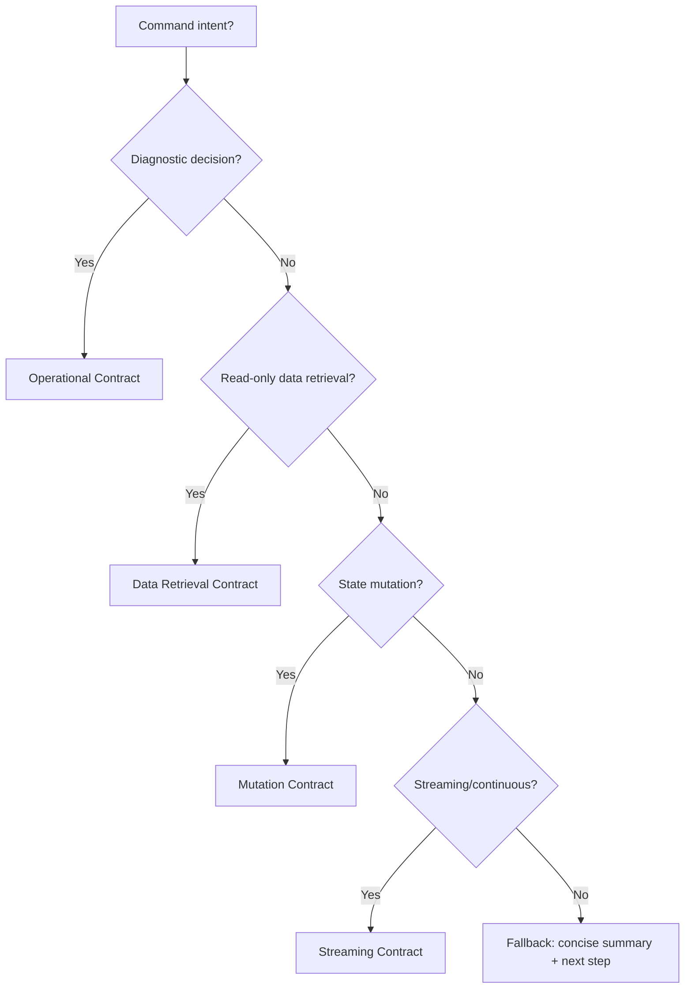

## Steer focus: CLI Steer

**Scope mode: `architecture`.** Hold to that row of `work-scope` for this session.

Design and maintain scenario CLIs as **thin, proto-first wrappers over the scenario API** in `scenarios/{{TARGET}}/cli/`. The CLI is the developer's primary interface — every Connect-RPC method on the API should be reachable as a CLI command via a generated Connect client, with the four REST exceptions reserved for the same reasons enforced at the API.

Do **not** break functionality, regress tests, or introduce features that don't exist in the API. All CLI changes must maintain feature parity with the API.

Required reading:
- `prompt-manager skill read api-steer` — the API contract this CLI mirrors; the four `RESTReason*` constants and `validateTransport` gate.
- `prompt-manager skill read visited-tracker-tools` — memory bookkeeping.
- `prompt-manager skill read knowledge-observatory-tools` — read and update stable docs.

Optional reading:
- `prompt-manager skill read interoperability-steer` — proto generation, casing, and Connect client patterns.

---

> **Template example domain — delete on generation.** The react-vite template ships a `notes` domain as a starter implementation; see `path:templates/scenarios/react-vite/cli/domains/notes/` for the concrete worked example. When you generate a new scenario from the template, **delete the `notes` domain and replace it with your own** — never carry it forward. Throughout this skill, `<domain>` (lowercase package / CLI noun), `<Domain>Service`, `<Resource>` (singular), and `<Resources>` (plural) are placeholders you substitute with your scenario's actual identifiers. Encountering one is the decision point: am I keeping `notes`, or did I forget to replace it?

---

### 1. Scope Boundaries

**In scope:**
- CLI architecture: command structure, argument parsing, output formatting
- cli-core integration: `ScenarioApp`, generated Connect clients, `UploadFile`, env derivation, stale detection
- Connect-RPC consumption: every proto-owned API method is reachable via a generated client
- REST-exception commands: multipart uploads, webhook test-fires, ops probes, third-party callbacks
- cross-platform concerns: Go binaries, portable installers
- developer experience: help text, error messages, discoverability, dry-run parity

**Out of scope:**
- API design (use `api-steer`)
- proto contracts and codegen workflow (use `interoperability-steer`)
- UI concerns
- domain/business logic (lives in the API, never in the CLI)

---

### 2. CLI Health Provider

Run CLI Health before manual judgment. The provider's default human output is the single source of truth for current local maturity, next level, blockers, global impact grouping, and recommended skill IDs:

```bash
cli-health validate scenario {{TARGET}}
```

Use this skill to interpret and fix the provider findings: scaffold, parity, generated Connect clients, report renderers, or drift gates. Do not duplicate or summarize CLI Health's `.vrooli/maturity.json` ladder in skill prose; if the ladder is wrong, fix `cli-health` or its maturity spec.

---

### 3. The CLI-API Relationship

**Core Principle:** The CLI is a thin wrapper. Business logic lives in the API.

```
   USER
    │
    ├── CLI ──┐
    ├── UI  ──┼──> API  ← all business logic lives here
    └── Agent ┘
```

**What the CLI does:**
- Parse arguments and flags
- Validate input format (not business rules)
- Call the API via a generated Connect client (or, for the four REST exceptions, via `APIClient`/`UploadFile`)
- Format and display output via cli-core report renderers
- Handle errors gracefully through `cliapp.WrapAPIError`

**What the CLI does NOT do:**
- Implement business logic
- Make decisions the API should make
- Store state beyond configuration
- Bypass the API for "efficiency"

---

### 4. cli-core: The Shared Foundation

All scenario CLIs use `cli-core` from `path:packages/cli-core/`.

| Component | Purpose | Import |
|---|---|---|
| `NewStandardScenarioApp` | Standard CLI scaffolding with env derivation, default `status`/`configure`, stale check, auto-start preflight | `cliapp.NewStandardScenarioApp` |
| `ScenarioApp` | Lower-level CLI scaffolding when standard isn't enough | `cliapp.ScenarioApp` |
| `NewConnectHTTPClient` | Build the `*http.Client` + base URL pair every generated Connect client needs | `cliapp.NewConnectHTTPClient` |
| `WrapAPIError` | Translate `*connect.Error` (and REST errors) into a uniform CLI error | `cliapp.WrapAPIError` |
| `UploadFile` | Multipart helper for the `multipart_upload` REST exception | `cliapp.UploadFile` |
| `APIClient` | Raw HTTP client — only used inside REST-exception commands | `cliutil.APIClient` |
| `StandardScenarioEnv` | Derive conventional env var names | `cliapp.StandardScenarioEnv` |
| `RenderListReport` / `RenderMutationReport` / `RenderOperationalReport` | Human report renderers | `cliapp.Render*Report` |
| `PrintReportJSON` / `RenderProtoList` / `RenderProtoMutation` | `--json` symmetry with proto-typed wire shapes | `cliapp.PrintReportJSON`, `cliapp.RenderProto*` |
| `ConfigFile` | JSON config persistence | `cliutil.ConfigFile` |
| `DetectPortFromVrooli` | Auto-discover API port | `cliutil.DetectPortFromVrooli` |
| `ParseInterspersed` | Argument parser that handles flags interspersed with positionals | `cliutil.ParseInterspersed` |
| Stale checking | Auto-rebuild when source changes | Built into `ScenarioApp` |

#### 4.2 Manifest-to-proto binding contract

The CLI manifest is the declaration generic Connect dispatchers consume. When an argument name differs from the request field, declare `"bind": {"field": "schema_json", "kind": "json_file"}` on the flag or positional (`kind`: `raw_string`, `json_inline`, `json_file`) instead of building the request in a handler. Resolution ladder: explicit `bind.field`, exact name or alias match, one-level auto-descent into the request's single non-repeated message envelope, otherwise `binding.arg_unmapped`. An argument's identity is the proto field it populates; a convenient CLI name is no licence to feed an unrelated field.

The semantic gate reports `binding.field_collision`, `binding.control_flag_bound` (a control such as `json`, `format`, `limit` or `wait` sent as request data) and `binding.required_field_unpopulated` as errors, and `binding.bind_where_rename_suffices` as a warning. Fix by correcting the name or alias or removing the competing bind; `bind_waiver` (a non-empty per-argument explanation) is only for a real exception, such as a `format` argument selecting a server-side encoding. `program-runtime bindings describe <id>` shows a resolved path and `bindings doctor --json` gives fleet counts. A scenario may keep a curated human renderer through `cliapp.ProtoBindingOptions.Render`.

#### 4.1 CLI Implementation Decision Tree

```
Is there an existing CLI for {{TARGET}}?
├─ NO  → Copy template at templates/scenarios/react-vite/cli/
│        Register commands; each domain wires a generated Connect client.
└─ YES → Built on cli-core?
         ├─ YES → Incremental improvement
         │        ├─ Switch hand-written APIClient calls to generated Connect clients
         │        ├─ Adopt report renderers
         │        └─ Close API-parity gaps
         └─ NO  → Bash script or non-portable?
                  ├─ YES → Greenfield rewrite using the template
                  └─ NO  → Migrate Go-but-not-cli-core to cli-core
```

---

### 5. CLI Project Structure

Template location: `path:templates/scenarios/react-vite/cli/`

```text
scenarios/{{TARGET}}/cli/
├── main.go              # Entry point (minimal)
├── app.go               # App struct, metadata, cli-core wiring
├── go.mod               # Module with cli-core dependency
├── install.sh           # Cross-platform installer (bash)
├── install.ps1          # Windows installer (PowerShell)
└── domains/
    ├── domains.go       # Aggregate domain registration
    └── <domain>/
        ├── register.go  # Command tree + ArgSchema
        └── handlers.go  # Generated Connect client wiring + RunCtx funcs
```

Domain-package layout is the greenfield default. `cmd_<domain>.go` may exist temporarily in legacy CLIs but is not the planned architecture for a growing scenario.

#### 5.1 Endpoint-to-Command Mapping

The default is one CLI command per Connect-RPC method. REST exceptions map to specialized commands.

| API source | CLI command | Notes |
|---|---|---|
| `HealthService.Check` (RPC, but typically exposed as the `ops_probe` REST exception) | `status` (or `health`) | Default command for `NewStandardScenarioApp`. |
| `<Domain>Service.List<Resources>` | `<domain> list` | Connect client `<domain>connect.New<Domain>ServiceClient`. |
| `<Domain>Service.Get<Resource>` | `<domain> get <id>` | Positional id via `ArgSchema`. |
| `<Domain>Service.Create<Resource>` | `<domain> create --<field> <value> [--<field> <value>]` | Required flags enforced by `ArgSchema`. |
| `<Domain>Service.Update<Resource>` | `<domain> update <id> [--<field> …]` | |
| `<Domain>Service.Archive<Resource>` | `<domain> archive <id>` | Lifecycle command, not "delete". |
| `RunsService.StreamRunEvents` | `runs watch <id>` | Server-streaming Connect method. |
| `ImportsService.StartImport` + `ImportsService.GetImport` | `imports start` + `imports status <id>` | Long-running pair. |
| REST `multipart_upload` exception | `<domain> upload <file>` | Uses `cliapp.UploadFile`, not the Connect client. |
| REST `webhook_receiver` exception | `webhooks fire <name>` or operator-only command | Lives only if a developer-facing trigger is useful. |
| REST `third_party_shape` exception | Domain-named command | Calls `APIClient.Post` with the third-party shape. |
| REST `ops_probe` exception | `status`, `ready` | Plain GETs via `APIClient.Get` are appropriate here. |

**Steer:** Every Connect-RPC method should have a corresponding CLI command. REST endpoints appear in the CLI only when their `RESTException.Reason` justifies it (see `api-steer` §7).

---

### 6. Environment Variables and Configuration

Use `NewStandardScenarioApp()` (`cliapp.StandardScenarioOptions`: name, version, description, build fingerprint, command groups); it derives env wiring, default `status` and `configure`, stale checking and auto-start preflight. Drop to `StandardScenarioEnv()` plus `NewScenarioApp()` only for lower-level control. Never add generic `API_PORT` to `ExtraAPIPortEnvVars`: it leaks ports across scenarios in web-console terminals; rely on `<SCENARIO>_API_PORT` and `DetectPortFromVrooli`.

Derived variables per scenario (`TEST_GENIE` shown): `<S>_API_BASE`/`<S>_API_URL`/`VROOLI_API_BASE`, `<S>_API_PORT`, `<S>_API_TOKEN`/`VROOLI_API_TOKEN`, `<S>_CONFIG_DIR`/`VROOLI_CLI_CONFIG_DIR`, `<S>_HTTP_TIMEOUT`/`VROOLI_HTTP_TIMEOUT`.

#### 6.1 Resolution Precedence

API base URL: `--api-base` flag, then env vars, then the config file (`api_base`, `token`), then port detection from the Vrooli lifecycle, then `ScenarioOptions.DefaultAPIBase`. Config location, first found wins: `$<SCENARIO>_CONFIG_DIR/config.json`, `$XDG_CONFIG_HOME/vrooli/<scenario>/config.json`, `~/.vrooli/config/<scenario>/config.json`, `~/.config/vrooli/<scenario>/config.json`.

---

### 7. Global Flags (Built-In)

| Flag | Purpose |
|---|---|
| `--api-base <url>` | Override API endpoint |
| `--auto-start` | Start scenario via `vrooli scenario start` if API unavailable |
| `--no-color` / `--color` | ANSI color control (also respects `NO_COLOR`) |
| `--json` | Machine-readable output (with `cliutil.JSONFlag`) |
| `--dry-run` | Sets `X-Dry-Run: true` on every outbound request automatically |
| `--help`, `-h` / `--version`, `-v` | Help / version |

**Do not reimplement these.**

---

### 8. Generated Connect Client Pattern (Default)

Every proto-owned API method is consumed through its generated Connect client; the worked example is `templates/scenarios/react-vite/cli/domains/notes/handlers.go` (a starter domain you delete on generation). A handler holds `core *cliapp.ScenarioApp` and `client <domain>connect.<Domain>ServiceClient` built from `cliapp.NewConnectHTTPClient(core)`, which resolves the base URL through the same precedence as the rest of cli-core. Call the typed request, wrap errors with `cliapp.WrapAPIError("<action>", err, nil)` (it understands `*connect.Error`), guard nil responses, and render with `cliapp.RenderProtoList` or `RenderProtoMutation` (proto-typed wire shape for `--json`, a human report otherwise, with `NextCommand` hints). No `json.Unmarshal`, casing handling or manual proto-JSON options.

#### 8.1 REST-Exception Command Pattern

Only the four REST exceptions, for the matching `RESTReason*`, fall back to `APIClient` or `cliapp.UploadFile(h.core, path, "file", file, nil)`; response metadata stays proto-typed. Reaching for `APIClient.Post` on an operation that has or could have a proto message means adding the proto to the API (`api-steer` §7), not keeping the shim.

---

### 9. Argument Parsing

Always use `cliutil.ParseInterspersed` instead of `fs.Parse`. Go's standard `flag.FlagSet.Parse()` stops at the first non-flag argument, which means `<domain> get my-id --json` silently drops `--json`. `ParseInterspersed` reorders args so flags come before positionals, then calls `fs.Parse`.

Prefer declaring command shapes via `ArgSchema` on `cliapp.Command` so cli-core handles required-positional and required-flag enforcement before the handler runs. Manual flag parsing is for legacy commands only.

| Pattern | Example | When |
|---|---|---|
| Positional | `get <id>` | Required, unambiguous |
| Flag | `--type unit` | Optional |
| Boolean flag | `--json`, `--verbose` | Output format / behavior |
| CSV list | `--types unit,integration` | Multiple values |
| File input | `--config @file.json` | Large payloads |

Helpers:
- `cliutil.ParseInterspersed(fs, args)` — required for any manual parsing
- `cliutil.ParseCSV(value)` — comma-separated values
- `cliutil.ReadFileString(value)` — read file if prefixed with `@`
- `cliutil.JSONFlag(fs)` — standard `--json`

---

### 10. Output Formatting

#### 10.1 Two Output Modes

Default human; `--json` for scripting. Prefer cli-core report renderers and their proto-aware variants.

```go
if ctx.JSON() {
    return cliapp.PrintReportJSON(os.Stdout, report)
}
return cliapp.RenderMutationReport(os.Stdout, report)
```

For Connect-typed responses, prefer `RenderProtoList` / `RenderProtoMutation` so `--json` emits the proto wire shape exactly as the server returned it.

#### 10.2 Human Output Contracts

| Contract | Command types | Structure |
|---|---|---|
| Operational | `status`, `health`, `audit`, `validate`, `doctor` | Status → Triage → Next Steps |
| Data Retrieval | `list`, `get`, `view`, `search` | Summary → Results → Retrieval hints |
| Mutation Result | `create`, `update`, `archive`, `start`, `stop` | Result → What changed → Next command |
| Streaming | `logs`, `watch`, `tail` | Header → Continuous events |

Convergence decision tree:



**Triage grouping rule:** group by remediation path (`auto-fix`, `agent repair`, `manual review`); show first few, then `+k more`.

**Next Steps rule:** copy-paste-ready commands; highest-impact first; one command per remediation group.

Implementation steer:
- `cliapp.RenderOperationalReport(...)` for diagnostic/decision commands
- `cliapp.RenderListReport(...)` for read/list commands
- `cliapp.RenderMutationReport(...)` for create/update/archive/start/stop
- `cliapp.PrintReportJSON(...)` for `--json` symmetry
- `cliapp.RenderProtoList` / `cliapp.RenderProtoMutation` when the response is a proto message and `--json` should be the wire shape

Promotion trigger: if the same troubleshooting clarification appears across multiple skills, treat it as a CLI product gap. Fix the default human output or add a general-purpose command rather than expanding prose.

#### 10.3 Error Output

```go
// Good — informative, wraps the typed Connect error
return cliapp.WrapAPIError("create <resource>", err, nil)

// Good — actionable
return fmt.Errorf("API not available at %s. Try --auto-start or check scenario status", apiBase)

// Bad — vague
return fmt.Errorf("error occurred")
```

#### 10.4 Progressive Disclosure

| Mode | Purpose | Guidance |
|---|---|---|
| Default (human) | Fast operator decisions | Concise status + triage + commands |
| `--verbose` | Expanded human diagnostics | More examples, same section structure |
| `--json` | Machine-readable automation | Proto-typed wire shape, full fidelity |

---

### 11. Stale Detection and Auto-Rebuild

cli-core embeds a source-tree fingerprint at build time and recomputes it at runtime before any `NeedsAPI: true` command. Mismatch → rebuild and re-exec with the same arguments.

```go
var (
    buildFingerprint = "unknown"  // injected at build
    buildTimestamp   = "unknown"  // injected at build
    buildSourceRoot  = ""         // injected at build
)
```

Edit source → next command rebuilds automatically. Users always run up-to-date code.

---

### 12. Installation

**install.sh** (Linux/macOS): calls `go run packages/cli-core/cmd/cli-installer`, installs to `~/.vrooli/bin/<scenario-name>`.

**install.ps1** (Windows): equivalent, installs to `%USERPROFILE%\bin\<scenario-name>`.

In `.vrooli/service.json`:

```json
{
  "cli": {
    "enabled": true,
    "command": "{{SCENARIO_ID}}",
    "adapter": { "kind": "go_module", "module_dir": "cli" },
    "install": [
      { "os": ["linux", "darwin"], "kind": "command", "run": "bash ./cli/install.sh" },
      { "os": ["windows"], "kind": "command", "run": "powershell -ExecutionPolicy Bypass -File .\\cli\\install.ps1" }
    ],
    "invoke": { "kind": "installed_command", "command": "{{SCENARIO_ID}}" },
    "freshness": { "inputs": ["cli/**", ".vrooli/service.json"] }
  }
}
```

The top-level `cli` section is the platform contract. `lifecycle.setup` should prepare runtime assets (API binaries, UI bundles), not install the CLI.

---

### 13. CLI Coherence Audit

#### 13.1 Audit Commands

Run `rg` over `scenarios/{{TARGET}}/cli`. Positive: `connectrpc.com/connect|_v1connect|NewConnectHTTPClient`. Red flags: `APIClient\.(Get|Post|Put|Delete|Patch)` outside REST-exception commands, `fs\.Parse\(` (use `cliutil.ParseInterspersed`), bash scripts in `cli/`, missing `cli-core` in `go.mod`, and hand-wired REST routes in the API for proto-able operations. Compare command `Name:` entries against the API's Connect methods for coverage.

#### 13.2 Red Flags

- CLI is a bash script, not a Go binary
- No `go.mod` or doesn't import cli-core
- Hardcoded API URLs (should use env vars / config)
- Default output is hard to interpret or lacks clear next actions
- CLI calls the API via raw `APIClient.Post` / `fetch` for an operation that has — or could have — a generated Connect client
- Connect-RPC methods on the API without corresponding CLI commands
- REST-exception commands without a matching `RESTException` on the API side
- Commands that implement business logic instead of calling the API
- No `install.sh` / `install.ps1`
- Commands that don't use `NeedsAPI: true` when calling the API
- Duplicate HTTP client code (should use `cliapp.NewConnectHTTPClient` or `APIClient`)
- `fs.Parse()` instead of `cliutil.ParseInterspersed()` for mixed positional+flag args
- Mutating commands that don't honor `--dry-run`

#### 13.3 Recording Findings

No standalone `CLI_AUDIT.md`. Use `knowledge-observatory-tools` to record in `docs/concepts/ARCHITECTURE.md` (CLI surface map and maturity), `docs/internal/SEAMS.md` (client factory, `UploadFile` adapter, renderers) and `docs/internal/PROBLEMS.md` (parity gaps, lingering `APIClient` calls, missing dry-run). A one-off report is acceptable only as a migration handoff with a retirement path into those docs.

---

### 14. Memory Management with Visited Tracker

Use the `visited-tracker-tools` skill with:
- LOCATION: `scenarios/{{TARGET}}/cli`
- TAG: `cli-steer`

---

### 15. Dry-Run Support

The `--dry-run` global flag is built into cli-core: it sets `X-Dry-Run: true` on every outbound request (Connect and REST exceptions), so the CLI needs no per-scenario change. The API must honor it: run full `protovalidate` validation, then before the first side effect check `cliutil.IsDryRun(ctx)` (or the header) and return a realistic typed response of the same message type with a `dry_run` field set (REST and REST-exception handlers return a realistic JSON body with `"dry_run": true` and 200).

---

### **16. Output Expectations**

You may update in `scenarios/{{TARGET}}/cli/`:
- migrate hand-written `APIClient.Get/Post` calls to generated Connect clients for any proto-owned RPC
- add new commands for Connect-RPC methods that lack CLI coverage
- adopt `cliapp.Render*Report` renderers and `RenderProto*` variants
- improve argument parsing, help text, and error wrapping
- add cross-platform installers if missing
- refactor commands into domain packages

You may update in `scenarios/{{TARGET}}/.vrooli/service.json`:
- add or correct the top-level `cli` manifest section

You must:
- keep `{{TARGET}}` fully functional and non-regressed
- maintain feature parity between CLI and API
- use `cliapp.NewConnectHTTPClient` + generated Connect clients for proto-owned operations
- reserve raw `APIClient` / `UploadFile` for the four REST exceptions
- keep default output human-friendly and actionable; keep `--json` proto-shape-accurate
- include cross-platform installation scripts
- update `ARCHITECTURE.md` / `SEAMS.md` / `PROBLEMS.md` via `knowledge-observatory-tools` to reflect changes

You must NOT:
- implement business logic in the CLI (belongs in the API)
- create bash scripts for CLI functionality (use Go)
- bypass cli-core utilities with custom HTTP / config code
- use raw `APIClient` calls for operations that have a generated Connect client
- add commands for features that don't exist in the API
- remove existing functionality without replacement
- create standalone `CLI_AUDIT.md` files as the default memory surface

**Avoid superficial changes that only rename things or restructure code without improving CLI quality, Connect-client coverage, or API parity.**

Last updated: 2026-05-12
