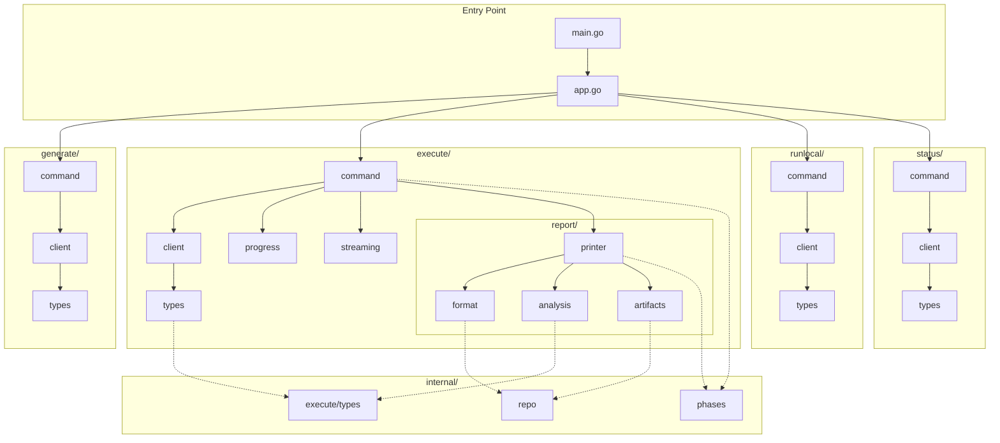

# Test Genie CLI

A command-line interface for AI-driven test suite generation and execution. The CLI follows **screaming architecture** principles—the directory structure immediately communicates what the application does.

## Architecture



## Directory Structure

```
cli/
├── main.go                      # Entry point
├── app.go                       # App struct & command registration
│
├── remediate/                   # DOMAIN: Findings-first remediation
│   ├── command.go              # Remediation job command implementation
│   └── client.go               # Remediation API client
│
├── execute/                     # DOMAIN: Test Suite Execution
│   ├── command.go              # Execute command implementation
│   ├── client.go               # API client for executions
│   ├── types.go                # Execution types & args
│   ├── progress.go             # Real-time progress ticker
│   ├── streaming.go            # Live log streaming
│   │
│   └── report/                 # Sub-domain: Execution Reporting
│       ├── printer.go          # Report orchestrator
│       ├── format.go           # Formatting utilities
│       ├── analysis.go         # Failure analysis heuristics
│       └── artifacts.go        # Artifact discovery
│
├── runlocal/                    # DOMAIN: Local Test Running
│   ├── command.go              # Run-tests command
│   ├── client.go               # API client
│   └── types.go                # Request/Response types
│
├── playbooksseed/              # DOMAIN: Playbooks Seed Lifecycle
│   ├── run.go                  # CLI command handler
│   ├── client.go               # API client
│   └── types.go                # Request/Response types
│
├── status/                      # DOMAIN: Health & Status
│   ├── command.go              # Status command
│   ├── client.go               # Health API client
│   └── types.go                # Health response types
│
└── internal/                    # Shared internals
    ├── execute/types.go        # Shared execution types
    ├── phases/phases.go        # Phase normalization
    └── repo/detect.go          # Repository detection
```

## Commands

### Execute Test Suites

Run the current scenario test suite with Test Genie, or use the lifecycle-managed
control-plane command when running it as an operator:

```bash
test-genie execute demo --preset quick
vrooli scenario test test-genie --phases unit
```

### Inspect and Remediate Runs

Use the durable run commands to list or inspect evidence. Remediation jobs are
created from a completed run and stable finding IDs:

```bash
test-genie runs list --scenario demo
test-genie remediate create demo --execution "uuid" --findings afid:123 --role code.default
```

### Inspect Requirements

The current requirements command is the read-through surface. Run `test-genie
requirements --help` for its supported options. Older subcommands for report,
manual logging, PRD linting, and drift checks are retired.

For the complete current command inventory, run `test-genie --help` and
`test-genie <command> --help`.

## Design Principles

### Screaming Architecture

The top-level directories communicate business capabilities, not technical concerns:

| Directory | Business Capability |
|-----------|---------------------|
| `remediate/` | Create evidence-bound remediation jobs |
| `execute/` | Run test suites with phases |
| `runlocal/` | Trigger local test runners |
| `status/` | Monitor system health |

### Domain Cohesion

Each domain package contains everything it needs:
- **types.go** - Request/response structures
- **client.go** - API communication
- **command.go** - CLI implementation

### Shared Internals

Common utilities live in `internal/` to prevent duplication:
- **repo/** - Repository root detection
- **phases/** - Phase normalization and descriptors
- **execute/** - Shared execution types (to avoid import cycles)

## Building

The preferred path is the repository lifecycle, which refreshes the selected
shared Proto artifact before installing the CLI:

```bash
vrooli setup --scenarios test-genie
```

For a compile-only check, perform the shared generated-artifact preflight from
the repository root first:

```bash
cd packages/proto
go run -mod=mod ./cmd/protogen generate --changed
go run -mod=mod ./cmd/protogen verify

cd scenarios/test-genie/cli
go build -o test-genie .
```

## Testing

```bash
go test ./...
```

## Configuration

Configure the CLI using the `configure` command:

```bash
test-genie configure api_base http://localhost:8080
test-genie configure token <your-token>
```

Or via environment variables:
- `TEST_GENIE_API_BASE` - API base URL
- `TEST_GENIE_API_TOKEN` - Authentication token
- `TEST_GENIE_CONFIG_DIR` - Config directory
